# ADR 0053: Separate Dev Tunnels Bridge for Remote Persistent Sessions

- **Status:** Proposed
- **Date:** 2026-10-29
- **Supersedes:** None
- **Related:** ADRs 0016, 0018, 0025, 0038 and 0052; issue #296
- **Scope:** Owner-requested experimental remote-access capability; not an M6
  acceptance requirement or a claim of hosted-service qualification.

## Context

Issue [#296](https://github.com/fes/fesTerm/issues/296) investigated a native
fesTerm client connecting through Dev Tunnels to an existing Microsoft VS Code
Server. It paused on server-product licensing, legitimate third-party Entra
authorization, and unqualified internal VS Code protocol/persistence behavior.
Using an MIT-licensed transport SDK did not resolve those separate gates.

The owner instead requested a design for using Dev Tunnels directly, with
fesTerm-owned software at both ends, and selected a separate remote bridge
process. The first implementation uses explicitly provisioned,
tunnel-scoped host/connect tokens, with **GitHub authentication through the
official Dev Tunnels CLI as the first supported provisioning route**.
The owner subsequently requested a native, iOS-compatible client workflow:
fesTerm-owned GitHub device authorization and tunnel-name discovery are now
implemented with the registered project-owned public client; live acceptance
[#429](https://github.com/fes/fesTerm/issues/429). Native Entra remains deferred. This does
not authorize borrowing another application's OAuth identity or extracting
its cached credentials.

ADR 0025 makes `festerm-sessiond` a local-only, per-session PTY owner. ADR
0038 gives that daemon an authoritative recovery mirror; the GUI owns the
presented terminal and suppresses duplicate terminal-query replies. Neither
decision makes the daemon a network server or provides an identity broker.
Those boundaries must survive the addition of remote access.

## Decision

Introduce an optional **separate executable/process**, provisionally
`festerm-tunnel-bridge`, on the remote host. It terminates the Dev Tunnels
connection and mediates access to that host user's existing daemon APIs.
It is not a VS Code extension, VS Code Server client, or replacement daemon.

```mermaid
flowchart LR
    subgraph Client["Client machine"]
        GUI["fesTerm application"]
        Backend["Remote session backend"]
        GUI --> Backend
    end
    Relay["Microsoft Dev Tunnels relay"]
    subgraph Remote["Remote machine - same OS user"]
        Bridge["festerm-tunnel-bridge"]
        IPC["Protected local IPC"]
        Daemon["festerm-sessiond"]
        PTY["PTY / ConPTY"]
        Shell["Shell / TUI"]
        Bridge --> IPC --> Daemon --> PTY --> Shell
    end
    Backend <-->|"authenticated tunnel"| Relay
    Relay <-->|"outbound host connection"| Bridge
```



The relay supplies connectivity through supported outbound network paths,
not PTY allocation, process persistence or a stable session-control protocol.
No inbound firewall exception, public daemon port or independently reachable
SSH server is required by this design.

### Responsibilities and dependency direction

| Component | Owns | Must not own |
| --- | --- | --- |
| Client application | Commands, connection metadata, consent, visible lifecycle, source classification, presented terminal | Relay internals or remote PTY lifetime |
| Native identity broker | Device authorization, account-bound refresh, bounded official-service discovery | CLI/browser implementation, daemon/session ownership, platform-vault implementation |
| Client remote backend | Tunnel connection, bridge protocol, bounded session events and recovery delivery | GUI policy or independent terminal mutation |
| Remote bridge | Tunnel host connection, credential lifetime, admission, session targeting, translation to protected local daemon APIs | Shell handles, terminal parser/mirror, cloud transcript storage |
| Remote daemon | Its local session identity, PTY/process lifetime, authoritative recovery mirror and local access enforcement | Dev Tunnels, OAuth, public listeners or relay tokens |

Keep network/identity dependencies out of `festerm-sessiond`, `festerm-core`
and `festerm-ui-egui`. Reuse `festerm-session` at the frontend boundary.
Shared daemon-client functionality may be factored into a GUI/network-free
library seam, without moving the daemon's PTY or mirror ownership.

Separate processes may ship in the same signed package. Separation does not
require an independent installer, service account, privileged broker or
always-running system service.

### First-class connections and independent credential bindings

Dev Tunnel is a peer connection/profile kind to Local, SSH and Serial, not an
SSH profile or shell-command alias. The initial implementation includes its
launcher entry, saved-profile editor, centralized application commands and
Inspector classification. The normal profile holds a tunnel name, verified
public host metadata, a link to a shared **account**, and an opaque
native-store **connect** reference. An account (`[[accounts]]`) holds the public
GitHub login/numeric ID and the opaque native-store **identity** reference; any
number of profiles name the same account, so one device sign-in serves listing
and every connection. Accounts are signed in and out independently of
profiles. Advanced legacy profiles retain their trusted
destination-file and scoped-token route. Credentials never belong in profiles;
connect-once identities and connect tokens remain session-only.

Different profiles/accounts/tunnels can coexist in one instance without a
global current-account/token slot. A connect reference still belongs to exactly
one profile and an identity reference to exactly one account; profiles share an
identity only through the account. Existing profiles with an embedded identity
migrate into accounts on load, reusing the same vault reference (no new
sign-in); signing in again as the same GitHub user replaces the account's
credential and keeps its profiles. Signing an account out deletes its credential
and unlinks, but keeps, the profiles that used it. Sessions from the same
profile deliberately reuse that reference. Scoped-connect rotation creates a fresh reference;
native identity refresh atomically replaces its account-bound pair. Asynchronous
credential-save completion must still match its original profile. Duplicating
a profile does not copy its credential. Live launches capture their profile,
credential value, verified host and exact exported generation; profile edits
never retarget another live connection. Explicit sign-in can select another
GitHub account only after verified-account/host approval. Refresh is serialized
and account-bound, not a global login switch or automatic session reconnection.

### Native GitHub identity and name discovery

`festerm-tunnel-client` is portable shared Rust with rustls, typed cancellable
HTTP boundaries and bounded decoding. It has no CLI/process, callback listener,
browser implementation, daemon, PTY, GUI or platform-vault dependency. The host
opens the fixed `https://github.com/login/device` URL and provides secure storage.
The existing mobile host does not yet integrate the runtime or Keychain.

Default builds use the SDK-published production Microsoft Dev Tunnels GitHub
App, public client ID `Iv1.e7b89e013f801f03`. The dialog names Microsoft Dev
Tunnels explicitly. No app secret, VS Code identity or existing application
credential is used. A retained `FESTERM_GITHUB_CLIENT_ID` build override must
match this reviewed service registration; empty, malformed and other IDs
disable sign-in rather than silently selecting a different consent identity.
No per-user registration is required. Native/iOS qualification remains open under
[#429](https://github.com/fes/fesTerm/issues/429).

Device authorization posts only `client_id`, without OAuth permission scopes,
to `/login/device/code`. GitHub App permissions come from the service's
registration, not an OAuth-app scope string; only empty/absent scope responses
are accepted. The standard monospace code button copies the code and opens
the fixed GitHub device URL in one explicit activation; displaying the dialog
does neither. This does not approve an account or host. The client
then polls `/login/oauth/access_token` with the device grant. Polls respect the
server interval (at least five seconds), add five on slowdown and stop at
expiry/cancellation. Responses are capped at 64 KiB, token values at 16 KiB,
requests at 20 seconds, device lifetime at 900 seconds, and the complete UI
operation at 30 minutes. Errors are content-free; no bodies, codes or tokens
enter logs, ordinary metadata, arguments, environment variables or files.
Public tunnel aliases and verified account logins use bounded identifier
validation rather than keyword-based credential rejection; unknown secret
fields remain forbidden and only opaque references name stored credentials.
Denial, disabled flow, expiry and rate limits never silently restart login.

Every newly issued/refreshed access token is verified through GitHub `/user`;
stable numeric account ID and originating public application ID, not mutable
login text alone, bind credentials. Private native-vault identity encoding V2
includes that application binding. Legacy V1 and mismatched applications
require explicit sign-in without forwarding or refreshing the old pair;
the old vault entry is retired only after a replacement profile is saved.
GitHub
device-issued refresh uses the documented public-client exception: client ID,
refresh grant and refresh token, **without client_secret**. Account-validated
rotation replaces the complete native-store pair before further discovery and
only while the original profile still matches. A single bounded worker
reservation lasts through worker and UI completion. Failed/uncertain rotation
requires explicit reauthentication; it cannot safely restore an invalidated
old pair. Stored-identity operations also hold a per-reference OS file lease
through worker and UI completion, preventing concurrent refresh of one vault
pair across desktop processes. Only empty coordination files/opaque UUIDs enter
the application cache; no credential bytes do. Native identity references stay
stable until explicit account replacement/retirement. Future mobile hosts must
provide equivalent single-broker coordination with their vault adapter.
Connect once obtains an independent transient identity and does not
rotate a saved identity.

The native identity broker uses official SDK `Authorization::Github` only for
bounded `get_tunnel(include_ports=true, token_scopes=[connect])`, with account
verification before and after minting. The session runtime receives only the
scoped connect token. Exactly one host and one port marked
`festerm-bridge-v1` (label or exact description) are required; ordinary VS Code tunnels, missing pins and
ambiguous exports fail rather than selecting arbitrary services. First/changed
account or host requires Cancel-default fingerprint approval. Pinned encrypted
read-only discovery then returns version, exact exported generation and file
capabilities before any daemon admission; it exposes no IPC paths. Ordinary
atomic no-takeover attachment follows with immutable source/account/profile/
host/session pins. Profile edits/cancel discard unpublished vault entries.

The supported device/refresh contracts are documented by
[GitHub](https://docs.github.com/en/apps/creating-github-apps/authenticating-with-a-github-app/generating-a-user-access-token-for-a-github-app).
Secretless web/PKCE exchange is not assumed: its documented token exchange
still requires a secret. Native sign-in is implemented, not live-qualified.

### Authentication, authorization and host identity

The initial experimental bootstrap is:

1. An operator deliberately signs in through the official Dev Tunnels CLI
   using `devtunnel user login --github`, then explicitly creates a private,
   dedicated test tunnel and port under that authorized GitHub identity.
   Existing VS Code client sign-in, `gh` authentication and standalone
   `devtunnel` authentication must not be assumed interchangeable. Confirm
   the intended CLI account without reading or exporting other apps' caches.
2. The operator provisions distinct tunnel-scoped **host** and **connect**
   tokens. The bridge receives only hosting authority; the client receives
   only connection authority. Provision ports separately rather than giving
   the runtime an unrestricted management token.
3. Tokens enter through an explicit secret-input/native-store path, never
   command-line token arguments, ordinary TOML, connection files, workspace
   state, terminal history, logs or diagnostic reports. Metadata stores only
   opaque credential references. Treat SDK errors/HTTP headers as potentially
   secret-bearing and redact before presenting them.
4. The client verifies the selected tunnel/host and the SDK's authenticated
   host-key binding before any daemon operation. Missing or changed identity
   fails closed; arbitrary relay URLs, missing keys and accept-any-key
   fallbacks are not acceptable.

The [documented token mechanism](https://learn.microsoft.com/en-us/azure/developer/dev-tunnels/security#tunnel-access)
currently issues expiring bearer capabilities, described as lasting 24 hours.
Treat expiry as service-owned, not a hard-coded renewal interval. No automatic
identity-based renewal is available for advanced scoped-only credentials. A host or connect token
does not grant authority to mint its replacement.

Possession of the admitted connect capability grants access to the exported
remote account/session scope. It is not proof of an independently identified
Entra principal, MFA at each attach, or support for multiple remote OS users.
No anonymous or tenant-wide access is enabled. Never silently broaden the
tunnel's ACL to make a connection work.

The bridge runs unelevated as the daemon owner and uses the existing
owner-scoped local IPC checks. A same-user bridge is trusted code: process
separation is fault/dependency isolation, not a sandbox against compromise of
that OS account. The daemon still validates local requests and generations.
Do not expose a raw Unix socket/named pipe, registry path or local executable
selection as an unrestricted network proxy.

The bridge/client session runtime consumes scoped capabilities rather than GitHub
OAuth tokens; its session protocol does not depend on the provisioning
identity provider. Native sign-in belongs only to the separate client identity
broker above; the bridge never receives GitHub OAuth/refresh credentials.

Native Entra sign-in requires a later supported fesTerm application identity,
confirmed service audience/scopes, consent/onboarding and real tenant/MFA/
Conditional Access evidence. The token bootstrap does not establish those.

### Session protocol and lifecycle

Define a versioned bridge protocol independently of the daemon's local
protocol and recovery-snapshot schema. Negotiate capabilities before actions;
unknown major versions and unsupported snapshot schemas refuse explicitly.
Do not assume the daemon's local-only deserializer is a safe network codec.
Network-facing decode needs its own bounded-allocation review and adversarial
tests before use.

The protocol must distinguish:

- **Inventory:** bounded, paginated exported sessions with stable identities,
  generations, factual status and provider capabilities; not arbitrary local
  filesystem discovery.
- **Create:** an explicit request through host-approved launch policy, never
  an implicit fallback from failed attachment.
- **Attach:** the selected existing daemon identity/generation, supported
  recovery schema and deliberate takeover policy.
- **Input/control:** ordered input, resize and recovery synchronization.
- **Detach:** close the attachment while leaving the daemon-owned shell alive.
- **Terminate:** a separately confirmed, exact-generation operation, never an
  interpretation of stream EOF or GUI tab closure.

Initial delivery may expose a deliberately restricted configured session
rather than a general account-wide inventory/creation service. Unsupported
operations must be advertised as unavailable, not simulated. The first code
PR must state its actual supported subset and numeric resource bounds.

ADR 0025 currently permits single-client takeover. The bridge must not hide
that policy: refuse an occupied target unless a deliberate takeover was
authorized, and protect the final adoption against intervening ownership
changes. A preliminary status check alone is not atomic authorization.
If the existing daemon API cannot provide that guarantee, add a narrowly
reviewed admission operation rather than promising safety from a racy check.

Deliberate takeover (amends the no-takeover default above): admission carries a
takeover flag and, from daemons that advertise `attach_kinds`, the attach kind
(`local` or `remote`) in an `FSA4` request. The wire protocol stays at 3, so an
existing client keeps attaching with `FSA3` and is treated as `local`, and an
existing daemon keeps serving every client. Daemons record `attached_by` in the
registry so Running Sessions can show who holds a session; legacy daemons that
report `attached` alone are shown as attached locally. The displaced client sees
the existing `SESSION_STOLEN` notice and never reattaches automatically, so
local and remote cannot fight over a session. Remote takeover is on by default
per Dev Tunnel profile and can be turned off; with it off, an occupied session
is refused exactly as before.

Recovery retains ADR 0038's snapshot-before-live-output and adoption barrier.
Preserve ordered resize/control events and exactly-once query-reply ownership.
Discard unsent input on disconnect; never replay keystrokes or destructive
operations after an uncertain outcome. Resolve uncertain create/terminate
results through the same operation/session identity instead of blind retry.

```mermaid
sequenceDiagram
    participant C as fesTerm client
    participant B as Remote bridge
    participant D as Existing daemon
    Note over C,B: Tunnel authorization and host verification complete
    C->>B: Negotiate; attach exact session generation
    B->>D: Admit compatible, authorized attachment
    D-->>B: Recovery state before live output
    B-->>C: Bounded recovery state and identity
    C->>B: Recovery adopted
    B->>D: Adoption acknowledgement
    D-->>B: Ordered live output / controls
    B-->>C: Session events
    C--xB: Disconnect / network loss
    B->>D: Close attachment, not terminate
    Note over D: Daemon continues owning shell and mirror
```

The remote backend must be classified as **remote**, not Local. Tunnel access
must not authorize client-local OSC 8 file reads, local-path inference,
clipboard access or OS-handler launches. Reuse existing explicit remote
terminal/clipboard policy, command routing and secret-store boundaries.

### Common filesystem capability for detected and OSC 8 paths

Both detected paths and explicit OSC 8 file targets use the originating
session's transport-neutral filesystem capability and shared dispatch.
`file:///...` and `file://localhost/...` from a remote session name that
**remote** filesystem. Explicit metadata, never its visible label, chooses
the target. Other authorities must match the verified source host.
HTTP(S) handling and local ADR 0052 no-follow reads/reloads/saves stay separate.

SSH/SFTP reuses its existing live authenticated SFTP requestor. Dev Tunnel
negotiates a bounded read-only bridge operation; it never guesses an SSH
endpoint, reconnects using other credentials, or interpolates shell commands.
The host must explicitly enable `--allow-file-read`. That grants admitted
connect-token holders regular-file read authority as the bridge's OS user.
Without that flag, Open is unavailable; PTY connectivity is not file authority.

The bridge advertises remote Windows/POSIX path semantics. Absolute native
paths only are accepted; relative paths and home expansion need trustworthy
provider metadata, not terminal output. Namespace/device/network paths,
Windows named streams and link/reparse traversal refuse before I/O. Reads
retain root-to-leaf no-follow handles, stop at 4 MiB, and use one blocking I/O
reservation across the bridge, retained even after caller cancellation.
Requests/results have 30-second deadlines. An uninterruptible filesystem call
can retain that single reservation until completion, but cannot create an
unbounded worker backlog.

Requests and adoption bind provider, profile, verified endpoint, exact live
capability/session instance and transport/controller generation. A different
connection with a matching hostname/path is never substituted. The existing
bounded text/Markdown surfaces receive read-only remote snapshots with
provider-specific identity; no remote content enters configuration, workspace
metadata, logs or automatic caches. Changed/disconnected bindings discard
pending results. Missing capability, malformed/oversized/non-text content and
foreign authorities produce refusal, never local/OS fallback. Remote writes
remain unsupported; explicit local Save As is a separate authorized operation.

### Bounds, cancellation and reconnection

Set numeric per-message, per-connection and aggregate budgets in code before
enabling a listener: handshakes, inventory metadata, concurrent attachments,
snapshot wire/decoded state, input/output queues, pending operations, retries
and diagnostics. Reject lengths before allocation, and release reservations
on all cancellation/failure paths. The local daemon's 768-MiB snapshot cap
is not an acceptable claim of a bounded remote service or total memory use.
Refuse an oversized recovery explicitly; do not silently truncate it.

Preserve backpressure end to end. User data is not lossy; typed lifecycle and
recovery barriers cannot disappear behind output. Cancellation and shutdown
must remain serviceable under saturation, including stalled peers.
Availability/completion wakes the GUI; do not add GUI polling.

The [Rust SDK](https://github.com/microsoft/dev-tunnels/tree/main/rs) is a
candidate, not a blanket acceptance of its resource behavior. Review and pin
the selected revision/dependencies. Its current feature matrix lacks automatic
reconnect/token refresh, and host internals include unbounded channels.
Bounding only an adapter's downstream queue does not bound those upstream
allocations. An audited bounded adapter/upstream fix or another explicitly
reviewed implementation is required before claiming that gate passed.

Use bounded, cancellable retry/backoff only for transport establishment.
Authentication expiry/revocation becomes an actionable credential-required
state. Reconnect targets the same host/session generation; it does not create
a shell, accept a changed identity or steal another client automatically.

### Deployment, updates and survival limits

Remote installation/startup is explicit. Verify executable provenance, run as
the intended user, and show missing/incompatible helpers as setup failures.
Do not silently install software, create services, elevate, change firewall
rules or enable remote access during an ordinary local launch.
Closing the bridge withdraws access without deleting unrelated tunnels or
terminating retained sessions. Only explicitly test-owned/provisioned
resources may be removed by automated cleanup.

The explicit host setup tool may provision a new private tunnel/marked virtual
port and a uniquely named local daemon, then host the separate bridge.
The owner's subsequent explicit approval adds a dedicated **per-user
auto-start service** and idempotent reruns, not silent deployment during an
ordinary GUI launch. This is operator-authorized local setup, not a remote create RPC
or silent helper deployment. Standalone per-platform release bundles and
installers must verify provenance and preserve existing tools, tunnels and
services. Linux uses systemd user services, macOS a LaunchAgent, and Windows a
least-privileged current-user logon task. No elevation, system service, linger
enablement, password-bearing task or unrelated service mutation is authorized.
Auto-start means user sign-in (or Linux boot when lingering already exists),
not survival/replacement of the daemon shell after reboot.

The private installation journal records its unique tunnel, verified CLI
account, exact daemon PID/generation/endpoint, original runtime namespace and
service identity. The worker and bridge use that recorded namespace rather
than the service manager's environment. Privileged execution refuses before
state/authentication/provisioning mutations. Missing journals with other state
also refuse; they cannot authorize a fresh tunnel or shell. Healthy
reruns return the same metadata without login, tunnel/session creation or
service restart. A stopped service may resume only that same live generation;
stale/replaced generations refuse. Uncertain interrupted cloud mutations
remain explicit operator-reconciliation failures, never blind create retries.
Versioned helper caches are immutable; reruns cannot overwrite live binaries
or silently upgrade a retained daemon.
Stopping the service withdraws its entire worker/bridge process group, not
the independently started session daemon.

Stable relay identity includes its host ID and Ed25519 host key, held in a
dedicated current-user-only identity file, separate from ordinary metadata.
The explicit headless-service boundary permits this unencrypted host-key
file with Unix 0700/0600 or a protected Windows current-user DACL. This is
not bearer-token storage, an OS-account compromise defense or a substitute
for disk encryption. Missing/corrupt/permissive identity refuses; service
startup never silently regenerates it. Host/connect tokens still use bounded
zeroized memory and stdin only. The official CLI owns its own cached login
and refresh policy; a changed account or reauthentication requirement refuses
without borrowing credentials or entering a repeated device-login loop.

Windows private-storage ancestor validation additionally recognizes the exact
`NT SERVICE\TrustedInstaller` SID, which owns normal OS-volume/system directories.
This servicing identity joins the current user, SYSTEM and Administrators only
for ancestors; final directories/files still require protected current-user-only
ownership/DACLs. Other service accounts, ordinary users and foreign direct
administrator-account grants remain refused. The existing document-save staging
policy is unchanged. Absolute-path ancestors additionally reject foreign
directory `DELETE` access, not only child-deletion/ACL/owner mutation, so another
user cannot rename an ancestor itself. Windows positive fixtures first try user
temporary storage, then system temporary storage only when accessible and
policy-compliant. Refused candidates are diagnosed and all-candidate failure
fails the test; no runner ACL is repaired or test skipped.
The same test-only fixture builder is shared by library and both binary test
roots, avoiding unsafe checkout ancestors or Windows verbatim-path prefixes.
Managed health/worker contention uses the daemon's existing native lock-error
classifier; contention is not assumed to map only to `WouldBlock` on Windows.

Setup prints a versioned **public** profile JSON wrapper. Client import bounds
and validates it, previews the tunnel/host fingerprint and requires explicit
profile creation; authentication and host approval remain separate. No token,
credential reference, client-local path authority or automatic connection is
imported. Public metadata is not authority to replace an existing profile.

| Event | Intended effect on shell | Required qualification |
| --- | --- | --- |
| Client exit, sleep or network loss | Daemon continues; attachment may be lost | Same process/session resumes without replayed input |
| Bridge crash or restart | Daemon continues; clients disconnect | Re-establish authenticated host binding, then deliberate reattach |
| Bridge executable upgrade | Stop/restart bridge; no PTY handoff | Compatible bridge/daemon protocol and remote host identity checked |
| Token expiry/revocation | Access/re-establishment may fail; no shell termination | Test actual service behavior; do not promise established-stream revocation timing |
| Tunnel deletion or relay outage | Connectivity lost; daemon remains independent | No replacement tunnel/shell or weakened ACL on retry |
| Daemon restart/upgrade | May terminate its shell/PTY | No hot replacement or cross-process ConPTY transfer is provided |
| Remote logoff, reboot or OS termination | No survival promise | Platform/user-service lifetime evidence required separately |

Process separation makes the **bridge** independently replaceable. It does
not make the daemon executable, PTY/ConPTY owner, shell environment, loaded
terminal parser or arbitrary snapshot schema hot-upgradeable. A new frontend
must retain a supported adapter for an older still-running daemon; otherwise
it refuses without killing or replacing that daemon.

### Delivery and unresolved external gates

Publish this proposal separately from implementation. Deliver an
experimental code PR with the GitHub-first token bootstrap, explicit supported
operations, deterministic protocol/lifecycle tests and independent security
review. Then qualify a controlled real tunnel and remote host; mock tests
alone do not establish service interoperability or native usability.

The MIT license of the SDK does not govern Microsoft's hosted service.
[Current service documentation](https://learn.microsoft.com/en-us/azure/developer/dev-tunnels/overview)
describes public-preview development/testing use, no SLA and no recommendation
for production workloads. Confirm applicable terms and supported usage before
advertising a production remote-access product. This ADR is not legal
clearance, service availability assurance or an SLA.

The 2026-10-30 investigation retrieved the terms currently linked by
[`aka.ms/devtunnels/tos`](https://aka.ms/devtunnels/tos). Sections 1(a) and
5(f) restrict the permitted product context and combining the software with
other applications for others to use. Microsoft's
[maintainer clarification](https://github.com/microsoft/dev-tunnels/issues/489#issuecomment-2455939910)
identifies the Visual Studio product family. Standalone fesTerm eligibility
therefore needs explicit clarification; development/testing-only labeling and
the SDK's MIT license do not establish that permission. Do not publish the
installer or broaden qualification without resolving applicable usage
rights and the supported third-party integration path. The owner's subsequent
bounded diagnostic/integration tests below do not waive this publication gate.

The pinned SDK's
[`GitHubAppClientId` contract](https://github.com/microsoft/dev-tunnels/blob/b73b0eb774b86a5b519c300f2f41c9072a66f663/cs/src/Contracts/TunnelServiceProperties.cs#L223-L230)
directs clients to the service's GitHub application when requesting user
tokens. It does not establish that an independently registered fesTerm OAuth
application is accepted. A same-valid-credential comparison passed GitHub
account verification before and after, but both raw-token and
`client_id=<fesTerm-public-id>` authorization returned HTTP 401 on account
limits and tunnel lookup. Missing client ID alone is not the root cause.
Acceptance of the independent fesTerm OAuth registration remains unconfirmed,
not proven to be a specific allowlist or scope defect. Open-source follow-up found Microsoft's
[AHP Swift app](https://github.com/microsoft/agent-host-protocol/blob/0b7b7f9f4ceb2fbd8846557416f765ac73da647d/clients/swift/AHPApp/AHPApp/Views/TunnelListView.swift#L385-L415)
using a library whose
[production configuration](https://github.com/rebornix/dev-tunnels-swift/blob/551bda5de3c7b044e9b85c6383f0f207e9672be5/Sources/DevTunnelsClient/Management/TunnelServiceProperties.swift#L23-L28)
selects the SDK-published service GitHub application. This is a concrete native
precedent for the documented service contract, not for an independently
registered caller application. That service identity is distinct from VS
Code's OAuth registration; using a documented service application is not
inherently credential borrowing. It still requires explicit user consent,
applicable usage rights and live qualification before adoption here. Do not
silently substitute identities, create app secrets or broaden scopes
speculatively. The experiment guide records the source comparisons.

The owner subsequently authorized an isolated live test of that service
application on 2026-10-30. Fresh device authorization requested no OAuth-app
permission scopes, used no client secret and kept credentials only in memory.
GitHub account verification succeeded before and after; account limits and the
selected existing tunnel metadata each returned HTTP 200 with both ordinary
and client-ID-qualified GitHub authorization.
[Recorded evidence](https://github.com/fes/fesTerm/issues/429#issuecomment-6527525291)
therefore establishes an accepted service-application credential path, not the
internal rejection mechanism for independent registrations. No connect token
was requested; refresh availability was observed but refresh was not tested.
The probe exited and dropped credentials without changing product registration,
vault entries, profiles or tunnels/services. Integrating the new application
contract still requires consent/binding/lifecycle review and product
qualification; this diagnostic does not resolve standalone usage rights or
authorize publication.

The owner then requested full local integration of this verified contract.
The experimental client now selects the published service application,
rejects unreviewed build overrides, binds stored/refreshed credentials to the
application and numeric account, and identifies the service in the ordinary
viewport-bounded dialog. This changes neither daemon nor bridge authority.
Owner-authorized integration testing is distinct from release/standalone-use
clearance; the remaining publication and platform gates above are retained.
The owner subsequently confirmed native macOS-to-Debian-ARM64 Pi attachment,
one-click clipboard/browser delivery and actual remote shell input/output.
With that isolated desktop closed, a task-private leased native-store check
completed real secretless refresh, saved/reloaded the renewed V2 pair,
reverified the account and minted a fresh scoped connect token without
changing the saved host binding. The owner then confirmed the restarted
desktop reconnected with its saved profile without another GitHub sign-in.
This is partial DT-07/client-restart evidence, not expiry/revocation,
two-account, all-platform, clean-machine or usage-rights qualification.

The original existing-VS-Code-host request in #296 remains distinct and is
not closed by this alternative. No Microsoft-distributed VS Code Server,
internal terminal RPC or VS Code OAuth client identity is required here.

## Alternatives considered

- **Add Dev Tunnels/OAuth to `festerm-sessiond`:** couples cloud dependencies
  and crashes/updates to PTY lifetime; violates its local-only responsibility.
- **Separate daemon mode in the same process:** feature flags do not provide
  independent failure or restart boundaries. Shared packaging is acceptable;
  shared process ownership is not selected.
- **Raw daemon IPC forwarding:** turns a local-only trust/serialization
  assumption into a network API and omits admission, capability negotiation,
  authorization and aggregate resource limits.
- **Reuse Microsoft VS Code Server:** preserves #296's licensing and internal
  protocol gates and gives a different deployment/compatibility contract.
- **SSH through a tunnel:** a valid separate route when an authorized SSH
  server is available; can reuse `festerm-ssh`. Not required for this design
  and does not provide direct daemon access by itself.
- **Build a custom relay/cloud identity service:** unnecessary infrastructure
  expansion. Relay choice remains separable if Dev Tunnels is unsuitable.

## Experimental implementation subset

The implementation is included in default desktop builds at the owner's
explicit request, without promoting its qualification status. It is described in
[`docs/dev-tunnels-experiment.md`](../dev-tunnels-experiment.md), including exact
commands and numeric resource bounds. It exports one preconfigured existing
session, with peer profiles, explicit CLI-to-GUI attach/detach, optional bounded
file reads and ordered terminal controls.
Inventory, create, takeover, terminate and automatic reconnect are unavailable;
they are not simulated by this subset. Native identity/name discovery is
implemented with deterministic coverage and the registered public client;
live qualification under #429 remains pending.

The standalone bridge uses the pinned official SDK's management/contracts and
WebSocket adapter with a narrowly ported modern-russh relay handshake.
Upstream's legacy unbounded/OpenSSL relay modules are not compiled. Only one
encrypted client and one preprovisioned port are admitted; channel queues,
control replies, network frames and recovery allocation are bounded.
`vendor/dev-tunnels/VENDORING.md` and `vendor/russh/VENDORING.md` record the
pin, licensing and local changes.

New daemons use local protocol 3: a fixed-size admission request checks the
exact generation, no-takeover flag and recovery limit on the daemon's serialized
admission loop **before** replacing an active client. Local clients retain
protocol-1/2 and schema-2/3 adapters. Remote export requires protocol 3; it never
upgrades, kills or recreates an older daemon. The bridge asks for an 8-MiB
recovery cap; the network uses bounded JSON, not the trusted-local bincode
decoder. After network validation, a client adapter produces trusted local
framing for the existing Session worker, preserving its adoption/reply policy.

Independent source reviews and one private GitHub/Windows relay/session
fixture passed; this code remains experimental pending the broader
`DT-01`–`DT-07` real-service/native qualification. The prior scoped-token
fixture is not evidence for the new native GitHub flow. Entra is unsupported.

## Consequences

The bridge can fail or be updated without replacing the PTY owner. Local-only
users retain the existing daemon and need no cloud sign-in; daemon/core/UI
dependencies remain cloud-free. New packaging, remote setup, compatibility negotiation and
credential lifecycle still require deliberate implementation.

Configuration adds a secret-free `dev_tunnel` profile kind; existing documents
and local takeover semantics remain supported. Protocol 3 adds atomic admission;
the remote subset authorizes takeover only when the profile's "take over if
attached" setting (default on) is enabled. Initial desktop scope is
Windows, Linux and macOS with platform-specific evidence required. Mobile,
multi-user delegation, system-wide/unapproved unattended services, arbitrary port forwarding,
automatic helper deployment and daemon hot handoff remain out of scope.

## Validation impact

- **Invariants introduced or changed:** proposed separate network bridge;
  daemon stays local-only and owns PTY/recovery lifetime; exact session/host
  targeting; bounded network decode and queues; secrets stay outside ordinary
  metadata; remote links never become client-local file authority.
- **GUI/action edges affected:** `TUNNEL-01`/`02`/`03`/`05`/`06`/`07`/`08`/`09`/`10`,
  `TERM-05` and `TERM-08` have restricted experimental implementation and partial automated evidence;
  `TUNNEL-04` remains deferred/unavailable. Existing local/SSH ownership and close semantics are
  unchanged. Implemented operations must converge on the application command
  model rather than introducing widget-specific copies.
- **Automated evidence:** bridge tests cover bounded JSON/length refusal,
  actual in-memory encrypted transport and host-key denial, real Session-worker
  adoption/output/reply ownership, saturation/cancellation, and daemon atomic
  admission refusal and borrowed-state recovery-budget preflight. App tests
  exercise concurrent mocked account/profile bindings and rotation, peer
  profile command routing, detected/OSC 8 Windows/POSIX text/Markdown dispatch,
  changed bindings and remote origin without local file authority.
  Native identity tests cover interval/slowdown, expiry/denial/cancel, account
  mismatch, refresh, scope/URI refusal, bounded/redacted HTTP outcomes, profile
  isolation/stale completion and serialized atomic refresh publication.
  Structural editor routing and bounded pre-admission discovery have regressions;
  no new snapshot baseline is implied.
  Device-code copying has normal/narrow real-widget activation coverage.
  Shared styled buttons retain a literal monospace code; card actions wrap
  inside narrow editors. Distinct tunnel marks preserve SSH terminal geometry
  and optical slot sizing, and launcher order has feature-aware coverage.
  These structural checks do not replace native theme/scale/focus review.
  The relay TLS regression explicitly enables both ring and aws-lc in the
  workspace test graph, refuses a closed peer without panic, retains native
  roots/certificate checks and does not change the process provider.
  Host-setup unit and owned subprocess tests cover exact new tunnel identity,
  private state, scoped-token decoding/stdin-only delivery, fixed-stage error
  redaction, marked ports, no file capability, readiness and Ctrl+C detachment.
  Bundle/installer tests cover all six artifact shapes, required notices,
  exact versions/checksums, traversal/duplicate/symlink refusal and changed
  upstream CLI pins. Published artifacts, native signing and clean-machine
  install/auth/storage behavior remain required evidence, not mock passes.
  Reusable setup additionally requires private checkpoint/lock ownership,
  immutable helper cache, stable host-key/ID reload, strict public import,
  exact-generation service startup and no reprovisioning on healthy repeat.
  Service-definition tests must cover argument/XML/specifier escaping,
  ownership collisions, user-only/non-elevated execution and bounded runners.
  `private_storage_ancestor_trust_adds_only_the_exact_servicing_sid` distinguishes
  the private-storage exception from unchanged save staging and rejects unrelated
  services/users. `staging_parent_rejects_a_dacl_that_allows_child_substitution`
  also verifies private ancestors still refuse a null DACL.
  `private_storage_ancestors_refuse_foreign_directory_delete_access` covers
  ancestor self-renaming permission separately from unchanged save staging.
  `managed_healthy_reuse_preserves_metadata_and_refuses_a_dead_generation`
  covers both health and worker contention with platform-native runtime paths.
  Real user-service/login/reboot behavior and native clipboard/accessibility
  remain explicit native/manual gates.
  Further tests/evidence required include real bridge process death and native
  daemon survival, credential expiry/revocation and platform GUI behavior.
  The original planned obligations remain: protocol/schema/length refusal,
  host-key/credential redaction, exact-generation attach/takeover/terminate,
  adoption/output/query ordering, saturation/cancellation, bridge process
  death without daemon death, token-required state, no input replay and
  independent native credential bindings, transient/stored token isolation,
  source-bound remote detected/OSC 8 reads and provider-specific snapshots.
  Real-service/native obligations are not claimed passed by mock tests.
- **Native/manual evidence required:** `DT-01` through `DT-07` in
  `docs/manual-validation.md`; service policy/authentication, real PTY/TUI
  input/resize, disconnect/bridge restart and platform lifetimes remain
  pending. Usage rights and supported third-party OAuth application/token
  eligibility must be clarified before further live qualification or release.
  Controlled automation should replace manual checks where possible.
- **Coverage superseded:** No existing local/SSH evidence is retired. Trace
  entries distinguish the partial experimental subset from deferred management
  operations and pending real-service/native qualification.
