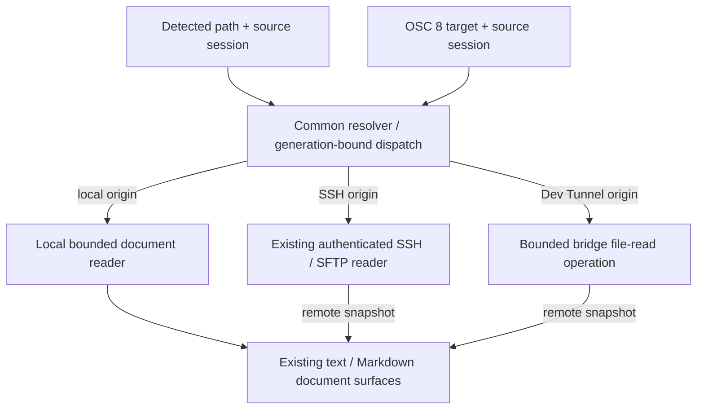

# ADR 0053: Separate Dev Tunnels Bridge for Remote Persistent Sessions

- **Status:** Proposed
- **Date:** 2026-10-29
- **Supersedes:** None
- **Related:** ADRs 0016, 0018, 0025, 0038 and 0052; issue #296
- **Scope:** Owner-requested experimental remote-access capability; not an M6
  acceptance requirement or a claim of hosted-service qualification.

## Context

Issue [#296](https://github.com/fes/fesTerm/issues/296) investigated a native
fesTerm client connecting through Dev Tunnels to an existing Microsoft VS Code
Server. It paused on server-product licensing, legitimate third-party Entra
authorization, and unqualified internal VS Code protocol/persistence behavior.
Using an MIT-licensed transport SDK did not resolve those separate gates.

The owner instead requested a design for using Dev Tunnels directly, with
fesTerm-owned software at both ends, and selected a separate remote bridge
process. The first implementation uses explicitly provisioned,
tunnel-scoped host/connect tokens, with **GitHub authentication through the
official Dev Tunnels CLI as the first supported provisioning route**.
Native fesTerm-owned sign-in and Entra integration are deferred. This does
not authorize borrowing another application's OAuth identity or extracting
its cached credentials.

ADR 0025 makes `festerm-sessiond` a local-only, per-session PTY owner. ADR
0038 gives that daemon an authoritative recovery mirror; the GUI owns the
presented terminal and suppresses duplicate terminal-query replies. Neither
decision makes the daemon a network server or provides an identity broker.
Those boundaries must survive the addition of remote access.

## Decision

Introduce an optional **separate executable/process**, provisionally
`festerm-tunnel-bridge`, on the remote host. It terminates the Dev Tunnels
connection and mediates access to that host user's existing daemon APIs.
It is not a VS Code extension, VS Code Server client, or replacement daemon.

```mermaid
flowchart LR
    subgraph Client["Client machine"]
        GUI["fesTerm application"]
        Backend["Remote session backend"]
        GUI --> Backend
    end
    Relay["Microsoft Dev Tunnels relay"]
    subgraph Remote["Remote machine - same OS user"]
        Bridge["festerm-tunnel-bridge"]
        IPC["Protected local IPC"]
        Daemon["festerm-sessiond"]
        PTY["PTY / ConPTY"]
        Shell["Shell / TUI"]
        Bridge --> IPC --> Daemon --> PTY --> Shell
    end
    Backend <-->|"authenticated tunnel"| Relay
    Relay <-->|"outbound host connection"| Bridge
```



The relay supplies connectivity through supported outbound network paths,
not PTY allocation, process persistence or a stable session-control protocol.
No inbound firewall exception, public daemon port or independently reachable
SSH server is required by this design.

### Responsibilities and dependency direction

| Component | Owns | Must not own |
| --- | --- | --- |
| Client application | Commands, connection metadata, consent, visible lifecycle, source classification, presented terminal | Relay internals or remote PTY lifetime |
| Client remote backend | Tunnel connection, bridge protocol, bounded session events and recovery delivery | GUI policy or independent terminal mutation |
| Remote bridge | Tunnel host connection, credential lifetime, admission, session targeting, translation to protected local daemon APIs | Shell handles, terminal parser/mirror, cloud transcript storage |
| Remote daemon | Its local session identity, PTY/process lifetime, authoritative recovery mirror and local access enforcement | Dev Tunnels, OAuth, public listeners or relay tokens |

Keep network/identity dependencies out of `festerm-sessiond`, `festerm-core`
and `festerm-ui-egui`. Reuse `festerm-session` at the frontend boundary.
Shared daemon-client functionality may be factored into a GUI/network-free
library seam, without moving the daemon's PTY or mirror ownership.

Separate processes may ship in the same signed package. Separation does not
require an independent installer, service account, privileged broker or
always-running system service.

### First-class connections and independent credential bindings

Dev Tunnel is a peer connection/profile kind to Local, SSH and Serial, not a
local-shell command alias or an SSH profile in disguise. The application
provides its own launcher/profile fields, lifecycle/Inspector identity and
centralized application-command routing while reusing the common session,
terminal rendering, clipboard and persistence policy boundaries.
This first-class frontend is part of the initial implementation, even if
the first bridge exports only one configured existing daemon session.

Each saved profile holds its own opaque native-secret-store reference for
the **connect** capability and non-secret destination metadata: tunnel,
cluster, bridge port and intended exported session. Persisting a token is an
explicit choice. An unsaved/unsaved-credential launch may retain its connect
token only in that session's memory. Never use a process-global "current
GitHub account" or last-entered token as the connection's credential source.
Host capabilities belong to the remote bridge, not a frontend profile.

Profiles for different GitHub accounts/tunnels can coexist and run
simultaneously in one application instance. Multiple sessions from the same
profile may deliberately reuse its intended credential reference; do not
create persistent secret copies for each tab. Independent profiles do not
implicitly share a credential slot. Rotation, removal, sign-out or editing
one binding must not overwrite another profile's credential or silently
retarget an existing session. Live sessions pin their launch binding and
lifecycle generation; reconnect remains bound to the selected remote
host/session and treats an incompatible credential change as requiring
explicit user resolution.

This is concurrent use of independently provisioned tunnel capabilities,
not an initial native GitHub OAuth account switcher. Account display labels
are descriptive metadata, not authorization evidence derived from an
unverified token. Provisioning with the external CLI may require switching
its selected account, but doing so cannot change an already running fesTerm
session. A later native account broker must preserve the same independent
bindings rather than replacing them with one application-global login.

### Authentication, authorization and host identity

The initial experimental bootstrap is:

1. An operator deliberately signs in through the official Dev Tunnels CLI
   using `devtunnel user login --github`, then explicitly creates a private,
   dedicated test tunnel and port under that authorized GitHub identity.
   Existing VS Code client sign-in, `gh` authentication and standalone
   `devtunnel` authentication must not be assumed interchangeable. Confirm
   the intended CLI account without reading or exporting other apps' caches.
2. The operator provisions distinct tunnel-scoped **host** and **connect**
   tokens. The bridge receives only hosting authority; the client receives
   only connection authority. Provision ports separately rather than giving
   the runtime an unrestricted management token.
3. Tokens enter through an explicit secret-input/native-store path, never
   command-line token arguments, ordinary TOML, connection files, workspace
   state, terminal history, logs or diagnostic reports. Metadata stores only
   opaque credential references. Treat SDK errors/HTTP headers as potentially
   secret-bearing and redact before presenting them.
4. The client verifies the selected tunnel/host and the SDK's authenticated
   host-key binding before any daemon operation. Missing or changed identity
   fails closed; arbitrary relay URLs, missing keys and accept-any-key
   fallbacks are not acceptable.

The [documented token mechanism](https://learn.microsoft.com/en-us/azure/developer/dev-tunnels/security#tunnel-access)
currently issues expiring bearer capabilities, described as lasting 24 hours.
Treat expiry as service-owned, not a hard-coded renewal interval. No automatic
identity-based renewal is promised for this phase. A host or connect token
does not grant authority to mint its replacement.

Possession of the admitted connect capability grants access to the exported
remote account/session scope. It is not proof of an independently identified
Entra principal, MFA at each attach, or support for multiple remote OS users.
No anonymous or tenant-wide access is enabled. Never silently broaden the
tunnel's ACL to make a connection work.

The bridge runs unelevated as the daemon owner and uses the existing
owner-scoped local IPC checks. A same-user bridge is trusted code: process
separation is fault/dependency isolation, not a sandbox against compromise of
that OS account. The daemon still validates local requests and generations.
Do not expose a raw Unix socket/named pipe, registry path or local executable
selection as an unrestricted network proxy.

The bridge/client runtime consumes scoped capabilities rather than GitHub
OAuth tokens; its session protocol does not depend on the provisioning
identity provider. GitHub-first does not imply a native in-app GitHub sign-in
flow in this initial token-bootstrap experiment. Such a flow needs its own
supported application identity/authorization design and qualification.

Native Entra sign-in requires a later supported fesTerm application identity,
confirmed service audience/scopes, consent/onboarding and real tenant/MFA/
Conditional Access evidence. The token bootstrap does not establish those.

### Session protocol and lifecycle

Define a versioned bridge protocol independently of the daemon's local
protocol and recovery-snapshot schema. Negotiate capabilities before actions;
unknown major versions and unsupported snapshot schemas refuse explicitly.
Do not assume the daemon's local-only deserializer is a safe network codec.
Network-facing decode needs its own bounded-allocation review and adversarial
tests before use.

The protocol must distinguish:

- **Inventory:** bounded, paginated exported sessions with stable identities,
  generations, factual status and provider capabilities; not arbitrary local
  filesystem discovery.
- **Create:** an explicit request through host-approved launch policy, never
  an implicit fallback from failed attachment.
- **Attach:** the selected existing daemon identity/generation, supported
  recovery schema and deliberate takeover policy.
- **Input/control:** ordered input, resize and recovery synchronization.
- **Detach:** close the attachment while leaving the daemon-owned shell alive.
- **Terminate:** a separately confirmed, exact-generation operation, never an
  interpretation of stream EOF or GUI tab closure.

Initial delivery may expose a deliberately restricted configured session
rather than a general account-wide inventory/creation service. Unsupported
operations must be advertised as unavailable, not simulated. The first code
PR must state its actual supported subset and numeric resource bounds.

ADR 0025 currently permits single-client takeover. The bridge must not hide
that policy: refuse an occupied target unless a deliberate takeover was
authorized, and protect the final adoption against intervening ownership
changes. A preliminary status check alone is not atomic authorization.
If the existing daemon API cannot provide that guarantee, add a narrowly
reviewed admission operation rather than promising safety from a racy check.

Recovery retains ADR 0038's snapshot-before-live-output and adoption barrier.
Preserve ordered resize/control events and exactly-once query-reply ownership.
Discard unsent input on disconnect; never replay keystrokes or destructive
operations after an uncertain outcome. Resolve uncertain create/terminate
results through the same operation/session identity instead of blind retry.

```mermaid
sequenceDiagram
    participant C as fesTerm client
    participant B as Remote bridge
    participant D as Existing daemon
    Note over C,B: Tunnel authorization and host verification complete
    C->>B: Negotiate; attach exact session generation
    B->>D: Admit compatible, authorized attachment
    D-->>B: Recovery state before live output
    B-->>C: Bounded recovery state and identity
    C->>B: Recovery adopted
    B->>D: Adoption acknowledgement
    D-->>B: Ordered live output / controls
    B-->>C: Session events
    C--xB: Disconnect / network loss
    B->>D: Close attachment, not terminate
    Note over D: Daemon continues owning shell and mirror
```

The remote backend must be classified as **remote**, not Local. Tunnel access
must not authorize client-local OSC 8 file reads, local-path inference,
clipboard access or OS-handler launches. Reuse existing explicit remote
terminal/clipboard policy, command routing and secret-store boundaries.

### Common filesystem capability for detected and OSC 8 paths

The owner requires **both detected terminal paths and explicit OSC 8 file
links to open remote files through SSH or Dev Tunnels** in the current
implementation scope. A working remote PTY alone does not satisfy this.
This extends ADR 0052's remote-file activation policy without weakening its
prohibition on remote output authorizing a client-local file read.

Use one application-owned resource-resolution/dispatch path for both
invocation surfaces, backed by an explicit filesystem capability:



The current `SessionTab::terminal_filesystem_origin()` and
`terminal_paths.rs` resolver already distinguish Local from SSH/SFTP origins.
Generalize their remote-reader seam, currently `LiveRemoteFileRequestor`,
rather than duplicating path policy in each widget or pretending the bridge
has an SSH endpoint. Local I/O remains separate from remote snapshot adoption.

- Bind each request and result to its originating profile/credential binding,
  verified endpoint, filesystem namespace and transport/session generation.
  Never look up a different live connection merely because its hostname or
  displayed path matches. Revalidate before I/O/adoption; reconnect, profile
  edits and changed identities cannot silently retarget a pending open.
- Resolve OSC 8 activation from its explicit target, not its visible label.
  Preserve deliberate modifier/context activation. For a remote source,
  `file:///...` and `file://localhost/...` refer to the **remote** filesystem,
  not this client. An authority may identify only the verified source host;
  foreign or ambiguous authorities refuse without a network/local fallback.
- Interpret paths using the provider's remote filesystem semantics, not the
  client's `PathBuf` rules. Absolute POSIX and Windows paths remain distinct;
  relative detected paths and `~` require trustworthy provider cwd/home
  metadata. Do not infer cwd from prompts, titles or shell-command output.
  Raw/relative OSC 8 targets remain unsupported unless separately designed.
- SSH reuses the already authenticated, generation-bound SFTP capability.
  Dev Tunnel uses a separately negotiated bridge **read-file** operation
  under the remote OS user; it does not run `cat`, PowerShell or another
  interpolated shell command, or connect to a guessed SSH service.
- Reads are regular-file, size/type/encoding bounded, cancellable and
  backpressured. The bridge validates requested paths and unsupported device/
  network namespaces before I/O; no general filesystem proxy or arbitrary
  local IPC endpoint is exposed. Preserve existing SSH/SFTP read semantics
  and document provider-specific alias/no-follow limitations accurately.
- Use the existing remote text/Markdown snapshot surfaces and bounds.
  Document identity includes its provider and verified owner/binding, so an
  identical path on another account/host cannot reuse the wrong document.
  Remote writes, automatic local caching and remote-to-local synchronization
  are not introduced by Open. An explicit local Save As remains a different
  user-authorized operation.
- Missing file capability, malformed paths, excessive/non-text content and
  stale/disconnected sources give actionable refusal. They never fall back
  to client-local filesystem access, OS file associations or shell execution.
  HTTP/HTTPS handling and local no-follow read/reload/save protections remain
  unchanged.

The bridge protocol therefore includes a bounded, capability-negotiated
read-file request/result in addition to its advertised session operations.
An older peer without this capability must refuse Open clearly rather than
misrepresent PTY connectivity as file access. Numeric path, content, request,
concurrency and aggregate-buffer limits belong in the implementation tests.

### Bounds, cancellation and reconnection

Set numeric per-message, per-connection and aggregate budgets in code before
enabling a listener: handshakes, inventory metadata, concurrent attachments,
snapshot wire/decoded state, input/output queues, pending operations, retries
and diagnostics. Reject lengths before allocation, and release reservations
on all cancellation/failure paths. The local daemon's 768-MiB snapshot cap
is not an acceptable claim of a bounded remote service or total memory use.
Refuse an oversized recovery explicitly; do not silently truncate it.

Preserve backpressure end to end. User data is not lossy; typed lifecycle and
recovery barriers cannot disappear behind output. Cancellation and shutdown
must remain serviceable under saturation, including stalled peers.
Availability/completion wakes the GUI; do not add GUI polling.

The [Rust SDK](https://github.com/microsoft/dev-tunnels/tree/main/rs) is a
candidate, not a blanket acceptance of its resource behavior. Review and pin
the selected revision/dependencies. Its current feature matrix lacks automatic
reconnect/token refresh, and host internals include unbounded channels.
Bounding only an adapter's downstream queue does not bound those upstream
allocations. An audited bounded adapter/upstream fix or another explicitly
reviewed implementation is required before claiming that gate passed.

Use bounded, cancellable retry/backoff only for transport establishment.
Authentication expiry/revocation becomes an actionable credential-required
state. Reconnect targets the same host/session generation; it does not create
a shell, accept a changed identity or steal another client automatically.

### Deployment, updates and survival limits

Remote installation/startup is explicit. Verify executable provenance, run as
the intended user, and show missing/incompatible helpers as setup failures.
Do not silently install software, create services, elevate, change firewall
rules or enable remote access during an ordinary local launch.
Closing the bridge withdraws access without deleting unrelated tunnels or
terminating retained sessions. Only explicitly test-owned/provisioned
resources may be removed by automated cleanup.

| Event | Intended effect on shell | Required qualification |
| --- | --- | --- |
| Client exit, sleep or network loss | Daemon continues; attachment may be lost | Same process/session resumes without replayed input |
| Bridge crash or restart | Daemon continues; clients disconnect | Re-establish authenticated host binding, then deliberate reattach |
| Bridge executable upgrade | Stop/restart bridge; no PTY handoff | Compatible bridge/daemon protocol and remote host identity checked |
| Token expiry/revocation | Access/re-establishment may fail; no shell termination | Test actual service behavior; do not promise established-stream revocation timing |
| Tunnel deletion or relay outage | Connectivity lost; daemon remains independent | No replacement tunnel/shell or weakened ACL on retry |
| Daemon restart/upgrade | May terminate its shell/PTY | No hot replacement or cross-process ConPTY transfer is provided |
| Remote logoff, reboot or OS termination | No survival promise | Platform/user-service lifetime evidence required separately |

Process separation makes the **bridge** independently replaceable. It does
not make the daemon executable, PTY/ConPTY owner, shell environment, loaded
terminal parser or arbitrary snapshot schema hot-upgradeable. A new frontend
must retain a supported adapter for an older still-running daemon; otherwise
it refuses without killing or replacing that daemon.

### Delivery and unresolved external gates

Publish this proposal separately from implementation. Deliver an opt-in
experimental code PR with the GitHub-first token bootstrap, explicit supported
operations, deterministic protocol/lifecycle tests and independent security
review. Then qualify a controlled real tunnel and remote host; mock tests
alone do not establish service interoperability or native usability.

The MIT license of the SDK does not govern Microsoft's hosted service.
[Current service documentation](https://learn.microsoft.com/en-us/azure/developer/dev-tunnels/overview)
describes public-preview development/testing use, no SLA and no recommendation
for production workloads. Confirm applicable terms and supported usage before
advertising a production remote-access product. This ADR is not legal
clearance, service availability assurance or an SLA.

The original existing-VS-Code-host request in #296 remains distinct and is
not closed by this alternative. No Microsoft-distributed VS Code Server,
internal terminal RPC or VS Code OAuth client identity is required here.

## Alternatives considered

- **Add Dev Tunnels/OAuth to `festerm-sessiond`:** couples cloud dependencies
  and crashes/updates to PTY lifetime; violates its local-only responsibility.
- **Separate daemon mode in the same process:** feature flags do not provide
  independent failure or restart boundaries. Shared packaging is acceptable;
  shared process ownership is not selected.
- **Raw daemon IPC forwarding:** turns a local-only trust/serialization
  assumption into a network API and omits admission, capability negotiation,
  authorization and aggregate resource limits.
- **Reuse Microsoft VS Code Server:** preserves #296's licensing and internal
  protocol gates and gives a different deployment/compatibility contract.
- **SSH through a tunnel:** a valid separate route when an authorized SSH
  server is available; can reuse `festerm-ssh`. Not required for this design
  and does not provide direct daemon access by itself.
- **Build a custom relay/cloud identity service:** unnecessary infrastructure
  expansion. Relay choice remains separable if Dev Tunnels is unsuitable.

## Consequences

The bridge can fail or be updated without replacing the PTY owner. Local-only
users retain the existing daemon and need no cloud sign-in or new network
dependencies. New packaging, remote setup, compatibility negotiation and
credential lifecycle still require deliberate implementation.

No current configuration schema, daemon protocol, accepted capability or
session behavior changes in this documentation PR. Initial desktop scope is
Windows, Linux and macOS with platform-specific evidence required. Mobile,
multi-user delegation, unattended services, arbitrary port forwarding,
automatic helper deployment and daemon hot handoff remain out of scope.

## Validation impact

- **Invariants introduced or changed:** proposed separate network bridge;
  daemon stays local-only and owns PTY/recovery lifetime; exact session/host
  targeting; bounded network decode and queues; secrets stay outside ordinary
  metadata; remote links never become client-local file authority.
- **GUI/action edges affected:** future `TUNNEL-01` through `TUNNEL-06`, all
  deferred; `TUNNEL-06` extends remote detected/OSC 8 file opening across SSH
  and Dev Tunnels. Existing runtime behavior is unchanged by this proposal.
  Implemented operations must converge on the application command model
  rather than introducing widget-specific copies.
- **Automated tests required:** planned protocol/schema/length refusal,
  host-key/credential redaction, exact-generation attach/takeover/terminate,
  adoption/output/query ordering, saturation/cancellation, bridge process
  death without daemon death, token-required state, no input replay and
  remote-origin file-link refusal; peer profile/launcher/command routing,
  simultaneous independent credential bindings, transient versus opted-in
  stored credentials, and profile rotation without live-session retargeting;
  detected and explicit OSC 8 production file-open routing through both
  remote providers, remote-versus-local namespace isolation, cross-platform
  path handling, stale read/result refusal, bounded non-file/binary/oversize
  refusal and provider/account-specific document identity.
  Remote-origin file-link refusal means refusal of client-local access, not
  unconditional refusal of an authorized remote read.
  These are obligations, not existing tests.
- **Native/manual evidence required:** future `DT-01` through `DT-06` in
  `docs/manual-validation.md`; service policy/authentication, real PTY/TUI
  input/resize, disconnect/bridge restart and platform lifetimes remain
  pending. Controlled automation should replace manual checks where possible.
- **Coverage superseded:** None in this proposal. Implementation must update
  tests that assume every remote OSC 8 file activation is refused, replacing
  that assumption with authorized remote-read and no-client-local-fallback
  cases. No existing evidence is promoted or retired here; trace entries
  classify this proposal as deferred behind named prerequisites.
