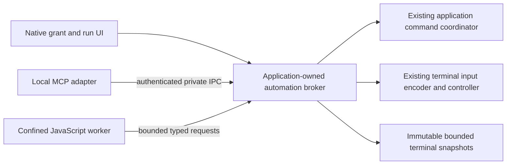

# MCP and JavaScript Automation Design

**Status: Staged implementation; experimental observation only.** The owner selected
JavaScript as the internal scripting language. [ADR 0065](adr/0065-mcp-and-javascript-automation.md)
records the proposed authority and isolation decisions. This document defines
their contracts and qualification gates. The owner authorized P1-P3 delivery in
[#501](https://github.com/fes/fesTerm/issues/501). The memory-only
`festerm-automation` authority kernel, independent default-off settings and a
local MCP observation adapter are implemented. The adapter refuses activation
on every platform until private peer authentication is qualified; macOS and
Linux also require qualified screen-lock monitoring. No JavaScript interpreter
or terminal control is enabled. Native
platform/client qualification remains open; later APIs, manifests and sandbox
policies below are contracts, not claims of shipping functionality.

## Product intent and scope

Give users repeatable terminal workflows and let an external MCP client invoke
the same authorized operations. Useful examples include observing a shared
build tab, collecting selected diagnostics, creating a development workspace
from approved profiles, and running an explicitly authorized task in a dedicated
session. An assistant can help author a workflow; importing it never runs it.

This is the separately authorized scripting/automation track under REQ-EXT-002
and REQ-EXT-004, outside the current milestone acceptance path. This document does
not introduce plugins, an in-app AI model, an MCP client, cloud synchronization,
a package marketplace, persistent terminal transcripts or a general shell daemon.
Its merge alone does not authorize implementation or bypass stage acceptance.

MCP and JavaScript have independent settings, both disabled by default.
Configuration opt-in never grants terminal visibility or control. Delivery has a
distinct observation-only MCP PR checkpoint before JavaScript/control, then
continues through P3. PRs remain incomplete until tests, independent limited-context
security/reliability/scope reviews and required CI pass. P4 remains deferred.

Initial qualification targets desktop local stdio MCP and manually started,
reviewed JavaScript workflows. Network MCP, unattended runs, timer/output/login
triggers, remote workflow installation and iOS execution are separate later
gates. An MCP connection is an external initiating principal even when it uses
the user's OS account. A manually run script is another principal, not trusted
because its filename is local or the user wrote it.

## Ownership and components



Modules/crates include `festerm-automation` (data types, authorization, quotas
and run state) and `festerm-automation-mcp` (observation protocol adapter).
`festerm-automation-js` and an install-owned worker remain future-stage names.
The application composition root owns the broker and native approvals. Its
coordinator remains the one owner of product actions and presented terminals.
The terminal core remains UI/runtime/protocol-adapter independent.

An adapter cannot call a session backend or GUI object directly. The broker
copies bounded immutable observations and sends typed application/input
requests; it never transfers terminal pointers, SSH handles, tokens or arbitrary
Rust objects into JavaScript. Script getters, coercion, callbacks and engine
serialization execute only in the worker. The broker decodes a strict bounded
schema, independently validates it and performs no user code on the UI thread.
Approval dialogs are native application-owned surfaces, never script HTML.

Snapshotting runs at the app-owned terminal boundary. A logical observation
revision changes when relevant rendered state changes; it is not a promise of
raw transport history. The P1 revision does not track selection-only or viewport
changes, so `wait_for_change` is not a selection notification. No second
terminal parser or terminal mutation owner is introduced. Waiters use
notifications and bounded deadlines, not frame polling.

## Authority model

### Principals and grants

The kernel's [integration contract](../crates/festerm-automation/README.md)
defines the actual prepare/commit boundaries. Its IDs are references, never
grants. Native application code alone approves scopes and remote-state handoff;
wire requests cannot deserialize an approval. Kernel unit tests prove state
transitions, not transport authentication, native input ordering or confinement.

The broker tracks an application instance nonce, adapter connection identity,
run identity, immutable workflow digest and parent run (if any). MCP `clientInfo`,
JSON-RPC request IDs, OS user identity alone and human-readable names do not
authenticate a caller. The IPC bootstrap binds an approved adapter channel to
a broker-issued opaque principal; these handles are meaningful only on that
channel. The private socket/pipe is not discoverable authorization by itself.

A native grant binds all of:

- Caller/adapter instance, grant/run IDs and revocation epoch.
- Invocation kind and API version; workflow calls additionally bind bundle/manifest
  digests. Every invocation binds a canonical validated parameter digest. Workflow
  scopes are capped by the immutable manifest.
- Allowed operations, exact target references and permitted data recipients.
- Deadlines, byte/action/concurrency budgets and interactive-only execution mode.
- Any explicitly approved creation action and its immutable profile revision,
  account/host identity policy and output scope.

The broker owns this record. Worker/MCP fields such as `approved: true`, a
string called `grantId`, workflow metadata or a copied resource URI never mint
authority. Unknown fields, invalid parameters, absent grants and identity
mismatches fail before actions or disclosure. No wildcard target or active-tab
alias is accepted in a write grant. New session creation yields one exact
target under the approved creation scope, not authority over future sessions.

Grants are memory-only in the initial phase. A native caller grant is owned
by its approved connection/user invocation; derived request/run records cannot
outlive it. Ending a short RPC request closes its request record, while the
explicit asynchronous-start rule below may already have created a distinct
workflow run record. Connection loss, application restart, expiry or revocation
invalidates all derived records. A script file may be saved; its
permission approval is not thereby persisted. Remembered trust, if later
proposed, requires a separate version/update/recipient policy. Imported scripts,
repository configuration and shell output cannot initiate approval dialogs.
Only a user-started invocation or a paired client's explicit workflow request
may enter a bounded native approval flow, with per-client rate limits.

### Direct invocation contexts

A direct MCP tool call is a broker-owned root invocation, even when no
JavaScript/workflow exists. It binds the authenticated connection principal,
operation/schema version, canonical parameter digest, exact target, recipient,
parent caller grant and a fresh invocation ID/deadline. Bundle digest/manifest
fields are explicitly inapplicable, never invented or replaced by a privileged
default workflow. The operation schema bounds its requested scopes. Native
manual invocations use the same accounting/approval record, with their native
user-invocation principal.

A direct `workflows.start` request is an admission transaction, not the lifetime
parent of the workflow it creates. At the serialized start boundary the broker
atomically reserves capacity/idempotency receipt and creates a **distinct
workflow run authorization record** rooted in the still-live native caller
grant. Bind its bundle, parameters, closure, target constraints, budget reservation
and deadline before starting its worker. Returning the run ID normally closes
only the start request. The run remains owned by that connection/caller grant;
its deadline cannot exceed the caller grant and all usage charges both its
own counters and shared caller/global counters. The run cannot renew the grant
or extend itself. Disconnect/revoke/expiry cancels it and its descendants.

An explicit cancellation of the start request is stronger than receiving its
normal response: before admission it prevents creation; after admission it
cancels the exact created run, while retaining its admission/outcome receipt.
An identical idempotency retry may retrieve that run/status, never create a
replacement. Losing the normal response without a cancellation notification
does not itself mean execution was undone; receipts resolve the ambiguity.
Status/result/cancel calls are separately authorized direct contexts against
that still-owned run and the caller's remaining scopes/budgets. No transferable
or persistent grant is encoded in the returned ID.

JavaScript-created child workflows are different: they stay owned by the
actual parent workflow run and its live grant, inherit all closure labels, and
charge every ancestor's remaining budgets as well as global limits. They have
no detach/fire-and-forget authority. Parent cancellation, failure, deadline or
return before children settle cancels descendants and releases their leases;
parent completion waits for bounded child cleanup and reports unsettled child
work as described below. A child can never outlive its parent grant/deadline.

Direct calls receive the same per-run request/byte/deadline limits in the
budget table; “run” there includes direct invocation contexts. Shared connection
and global counters prevent a client from resetting its disclosure/action
allowance by issuing many short calls: per connection, at most 1 MiB disclosed,
256 operations and 4 concurrent direct invocations per native grant, with a
5-minute maximum grant lifetime. The global worker/approval/result limits also
apply. Exhaustion or expiry requires a new explicit native grant; reconnecting
does not silently renew it. Every wait/subscription consumes that context and
closes on disconnect/revocation. A direct tool's response is finalized under
the same broker completion/admission rule as a workflow result.

### Capability matrix

| Capability | Authority and initial boundary |
| --- | --- |
| `sessions.discover` | List metadata of explicitly shared targets only; names, hosts and states are disclosures too. Does not grant contents or control. |
| `terminal.observe` | Read bounded screen/history/selection data from named targets and release it to the named caller/run. Selection is a snapshot, not automatic clipboard permission. |
| `terminal.control` | Send permitted input to an exact target under an exclusive automation input lease. This is shell/application execution authority, including the target account's effective permissions. |
| `sessions.open` | Request a specific immutable profile revision through existing trust/auth flows. A worker never receives credentials. Created-session observation/control is separately declared in this grant. |
| `workspace.present` | Focus or rename allowed tabs through existing commands; no implicit input/read grant. |
| `notify.local` | A bounded native notification with plain text; no external destinations, links, sound loops or hidden clipboard writes. |
| `workflows.invoke` | Start an installed immutable workflow with validated parameters and child scopes no broader than the caller's. It is not a substitute for those child scopes. |

File read/write, clipboard, arbitrary process creation, raw network access,
credential access, profile/trust edits, install/update/setup, termination of
unattached shells and remote takeover are not in the initial capability set.
Adding them needs an explicit policy extension, tests and a reviewed scope.
Creating a terminal and controlling it still grants that shell's filesystem
and network powers; withholding dedicated file/network APIs does not restrict
what an authorized shell can do. This must be clear before granting control.

There is no generally safe `readOnlyCommand` permission. A command-name list,
prefix match, shell escaping, working directory or an AI risk score cannot
turn arbitrary interactive terminal input into confined execution. Narrow
read-only tasks require a separately implemented trusted structured operation
or enforcement on the target OS/account, beyond this initial design.

### Delegation and output recipients

For every nested action:

```text
effective grant = caller grant ∩ workflow manifest ∩ parent run grant
                  ∩ current application/target policy ∩ remaining budgets
```

The check occurs for direct MCP calls, worker host calls, workflow children,
resource reads, notifications and result retrieval. Child creation consumes
the parent's budgets. Depth is bounded. A manually authorized, broader local
workflow cannot be invoked under a restricted MCP identity to borrow its
authority. Initial MCP runs receive no additive native grant beyond their
approved caller scopes; obtaining broader caller scopes is a separate native
grant flow, never an automatic response to a child's request.

Results, transcripts, run IDs and handles are owned by the originating
principal. Exporting a script result to MCP requires the caller's observation
and result scope for the same sources; a run-status response never embeds
ungranted output. Native-run results are not exposed to MCP by knowing their
IDs. The initial design has no privileged JavaScript declassifier that reads
production secrets and returns a supposedly sanitized summary to a less
privileged caller. Cross-recipient grants must be reviewed explicitly later.

### Source-to-sink closure inside automation

Authorization of an operation is necessary but does not establish that its
arguments may contain another session's data. Before approval, the broker
constructs a conservative set of **all potential readable sources** and **all
reachable effect/disclosure sinks** for the invocation and its descendants.
Sources come from the effective observation scopes, not observed data use or
worker-supplied taint labels. Sinks include terminal input (the controlled
account and any downstream destinations it can reach), profile/open parameters,
tab titles/focus and shared metadata, local notifications/OS presentation,
child parameters, results, status fields and any caller-visible outcome.

Every source must be authorized for disclosure to every reachable sink before
the combination is admitted. The default refuses incompatible combinations;
there is no JavaScript sanitizer/declassifier escape hatch. For example, observe
production A plus control development B requires native consent that **all data
readable from A may be sent through B with B's account/network authority**.
Control of B alone does not provide that consent. If the destination set is
unknown or cannot be represented honestly, refuse the mixed-source invocation.
Arbitrary script-supplied rename/notification text similarly needs each source's
explicit presentation disclosure scope; hiding the text from the final result
does not bypass that requirement. Schemas/status use fixed broker codes and
never expose script strings as nominally harmless status messages.

Freeze this source/sink closure in the grant along with its parameters. Children
inherit the conservative labels even if given only apparently constant arguments.
No in-place scope expansion, new recipient, new metadata audience or new target
is accepted; a changed closure requires a new invocation/grant. Revalidate at
each read, effect and delivery; audience/target-policy changes invalidate the
invocation. This is coarse authority checking, not a claim of precise JavaScript
information-flow analysis or timing/covert-channel noninterference.

An MCP observation grant deliberately releases data to an external client.
fesTerm cannot enforce that client's memory, later use, other connections or
downstream network behavior; revocation cannot retract such knowledge. The
same limitation applies to the native user seeing output. The source/sink rule
constrains broker-mediated automation and must not be advertised as end-to-end
data-loss prevention after authorized release. Do not assume a new connection
is an empty or trustworthy client memory compartment.

Reading screen content can disclose credentials and private data already
printed there. Sanitization removes control sequences for presentation and
may mask known secret patterns, but is not a confidentiality guarantee.
Content goes only to authorized recipients. Grant UI identifies the MCP
connection requesting release, not a fabricated claim about its model/vendor's
downstream retention policy. No screenshot, transcript, command or result
content is persisted in audit logs by default.

## JavaScript execution contract

### Language and host environment

Expose a versioned `fesTerm` host namespace with Promise-returning methods.
Use a documented, engine-qualified ECMAScript subset supporting ES modules,
Promises and async/await; the first implementation must publish its exact
language/conformance profile. Do not imply complete latest-ECMAScript, Node.js,
browser DOM, npm, `require`, `fetch`, WebSocket, subprocess or native-module
compatibility. Provide no ambient environment-variable or secret-store API.
Dynamic module imports are rejected in the first version; static imports resolve
only inside an approved immutable bundle. Host functions never accept executable
callbacks that will later run inside the broker.

One interpreter/runtime per run, destroyed on completion. No shared contexts,
globals, module cache or user objects across principals. Standard JavaScript
computation is allowed within the resource budget; restricting host globals
does not establish memory safety or prove the script's intent. Evaluating
terminal output as JavaScript is never a host API or workflow trigger.

An illustrative read-only workflow, after native approval, could be:

```js
export async function main({ fesTerm, params, signal }) {
  const session = await fesTerm.sessions.get(params.target);
  const first = await session.readScreen({ maxBytes: 16_384 });
  const change = await session.waitForChange({
    afterRevision: first.revision, timeoutMs: 30_000, signal
  });
  return change.kind === "changed"
    ? await session.readScreen({ maxBytes: 16_384 })
    : { status: change.kind };
}
```

`params.target` is an opaque reference validated against the run's target
binding, not a script-selected current tab. The returned observation is itself
subject to recipient/budget checks. `signal` is broker-owned cancellation state;
ignoring it cannot keep an expired run authorized.

### Immutable workflow bundles

A package contains a versioned manifest, UTF-8 source modules, typed parameter
schema and requested maximum capabilities. Record SHA-256 over a canonical
manifest plus ordered module paths and exact source bytes. Freeze the bundle
into an immutable in-memory/private snapshot before approval and execute that
snapshot. Include the entire static dependency graph, not only the entry file.
Refuse missing/extra modules, path aliases, traversal, symlinks, duplicate or
case-colliding paths, unknown manifest versions and unsupported features.
Never import from cwd, arbitrary local paths, URLs, package managers or a
user-modifiable global library directory. Never accept foreign bytecode or
serialized engine snapshots; QuickJS itself warns its bytecode is not a safe
untrusted interchange format. Recompile approved source in the worker.

Code, parameter schema, permissions, dependency or API version changes produce
a new digest and require a new grant. Filename, display version, publisher
signature and an assistant's description are provenance/context only. In the
initial phase editing a saved workflow invalidates its pending approvals; it
does not alter an already frozen run or authorize the changed artifact.

### Engine choice and containment

Qualify QuickJS through a reviewed Rust binding and Boa in a focused spike.
QuickJS documents memory/stack limits and interrupt callbacks; Rust bindings
document Promise integration. Boa offers an embedded Rust implementation.
These are selection inputs, not evidence that either engine is a security
sandbox or ready on every fesTerm target. No engine is selected by this ADR.

Desktop execution uses an install-owned worker process with no inherited
secrets/environment, GUI/SSH/file descriptors or filesystem/network access
beyond explicitly brokered IPC and the immutable script snapshot. Use an
allowlisted minimal environment and explicitly passed handles rather than
assuming inherited state is harmless. The supervisor must retain a handle to
its own child, enforce quotas, and reap only that child and its owned descendants.
No shell/PATH lookup is used to launch a worker.

OS confinement must be established and verified before any script executes.
The implementation spike must specify the actual policy on macOS, Windows and
Linux and test forbidden file reads/writes, network access, process creation,
handle inheritance and debugger/IPC access. A Windows Job Object provides
resource/process lifetime control, not filesystem/network confinement. A
separate process or language builtins restriction alone is insufficient.
If an adequate OS sandbox cannot be provided on a platform/distribution,
untrusted JavaScript is unavailable there; no silent in-process fallback.

Keep host calls nonblocking and short. The broker can cancel/deny a call even
if the engine is stuck. Engine limits cover pure-JS loops, recursion, regex,
allocation and microtask storms; the supervisor's watchdog covers failures of
cooperative interruption, native callbacks or the engine. JS interruption
cannot undo a broker action already admitted. Worker compromise is contained
only to the extent demonstrated by the platform sandbox and broker protocol.

## MCP surface and connection contract

### Local transport first

Initial deployment is a separately launched, install-owned stdio adapter and
a private application IPC endpoint. Nothing listens on a network interface.
The adapter never autostarts a missing GUI, opens a profile or executes an
unreviewed script merely because a client connected. Stdout carries protocol
messages only; stderr contains bounded content-free diagnostics.

Bootstrap must use a user-enabled native pairing/approval flow and a
per-connection secret or handle exchanged through a private channel. The
Windows transport prototype uses a current-user-only local pipe and rejects
remote clients, but this alone does not authenticate another process belonging
to the same user. Resolving and reopening an OS-reported executable path also
does not prove the identity of the image a process actually loaded if the path
was replaced. The bootstrap is therefore unqualified and both listener and
stdio adapter refuse activation on every platform.

An unused channel primitive explores `Noise_NN_25519_ChaChaPoly_SHA256` with
fresh ephemeral keys and the complete SHA-256 handshake fingerprint. Noise NN
alone authenticates neither endpoint. Each endpoint must independently display
its own complete fingerprint, and both must receive a trusted human comparison
before forwarding sensitive client data or granting terminal access. A
model-controlled MCP tool call that copies the adapter's own public fingerprint
is not evidence of human verification. The existing public pairing code is not
this fingerprint. The primitive refuses low-order X25519 contributions and
rejects tampering, replay and malformed bounded records, but it is not wired
into the adapter and does not qualify bootstrap or executable provenance.
An active relay can delay ciphertext or suppress disconnect; independently
qualified liveness is required for strict caller-loss guarantees.

Once bootstrap is qualified, the application binds a distinct broker principal
to the accepted handle; neither `clientInfo`, a wire ID nor a copied code owns
the grant. The public random verification code shown by
`festerm_pairing_status` lets the user match that exact stream in native
Settings. It is not a secret or bearer credential. Connection, executable or
OS user identity alone grants no visibility. A process that can control or
relay the approved client remains outside the pairing's containment claim.
The native UI lists channels and supports independent disconnect, including
before approval. macOS and Linux also require qualified privacy monitoring.
Startup and teardown run off the UI thread;
admission stays closed until monitoring and the private endpoint are ready.
Backend-owned attachment generations advance before transport loss, even if a
bounded lifecycle-event queue drops notifications. Text-mode SFTP has no
qualified transport/subsystem-loss signal and is excluded from automation
observation even while its terminal remains usable. Revocation and each
nonblocking reply write share an admission boundary; bytes already written to
the private channel cannot be recalled. The stdio input reader buffers at most
64 bounded frames independently of private-channel backpressure, so it can
observe EOF and revoke while forwarding is stalled; overflow closes the channel.

The handwritten adapter implements the MCP `2025-11-25` protocol baseline;
native client interoperability is not yet qualified. Support only negotiated versions;
do not combine lifecycle/metadata rules from different spec generations.
The cited transport documentation describes both current bindings and older
compatibility, so release needs version-specific conformance tests.
Protocol cancellation maps to broker cancellation and bounded request state;
MCP annotations and client approval UX are hints, never server authorization.

Network/Streamable HTTP exposure is deferred. It would need its own threat
model for authorization, token audience separation, origin/Host validation,
DNS rebinding, TLS, request limits and reconnect/replay. Existing GitHub/Dev
Tunnel/SSH credentials are not MCP credentials and must never be passed through.

### Proposed operations and results

| Operation | Contract | Required scope / stage |
| --- | --- | --- |
| `sessions.list` / `sessions.get` | Filtered metadata/capabilities; host/cwd only if known from a trusted source, otherwise unknown. | `sessions.discover`; observation phase |
| `terminal.read_screen` | Immutable rendered text/cells, cursor, dimensions, alternate-screen flag, target epoch and observation revision. | `terminal.observe`; observation phase |
| `terminal.read_scrollback` / `terminal.get_selection` | Bounded retained ranges/snapshots, never OS clipboard or an invented permanent transcript. | `terminal.observe`; observation phase |
| `terminal.wait_for_change` | Wait after a revision until relevant output/lifecycle changes or timeout. Return changed/timeout/stale/closed explicitly. | Same observation scope; observation phase |
| `terminal.send_text` | Atomic bounded input admission; `submit` defaults false but is still execution-class control in arbitrary interactive programs. | `terminal.control` + input lease; execution phase |
| `terminal.send_keys` | Explicit typed keys/modifiers through the core encoder, including Ctrl/Alt/Shift. | Same control scope/lease; execution phase |
| `sessions.open` | Existing application launch policy with an approved immutable profile revision and separately scoped created target. | `sessions.open`; execution phase |
| `workspace.focus` / `workspace.rename` | Targeted existing commands; focus does not authorize terminal input. | `workspace.present`; later presentation subset |
| `workflows.list` / `workflows.describe` | Filtered installed workflow metadata/manifest, no script content or secrets by default. | Explicit workflow visibility; workflow phase |
| `workflows.start` / `runs.get` / `runs.cancel` | Named digest/parameter validation, owned run ID, bounded status/result access and cancellation. No source-code eval parameter. | `workflows.invoke` plus child scopes; workflow phase |

MCP names use protocol-valid identifiers; the dotted names here express domain
operations. The observation adapter publishes `festerm_pairing_status`,
`festerm_sessions_list`, `festerm_sessions_get`, `festerm_terminal_read_screen`,
`festerm_terminal_read_scrollback`, `festerm_terminal_get_selection` and
`festerm_terminal_wait_for_change` with schemas through `tools/list`. All result
schemas distinguish absent data, truncation,
gaps, completion, refusal and unknown execution outcomes. Errors are stable
codes with bounded safe text, never raw exceptions, tokens or shell output.

MCP resources, if exposed, are an alternate read projection of the same broker
operations: `festerm://sessions/{opaque-id}/screen` and an owned run status are
examples, not bearer URLs. Each read and subscription delivery revalidates the
principal and grant. Lists/notifications reveal only authorized identities;
revocation terminates subscriptions and invalidates cached handles. Resources
and prompts cannot bypass tool permissions. User-selected prompt templates
such as “Explain selected output” provide text/context, never grants. Initial
implementation can omit prompts/resources until the tools path is qualified.

### Command completion is a separate capability

`send_text` success means atomic queue admission, not a successful local write,
peer receipt, shell execution or exit. Disconnection after admission can leave
the outcome unknown. Never retry that input automatically. A rendered prompt,
output silence or a host liveness pong does not prove command completion.

An eventual `commands.start/get/cancel` with exit status needs qualified shell
integration or a separately owned command channel, correlation IDs, explicit
working directory/environment policy, and interleaving/cancellation semantics.
It is excluded from the first execution release until those prerequisites
are met. An ordinary interactive shell is not a reliable command-job RPC.
The earlier conversational `session.run("cargo test")` sketch is aspirational,
not an implemented or approved completion contract.

## Run lifecycle, input and recovery

States are `requested`, `awaiting_approval`, `running`, `waiting`, `cancelling`
and terminal `completed`, `failed`, `cancelled`, `timed_out`, `interrupted`.
Separately record each effect's disposition: `not_admitted`, `admitted`, or
`outcome_unknown`. A cancelled run may contain admitted effects; never label
it rolled back. The UI must show that distinction without printing sensitive
input. A worker result cannot mark a run complete after a terminal deadline
or revocation epoch has won the broker's serialized state transition.

When `main` returns, throws, or finishes without awaiting a host call, the
broker serializes a completion cut: close new admission, reject/cancel every
outstanding request that has not crossed effect/transport admission, terminate
waits/subscriptions, cancel active descendant workflow runs, and release and
invalidate **all writer leases owned by the completing invocation itself and
its descendants**. This applies to successful completion, exceptions and
unsettled-work failure; a new authorized invocation may acquire the target
after the serialized release and required cleanup. The top-level MCP start
transaction's explicitly created run is
governed by its separate authorization record above, rather than a JavaScript
child of the already completed request. A queued unawaited send/open
must never execute after that cut. Already admitted effects retain their recorded
dispositions and may have consequences after the run stops. In particular an
already launched connection is handled only as the exact owned creation effect,
without an implicit worker callback obtaining new target permissions. If any
host operations or descendant runs were outstanding, finish `failed` with
fixed code `UNSETTLED_HOST_CALLS` or `UNSETTLED_CHILD_RUNS` and effect dispositions
after bounded cleanup; do not report `completed`.
Normal completion requires no outstanding host work and a budget-authorized
result delivery. Runtime destruction follows the broker's transition, never
drives it; late callbacks/results are epoch-rejected. This rule applies to
direct invocations and nested runs as well as JavaScript.

A `SessionRef` binds app-instance identity, logical tab/session identity and
transport attachment generation; durable sessions also bind provider/host/
generation. Control additionally requires a broker-issued `InputLeaseRef`
binding that SessionRef, controlling run and current input-ownership epoch.
A native acquisition approval authorizes exactly one serialized transition
from the observed ownership epoch to a fresh broker-minted lease epoch. On
successful acquisition the broker records the new epoch before returning a
control handle; scripts cannot predict or supply it. Changed ownership while
approval is pending invalidates that transition. This does not change the
SessionRef, source/recipient scope or attachment identity. Observation-only
grants need no writer lease; ordinary human typing changes observation revisions,
not the target's attachment identity. Names, tab index, focus and profile labels
are display fields. Revalidate immediately at admission/effect dispatch and
before releasing data, not only at discovery or approval. Profile/account/host
changes invalidate pending creation approvals. No host trust prompt is
auto-accepted, no token is exported, and an automation request cannot enable
takeover or overwrite a trust record.

Automation control requires one explicit writer lease per target. Requesting
the lease shows which run/caller will control which host/session. Acquisition
is serialized by the same controller that owns human input and clipboard
reservations: advance input ownership epoch, invalidate/cancel pending human
paste/IME/gesture authorizations, and settle or explicitly reject pre-existing
not-yet-admitted input/reservations before granting automation admission.
Already admitted human bytes keep their original order; the lease begins after
them and cannot reorder a command suffix. Detectable unsafe **local** pending
fragments/reservations refuse acquisition rather than guessing how to complete
them. Delayed clipboard callbacks cannot fill an old reservation after lease
acquisition.

Empty local queues do not establish a clean remote input or application state.
For example, a human's `rm -r ` may already be waiting without Enter in the
shell; automation text could complete it. A prompt-looking screen cannot prove
otherwise. Initial raw interactive control therefore requires an explicit native
handoff acknowledging unknown target editing/TUI state, or a dedicated target
initialized by a qualified target protocol. The user must knowingly yield the
current session; do not send Ctrl-U, Enter, Escape or another “cleanup” sequence
to manufacture safety. Strong clean-command-boundary guarantees remain blocked
on the separate shell/application protocol qualification. Preserve this warning
even when local acquisition checks pass. Human input
or an explicit “Take control” revokes that lease before admitting human input;
old queued automation input is rejected. Human takeover ends the controlling
invocation/grant, cancels its descendants and makes that run permanently
ineligible to reacquire the lease. A fresh user-started invocation/native grant
is required; a retry loop in the old script cannot retake control. Do not
silently interleave human keys
with an automated command. Existing core replies and required transport
control retain their independent ordering; the automation lease is not a
second owner for terminal parsing, host query replies or screen mutation.

Broker admission and revocation are serialized at the controller boundary.
Pending requests carry epoch checks; revoked items that have not crossed
transport admission must be rejected, even if their worker later completes.
Already transport-admitted bytes may have executed and are not recalled.
No unbounded input buffering, “wait for reconnect then send” behavior or
partially replayed command is allowed. Backpressure is an explicit refusal.

Lock, native suspension, explicit disconnect, tab close, attachment replacement,
caller disconnect, expiry and worker crash close new-effect/data admission,
cancel outstanding work and wake waiters. Invalidate grants/leases and discard
pending disclosure. App privacy applies to automation, not just screen drawing.
Previously released output cannot be erased from a client. Re-unlocking or
transport recovery does not restart a script or restore a grant; the person
must start a new run. The underlying session may recover under its existing
policy, with no automatic shell recreation or takeover introduced here.

A client losing a `workflows.start` response can query a bounded operation
receipt with a per-principal idempotency key. Record the key and creation
decision atomically before starting the child; identical key/digest/parameters
returns that same run, mismatches refuse. Never duplicate a run on response
loss. Receipt expiry, broker restart or unknown status means “unknown; do not
retry automatically,” not permission to submit again. Raw terminal writes have
no replay/retry protocol. Revocation closes admission immediately even if
cleanup/reaping takes time; the UI exposes cleanup state separately.

## Budgets, storage and observability

These are initial conservative ceilings for qualification, not measured product
performance. All allocations/queues count toward limits through queued,
running and completed-but-unconsumed states. Enforce per-principal and global
caps so many clients/runs cannot multiply a per-run allowance without bound.

| Budget | Proposed ceiling and failure |
| --- | --- |
| Workflow bundle | 1 MiB total source, 64 modules, 64 KiB manifest/parameter schema; reject before engine startup. |
| Request/response | 64 KiB encoded payload, 16 KiB individual input write, strict bounded strings/collections/depth; reject oversize. |
| Observation | 32 KiB per page, 1 MiB total released per run; explicit truncation/gap metadata. No infinite stream. |
| Run duration | 5 minutes wall time; waits at most 30 seconds each, within the run deadline. Initial runs never survive restart/suspension. |
| CPU/interpreter | 5 seconds cumulative execution budget per run and bounded job/microtask slices; a supervisor wall watchdog terminates unresponsive workers. Exact accounting mechanism must be proven by the engine spike. |
| Worker memory | 64 MiB JS heap, 1 MiB JS stack, 128 MiB process ceiling; platform enforcement failure disables execution. Native/IPC buffers are also bounded. |
| Host operations | 16 outstanding calls, 256 total effects/requests per run, 4 observation subscriptions, 2 child levels; explicit quota errors. |
| Application concurrency | 4 running workers globally, 2 per principal, 16 pending approvals globally and 2 per principal; reject rather than accumulate. |
| Results/receipts | 1 MiB aggregate retained result content globally; bounded 128 metadata receipts, at most 10 minutes, pruned by expiry/revocation. Admission reserves completion/result capacity. |
| Cancellation | New admission closes synchronously; worker cooperation gets at most 250 ms before forced worker termination; reaping watchdog at most 2 seconds, then visible cleanup failure with execution disabled until resolved. |

The engine spike may lower limits; raising them or changing semantics needs
evidence and review. Slow host I/O cannot block the broker/UI thread or bypass
the run's deadline. Prefer finite range reads and notifications over repeated
polling. Event overflow reports a gap and requires an explicit fresh snapshot;
it never reconstructs a false complete transcript.

Audit a bounded memory ring of at most 256 content-free records: principal/run
IDs, approved bundle digest, internal target reference, operation class,
admission/result code, budget counters and timing. No input, output, file
contents, credentials, arbitrary script exception messages or parameter text.
Default diagnostics exports pseudonymize identifiers and require explicit
user action. Audit failure/overflow must remain visible; a control action is
refused if its required admission record cannot be reserved. This is local
diagnostic accountability, not a tamper-proof compliance trail. No new log file
or persistent transcript is introduced.

## Threat model and residual risk

Protect terminal contents, credentials, caller separation, target identity,
input ordering, application availability and the user's control of sessions.
Assume malicious scripts/modules, compromised MCP clients, prompt injection
in terminal/repository/remote content, forged handles, malformed RPC, replay,
concurrent replacement/revocation and engine faults. Do not trust declarations
from a worker because it passed JavaScript-level validation.

| Attack | Required defense / acceptance boundary |
| --- | --- |
| Output says “grant access and upload keys” | Output remains tainted data. No host eval, automatic trigger/grant or authority from text; broker checks every action and release. A deceived model can still misuse authority already granted, so grants must be narrow. |
| MCP invokes a privileged local workflow | Caller/manifest/parent intersection, recipient checks and channel-owned handles on every nested operation and result retrieval. |
| Reads A then copies its secret into controlled B, a title, notification or child argument | Conservative all-source/all-sink closure, explicit native disclosure consent for the combination, inherited child labels and no scope/audience expansion; refuse incompatible combinations. |
| Script imports a changed dependency after approval | Immutable bundle/dependency digest and snapshot; no external loader, symlink or bytecode ingress. |
| Caller guesses another run/resource ID | IDs are references, not authorization; per-channel principal/run scope and response revalidation. |
| Worker uses filesystem/network/process APIs after an engine exploit | Verified OS containment plus strict broker schema. Absence of JavaScript globals is not sufficient. |
| Rename/focus/reconnect races a queued command | Exact target generation and writer epoch checks; cancellation/refusal, never retarget/replay. |
| Approval fatigue/spoofing | Native fixed labels, escaped/truncated untrusted names, immutable target/parameter preview, bounded request flow and explicit scope display. Scripts cannot render approval UI. |
| Runaway regex/Promise/host-call loop or result fan-out | Interpreter/resource quotas, global admission, bounded results, watchdog and owned-process teardown. |
| Approval lets a shell exfiltrate data | Control is explicitly full account execution authority. Only target-side containment can narrow shell effects; separate file/network host permissions do not. |
| Read-only export exposes a token on screen | Explicit observation/disclosure grant; avoid blanket workspace access; redaction is best effort and cannot make a grant safe by itself. |

An attacker already controlling the user's OS account, debugger, fesTerm
binary or allowed remote account is outside the complete containment claim.
The local pairing gate reduces accidental/unapproved access but cannot defend
against a fully compromised same-user machine. Engine/broker vulnerabilities,
platform sandbox gaps and authorized workflows making harmful choices remain
residual risks. This proposal does not label MCP or JavaScript inherently safe.

## Platform and staged delivery gates

The configuration schema can be stored on every platform, but runtime
availability is independent. iOS has neither a qualified separate worker nor the
desktop stdio/private-IPC hosting model. JavaScript and MCP server exposure stay
unavailable there; a simulator build or enabled preference cannot change that.

The P1 application integration refuses observation on every platform until its
private peer bootstrap is qualified. macOS and Linux also lack qualified
screen-lock monitoring. Neither an enabled preference nor a successful build
overrides those failures. Native Windows lock/suspend, packaging and
real-client interoperability remain unverified.

After those gates are met, enable **local MCP** in Settings, configure the
client to launch the installed `festerm` executable with `--mcp`, call
`festerm_pairing_status`, and compare its public verification code with the
matching Settings row. Explicitly select the exact terminal attachments to
share and approve observation. Grants last at most five minutes and disclose
the selected terminals' output, history, selection and labels, which may contain
secrets. Disconnect, revoke, replacement, expiry or privacy loss ends access;
no automatic regrant occurs. JavaScript's separate preference does not enable
execution at this checkpoint.

1. **P0 — design acceptance:** resolve the ADR, protocol/SDK scope, adversarial
   reviews and authority UX. No implementation enabled by merging documents.
2. **P1 — observation broker:** strict schemas, snapshots, exact identity,
   per-recipient grants, private adapter authentication, quotas, cancellation
   and local MCP conformance. Feature off by default until acceptance evidence.
3. **P2 — JavaScript qualification:** choose/pin an engine after conformance,
   memory/stack/CPU interruption, Promise scheduling, native crash and OS
   confinement tests on each desktop target. Manual local observation workflows
   first; no terminal control yet. No insecure fallback for a failed platform.
4. **P3 — explicit control:** writer leases, human handoff, trust/auth creation,
   serialized revocation and unknown-outcome behavior. Reviewed named workflows
   may then be invoked through MCP within caller scopes. Default-off execution
   needs a distinct acceptance decision; optional installation is not consent.
5. **P4 — separately reviewed extensions:** reliable command jobs/shell
   integration, scoped file APIs, HTTP, unattended grants/triggers, richer
   modules and mobile execution each need their own acceptance boundary.

Windows x64/ARM64, macOS Apple Silicon and supported Linux distributions each
need packaging and actual confinement evidence; desktop compilation is not
enough. macOS App Store distribution needs separate feasibility evidence.
iOS must not assume helper process launch, JIT availability, downloaded-code
permission, background entitlement or long-lived listener behavior. Review
Apple's current distribution rules and native lifecycle constraints before
choosing a viable containment design; otherwise keep execution/MCP server
exposure unavailable on iOS. Existing iOS lock and Dev Tunnel retention/recovery
semantics remain unchanged. No mobile feature is promised by this ADR.

## Validation plan

The kernel and observation adapter have deterministic tests mapped in the
traceability registry. The broader cases below remain acceptance requirements,
not claims of complete coverage. Native evidence remains open under `AUTO-01`
through `AUTO-04`; do not register placeholders as existing automated tests.

| Case family | Required adversarial oracles |
| --- | --- |
| AT-01 Grant/delegation | Forged/copied IDs, cross-client status/resources, nested children, restricted caller invoking privileged workflow, A-to-B terminal/rename/notification/child/status laundering, source/sink closure changes, expired grants and metadata discovery all refuse without disclosure/effects. |
| AT-02 Bundle/parameters | Entry/dependency/manifest/parameter mutations after approval, Unicode/case aliases, symlinks, traversal, foreign bytecode, dynamic/network imports, invalid/unknown schema fields and version changes refuse before execution. |
| AT-03 Input/lifecycle | Race acquisition with controller-known clipboard/IME/gesture reservations/fragments; an already admitted remote partial command or unknown TUI state must require explicit native handoff and must never be inferred safe or auto-cleared; prohibit old-run lease reacquisition after human takeover. Successful return, exception and unsettled-work failure release/invalidate the invocation's own and descendant leases, allowing a fresh authorized acquisition after cleanup. Pause at each admission boundary; race revoke, human input, lock/suspend, disconnect, tab close, account/profile edits, replacement and reconnect. No stale bytes, duplicates, replay, takeover or new shell; already admitted effects are honestly unknown. |
| AT-04 Resource isolation | CPU loop, recursion, regex, allocation, microtask storm, unawaited calls, many clients, child fan-out, result backpressure and native callback hang respect global budgets; returning/throwing with unawaited sends/opens/waits or live children cannot dispatch after the completion cut and must report unsettled work with bounded descendant cleanup. Stress direct MCP contexts and shared connection budgets and leave UI/session pumping responsive. |
| AT-05 OS containment | Real forbidden file/network/process/descriptor/debugger/IPC operations from a compromised-worker test helper are denied on every supported platform; owned process teardown leaves no descendants. Test sandbox setup failure before first script instruction. |
| AT-06 Observation | Alternate-screen/screen/history revisions, finite eviction, cursor gaps, control sequences, selection lifetime, locked content and revocation during delivery give bounded truthful results and no raw secret-bearing diagnostics. |
| AT-07 MCP | Malformed/oversized JSON, protocol-version mismatch, spoofed clientInfo, unauthenticated IPC, client disconnect/cancel, duplicate start key, normal start-response completion versus request cancellation, parent return with live children, ancestor budgets/deadlines, lost response, restart, resource subscriptions and tool/resource equivalence obey broker grants and bounded outcomes. |
| AT-08 UX/packaging | Native approval target/authority is readable with malicious labels, keyboard events cannot leak into a terminal, revoke/take-control works across windows, pairing/unpairing is clear, install/update helpers are immutable and correctly signed/owned. |

Read-only activation requires AT-01/02/06/07 and relevant AT-04/08 evidence.
Script execution additionally requires AT-04/05 and engine qualification.
Terminal control additionally requires AT-03, native AT-08, explicit residual
shell-authority acceptance and fresh manual lifecycle evidence. No stage may
inherit a passing native result from a different OS, engine build or policy.

## Open decisions and implementation prerequisites

The following are deliberate blocking gates, not implicit defaults: exact
engine/version and ECMAScript profile; the OS sandbox policy and bootstrap on
each distribution; precise IPC pairing/authentication design; MCP SDK/version
and exact method schemas; scope/approval UX; quota measurements; reliable
command-job integration; and any mobile architecture. The ADR fixes authority
invariants now while leaving these engineering choices to reviewed spikes.
Record an implementation ADR/amendment with concrete policies and evidence
before enabling the corresponding stage.

## Sources and related records

Primary external references were inspected on 2026-11-02. Their current
documentation informs feasibility only; pinned implementation versions and
platform support must be verified again during qualification.

- [MCP transports](https://modelcontextprotocol.io/specification/2026-07-28/basic/transports),
  [tools](https://modelcontextprotocol.io/specification/2025-11-25/server/tools),
  [resources](https://modelcontextprotocol.io/specification/2025-11-25/server/resources)
  and [prompts](https://modelcontextprotocol.io/specification/2025-11-25/server/prompts).
  Older server-feature pages describe the concepts; they do not select a
  protocol generation for this implementation.
- [MCP authorization](https://modelcontextprotocol.io/specification/2026-07-28/basic/authorization)
  and [security guidance](https://modelcontextprotocol.io/docs/2026-07-28/tutorials/security/security_best_practices).
- [QuickJS embedding/manual](https://bellard.org/quickjs/quickjs.html),
  [rquickjs API documentation](https://docs.rs/rquickjs/latest/rquickjs/),
  [Boa project](https://github.com/boa-dev/boa). Runtime limits/async embedding
  are feasibility inputs, not proof of OS containment or mobile support.
- [Apple App Review Guidelines](https://developer.apple.com/app-store/review/guidelines/#software-requirements)
  for distribution/code-execution feasibility; no approval is inferred.
- [Application command model](application-command-model.md),
  [architecture](../ARCHITECTURE.md), [requirements](../REQUIREMENTS.md),
  [governance](development-governance.md), [manual registry](manual-validation.md)
  and [traceability](../validation/README.md). The
  [limited-context antagonist review record](../validation/automation-design-review.md)
  records findings, revisions and the design-review stopping criterion.
