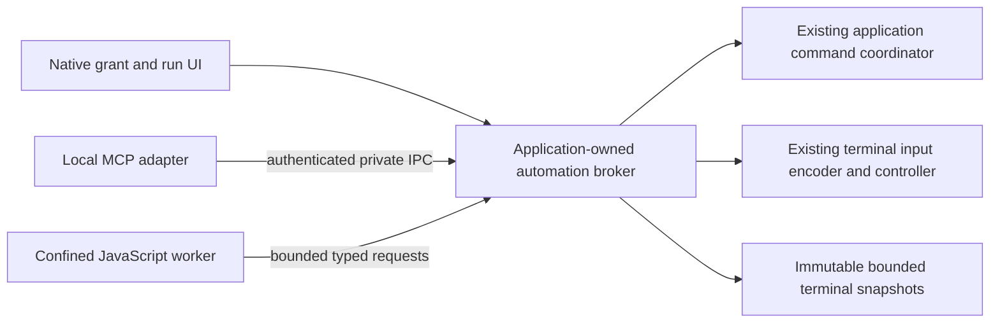

# MCP and JavaScript Automation Design

**Status: Staged implementation; experimental observation only.** The owner selected
JavaScript as the internal scripting language. [ADR 0065](adr/0065-mcp-and-javascript-automation.md)
records the proposed authority and isolation decisions. This document defines
their contracts and qualification gates. The owner authorized P1-P3 delivery in
[#501](https://github.com/fes/fesTerm/issues/501). The memory-only
`festerm-automation` authority kernel, independent default-off settings and a
local MCP observation adapter are implemented. The adapter refuses activation
on every platform until private peer authentication is qualified; macOS and
Linux also require qualified screen-lock monitoring. No JavaScript interpreter
or terminal control is enabled. Native
platform/client qualification remains open; later APIs, manifests and sandbox
policies below are contracts, not claims of shipping functionality.

## Product intent and scope

Give users repeatable terminal workflows and let an external MCP client invoke
the same authorized operations. Useful examples include observing a shared
build tab, collecting selected diagnostics, creating a development workspace
from approved profiles, and running an explicitly authorized task in a dedicated
session. An assistant can help author a workflow; importing it never runs it.

This is the separately authorized scripting/automation track under REQ-EXT-002
and REQ-EXT-004, outside the current milestone acceptance path. This document does
not introduce plugins, an in-app AI model, an MCP client, cloud synchronization,
a package marketplace, persistent terminal transcripts or a general shell daemon.
Its merge alone does not authorize implementation or bypass stage acceptance.

MCP and JavaScript have independent settings, both disabled by default.
Configuration opt-in never grants terminal visibility or control. Delivery has a
distinct observation-only MCP PR checkpoint before JavaScript/control, then
continues through P3. PRs remain incomplete until tests, independent limited-context
security/reliability/scope reviews and required CI pass. P4 remains deferred.

### Desktop preference ownership and failure

The application shares the current MCP/JavaScript preference pair across
windows. Its synchronous configuration writes and committed broadcasts
overlay that pair, so stale sibling documents, including unrelated saves,
cannot restore a successfully saved disable. Individual toggles remain
independent and are saved normally. In-memory overlays reflect the requested
pair, not proof of persistence after a failed or uncertain write. Same-pass
conflicting automation actions or queue overflow close admission, cancel
pending workflow previews, suppress approval, and visibly report that settings
changes may not have been applied;
the user must review and retry. Two workflow capture selections in the same
batch conflict even when their paths are identical: path equality cannot prove
the same intent or snapshot. Neither selection wins, and an existing preview is
cancelled. A single nonconflicting selection still works normally. Each toggle
has a process-local UI interaction
revision, not a configuration snapshot revision: a stale release cannot undo
a sibling change even when its displayed boolean changed and changed back.
Revision exhaustion stops automation and requires restart. Native actions are
bounded and held through discarded layout passes, so an approval cannot be
committed before a cancellation in a later pass of the same frame.

After a failed or indeterminate preference save, both live features are stopped
for the rest of the process. Settings warns that an enabled value may remain
or have reached disk and offers an explicit retry. Unrelated later saves cannot
copy a failed enable, and do not clear that warning. A successful explicit
preference save or retry confirms the current pair but does not resume
automation in this process. There is no durable failure latch: on restart a
value still enabled on disk can be read again; existing connection grants are
never restored.

The guarantee covers in-process writes through the shared reloader and is
subject to the existing storage contract. It does not reconcile unknown
outcomes for unrelated fields, protect against other processes or filesystem
namespace races, or qualify either adapter. A separate configuration-outcome
owner/latch remains necessary for broader transaction guarantees.

Initial qualification targets desktop local stdio MCP and manually started,
reviewed JavaScript workflows. Network MCP, unattended runs, timer/output/login
triggers, remote workflow installation and iOS execution are separate later
gates. An MCP connection is an external initiating principal even when it uses
the user's OS account. A manually run script is another principal, not trusted
because its filename is local or the user wrote it.

## Ownership and components



Modules/crates include `festerm-automation` (data types, authorization, quotas
and run state) and `festerm-automation-mcp` (observation protocol adapter).
`festerm-automation-js` supplies a confined worker component and the desktop
executable has an early private worker entry, but no application launcher or
qualified install provenance. The application composition root owns the broker
and native approvals. Its coordinator remains the one owner of product actions
and presented terminals.
The terminal core remains UI/runtime/protocol-adapter independent.

The coordinator's broker and privacy monitor have a shared lifetime separate
from the MCP listener and its peers. Stopping, restarting or losing MCP closes
only MCP admission and disconnects its principals; it does not discard other
broker state. Privacy loss, an internal shared safety failure or application
shutdown closes shared admission and revokes all principals. A successfully
started shared lifetime can remain dormant until a global stop; it does not
itself authorize an adapter or retain terminal contents. A restart queued
before a global loss is discarded; a later explicit restart is required.
Cleanup runs outside the UI thread; if cleanup cannot be started or fails,
the affected service remains closed until the application is restarted.

When admission is poisoned, privacy closure stores both its closed flag and
the bound MCP stop before logging. MCP stop closes each peer and drops the
broker before logging; the shared flag helper also applies its requested cut
first. These diagnostics run without admission held. A panicking subscriber
can still interrupt later cleanup; this ordering does not establish a
final-recipient or physical-delivery fence.

Only an actual adapter may request shared startup. The JavaScript preference
alone starts neither the broker nor an MCP listener, and there is no integrated
JavaScript adapter in this slice. Future worker integration must serialize its
own admission and delivery against the shared privacy gate and arrange
cancellation/reaping on global loss; this prerequisite does not provide those
worker guarantees.

An adapter cannot call a session backend or GUI object directly. The broker
copies bounded immutable observations and sends typed application/input
requests; it never transfers terminal pointers, SSH handles, tokens or arbitrary
Rust objects into JavaScript. Script getters, coercion, callbacks and engine
serialization execute only in the worker. The broker decodes a strict bounded
schema, independently validates it and performs no user code on the UI thread.
Approval dialogs are native application-owned surfaces, never script HTML.

Snapshotting runs at the app-owned terminal boundary. A logical observation
revision changes when relevant rendered state changes; it is not a promise of
raw transport history. The P1 revision does not track selection-only or viewport
changes, so `wait_for_change` is not a selection notification. No second
terminal parser or terminal mutation owner is introduced. Waiters use
notifications and bounded deadlines, not frame polling.

## Authority model

### Principals and grants

The kernel's [integration contract](../crates/festerm-automation/README.md)
defines the actual prepare/commit boundaries. Its IDs are references, never
grants. Native application code alone approves scopes and remote-state handoff;
wire requests cannot deserialize an approval. Kernel unit tests prove state
transitions, not transport authentication, native input ordering or confinement.

The broker tracks an application instance nonce, adapter connection identity,
run identity, immutable workflow digest and parent run (if any). MCP `clientInfo`,
JSON-RPC request IDs, OS user identity alone and human-readable names do not
authenticate a caller. The IPC bootstrap binds an approved adapter channel to
a broker-issued opaque principal; these handles are meaningful only on that
channel. The private socket/pipe is not discoverable authorization by itself.

A native grant binds all of:

- Caller/adapter instance, grant/run IDs and revocation epoch.
- Invocation kind and API version; workflow calls additionally bind bundle/manifest
  digests. Every invocation binds a canonical validated parameter digest. Workflow
  scopes are capped by the immutable manifest.
- Allowed operations, exact target references and permitted data recipients.
- Deadlines, byte/action/concurrency budgets and interactive-only execution mode.
- Any explicitly approved creation action and its immutable profile revision,
  account/host identity policy and output scope.

The broker owns this record. Worker/MCP fields such as `approved: true`, a
string called `grantId`, workflow metadata or a copied resource URI never mint
authority. Unknown fields, invalid parameters, absent grants and identity
mismatches fail before actions or disclosure. No wildcard target or active-tab
alias is accepted in a write grant. New session creation yields one exact
target under the approved creation scope, not authority over future sessions.

The configuration crate provides a **non-authorizing** host-side effective
profile snapshot for prospective native review. It copies the complete plain
local, plain SSH-shell or serial profile and separately captures the known-host
fingerprint selected by the saved profile's actual SSH connection identity.
Capture and revalidation both use the same connection-profile conversion as
launch, including its host normalization, and fail closed if it fails. Trust
records are matched exactly, so a conflicting raw-host record is not substituted.
The SSH value includes account, authentication kind, opaque credential
reference and port forwards. Capture never retrieves secret-store contents,
but full profile data, including freeform command arguments, may itself be
sensitive; the configuration heuristic is not sanitization. Handle snapshots
and accessor results only in trusted native code, never blindly log them or
disclose them to a worker. Snapshot `Debug` is redacted, not its contents.
Persistent local/SSH profiles, SFTP and Dev Tunnels are refused.
The current SSH policy accepts a matching stored key and prompts for unknown or
changed keys; a captured fingerprint is not a stricter trust policy.

Exact revalidation compares both the captured values and an opaque in-process
configuration revision. The host has not integrated revision ownership: a
future owner must rotate it on every configuration adoption or mutation, never
restore an old revision, and synchronize review and launch with that same
owner. Reusing the revision permits identical remove/recreate (ABA). No content
digest is produced here; even a future digest would identify content, not
prove freshness. Neither snapshot nor revision pins executable/path contents,
device identity or secret-store contents. Current profile launch resolves
configuration again, SSH looks up trust separately and consumes stored-secret
references asynchronously, and tab replacement does not attest a fresh session.
Native approval, launch/privacy/attachment fences, fresh-target attestation,
broker authority and workflow `open` therefore remain unavailable.

Grants are memory-only in the initial phase. A native caller grant is owned
by its approved connection/user invocation; derived request/run records cannot
outlive it. Ending a short RPC request closes its request record, while the
explicit asynchronous-start rule below may already have created a distinct
workflow run record. Connection loss, application restart, expiry or revocation
invalidates all derived records. A script file may be saved; its
permission approval is not thereby persisted. Remembered trust, if later
proposed, requires a separate version/update/recipient policy. Imported scripts,
repository configuration and shell output cannot initiate approval dialogs.
Only a user-started invocation or a paired client's explicit workflow request
may enter a bounded native approval flow, with per-client rate limits.

### Direct invocation contexts

A direct MCP tool call is a broker-owned root invocation, even when no
JavaScript/workflow exists. It binds the authenticated connection principal,
operation/schema version, canonical parameter digest, exact target, recipient,
parent caller grant and a fresh invocation ID/deadline. Bundle digest/manifest
fields are explicitly inapplicable, never invented or replaced by a privileged
default workflow. The operation schema bounds its requested scopes. Native
manual invocations use the same accounting/approval record, with their native
user-invocation principal.

The pure broker kernel also represents one direct terminal-input invocation as
an exact `TargetRef`, SHA-256 digest and byte length of immutable encoded input,
plus the existing canonical parameter digest. The trusted application computes
both digests; the canonical digest binds the operation/schema identity and
validated parameters. A client-supplied digest is not authority. A native grant
must explicitly approve this whole binding and the target's control scope, including
`accept_control_handoff`; an invocation needs neither JavaScript/workflow nor
screen, scrollback or selection observation. The kernel checks the approved
target at lease preparation/commit and checks the target, input digest and
length at control preparation and exact commit. That invocation cannot be used
for discovery, observation, workflow start or result-content disclosure.

One successfully prepared direct-input request consumes the invocation's sole
action even if the request is aborted or settled; an already committed request
cannot be committed again. A live native grant can authorize later **new
intentional** invocations of the same approved action, subject to its original
lifetime and shared budgets. The future native UI must explain this repetition
and obtain explicit handoff; a client assertion about a hardware gesture is not
proof of consent. The kernel has no persistent input receipt and cannot tell a
new intent from a replay. No adapter may automatically replay a lost response;
the #524 client owns the durable uncertain-action interlock and disarm/reapproval
flow. Admitted input remains outcome-unknown, not command completion.

The host-only direct-action seam prepares bounded text or keys with the exact
tab's core encoder before review, freezing the encoded bytes, terminal modes
and host-computed binding with that review. It can reserve those bytes on the
same tab's backend without exposing them to a caller. The reservation takes
the admission lock itself, so the host validates both before and after the
backend call, and independently checks the binding, exact bytes, modes, target,
attachment and existing human/IME, privacy and optional presentation fences
at publication. The opaque reservation is bound to the channel and request.
Backend failures remain distinct from authority refusals; loss after admission
is unknown, not evidence of command completion.

The host may explicitly propose readable sources as part of the ordinary
handoff review. Existing metadata sources must fit that reviewed closure;
they are never added automatically. The native decision freezes the exact
cross-flow and grant epochs, and ordinary-grant expiry also cuts presentation.
The host seam models these checks but does not install a writer epoch or
qualify native UI or recipients. A synthetic-only adapter stages and cancels
pending MCP input reviews before publication; it does not dispatch input or
deliver an admitted response.

This direct-input binding is a prerequisite, not a feature. #524's P1
checkpoint remains observation-only. A separately selected protocol catalog
defines bounded `festerm_terminal_send_text` and `festerm_terminal_send_keys`
calls against exact enrollment handles, with an optional host-owned
presentation revision. Refusal means definitely not admitted, admission means
queue admission only, and a mismatched or uncertain backend result is unknown.
Cancellation or response loss does not prove non-admission or authorize replay.
The production application does not select this catalog and explicitly refuses
these operations in its observation path. Synthetic tests alone select it to
stage one bounded request per peer. After a current-window review is requested,
the host freezes the exact association, full escaped action and all separately
approved metadata sources before displaying them. Cancellation, source expiry,
human/IME fences, terminal mode changes or retirement invalidate the review and
reclaim its pending proposal. A pending request's approved handoff is cut on
cancellation; a handoff tied to an enrollment is revoked when that enrollment
is replaced or removed. This stage has no approval or send action. There is no
production control approval UI, MCP input publication or feature activation;
the modeled enrollment and presentation foundations do not qualify those paths
or a desktop.

The kernel also has a separately native-approved, discovery-only metadata slot
on the same connection. It binds exact target generations and has its own epoch,
expiry and revocation. A typed metadata root uses only that slot; the ordinary
root API uses only the ordinary grant. Metadata grants do not authorize
observation, control, workflow execution or result content. Each request still
binds application-computed canonical parameters and projects only its approved
target subset. Neither slot is an implicit fallback for the other.

The slots do not independently compose into unreviewed authority. If control
is live, its already reviewed scope must contain every metadata target as a
source and its handoffs must approve each source at every control sink. Native
metadata approval must also explicitly acknowledge the exact metadata sources
for every current control sink. If metadata is approved first, a subsequent
native control approval must include those sources and explicitly accept their
handoff to each sink. A handoff's extra source not present in the ordinary
scope is insufficient; incompatible combinations refuse rather than expanding
an active grant. Changing the closure requires a fresh reviewed ordinary grant.
Both slot revisions and relevant target ownership are frozen in pending
decisions, so even an add/remove ABA transition makes an old decision stale.
A revision change immediately discards that connection's stale pending
decisions and releases their principal/global pending capacity; it does not
refund lifetime proposal charges or invalidate other principals' decisions.
Revoking an already empty slot still discards that slot's proposals, but does
not invalidate a still-current opposite-slot proposal.
The ordinary source scope does not itself permit discovery without an approved
discovery or workflow invocation. Separate discovery authority deliberately
approved in the ordinary grant survives metadata-slot revocation; no route
silently falls back. Native code must retain and display both current scopes and
the exact cross-flows under its controller fence, and reject stale decisions.

Both slots share the existing principal/global budgets, pending-approval
limits and direct-context ceiling. Reapproval of one cannot refill the other:
the shared principal allowance resets only when the other slot is absent.
Human takeover and an explicit ordinary-slot cut close affected ordinary runs,
leases and delivery liveness while preserving an otherwise live metadata grant.
A metadata-only cut preserves ordinary authority; a principal-wide `revoke`,
lock/privacy loss and disconnect cut both. Pending decisions depending on a
changed slot are discarded even when the other grant survives. Expiry and
exact-generation replacement cut affected slots. A
non-serializable disclosure-liveness handle binds a committed response to its
original connection, grant/run/ancestor liveness and deadline, including after
the run's normal completion. It is not a disclosure permit or a substitute for the
application's serialized privacy, request-cancellation and actual attachment
checks. A future adapter must bind the original response and per-grant handle
to the existing bounded queue and recheck under the same nonblocking fence as
revocation at every write; contention must defer without blocking the controller
or watchdog. A partial frame interrupted by revocation, expiry or cancellation
requires connection closure, not unauthorized continuation or replay.

An inactive host seam freezes exact metadata source guards and the current
control sink before a native metadata decision. A control review separately
exposes currently authorized metadata sources and freezes the whole ordinary
readable-source closure. Reapproval cannot widen that closure, and metadata
installed outside the host seam cuts affected control rather than being
silently trusted. Independent slot cuts preserve the other slot unless an
exact source itself becomes stale.

The observation-only adapter's queued responses lack independent per-grant
delivery fencing, so the seam refuses to compose with its live observation
grant in either direction. A future adapter must bind the original per-slot
liveness and reviewed source, connection and privacy guards to every
nonblocking frame write. There is no metadata-only native UI, metadata MCP
routing, input tool or real terminal write here. Future metadata projection
must use a reviewed bounded schema, never relabel observation or workflow
content as metadata. Native UI must explain recipients, lifetime,
repeatability, cross-flow consent and control handoff. Native lifecycle and
client evidence remain open; no OS platform is qualified by this seam.

A direct `workflows.start` request is an admission transaction, not the lifetime
parent of the workflow it creates. At the serialized start boundary the broker
atomically reserves capacity/idempotency receipt and creates a **distinct
workflow run authorization record** rooted in the still-live native caller
grant. Bind its bundle, parameters, closure, target constraints, budget reservation
and deadline before starting its worker. Returning the run ID normally closes
only the start request. The run remains owned by that connection/caller grant;
its deadline cannot exceed the caller grant and all usage charges both its
own counters and shared caller/global counters. The run cannot renew the grant
or extend itself. Disconnect/revoke/expiry cancels it and its descendants.

An explicit cancellation of the start request is stronger than receiving its
normal response: before admission it prevents creation; after admission it
cancels the exact created run, while retaining its admission/outcome receipt.
An identical idempotency retry may retrieve that run/status, never create a
replacement. Losing the normal response without a cancellation notification
does not itself mean execution was undone; receipts resolve the ambiguity.
Status/result/cancel calls are separately authorized direct contexts against
that still-owned run and the caller's remaining scopes/budgets. No transferable
or persistent grant is encoded in the returned ID.

JavaScript-created child workflows are different: they stay owned by the
actual parent workflow run and its live grant, inherit all closure labels, and
charge every ancestor's remaining budgets as well as global limits. They have
no detach/fire-and-forget authority. Parent cancellation, failure, deadline or
return before children settle cancels descendants and releases their leases;
parent completion waits for bounded child cleanup and reports unsettled child
work as described below. A child can never outlive its parent grant/deadline.

Direct calls receive the same per-run request/byte/deadline limits in the
budget table; “run” there includes direct invocation contexts. Shared connection
and global counters prevent a client from resetting its disclosure/action
allowance by issuing many short calls: per connection, at most 1 MiB disclosed,
256 operations and 4 concurrent direct invocations per native grant, with a
5-minute maximum grant lifetime. The global worker/approval/result limits also
apply. Exhaustion or expiry requires a new explicit native grant; reconnecting
does not silently renew it. Every wait/subscription consumes that context and
closes on disconnect/revocation. A direct read tool's response is finalized under
the same broker completion/admission rule as a workflow result. An eventual
input adapter must securely report admission/refusal on the original channel;
an input disposition is not permission to disclose workflow result content.

### Capability matrix

| Capability | Authority and initial boundary |
| --- | --- |
| `sessions.discover` | List metadata of explicitly shared targets only; names, hosts and states are disclosures too. Does not grant contents or control. |
| `terminal.observe` | Read bounded screen/history/selection data from named targets and release it to the named caller/run. Selection is a snapshot, not automatic clipboard permission. |
| `terminal.control` | Send permitted input to an exact target under an exclusive automation input lease. This is shell/application execution authority, including the target account's effective permissions. |
| `sessions.open` | Request a specific immutable profile revision through existing trust/auth flows. A worker never receives credentials. Created-session observation/control is separately declared in this grant. |
| `workspace.present` | Focus or rename allowed tabs through existing commands; no implicit input/read grant. |
| `notify.local` | A bounded native notification with plain text; no external destinations, links, sound loops or hidden clipboard writes. |
| `workflows.invoke` | Start an installed immutable workflow with validated parameters and child scopes no broader than the caller's. It is not a substitute for those child scopes. |

File read/write, clipboard, arbitrary process creation, raw network access,
credential access, profile/trust edits, install/update/setup, termination of
unattached shells and remote takeover are not in the initial capability set.
Adding them needs an explicit policy extension, tests and a reviewed scope.
Creating a terminal and controlling it still grants that shell's filesystem
and network powers; withholding dedicated file/network APIs does not restrict
what an authorized shell can do. This must be clear before granting control.

There is no generally safe `readOnlyCommand` permission. A command-name list,
prefix match, shell escaping, working directory or an AI risk score cannot
turn arbitrary interactive terminal input into confined execution. Narrow
read-only tasks require a separately implemented trusted structured operation
or enforcement on the target OS/account, beyond this initial design.

### Delegation and output recipients

For every nested action:

```text
effective grant = caller grant ∩ workflow manifest ∩ parent run grant
                  ∩ current application/target policy ∩ remaining budgets
```

The check occurs for direct MCP calls, worker host calls, workflow children,
resource reads, notifications and result retrieval. Child creation consumes
the parent's budgets. Depth is bounded. A manually authorized, broader local
workflow cannot be invoked under a restricted MCP identity to borrow its
authority. Initial MCP runs receive no additive native grant beyond their
approved caller scopes; obtaining broader caller scopes is a separate native
grant flow, never an automatic response to a child's request.

Results, transcripts, run IDs and handles are owned by the originating
principal. Exporting a script result to MCP requires the caller's observation
and result scope for the same sources; a run-status response never embeds
ungranted output. Native-run results are not exposed to MCP by knowing their
IDs. The initial design has no privileged JavaScript declassifier that reads
production secrets and returns a supposedly sanitized summary to a less
privileged caller. Cross-recipient grants must be reviewed explicitly later.

### Source-to-sink closure inside automation

Authorization of an operation is necessary but does not establish that its
arguments may contain another session's data. Before approval, the broker
constructs a conservative set of **all potential readable sources** and **all
reachable effect/disclosure sinks** for the invocation and its descendants.
Sources come from the effective observation scopes, not observed data use or
worker-supplied taint labels. Sinks include terminal input (the controlled
account and any downstream destinations it can reach), profile/open parameters,
tab titles/focus and shared metadata, local notifications/OS presentation,
child parameters, results, status fields and any caller-visible outcome.

Every source must be authorized for disclosure to every reachable sink before
the combination is admitted. The default refuses incompatible combinations;
there is no JavaScript sanitizer/declassifier escape hatch. For example, observe
production A plus control development B requires native consent that **all data
readable from A may be sent through B with B's account/network authority**.
Control of B alone does not provide that consent. If the destination set is
unknown or cannot be represented honestly, refuse the mixed-source invocation.
Arbitrary script-supplied rename/notification text similarly needs each source's
explicit presentation disclosure scope; hiding the text from the final result
does not bypass that requirement. Schemas/status use fixed broker codes and
never expose script strings as nominally harmless status messages.

Freeze this source/sink closure in the grant along with its parameters. Children
inherit the conservative labels even if given only apparently constant arguments.
No in-place scope expansion, new recipient, new metadata audience or new target
is accepted; a changed closure requires a new invocation/grant. Revalidate at
each read, effect and delivery; audience/target-policy changes invalidate the
invocation. This is coarse authority checking, not a claim of precise JavaScript
information-flow analysis or timing/covert-channel noninterference.

An MCP observation grant deliberately releases data to an external client.
fesTerm cannot enforce that client's memory, later use, other connections or
downstream network behavior; revocation cannot retract such knowledge. The
same limitation applies to the native user seeing output. The source/sink rule
constrains broker-mediated automation and must not be advertised as end-to-end
data-loss prevention after authorized release. Do not assume a new connection
is an empty or trustworthy client memory compartment.

Reading screen content can disclose credentials and private data already
printed there. Sanitization removes control sequences for presentation and
may mask known secret patterns, but is not a confidentiality guarantee.
Content goes only to authorized recipients. Grant UI identifies the MCP
connection requesting release, not a fabricated claim about its model/vendor's
downstream retention policy. No screenshot, transcript, command or result
content is persisted in audit logs by default.

## JavaScript execution contract

### Language and host environment

Expose a versioned `fesTerm` host namespace with Promise-returning methods.
Use a documented, engine-qualified ECMAScript subset supporting ES modules,
Promises and async/await; the first implementation must publish its exact
language/conformance profile. Do not imply complete latest-ECMAScript, Node.js,
browser DOM, npm, `require`, `fetch`, WebSocket, subprocess or native-module
compatibility. Provide no ambient environment-variable or secret-store API.
Dynamic module imports are rejected in the first version; static imports resolve
only inside an approved immutable bundle. Host functions never accept executable
callbacks that will later run inside the broker.

One interpreter/runtime per run, destroyed on completion. No shared contexts,
globals, module cache or user objects across principals. Standard JavaScript
computation is allowed within the resource budget; restricting host globals
does not establish memory safety or prove the script's intent. Evaluating
terminal output as JavaScript is never a host API or workflow trigger.

An illustrative read-only workflow, after native approval, could be:

```js
export async function main({ fesTerm, params }) {
  const first = await fesTerm.readScreen({ target: params.target, maxBytes: 16_384 });
  const change = await fesTerm.waitForChange({
    target: params.target, afterRevision: first.revision, timeoutMs: 30_000
  });
  return change.changed
    ? await fesTerm.readScreen({ target: params.target, maxBytes: 16_384 })
    : { status: "unchanged" };
}
```

`params.target` is an opaque, generation-bound handle derived from the run's
frozen target mapping, not a script-selected current tab. It does not imply
permission to discover other sessions. The returned observation is itself
subject to recipient/budget checks; worker cancellation and the broker deadline
apply even when JavaScript does not cooperate.

### Immutable workflow bundles

A package contains a versioned manifest, UTF-8 source modules, typed parameter
schema and requested maximum capabilities. Record SHA-256 over a canonical
manifest plus ordered module paths and exact source bytes. Freeze the bundle
into an immutable in-memory/private snapshot before approval and execute that
snapshot. Include the entire static dependency graph, not only the entry file.
Refuse missing/extra modules, path aliases, traversal, symlinks, duplicate or
case-colliding paths, unknown manifest versions and unsupported features.
Never import from cwd, arbitrary local paths, URLs, package managers or a
user-modifiable global library directory. Never accept foreign bytecode or
serialized engine snapshots; QuickJS itself warns its bytecode is not a safe
untrusted interchange format. Recompile approved source in the worker.

#### User-selected single-file intake

The `festerm_automation_workflow::intake::load_user_selected_bundle` API
accepts one absolute, locally user-selected JSON file containing a
`SourceSnapshot`. For example:

```json
{
  "manifest": {
    "version": 1,
    "apiVersion": 1,
    "name": "example",
    "entry": "main.js",
    "modules": ["main.js"],
    "parameters": {},
    "capabilities": []
  },
  "modules": {
    "main.js": "export function main() { return 1; }"
  }
}
```

All shown fields are required. The manifest's sorted `modules` list must be
the exact reachable static module graph; its names are canonical ASCII
root-relative `.js` paths, and its parameter schema and capability names use
the worker's [snapshot contract](../crates/festerm-automation-js/README.md#snapshot-and-language-profile).
Duplicate fields, module-map or parameter-map keys, duplicate/case-colliding
module names, unknown fields, missing/extra/unreachable modules, aliases,
traversal and unsupported syntax are rejected. The input file itself is at
most 2 MiB of UTF-8 JSON, including whitespace and escapes; the existing
snapshot validator also limits decoded source to 1 MiB, the manifest to 64 KiB,
the canonical snapshot to 2 MiB, and module and parameter counts to 64 each.

On Linux, macOS and iOS, intake anchors at `/` and opens each component
relative to the retained directory with no-follow flags. On Windows it accepts
only Unicode absolute local drive paths whose opened root resolves to that
drive's volume root, and uses retained no-reparse handles on the same volume.
Windows UNC, mapped network, device and verbatim roots, alternate streams,
reserved names, and ambiguous trailing dots/spaces are refused. On all these
platforms, empty, `.` and `..` path components, symlinks/reparse points and
nonregular final files are refused; path encoding is limited to 4096 bytes
(UTF-8 on Windows, native bytes on Unix). Other platforms fail closed. These
are component implementations, not native-platform qualification; iOS
security-scoped document access must be held by the caller, and provider URLs
that are not file URLs cannot be passed as paths. Snapshot intake can compile
for iOS without the unqualified JavaScript engine; worker startup remains
unavailable. The Unix security crate's
unqualified iOS private-storage checks remain unavailable. Filesystems, mounts
and hard links are not provenance or publisher verification; Unix mounts may
be crossed. Opening a special file may itself have filesystem-specific effects
before its type is rejected.

The read consumes at most the JSON limit plus one byte, even if the file grows.
Concurrent modification can produce different or mixed captured bytes; only a
successfully validated captured snapshot is hashed and returned. The digest is
over the existing canonical snapshot encoding, not the raw JSON whitespace or
escape spelling, and includes the exact decoded source strings. The returned
`ApprovedBundle` name does **not** mean the user has granted authority. A
future native UI must show and approve that frozen snapshot and must satisfy the
pending-approval invalidation policy for edits; execution must use the frozen
snapshot without reopening its pathname. The API does not establish that a path
came from a person: its caller must enforce trusted native selection, keep I/O
off the UI thread, and never expose it as an MCP-supplied source/eval path.
Filesystem/provider I/O can stall even for a regular file. The application must
bound concurrent intake tasks, retain each slot until the underlying I/O exits
even after cancellation, and discard results from cancelled or superseded
selections. Desktop Settings now offers an opt-in, local-file picker and a
non-authorizing preview of the captured snapshot. It retains one
background intake slot until the read exits, discards cancelled results, and
holds at most the latest superseding selection until that slot is free. It
displays the canonical digest and requested capabilities and allows browsing
the captured source, not a reopened file. The source view pages at bounded
UTF-8 boundaries and makes backslashes, controls, newlines and non-ASCII
characters explicit; this representation is not executable source. It does
not provide approval, execution, or publisher verification; those remain
separate requirements. There is no iOS picker integration, file watcher,
worker launch or execution here.

The standalone workflow binding component freezes the snapshot, validated
parameters, requested scopes and the complete one-to-one mapping from opaque
target names to application-instance/session/generation references. Its
parameter digest includes that mapping, so swapping two approved targets cannot
silently retarget an unchanged parameter. It rejects host calls outside the
manifest and frozen scopes; profile opening and child workflow calls remain
unavailable there. Target parameters reach the worker only as handles derived
from this mapping and bound to the exact bundle; the application must still use
the matching frozen invocation when launching and projecting requests. This is
only an intake projection, not a native grant, worker launch or substitute for
live broker and controller checks.

Code, parameter schema, permissions, dependency or API version changes produce
a new digest and require a new grant. Filename, display version, publisher
signature and an assistant's description are provenance/context only. In the
initial phase editing a saved workflow invalidates its pending approvals; it
does not alter an already frozen run or authorize the changed artifact.

### Engine choice and containment

Qualify QuickJS through a reviewed Rust binding and Boa in a focused spike.
QuickJS documents memory/stack limits and interrupt callbacks; Rust bindings
document Promise integration. Boa offers an embedded Rust implementation.
These are selection inputs, not evidence that either engine is a security
sandbox or ready on every fesTerm target. No engine is selected by this ADR.
The isolated worker component currently pins `rquickjs` 0.14.0 with QuickJS-NG;
its [language profile and native probes](../crates/festerm-automation-js/README.md)
are component evidence, not application integration or platform acceptance.
The JavaScript preference still grants no execution.

Desktop execution uses an install-owned worker process with no inherited
secrets/environment, GUI/SSH/file descriptors or filesystem/network access
beyond explicitly brokered IPC and the immutable script snapshot. Use an
allowlisted minimal environment and explicitly passed handles rather than
assuming inherited state is harmless. The supervisor must retain a handle to
its own child, enforce quotas, and reap only that child and its owned descendants.
No shell/PATH lookup is used to launch a worker.

OS confinement must be established and verified before any script executes.
The implementation spike must specify the actual policy on macOS, Windows and
Linux and test forbidden file reads/writes, network access, process creation,
handle inheritance and debugger/IPC access. A Windows Job Object provides
resource/process lifetime control, not filesystem/network confinement. A
separate process or language builtins restriction alone is insufficient.
If an adequate OS sandbox cannot be provided on a platform/distribution,
untrusted JavaScript is unavailable there; no silent in-process fallback.

Keep host calls nonblocking and short. The broker can cancel/deny a call even
if the engine is stuck. Engine limits cover pure-JS loops, recursion, regex,
allocation and microtask storms; the supervisor's watchdog covers failures of
cooperative interruption, native callbacks or the engine. JS interruption
cannot undo a broker action already admitted. Worker compromise is contained
only to the extent demonstrated by the platform sandbox and broker protocol.

## MCP surface and connection contract

### Local transport first

Initial deployment is a separately launched, install-owned stdio adapter and
a private application IPC endpoint. Nothing listens on a network interface.
The adapter never autostarts a missing GUI, opens a profile or executes an
unreviewed script merely because a client connected. Stdout carries protocol
messages only; stderr contains bounded content-free diagnostics.

Bootstrap must use a user-enabled native pairing/approval flow and a
per-connection secret or handle exchanged through a private channel. The
Windows transport prototype uses a current-user-only local pipe and rejects
remote clients, but this alone does not authenticate another process belonging
to the same user. Resolving and reopening an OS-reported executable path also
does not prove the identity of the image a process actually loaded if the path
was replaced. The bootstrap is therefore unqualified and both listener and
stdio adapter refuse activation on every platform. MCP checks this gate before
requesting shared startup, and the listener checks it again before binding.
This does not replace the independently required privacy-monitor qualification.

An unused channel primitive explores `Noise_NN_25519_ChaChaPoly_SHA256` with
fresh ephemeral keys and the complete SHA-256 handshake fingerprint. Noise NN
alone authenticates neither endpoint. Each endpoint must independently display
its own complete fingerprint, and both must receive a trusted human comparison
before forwarding sensitive client data or granting terminal access. A
model-controlled MCP tool call that copies the adapter's own public fingerprint
is not evidence of human verification. The existing public pairing code is not
this fingerprint. The primitive refuses low-order X25519 contributions and
rejects tampering, replay and malformed bounded records. Raw handshake entry
points are private; a transport-independent incremental driver frames the
initiator's 32-byte message and responder's 48-byte reply with two-byte
big-endian lengths, rejects every other length before buffering a payload, and
never reads past the expected frame. It exposes only an unverified channel,
after every required outbound byte has been written, and performs no fingerprint
confirmation or peer authentication. EOF, cancellation, malformed input,
terminal I/O errors or an unknown callback outcome discard pending state. A
partial or interrupted operation is immediately retryable; only `WouldBlock`
calls for waiting on readiness. A direction change must also be attempted
without assuming a fresh readiness edge. The caller must enforce deadlines,
live privacy/admission checks and cancellation, and close the owned stream.
Every write callback must report the actual bytes accepted by a physical
nonblocking stream write, not a local buffered queue; the driver cannot verify
a dishonest callback. OS acceptance does not prove peer receipt.

An independent incremental framing component supports fragmented, full-duplex
record I/O, prefixing each encrypted record with a big-endian 16-bit length.
It closes on truncated input or failed partial output and bounds one pending
frame per direction. A panicking physical writer also closes the channel
during unwinding because it may already have accepted an unknown prefix; the
caller must discard the underlying stream and must not replay that frame. It
takes a freshly verified channel before any records have been sent or
received, and distinguishes interrupted writes from backpressure so
edge-triggered callers can retry. It does not own I/O deadlines, authorization
or privacy: the caller must hold the live disclosure boundary for each
physical write.
On cancellation or a denied boundary, the caller must close the channel and
discard pending output rather than retrying under a later grant.
None of these components is wired into the adapter or qualifies bootstrap or
executable provenance.
An active relay can delay ciphertext or suppress disconnect; independently
qualified liveness is required for strict caller-loss guarantees.

Once bootstrap is qualified, the application binds a distinct broker principal
to the accepted handle; neither `clientInfo`, a wire ID nor a copied code owns
the grant. The public random verification code shown by
`festerm_pairing_status` lets the user match that exact stream in native
Settings. It is not a secret or bearer credential. Connection, executable or
OS user identity alone grants no visibility. A process that can control or
relay the approved client remains outside the pairing's containment claim.
The native UI lists channels and supports independent disconnect, including
before approval. macOS and Linux also require qualified privacy monitoring.
Startup and teardown run off the UI thread;
admission stays closed until monitoring and the private endpoint are ready.
Backend-owned attachment generations advance before transport loss, even if a
bounded lifecycle-event queue drops notifications. Text-mode SFTP has no
qualified transport/subsystem-loss signal and is excluded from automation
observation even while its terminal remains usable. Revocation and each
nonblocking reply write share an admission boundary; bytes already written to
the private channel cannot be recalled. The stdio input reader buffers at most
64 bounded frames independently of private-channel backpressure, so it can
observe EOF and revoke while forwarding is stalled; overflow closes the channel.

An accepted peer cancellation marks its existing bounded wait before attempting
the shared admission guard. Busy leaves that wait pending without servicing it,
defers peer events and schedules a retry; native observation approval and
controller confirmation are visibly refused, not replayed, while this or other
admission/safety work defers the tick. Poison closes shared privacy. The
exact run is cancelled under the guard; cleanup failures close and disconnect
the peer under it. Bounded error details are logged only after its release,
because tracing subscribers can reenter admission. It is also released before
any response send. Explicit ordinary-slot, legacy metadata-slot and
whole-principal broker revocations also require that guard; the first two
preserve independently approved enrollment metadata. Ordinary and legacy
metadata reapproval also requires the guard through its own slot replacement,
preserving the opposite slot. Other broker cuts and expiry are not uniformly
guarded, and broker destruction remains unguarded. Guarded queue insertion
does not bind the legacy frame to a grant or fence physical delivery. Queued
or written bytes cannot be recalled.

For the live observation peer paths, one fixed-size record per peer retains the
exact run and optional request before a response is finished or sent. After
the send, cleanup tries admission without holding it across the send; busy
retains the record and defers later peer events and waits, without replaying
the response. Cleanup settles the request, completes and forgets the run;
an inconsistent or missing run closes and disconnects the peer. Expiration
and revocation can cut the run first. Poison closes privacy. If a tick unwinds
with its broker temporarily taken, a non-reentrant sentinel closes privacy and
the adapter stop flag before broker destruction; grant liveness is invalidated
by broker drop. Busy repaint callbacks and privacy-loss shutdown run while the
broker is still locally owned, including when those callbacks unwind. An outer
tick unwind guard borrows the coordinator and closes privacy and stop and
drops any broker still in the coordinator, including on a pre-take callback
panic. Equivalent guards cover coordinator command and overflow entry points;
an application guard covers input, logic and UI dispatch, including command
collection, window settlement and post-dispatch repaint. Their unwind cuts are
idempotent and do not acquire admission or invoke callbacks. They also clear
start intents and opt-ins and latch startup closed;
atomic cancellation flags immediately disarm current, pending and queued
workflow selections without dropping their closures during unwind. A later
normal cleanup retires outstanding startup results and drops queued selection
work. MCP remains latched until explicit restart. Independently, workflow
selection remains stopped until a disabled JavaScript setting is observed
after cleanup and the user explicitly enables it while all windows permit it;
with JavaScript already enabled, turn it off and on. Unchanged settings and
selecting a file alone cannot rearm it, and the settings view explains the
recovery. This rearm does not restart MCP or restore grants. While MCP is
enabled but still unwind-latched, settings explicitly require MCP restart.
These guards do not recall a queued or already-written response, stop an
already-running capture, or recall an already-extracted workflow bundle.

A panic at privacy-close logging can precede peer-flag closure, although the
tick unwind guards close privacy and stop and drop the broker. This does not
add a final-recipient or physical-delivery fence.

This is a live cleanup prerequisite, not a guarded broker completion API:
`Broker::complete`, `complete_with_result`, other cuts, expiry and broker drop
remain unguarded. It does not fence metadata, queue insertion or final-recipient
or physical delivery, and does not qualify or enable any platform or adapter.

The existing capacity-four outbound queue and its frame/target-guard
representation live in `festerm-automation`, while the app retains the same
connection and writer. The frame limit and expiration remain host checks; the
queue itself does not authorize or bound frame bytes. `Connection::send_guarded`
retains the shared guard through its existing connection, expiry, target and
flag checks and nonblocking queue insertion; the sender requires that guard.
A full or disconnected queue closes the connection before releasing it.
Publicly constructible legacy frames are still not an enrollment witness or
revocable metadata publication boundary, and other broker cuts remain
unguarded. A future bound path must prevent bypass and establish all relevant
lifetime and final-recipient fences.

The handwritten adapter implements the MCP `2025-11-25` protocol baseline;
native client interoperability is not yet qualified. Support only negotiated versions;
do not combine lifecycle/metadata rules from different spec generations.
The cited transport documentation describes both current bindings and older
compatibility, so release needs version-specific conformance tests.
Protocol cancellation maps to broker cancellation and bounded request state;
MCP annotations and client approval UX are hints, never server authorization.

Network/Streamable HTTP exposure is deferred. It would need its own threat
model for authorization, token audience separation, origin/Host validation,
DNS rebinding, TLS, request limits and reconnect/replay. Existing GitHub/Dev
Tunnel/SSH credentials are not MCP credentials and must never be passed through.

### Controller enrollment prerequisite

The authority kernel also models a bounded, per-registration metadata review
and decision, independent of the legacy metadata slot. Each candidate freezes
the exact connection, enrollment, target, ordinary-grant revision and control
ownership. A native-only model input must acknowledge every current control
sink, and the ordinary grant must already contain the metadata source and
handoff closure. Rebinding, cancellation, per-registration revocation,
principal revocation, target loss and expiry fail closed; an ordinary grant
revision invalidates the model decision rather than silently composing it with
a new grant. Decisions have no metadata-run, request, charging or disclosure
route, and are not consent or publication permits. The model stores no labels;
two differently registered terminals can have identical visible labels.

A separate broker-only authority path now supports independently approved
discovery grants for each exact connection, registration, enrollment and
target generation. It does not convert the inert decisions above into grants.
The host-only grant proposal freezes the ordinary and metadata revisions and
current control ownership and existing control-grant identity, and consumes
the existing pending and lifetime approval budgets. If control is active,
trusted review must separately acknowledge each sink from the new metadata
side and from the exact existing control-grant side; the ordinary grant's
reviewed source and handoff closure must already contain the target. An
ordinary control review conversely exposes each exact active enrollment-grant
identity and requires separate control-side and metadata-side acknowledgement
of each source/sink combination. That native decision must carry a
broker-frozen, non-serializable review bound to the exact pending approval,
connection, revisions, current ordinary epoch, enrollment-grant epochs and
approved sink set. It cannot be reused for a different pending approval.
Unbound legacy ordinary decisions remain available only when no enrollment
metadata is being composed with control. The resulting consent binds both grant
epochs and the entire sink set. Either grant's replacement requires a fresh
two-sided review, including when two enrollments name the same target.
Adding, removing or replacing an enrollment grant invalidates earlier pending
grant reviews, including ABA transitions.

An enrollment metadata root accepts exactly the associated target and uses
only that enrollment's grant. Existing run, request, reserved-byte, principal
and global budgets apply; another slot's reapproval cannot replenish shared
usage while any grant remains. Per-enrollment revocation, rebind, unregistration,
target loss and expiry cut its runs and grant liveness without cutting unrelated
enrollments. Removing, expiring or disarming ordinary control, or changing an
observation-only ordinary grant, preserves live enrollment metadata; a later
ordinary control decision must explicitly review the then-current exact
enrollments and their complete source/sink closure.
Cancellation, principal revocation, disconnect and privacy loss
use the existing broker lifecycle. Legacy unbound metadata is never a fallback
for this path.

A dormant application seam separately prepares and approves one exact
enrollment metadata grant. It freezes the connection, registration,
association, local target and attachment, plus the workspace revision at
review, and revalidates them before installing the grant under admission.
The host retains that binding with the exact broker grant epoch. Cancellation,
stale decisions and cross-connection decisions do not authorize a replacement.
An enrollment metadata review still refuses active control and legacy
observation composition. A later dormant direct-input review can compose the
already approved enrollment grants only when the explicit readable-source
scope includes every active enrollment target. It freezes and revalidates
each exact grant and association, and the modeled native decision acknowledges
both sides of every source-to-control flow. Metadata replacement or association
retirement invalidates an earlier review. This metadata-first path does not
provide a handoff UI or qualify delivery; other control and legacy observation
composition remain unavailable. A dormant
Settings review models a separate confirmation in the association's window.
It shows the connection code, untrusted client identifier and exact local
terminal, and describes only label and lifecycle-status access for at most five
minutes, without terminal contents, input or a JavaScript dependency. It
explicitly says delivery is unavailable. Cancellation immediately invalidates
cloned review snapshots; proposal cleanup and scoped revocation wait for the
admission boundary and report their pending state. This UI is exercised only
with synthetic qualification, not qualified native consent. The test-qualified
metadata consumer enforces the displayed field scope, but a binding check is
not disclosure authority. Qualified privacy, application revalidation at
publication and enrollment-bound per-write recipient fencing remain
unimplemented; no production gate or metadata capability is enabled.

The hardware-controller use case in [#524](https://github.com/fes/fesTerm/issues/524)
begins with an ordinary untrusted MCP connection, not a privileged device.
Claimed gestures, labels, PIDs, working directories, tab positions and
correlation IDs establish neither user intent nor target ownership. The
application-owned kernel can record a connection's opaque 1–128-byte local
registration, bounded to 16 per connection and 128 globally. The same bytes on
another connection are independent; repeating them on the same connection does
not select or change a target. Registration does not trigger a native prompt.

For native selection, trusted application code freezes the
registration, the real `ConnectionId`, the user's explicitly selected live
`TargetRef` and the registration revision. A non-serializable
`NativeControllerEnrollment` represents that native decision; trusted code must
never construct it from an IPC claim. Committing it associates precisely that
target generation and mints a fresh broker-owned enrollment ID. A later binding
requires another native decision, invalidates the old ID and rejects older
in-flight review decisions. Attempting a newer native selection supersedes an
earlier pending decision even if the new target is stale, without changing an
existing association. The kernel does not queue proposals; the application
serializes native selection changes and cancellation before decisions, bounds
its pending reviews and sanitizes displayed registration bytes. Identical
labels and changes in display ordering never retarget an association. Unregister,
disconnect and global privacy revocation remove registrations; close or
attachment replacement removes registrations bound to that target and invalidates
review candidates naming its old generation. A fresh broker instance with a
fresh unpredictable instance nonce invalidates all records. A new registration
or decision is required; matching bytes do not restore an association.
Per-connection grant revocation alone leaves these non-authorizing registrations
intact; unpairing must unregister them or disconnect.

This is not yet a supported controller workflow. A dormant application
adapter and native Settings chooser now connect this kernel to controlled
synthetic protocol peers, but private bootstrap and native qualification remain
unconditionally closed in production. The returned reference identifies an
association; it does not authorize disclosure of even
target metadata, or screen, scrollback, selection, input, presentation or
workflow invocation. It starts no listener or worker and enables neither MCP
nor JavaScript. The application must deliver target/connection lifecycle
transitions to the broker and, before any future use or disclosure, revalidate
real attachment liveness under its admission boundary; the kernel cannot
observe backend transitions on its own. Queued work must capture its original
enrollment ID and resolve that
same ID again at admission, never resolve the then-current association in its
place. The kernel is backend-neutral; the adapter separately enforces #524's
local-PTY eligibility policy.

The local adapter's synthetic regressions explicitly cover two live identically
labelled terminals and the user's exact selected generation, as well as close
and recreation or a simulated backend disconnect/reconnect under the same tab.
Reusing a label or local registration string never restores or retargets the
old association; a replacement needs a new registration and native decision.
The synthetic reconnect models lifecycle/attachment ABA and does not claim that
the production local PTY supports reconnect.

### Bounded confirmed-presentation seam

The kernel has a **separate native presentation decision** for one exact
connection, registration, enrollment and live target generation. Enrollment,
an observation grant, a label, a client token or a claimed gesture cannot
create this decision. The decision grants neither discovery/observation nor
input, and expires within five minutes. A newer native review supersedes older
reviews and withdraws the previous presentation grant. Rebinding, unpairing,
revocation, disconnect, privacy loss, target close or replacement invalidates
the affected grant/evidence.

An application-owned monitor identity represents one *qualified and continuous*
native event source. Presentation attempts are limited to one application-wide,
five seconds, 16 per native grant and 4096 per broker lifetime. A prepared
attempt selects the exact session through `AppCommand::ActivateTab` and queues
the existing window focus command only after resolving the enrollment and
checking the local-PTY target, connection, attachment and privacy gates. It is
still pending after those commands. A later fresh native barrier must establish
the actual foreground/key window and selected target before the kernel can
mint a unique opaque revision. A different window/target stays pending or
refuses; an explicitly refused foreground request is `FOREGROUND_REFUSED`.
Cancellation and absolute expiry discard the attempt; the application schedules
the deadline in both UI and logic-only passes. Nothing polls or blocks the UI.
The host must also revalidate the evidence, recipient and all live guards at
actual response admission; a confirmation prepared earlier is not permission
to release a later response.

At input preparation, a requested presentation condition is frozen with the
exact lease, enrollment and revision. Ordinary control commit refuses that
condition rather than dropping it. The modeled application handoff captures
the exact controller, human-input, IME and backend-attachment generations
**before presenting a pending native control review** for one target. Under
the admission boundary it first cuts stale handoffs/reviews, then captures the
fence, freezes guards for **every** discovered or observed source in the
requested grant, and creates the broker's ownership snapshot. These guards
bind each exact target and controller instance/lifecycle generation to the
original liveness and registration identities and backend attachment
identity/generation. The exact request and bounded grant lifetime are frozen
for display. The host-only decision is bound to that specific review and its
entire displayed readable-source closure; it cannot be paired with a newer
proposal. Human input invalidates the captured epoch before delivery, even if
no grant, lease or previous handoff exists. IME loss/regain, pending
clipboard/IME input, source disconnect or attachment replacement also
invalidate the review. The old broker proposal is rejected rather than
repaired by a fresh capture. Only a genuine new native review can authorize a
new handoff, and its first proposal snapshots ownership after the cut.

The original review fence and all source guards stay bound to the principal's
opaque grant and acquired lease/run; a caller cannot substitute newly captured
guards for an old grant. Every approved source is revalidated at decision,
lease acquisition and input admission, including sources omitted from a narrower
run. The admission lock remains held through publication, so a backend
transition is ordered either before the checks or after the publication. A
stale source retires its exact old target and cuts only grants and proposals
whose scopes contain it. Already-retired targets have already been cut by
broker close/replacement and must not globally revoke unrelated principals.
At most 16 pending reviews globally, two per principal, and one handoff per
principal are retained. Cancellation, expiry, revocation, disconnect and
privacy loss reject pending decisions; inactive host records are pruned on
the next boundary, and any future UI must independently dismiss expired or
cancelled prompts. Before proposal creation, handoff, lease acquisition or
presented-input admission, a stale human/IME control fence synchronously cuts
every control grant for that target, including old requests and pending
approvals. Worker disclosure and other future input paths must implement the
same ordering; this modeled seam is not an exposed direct-input adapter.

The presented-input seam resolves the request's exact lease, grant and target
again and, under the shared admission lock, checks the connection/stop and
privacy flags, concrete local PTY, registration and original attachment
generations. Each backend reservation is created with the host controller ID
and the backend's own attachment identity and running generation; the seam
compares all three to the prepared target under the same lock. Equal bytes or
equal generation numbers on a different PTY are insufficient. The seam then
requires a **new** native barrier, rehashes the immutable reserved bytes and
retains both boundaries through publication. If the reservation or barrier
fails after broker admission has succeeded, the outcome is unknown, never a
not-admitted refusal or permission to replay. UI admission, handoff and
activation use a nonblocking try-lock; contention refuses before effects.
Any future native barrier must itself be nonblocking and bounded, with pending
activation resumed by events/deadline instead of waiting on the UI thread.
The existing controller's human-input invalidation acquires the same mutex
blocking; before enabling native review in production, its UI responsiveness
must be qualified or human delivery deferred without weakening ordering.
These fences order human/IME transitions already recorded by the application;
they do not prove that the OS has no undelivered human input. A real input
adapter must also establish that ordering or conservatively refuse.

**Loss and regain between observations:** two identical current window/tab
samples do not prove uninterrupted presentation. The native source must record
every intervening activation transition, including loss and regain before the
next sample, with a non-reused monotonically advancing event generation, detect
any gap/overflow, and establish an ordering/freshness barrier at confirmation,
response release and every input admission. The application separately advances
a shared non-wrapping workspace revision on tab selection and window topology
changes, including away-and-back changes. The shared revision is bound to the
UI thread and once to its coordinator, so admission cannot substitute a
different workspace. The synchronous input callback rechecks it after the native
barrier and before publication; that callback must not re-enter UI mutation.
A future response adapter needs the same ordering. An old revision never becomes
valid again: a transition, mismatch, unknown state, source restart or gap
closes the evidence; a new explicit request is necessary.

The OS can change foreground independently of the application's admission
mutex. Merely draining delayed events, comparing `NSWindow.isKeyWindow`,
`window.has_focus()`, egui's cached `viewport().focused`, or seeing a queued
`ViewportCommand::Focus` does **not** prove that no transition was missed or
serialize an OS change against admission. eframe exposes a root frame/raw
handle but not a frame for every immediate secondary viewport, and its normal
UI/event delivery is not a proven native admission barrier. A platform source
must prove the complete event history and the ordering through publication, or
invalidate/refuse. Synthetic event/barrier tests prove only the state machine,
not AppKit, Win32, compositor or human-attention behavior. No production native
source is installed; **all platforms and viewports remain unavailable**,
including Windows foreground refusal and macOS root/secondary windows. Local
PTY eligibility does not qualify a platform, and SSH, persistent, tunnel and
serial sessions are not enabled for this slice.

There are concrete obstacles beyond an absent adapter. On macOS, the vendored
`egui-winit` focus handler substitutes `window.has_focus()` for the delivered
event value, so a delayed loss after regain can be collapsed into a current
snapshot; AppKit/run-loop notifications are not a proven publication barrier.
On Windows, the pinned winit 0.30.13 `Window::focus_window` can call
`force_window_active`, which synthesizes Alt with `SendInput` and ignores the
`SetForegroundWindow` result. That path cannot report OS refusal and must not
be used as the qualified presentation request. The refusal-only client tool
does not reach this queue. Existing ordinary window focus behavior is unchanged.

The later-stage MCP catalog offers the content-free
`festerm_presentation_capabilities` and refusal-only
`festerm_workspace_present` tools. The former currently returns
`presentation: {available: false, reason: "NATIVE_EVIDENCE_UNQUALIFIED"}`,
`backends.local_pty: "NATIVE_EVIDENCE_UNQUALIFIED"`,
`backends.other: "UNSUPPORTED_BACKEND"` and `input_available: false`.
The presentation-only catalog reports `enrollment_available: false`. When the
controller and presentation catalogs are explicitly combined, the same
qualified backend that answers controller capabilities supplies current
enrollment availability for each presentation capability request.
The backend policy describes the slice, not any enrolled session. The latter
tool strictly validates its opaque `enrollment_ref` and 1–5000 ms `timeout_ms`,
then returns `UNAVAILABLE` without starting work, changing a tab or prompting. The schema
reserves a supported success containing the exact opaque `target_ref` and a
48-character host-owned `presentation_revision`, and a distinct
`FOREGROUND_REFUSED` result; neither is emitted by this unqualified adapter.
`available: true` would require the corresponding real tool, native grant and
qualified backend; it would not itself grant authority. The ordinary P1
`Machine::new()` catalog stays observation-only. The later-stage opt-in cannot
mint a native decision and does not enable JavaScript or input.

### Dormant controller protocol and native adapter

The protocol crate separately offers `Machine::with_controller_enrollment()`
for an **explicitly selected controller catalog**. `Machine::new()` retains the
observation-only catalog. The desktop host normally selects the separate
refusal-only presentation catalog. A native Settings action can select the
controller catalog for *new* connections only when a separately qualified
native controller path is available; that qualification is currently
unconditionally false in production, and private bootstrap remains closed.
The disabled control cannot start a listener. Restart or disabling MCP clears
the ephemeral opt-in and all connection-owned records. Those new controller
connections use the combined controller and refusal-only presentation catalog.
The standalone controller and presentation catalog constructors remain
independently selectable, and `Machine::new()` is unchanged. Controlled tests
inject qualification and deterministic IDs for synthetic peers to exercise
the real protocol dispatch and application broker; they do not establish
native qualification.

| Later-stage tool | Bounded, non-authorizing contract |
| --- | --- |
| `festerm_controller_capabilities` | No arguments; reports backend-qualified enrollment feature availability, not grant status. Association-handle metadata, presentation and input are unavailable. |
| `festerm_controller_register` | Untrusted `local_id`, 1–128 encoded UTF-8 bytes; returns an opaque registration ID and optional association ID, without selecting a target or triggering a prompt. |
| `festerm_controller_status` | A connection-local registration ID; returns only that registration and its optional association ID. |
| `festerm_controller_unregister` | A connection-local registration ID; the adapter removes only that registration and association. |

Unknown fields, including claimed gestures, PIDs, targets or approvals, are
rejected. IDs are 128-bit values encoded as 32 lowercase hexadecimal characters.
The type checks their encoding; the adapter generates unpredictable IDs
unique over each connection's lifetime and resolves them only within that
connection. It never logs or persists client registration bytes. Broker limits
bound registrations to 16 per connection and 128 globally; per-connection
issued-ID and controller-request limits are 256, and ID collisions and
exhaustion fail closed. Neither ID is a credential, target reference or grant.
Protocol-supplied backend results are not proof that any platform, privacy gate
or native flow is qualified.

Registration itself only creates an inline row; it neither opens a chooser nor
selects a target. The human explicitly chooses a registration, then one
currently live local PTY in the Settings view's own window, then confirms the
frozen choice. `This window` is based on the Settings view's owning `WindowId`,
not inferred focus or an OS title that may be hidden. A tab position and escaped
untrusted label help distinguish identical names, but are never target
authority. Another window cannot select or confirm the first window's target;
it can cancel, unregister, or initiate a new choice in its own view. The
decision rechecks the exact connection, registration, target generation,
backend type, controller instance/lifecycle, attachment epoch and privacy
under admission. Changes to the displayed candidate context invalidate a
review. A review also captures the app-owned workspace revision: tracked tab
activation and window-topology changes, including away-and-back changes before
settlement, invalidate it. A missing or exhausted revision source makes
enrollment unavailable. This is application UI-state evidence, not proof of
native foreground or presentation. An interwindow tab move cancels pending
choosers/reviews, even if a tab moves away and back before settlement;
associations to the moved tab are retired. Closing its window, unregistering,
disconnecting or losing privacy also invalidates the affected decision/record.
Same-frame competing controller actions and queue overflow stop rather than
choosing a winner; a concurrent cancellation or preference change cannot be
followed by approval. Client identifiers and terminal labels preserve readable
Unicode while escaping controls, bidirectional formatting, quotes and
backslashes for native display. Display covers at most 128 input Unicode
scalars plus a truncation marker; registration remains limited to 128 UTF-8
bytes. The adapter never logs or persists these values.

The reply worker retains registration and target guards through every
nonblocking write. A queued status invalidated before or during a frame closes
the connection rather than substituting a reply or extending the frame
deadline. Any previously delivered status is only a snapshot, not authority.

An association-handle `festerm_sessions_get` consumer is wired behind a
test-only delivery qualification. It resolves only the requesting connection's
exact association and separately reviewed grant, admits and charges an exact
discovery run with a 2 KiB encoded metadata reservation, and returns bounded
label/lifecycle data with the association reference rather than the internal
target. Its queued frame retains the
original grant/run liveness, connection, association and attachment guards;
the existing writer rechecks those guards on each nonblocking write. A
synthetic test exercises scoped revocation and expiry of queued replies. No
name, position or current-association fallback is permitted. Registration and
status never return terminal metadata or other clients' records.

This is not a qualified delivery fence. Cancellation after completion, all
expiry/destruction and revocation ordering, authenticated recipients,
privacy monitoring and the final physical recipient still require proof.
The existing stdio boundary is not qualified. Production delivery remains
unconditionally unavailable, and a separate grant alone does not enable it.
`metadata_available` reports feature availability, not grant status.

The combined catalog reports enrollment availability through the same bounded
backend path as controller capability requests. A changed opt-in, qualification,
workspace revision source or privacy/connection state therefore cannot be
inferred from the catalog selected at connection creation. Capability results
are snapshots, not grants; every registration still checks live authority.
Presentation stays unavailable. Production metadata availability remains
false even after a modeled native metadata review or grant; controlled tests
can separately enable the synthetic consumer. Presentation continues to
refuse during review, after approval and after revocation. These modeled grants
and synthetic writes do not qualify a transport or native platform.

The remaining #524 contract is deliberately open:

- Authenticated native pairing, platform-qualified selection and **separately
  authorized metadata-only** disclosure and bounded lifecycle refresh, without
  granting terminal contents.
- A qualified native event source and response-admission barrier, native
  enrollment/presentation-grant UI, and end-to-end presentation/input adapter.
  Windows foreground refusal and away-and-back races require real native
  evidence; no physical visibility or human-attention claim is implied.
- Integration of the presented-input seam with direct MCP input, writer lease
  and explicit handoff/disarm UI. Human input, pending IME/paste, lock,
  revocation, expiry and disconnect require fresh native handoff/reapproval,
  never silent lease reacquisition.
- Honest not-admitted, admitted and unknown outcomes; queue admission is not
  command completion, and lost responses do not authorize replay. The external
  client owns its durable uncertain-action interlock.
- Native/client proof of operation with JavaScript disabled, real
  capability/unavailability reporting for each backend/platform, and native
  Windows qualification before
  claiming Windows controller support. Authenticated private bootstrap and
  qualified privacy monitoring remain prerequisites; unsupported combinations
  must remain unavailable.

The P1 #506 checkpoint remains observation-only; none of these controller or
input requirements is backported into its MCP surface.

### Proposed operations and results

| Operation | Contract | Required scope / stage |
| --- | --- | --- |
| `sessions.list` / `sessions.get` | Filtered metadata/capabilities; host/cwd only if known from a trusted source, otherwise unknown. | `sessions.discover`; observation phase |
| `terminal.read_screen` | Immutable rendered text/cells, cursor, dimensions, alternate-screen flag, target epoch and observation revision. | `terminal.observe`; observation phase |
| `terminal.read_scrollback` / `terminal.get_selection` | Bounded retained ranges/snapshots, never OS clipboard or an invented permanent transcript. | `terminal.observe`; observation phase |
| `terminal.wait_for_change` | Wait after a revision until relevant output/lifecycle changes or timeout. Return changed/timeout/stale/closed explicitly. | Same observation scope; observation phase |
| `terminal.send_text` | Atomic bounded input admission; `submit` defaults false but is still execution-class control in arbitrary interactive programs. | `terminal.control` + input lease; execution phase |
| `terminal.send_keys` | Explicit typed keys/modifiers through the core encoder, including Ctrl/Alt/Shift. | Same control scope/lease; execution phase |
| `sessions.open` | Existing application launch policy with an approved immutable profile revision and separately scoped created target. | `sessions.open`; execution phase |
| `workspace.focus` / `workspace.rename` | Targeted existing commands; focus does not authorize terminal input. | `workspace.present`; later presentation subset |
| `workflows.list` / `workflows.describe` | Filtered installed workflow metadata/manifest, no script content or secrets by default. | Explicit workflow visibility; workflow phase |
| `workflows.start` / `runs.get` / `runs.cancel` | Named digest/parameter validation, owned run ID, bounded status/result access and cancellation. No source-code eval parameter. | `workflows.invoke` plus child scopes; workflow phase |

MCP names use protocol-valid identifiers; the dotted names here express domain
operations. The observation adapter publishes `festerm_pairing_status`,
`festerm_sessions_list`, `festerm_sessions_get`, `festerm_terminal_read_screen`,
`festerm_terminal_read_scrollback`, `festerm_terminal_get_selection` and
`festerm_terminal_wait_for_change` with schemas through `tools/list`. All result
schemas distinguish absent data, truncation,
gaps, completion, refusal and unknown execution outcomes. Errors are stable
codes with bounded safe text, never raw exceptions, tokens or shell output.

MCP resources, if exposed, are an alternate read projection of the same broker
operations: `festerm://sessions/{opaque-id}/screen` and an owned run status are
examples, not bearer URLs. Each read and subscription delivery revalidates the
principal and grant. Lists/notifications reveal only authorized identities;
revocation terminates subscriptions and invalidates cached handles. Resources
and prompts cannot bypass tool permissions. User-selected prompt templates
such as “Explain selected output” provide text/context, never grants. Initial
implementation can omit prompts/resources until the tools path is qualified.

### Command completion is a separate capability

`send_text` success means atomic queue admission, not a successful local write,
peer receipt, shell execution or exit. Disconnection after admission can leave
the outcome unknown. Never retry that input automatically. A rendered prompt,
output silence or a host liveness pong does not prove command completion.

An eventual `commands.start/get/cancel` with exit status needs qualified shell
integration or a separately owned command channel, correlation IDs, explicit
working directory/environment policy, and interleaving/cancellation semantics.
It is excluded from the first execution release until those prerequisites
are met. An ordinary interactive shell is not a reliable command-job RPC.
The earlier conversational `session.run("cargo test")` sketch is aspirational,
not an implemented or approved completion contract.

## Run lifecycle, input and recovery

States are `requested`, `awaiting_approval`, `running`, `waiting`, `cancelling`
and terminal `completed`, `failed`, `cancelled`, `timed_out`, `interrupted`.
Separately record each effect's disposition: `not_admitted`, `admitted`, or
`outcome_unknown`. A cancelled run may contain admitted effects; never label
it rolled back. The UI must show that distinction without printing sensitive
input. A worker result cannot mark a run complete after a terminal deadline
or revocation epoch has won the broker's serialized state transition.

When `main` returns, throws, or finishes without awaiting a host call, the
broker serializes a completion cut: close new admission, reject/cancel every
outstanding request that has not crossed effect/transport admission, terminate
waits/subscriptions, cancel active descendant workflow runs, and release and
invalidate **all writer leases owned by the completing invocation itself and
its descendants**. This applies to successful completion, exceptions and
unsettled-work failure; a new authorized invocation may acquire the target
after the serialized release and required cleanup. The top-level MCP start
transaction's explicitly created run is
governed by its separate authorization record above, rather than a JavaScript
child of the already completed request. A queued unawaited send/open
must never execute after that cut. Already admitted effects retain their recorded
dispositions and may have consequences after the run stops. In particular an
already launched connection is handled only as the exact owned creation effect,
without an implicit worker callback obtaining new target permissions. If any
host operations or descendant runs were outstanding, finish `failed` with
fixed code `UNSETTLED_HOST_CALLS` or `UNSETTLED_CHILD_RUNS` and effect dispositions
after bounded cleanup; do not report `completed`.
Normal completion requires no outstanding host work and a budget-authorized
result delivery. Runtime destruction follows the broker's transition, never
drives it; late callbacks/results are epoch-rejected. This rule applies to
direct invocations and nested runs as well as JavaScript.

The standalone worker protocol pauses further JavaScript jobs while a forwarded
host call has not crossed broker admission or been refused. The parent
acknowledges only after the exact effect/operation is admitted; an immediate
result also closes that admission phase. Admitted asynchronous calls can still
await their results while JavaScript proceeds. The future application must
prepare the exact broker request, cap its run deadline at the supervisor's,
and consume a one-shot admission permit at the nonblocking broker/controller
commit. The permit atomically orders the claim against watchdog closure; an
already claimed effect may physically execute later. Explicit cancellation
serializes the broker cut before signalling the worker, while the watchdog can
still reap at deadline without waiting for a stalled admission gate. App
integration must also serialize target, privacy and cross-run revocation; this
component alone does not provide those lifecycle hooks.

Each worker host-result frame additionally requires an application-provided
disclosure guard. The watchdog attempts that guard for every nonblocking
pipe write, retaining its permit through the write; contention defers output
without stalling the watchdog. The application must bind it to the exact run,
recipient, privacy state, deadline and all source attachment generations, using
the same serialization boundary as revocation. A guard is not itself a broker
grant, and bytes already written to the worker cannot be recalled.

Worker events can signal a shared one-slot wake channel without calling GUI
code from the watchdog. A separate application bridge must request a frame and
drain every active run, rescheduling when a frame budget leaves queued work.
The startup thread must publish its success or failure and signal the
application, which must signal again after registering a successful supervisor:
the bridge may have consumed an earlier wake before the run was installed.
A full wake channel coalesces signals; a disconnected receiver closes the worker.

A `SessionRef` binds app-instance identity, logical tab/session identity and
transport attachment generation; durable sessions also bind provider/host/
generation. Control additionally requires a broker-issued `InputLeaseRef`
binding that SessionRef, controlling run and current input-ownership epoch.
A native acquisition approval authorizes exactly one serialized transition
from the observed ownership epoch to a fresh broker-minted lease epoch. On
successful acquisition the broker records the new epoch before returning a
control handle; scripts cannot predict or supply it. Changed ownership while
approval is pending invalidates that transition. This does not change the
SessionRef, source/recipient scope or attachment identity. Observation-only
grants need no writer lease; ordinary human typing changes observation revisions,
not the target's attachment identity. Names, tab index, focus and profile labels
are display fields. Revalidate immediately at admission/effect dispatch and
before releasing data, not only at discovery or approval. Profile/account/host
changes invalidate pending creation approvals. No host trust prompt is
auto-accepted, no token is exported, and an automation request cannot enable
takeover or overwrite a trust record.

Automation control requires one explicit writer lease per target. Requesting
the lease shows which run/caller will control which host/session. Acquisition
is serialized by the same controller that owns human input and clipboard
reservations: advance input ownership epoch, invalidate/cancel pending human
paste/IME/gesture authorizations, and settle or explicitly reject pre-existing
not-yet-admitted input/reservations before granting automation admission.
Already admitted human bytes keep their original order; the lease begins after
them and cannot reorder a command suffix. Detectable unsafe **local** pending
fragments/reservations refuse acquisition rather than guessing how to complete
them. Delayed clipboard callbacks cannot fill an old reservation after lease
acquisition.

Empty local queues do not establish a clean remote input or application state.
For example, a human's `rm -r ` may already be waiting without Enter in the
shell; automation text could complete it. A prompt-looking screen cannot prove
otherwise. Initial raw interactive control therefore requires an explicit native
handoff acknowledging unknown target editing/TUI state, or a dedicated target
initialized by a qualified target protocol. The user must knowingly yield the
current session; do not send Ctrl-U, Enter, Escape or another “cleanup” sequence
to manufacture safety. Strong clean-command-boundary guarantees remain blocked
on the separate shell/application protocol qualification. Preserve this warning
even when local acquisition checks pass. Human input
or an explicit “Take control” revokes that lease before admitting human input;
old queued automation input is rejected. Human takeover ends the controlling
invocation/grant, cancels its descendants and makes that run permanently
ineligible to reacquire the lease. A fresh user-started invocation/native grant
is required; a retry loop in the old script cannot retake control. Do not
silently interleave human keys
with an automated command. Existing core replies and required transport
control retain their independent ordering; the automation lease is not a
second owner for terminal parsing, host query replies or screen mutation.
Native approval checks the proposal's ownership snapshot, but consent and
approval alone do not transfer another principal's writer, revoke its grant or
advance the target's ownership epoch. Before a transfer, the native adapter
must explicitly cut the old grant/run/lease and serialize the handoff with the
controller, worker and input fences. `human_takeover` is an explicit target-wide
cut that invalidates existing control grants and pending ownership snapshots;
the application must obtain a fresh proposal and native approval when needed.
A kernel cut alone does not perform controller or worker cleanup.

Broker admission and revocation are serialized at the controller boundary.
Pending requests carry epoch checks; revoked items that have not crossed
transport admission must be rejected, even if their worker later completes.
Already transport-admitted bytes may have executed and are not recalled.
No unbounded input buffering, “wait for reconnect then send” behavior or
partially replayed command is allowed. Backpressure is an explicit refusal.

The core can prepare a bounded batch of typed keyboard or paste events without
changing its input queue. It captures the terminal modes used by the existing
encoder and retains the exact immutable bytes. Preparation is not a target
binding, writer lease, authorization or transport reservation. The future
adapter must enforce the automation write limit, bind the exact target and
attachment, and recheck privacy, attachment/generation, captured terminal
modes, human input/IME, any required presentation condition and the same
immutable bytes while holding the relevant terminal and admission fences through
real queue publication. A mismatch refuses the entire batch; it must not
silently re-encode or retry an approved write.

The worker's `sendText` and `sendKeys` requests have a bounded, inert encoding
adapter. `sendText` uses the ordinary paste encoder, including bracketed-paste
mode and newline normalization, and adds no submit key. Supplied newlines or
control characters can still execute commands. Empty or oversized text is
refused.

Each `sendKeys` token consists of zero or more distinct lowercase `ctrl:`,
`alt:`, or `shift:` modifiers followed by an exact key name. A single ASCII
letter, digit, `.`, `_`, or `-` denotes that character. Named characters are
`Space`, `Plus`, `Equals`, `Slash`, `Backslash`, `BracketLeft`, `BracketRight`,
`Comma`, `Semicolon`, `Quote`, and `Backtick`. Non-character names are `Enter`,
`Tab`, `Backspace`, `Escape`, `ArrowUp`, `ArrowDown`, `ArrowRight`, `ArrowLeft`,
`PageUp`, `PageDown`, `Home`, `End`, `Insert`, `Delete`, `F1` through `F12`,
and `Keypad` followed by `0` through `9`, `Decimal`, `Enter`, `Add`,
`Subtract`, `Multiply`, `Divide`, `Equal`, or `Separator`. For example,
`ctrl:c`, `shift:Tab`, and `alt:ArrowLeft` are distinct typed events.
Character values are already Shift-translated: `shift:A` supplies `A`, not a
layout-dependent transformation. Unknown names, duplicate modifiers and
unsupported chords refuse the entire batch. The core applies terminal modes;
the adapter cannot turn a refused chord into a different key. An unrecognized
token is `InvalidKey`; a syntactically valid chord that the core cannot encode
(such as `ctrl:Plus`), or a locked key, is `Input(Rejected)`.

The local PTY component can reserve an inert position in its existing bounded
command queue before an exact broker commit. Its immutable bytes become
sendable only after the application completes the broker callback while
retaining worker, privacy and attachment admission fences through publication.
An unresolved slot expires after 250 ms, without allowing later commands to
overtake it. The bounded admission claim must be confirmed by a monotonic clock
read after the claim; a timely published reservation remains admitted even if
the transport consumes it later. If the callback succeeds but publication loses
the slot, the caller must report an unknown outcome and must not retry
automatically.
The controller can capture a composite human-input, application-wide IME and
authoritative backend-attachment fence only with no buffered input, clipboard
reservation or pending paste/file-drop confirmation. Human keyboard, paste,
mouse input while terminal mouse reporting is enabled, and clipboard initiation
invalidate an armed fence before delivery. IME events are observed before
input filtering or tab switching, and composition remains blocked across
windows until every observed composition receives a commit or native disabled
event, processed through the UI pass. Empty preedit, ordinary text and focus
loss do not prove cancellation.
When the platform omits a cancellation event, including for a closed window,
the gate can remain blocked until application restart. Duplicate empty
preedits after a commit can also block it: without a qualified native signal,
they cannot safely be distinguished from an empty preedit preceding another
commit. Any future adapter must surface that refusal and must not bypass it.
A native-qualified reset must establish that all relevant IME contexts have
resolved pending callbacks through the UI pass and must prevent new unobserved
input from racing rearm or admission; issuing a reset request alone is not
proof. If quiescence cannot be established, the gate stays closed. This
metadata fence is not a lease or native handoff. The future adapter must check
it under the shared admission lock through every effect and disclosure, and
synchronously cut the controlling
invocation and descendants through the broker on takeover. An empty local
queue is not evidence that the remote editing state is safe. Other session
backends currently refuse reservations, and no application control adapter
uses either primitive yet.

Lock, native suspension, explicit disconnect, tab close, attachment replacement,
caller disconnect, expiry and worker crash close new-effect/data admission,
cancel outstanding work and wake waiters. Invalidate grants/leases and discard
pending disclosure. App privacy applies to automation, not just screen drawing.
Previously released output cannot be erased from a client. Re-unlocking or
transport recovery does not restart a script or restore a grant; the person
must start a new run. The underlying session may recover under its existing
policy, with no automatic shell recreation or takeover introduced here.

A client losing a `workflows.start` response can query a bounded operation
receipt with a per-principal idempotency key. Record the key and creation
decision atomically before starting the child; identical key/digest/parameters
returns that same run, mismatches refuse. Never duplicate a run on response
loss. Receipt expiry, broker restart or unknown status means “unknown; do not
retry automatically,” not permission to submit again. Raw terminal writes have
no replay/retry protocol. Revocation closes admission immediately even if
cleanup/reaping takes time; the UI exposes cleanup state separately.

## Budgets, storage and observability

These are initial conservative ceilings for qualification, not measured product
performance. All allocations/queues count toward limits through queued,
running and completed-but-unconsumed states. Enforce per-principal and global
caps so many clients/runs cannot multiply a per-run allowance without bound.

| Budget | Proposed ceiling and failure |
| --- | --- |
| Workflow bundle | 1 MiB total source, 64 modules, 64 KiB manifest/parameter schema; reject before engine startup. |
| Request/response | 64 KiB encoded payload, 16 KiB individual input write, strict bounded strings/collections/depth; reject oversize. |
| Observation | 32 KiB per page, 1 MiB total released per run; explicit truncation/gap metadata. No infinite stream. |
| Run duration | 5 minutes wall time; waits at most 30 seconds each, within the run deadline. Initial runs never survive restart/suspension. |
| CPU/interpreter | 5 seconds cumulative execution budget per run and bounded job/microtask slices; a supervisor wall watchdog terminates unresponsive workers. Exact accounting mechanism must be proven by the engine spike. |
| Worker memory | 64 MiB JS heap, 1 MiB JS stack, 128 MiB process ceiling; platform enforcement failure disables execution. Native/IPC buffers are also bounded. |
| Host operations | 16 outstanding calls, 256 total effects/requests per run, 4 observation subscriptions, 2 child levels; explicit quota errors. |
| Application concurrency | 4 running workers globally, 2 per principal, 16 pending approvals globally and 2 per principal; reject rather than accumulate. |
| Results/receipts | 1 MiB aggregate retained result content globally; bounded 128 metadata receipts, at most 10 minutes, pruned by expiry/revocation. Admission reserves completion/result capacity. |
| Cancellation | New admission closes synchronously; worker cooperation gets at most 250 ms before forced worker termination; reaping watchdog at most 2 seconds, then visible cleanup failure with execution disabled until resolved. |

The engine spike may lower limits; raising them or changing semantics needs
evidence and review. Slow host I/O cannot block the broker/UI thread or bypass
the run's deadline. Prefer finite range reads and notifications over repeated
polling. Event overflow reports a gap and requires an explicit fresh snapshot;
it never reconstructs a false complete transcript.

Audit a bounded memory ring of at most 256 content-free records: principal/run
IDs, approved bundle digest, internal target reference, operation class,
admission/result code, budget counters and timing. No input, output, file
contents, credentials, arbitrary script exception messages or parameter text.
Default diagnostics exports pseudonymize identifiers and require explicit
user action. Audit failure/overflow must remain visible; a control action is
refused if its required admission record cannot be reserved. This is local
diagnostic accountability, not a tamper-proof compliance trail. No new log file
or persistent transcript is introduced.

## Threat model and residual risk

Protect terminal contents, credentials, caller separation, target identity,
input ordering, application availability and the user's control of sessions.
Assume malicious scripts/modules, compromised MCP clients, prompt injection
in terminal/repository/remote content, forged handles, malformed RPC, replay,
concurrent replacement/revocation and engine faults. Do not trust declarations
from a worker because it passed JavaScript-level validation.

| Attack | Required defense / acceptance boundary |
| --- | --- |
| Output says “grant access and upload keys” | Output remains tainted data. No host eval, automatic trigger/grant or authority from text; broker checks every action and release. A deceived model can still misuse authority already granted, so grants must be narrow. |
| MCP invokes a privileged local workflow | Caller/manifest/parent intersection, recipient checks and channel-owned handles on every nested operation and result retrieval. |
| Reads A then copies its secret into controlled B, a title, notification or child argument | Conservative all-source/all-sink closure, explicit native disclosure consent for the combination, inherited child labels and no scope/audience expansion; refuse incompatible combinations. |
| Script imports a changed dependency after approval | Immutable bundle/dependency digest and snapshot; no external loader, symlink or bytecode ingress. |
| Caller guesses another run/resource ID | IDs are references, not authorization; per-channel principal/run scope and response revalidation. |
| Worker uses filesystem/network/process APIs after an engine exploit | Verified OS containment plus strict broker schema. Absence of JavaScript globals is not sufficient. |
| Rename/focus/reconnect races a queued command | Exact target generation and writer epoch checks; cancellation/refusal, never retarget/replay. |
| Approval fatigue/spoofing | Native fixed labels, escaped/truncated untrusted names, immutable target/parameter preview, bounded request flow and explicit scope display. Scripts cannot render approval UI. |
| Runaway regex/Promise/host-call loop or result fan-out | Interpreter/resource quotas, global admission, bounded results, watchdog and owned-process teardown. |
| Approval lets a shell exfiltrate data | Control is explicitly full account execution authority. Only target-side containment can narrow shell effects; separate file/network host permissions do not. |
| Read-only export exposes a token on screen | Explicit observation/disclosure grant; avoid blanket workspace access; redaction is best effort and cannot make a grant safe by itself. |

An attacker already controlling the user's OS account, debugger, fesTerm
binary or allowed remote account is outside the complete containment claim.
The local pairing gate reduces accidental/unapproved access but cannot defend
against a fully compromised same-user machine. Engine/broker vulnerabilities,
platform sandbox gaps and authorized workflows making harmful choices remain
residual risks. This proposal does not label MCP or JavaScript inherently safe.

## Platform and staged delivery gates

The configuration schema can be stored on every platform, but runtime
availability is independent. iOS has neither a qualified separate worker nor the
desktop stdio/private-IPC hosting model. JavaScript and MCP server exposure stay
unavailable there; a simulator build or enabled preference cannot change that.

The P1 application integration refuses observation on every platform until its
private peer bootstrap is qualified. macOS and Linux also lack qualified
screen-lock monitoring. Neither an enabled preference nor a successful build
overrides those failures. Native Windows lock/suspend, packaging and
real-client interoperability remain unverified.

After those gates are met, enable **local MCP** in Settings, configure the
client to launch the installed `festerm` executable with `--mcp`, call
`festerm_pairing_status`, and compare its public verification code with the
matching Settings row. Explicitly select the exact terminal attachments to
share and approve observation. Grants last at most five minutes and disclose
the selected terminals' output, history, selection and labels, which may contain
secrets. Disconnect, revoke, replacement, expiry or privacy loss ends access;
no automatic regrant occurs. JavaScript's separate preference does not enable
execution at this checkpoint.

1. **P0 — design acceptance:** resolve the ADR, protocol/SDK scope, adversarial
   reviews and authority UX. No implementation enabled by merging documents.
2. **P1 — observation broker:** strict schemas, snapshots, exact identity,
   per-recipient grants, private adapter authentication, quotas, cancellation
   and local MCP conformance. Feature off by default until acceptance evidence.
3. **P2 — JavaScript qualification:** choose/pin an engine after conformance,
   memory/stack/CPU interruption, Promise scheduling, native crash and OS
   confinement tests on each desktop target. Manual local observation workflows
   first; no terminal control yet. No insecure fallback for a failed platform.
4. **P3 — explicit control:** writer leases, human handoff, trust/auth creation,
   serialized revocation and unknown-outcome behavior. Reviewed named workflows
   may then be invoked through MCP within caller scopes. Default-off execution
   needs a distinct acceptance decision; optional installation is not consent.
5. **P4 — separately reviewed extensions:** reliable command jobs/shell
   integration, scoped file APIs, HTTP, unattended grants/triggers, richer
   modules and mobile execution each need their own acceptance boundary.

Windows x64/ARM64, macOS Apple Silicon and supported Linux distributions each
need packaging and actual confinement evidence; desktop compilation is not
enough. macOS App Store distribution needs separate feasibility evidence.
iOS must not assume helper process launch, JIT availability, downloaded-code
permission, background entitlement or long-lived listener behavior. Review
Apple's current distribution rules and native lifecycle constraints before
choosing a viable containment design; otherwise keep execution/MCP server
exposure unavailable on iOS. Existing iOS lock and Dev Tunnel retention/recovery
semantics remain unchanged. No mobile feature is promised by this ADR.

## Validation plan

The kernel and observation adapter have deterministic tests mapped in the
traceability registry. The broader cases below remain acceptance requirements,
not claims of complete coverage. Native evidence remains open under `AUTO-01`
through `AUTO-04`; do not register placeholders as existing automated tests.

| Case family | Required adversarial oracles |
| --- | --- |
| AT-01 Grant/delegation | Forged/copied IDs, cross-client status/resources, nested children, restricted caller invoking privileged workflow, A-to-B terminal/rename/notification/child/status laundering, source/sink closure changes, expired grants and metadata discovery all refuse without disclosure/effects. |
| AT-02 Bundle/parameters | Entry/dependency/manifest/parameter mutations after approval, Unicode/case aliases, symlinks, traversal, foreign bytecode, dynamic/network imports, invalid/unknown schema fields and version changes refuse before execution. |
| AT-03 Input/lifecycle | Race acquisition with controller-known clipboard/IME/gesture reservations/fragments; an already admitted remote partial command or unknown TUI state must require explicit native handoff and must never be inferred safe or auto-cleared; prohibit old-run lease reacquisition after human takeover. Successful return, exception and unsettled-work failure release/invalidate the invocation's own and descendant leases, allowing a fresh authorized acquisition after cleanup. Pause at each admission boundary; race revoke, human input, lock/suspend, disconnect, tab close, account/profile edits, replacement and reconnect. No stale bytes, duplicates, replay, takeover or new shell; already admitted effects are honestly unknown. |
| AT-04 Resource isolation | CPU loop, recursion, regex, allocation, microtask storm, unawaited calls, many clients, child fan-out, result backpressure and native callback hang respect global budgets; returning/throwing with unawaited sends/opens/waits or live children cannot dispatch after the completion cut and must report unsettled work with bounded descendant cleanup. Stress direct MCP contexts and shared connection budgets and leave UI/session pumping responsive. |
| AT-05 OS containment | Real forbidden file/network/process/descriptor/debugger/IPC operations from a compromised-worker test helper are denied on every supported platform; owned process teardown leaves no descendants. Test sandbox setup failure before first script instruction. |
| AT-06 Observation | Alternate-screen/screen/history revisions, finite eviction, cursor gaps, control sequences, selection lifetime, locked content and revocation during delivery give bounded truthful results and no raw secret-bearing diagnostics. |
| AT-07 MCP | Malformed/oversized JSON, protocol-version mismatch, spoofed clientInfo, unauthenticated IPC, client disconnect/cancel, duplicate start key, normal start-response completion versus request cancellation, parent return with live children, ancestor budgets/deadlines, lost response, restart, resource subscriptions and tool/resource equivalence obey broker grants and bounded outcomes. |
| AT-08 UX/packaging | Native approval target/authority is readable with malicious labels, keyboard events cannot leak into a terminal, revoke/take-control works across windows, pairing/unpairing is clear, install/update helpers are immutable and correctly signed/owned. |

Read-only activation requires AT-01/02/06/07 and relevant AT-04/08 evidence.
Script execution additionally requires AT-04/05 and engine qualification.
Terminal control additionally requires AT-03, native AT-08, explicit residual
shell-authority acceptance and fresh manual lifecycle evidence. No stage may
inherit a passing native result from a different OS, engine build or policy.

## Open decisions and implementation prerequisites

The following are deliberate blocking gates, not implicit defaults: exact
engine/version and ECMAScript profile; the OS sandbox policy and bootstrap on
each distribution; precise IPC pairing/authentication design; MCP SDK/version
and exact method schemas; scope/approval UX; quota measurements; reliable
command-job integration; and any mobile architecture. The ADR fixes authority
invariants now while leaving these engineering choices to reviewed spikes.
Record an implementation ADR/amendment with concrete policies and evidence
before enabling the corresponding stage.

## Sources and related records

Primary external references were inspected on 2026-11-02. Their current
documentation informs feasibility only; pinned implementation versions and
platform support must be verified again during qualification.

- [MCP transports](https://modelcontextprotocol.io/specification/2026-07-28/basic/transports),
  [tools](https://modelcontextprotocol.io/specification/2025-11-25/server/tools),
  [resources](https://modelcontextprotocol.io/specification/2025-11-25/server/resources)
  and [prompts](https://modelcontextprotocol.io/specification/2025-11-25/server/prompts).
  Older server-feature pages describe the concepts; they do not select a
  protocol generation for this implementation.
- [MCP authorization](https://modelcontextprotocol.io/specification/2026-07-28/basic/authorization)
  and [security guidance](https://modelcontextprotocol.io/docs/2026-07-28/tutorials/security/security_best_practices).
- [QuickJS embedding/manual](https://bellard.org/quickjs/quickjs.html),
  [rquickjs API documentation](https://docs.rs/rquickjs/latest/rquickjs/),
  [Boa project](https://github.com/boa-dev/boa). Runtime limits/async embedding
  are feasibility inputs, not proof of OS containment or mobile support.
- [Apple App Review Guidelines](https://developer.apple.com/app-store/review/guidelines/#software-requirements)
  for distribution/code-execution feasibility; no approval is inferred.
- [Application command model](application-command-model.md),
  [architecture](../ARCHITECTURE.md), [requirements](../REQUIREMENTS.md),
  [governance](development-governance.md), [manual registry](manual-validation.md)
  and [traceability](../validation/README.md). The
  [limited-context antagonist review record](../validation/automation-design-review.md)
  records findings, revisions and the design-review stopping criterion.
