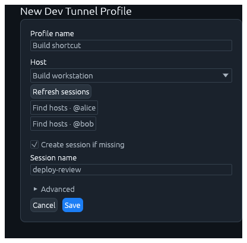
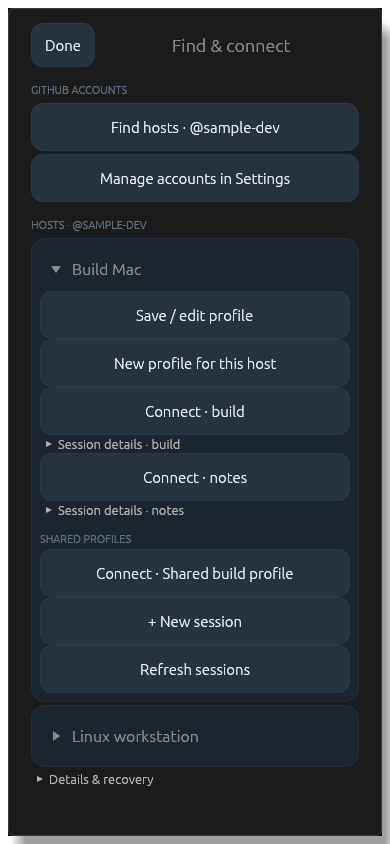

# Opt-in Dev Tunnels service-client lab campaign

This campaign uses the controlled GitHub identity **fes-festerm1**, actual Dev
Tunnels discovery/relay, the native credential store, protected HOST approval,
and production HOST client/session adapters. It is deliberately excluded from
ordinary tests. It does not create GitHub accounts, automate password entry,
accept credentials in job payloads, enroll an owner, weaken host verification,
or claim native GUI or iOS acceptance.

## Desktop and mobile matrix

The native campaign covers 24 cases: each direction below with generic shell
creation disabled and enabled. Directions name the server first.

| Server | Desktop clients | Mobile clients | Cases |
| --- | --- | --- | --- |
| Windows | macOS, Linux | iOS, Android | 8 |
| macOS | Windows, Linux | iOS, Android | 8 |
| Linux | Windows, macOS | iOS, Android | 8 |

Each case requires controlled-account discovery and exact owner approval,
advertised **Lab shared** and excluded **Lab private**, actual terminal I/O,
the expected generic-creation permission, exact detach and durable reconnect,
and screenshots on both server and client. Preserve issued identities after
uncertain results; expanding the matrix never authorizes replacement creates.

Mobile cases run the actual shared mobile client using `--host-clients` with
`scripts/build-ios-spike.py` or `scripts/build-android.py`. Record the exact app
source/build and whether execution used hardware, Simulator or emulator. Include
software-keyboard input and background/foreground reconnect. Simulator/emulator
results do not qualify physical-device lock, biometric or lifecycle gates.
The desktop service-client runner below cannot qualify mobile cases. Packaging,
headless fixtures and an available device do not count as a completed case.

## Fresh Copilot visual parity in every case

Fresh actual GitHub Copilot CLI visual parity is an active acceptance requirement
under DT-02 and MOB-06 for all 24 cases above, including Desktop, iOS and
Android clients in both creation-policy phases. A successful service-client
phase, old terminal recovery screen, captured byte replay or CPU renderer test
does not complete this requirement.

For each case, pair a fresh Copilot process in the server's local fesTerm shell
with a fresh Copilot process reached through the actual Dev Tunnels client.
The owner's acceptance scope is the initial Copilot screen, including its
unauthenticated welcome/sign-in screen. Neither controlled GitHub account has
Copilot enabled. No Copilot sign-in, plan activation, model selection or model
request is required for this comparison; Dev Tunnels authentication remains
required independently. Compare the same initial state on both sides.
Use the approved shared profile when generic creation is off; do not enable
creation or replace a durable generation merely to obtain a fresh application
process. Record the exact server/client app and helper source/build identities,
host/session generation and attachment, Copilot version and executable hash,
controlled working directory, shell and selected locale values. Pin the
same Copilot version, initial state, theme, font and font size/scale for the
comparison; record any unavoidable platform rendering difference explicitly.

Before launching either process, settle both terminal viewports at the same
columns and rows (for example 100 by 32). Record each terminal content rectangle
in logical and physical pixels, display scale and font metrics, excluding app
chrome and the software keyboard. A matching outer window size is insufficient.
Observe the actual PTY size before the launch input is accepted, then resize to
a second matched grid and repeat the observation. Record the selected `TERM`,
`TERM_PROGRAM`, `COLORTERM`, `LANG`, `LC_ALL` and `LC_CTYPE` values, distinguishing
unset values. Use bounded actual query/reply observations for DA1/DA2, DSR and
supported color/mode queries; verify one response per request and compare the
local and remote results at the same cursor, viewport and palette state.
Static server terminal identity is permitted for these fesTerm clients; do not
infer missing capability transfer merely because the creation request has no
terminal metadata fields. Do not substitute synthetic xterm probe replies.

Capture the fresh local reference on the server and the corresponding actual
client screen at matching initial-screen checkpoints. Compare the visible
glyphs, backgrounds, wrapping, cursor and screen-mode behavior. Review each pair
for the same terminal layout and visible colors, with platform rasterization
and any varying initial-screen text identified separately. Retain both screenshots
and the bounded geometry/environment/query observations with the case identity.
Use only the dedicated controlled working directory; do not export arbitrary
terminal history, credentials, device codes or provider diagnostics. iOS/Android
evidence must show the actual application and its keyboard/rotation geometry, and identify hardware,
Simulator or emulator. A missing CLI, required runtime or usable Dev Tunnels
session leaves that case blocked. A missing Copilot entitlement does not block
the initial-screen comparison. Installation or a version command alone does
not establish an actual initial-screen visual comparison.

Keep the deterministic resize-before-input regressions separate from this native
visual evidence. Desktop retains input in its existing bounded queue while a
refused resize waits, retries the latest viewport and drains after acceptance.
Mobile forces a pending viewport resize before input; if it is still refused,
it reports **Input not sent: viewport resize rejected; disconnected.** The input
is not replayed. Check these paths, including sustained resize backpressure and
a superseded viewport, without claiming that a passing CPU test proves native
PTY ordering or Copilot appearance. Reuse the existing capture/render and client
controller harnesses; this requirement adds no VM adapter payload, mode or
protocol capability. Fresh native Copilot comparisons remain unqualified until
the paired records exist for every case.

## Protected create protocol and legacy reservations

New intents also pin `create_access = "owner_default"`. Microsoft documents
[creator-only private access by default](https://learn.microsoft.com/en-us/azure/developer/dev-tunnels/security#tunnel-access).
The native campaign received HTTP 400: individual-user ACL entries are currently
disabled by the service. New creates therefore omit access-control entries;
they never fall back to anonymous or organization access. Every resource query
explicitly requests the full ACL. New-mode receipts reject nonempty tunnel or
port ACLs and unknown ACL fields. The authenticated account, exact conditional
reservation and recorded resource incarnation remain required; an empty ACL is
not independent owner proof. Inner HOST key approval and creation grants remain
separate.

A missing access-policy field preserves the old `github_users` intent. Existing
bound receipts retain that exact policy for observation and host-token checks.
An unbound legacy reservation cannot be reinterpreted as an owner-default
request. The explicit authenticated-absence/archive Reconcile path below covers
both legacy TCP and legacy user-ACL intents; submitted/uncertain originals,
receipts and bindings cannot be retired through that path. Unknown policy
values refuse. A fresh reviewed Enable after successful retirement pins the new
policy and requires matching signed helpers.

New HOST cloud intents pin `create_protocol = "auto"` in the protected resource.
Microsoft's [port protocol contract](https://learn.microsoft.com/en-us/azure/developer/dev-tunnels/cli-commands#advanced-manage-dev-tunnel-ports)
supports `auto`, `http`, and `https`; the native campaign observed a definitive
HTTP 400 for the previous `tcp` request. The outer service protocol does not
change the inner SSH/HOST handshake, owner approval, private account ACL, or
shell creation grants. Receipt and host-token checks require the exact pinned
protocol as well as the existing resource and account bindings.

A protected resource without this field decodes as the legacy `tcp` intent.
Unknown values refuse. Provisioning never converts a legacy reservation to
`auto`, clears it, or issues a replacement ID. It refuses before credential
loading or network work, preserving both submitted/uncertain and unsubmitted
originals. `submitted = false` alone is not migration evidence.

Use the existing explicitly reviewed **Reconcile** action for an unsubmitted,
unbound legacy reservation with no receipt. It confirms the native account,
requires an authenticated exact-resource absence, then rechecks the exact
protected record, lifecycle snapshot and cancellation before retiring anything.
A present resource, submitted/uncertain original, receipt, binding, account
failure, or changed epoch refuses and preserves the journal. This path does
not delete a cloud resource or stop sessions.

Before clearing the reservation, Reconcile durably archives the exact original
private bytes. That archive also fences the old ticket: a crash before clearing,
or after clearing but before lifecycle release, cannot create a replacement on
that ticket. A subsequent Reconcile validates the archive and finishes only
that old lifecycle operation. Corrupt or mismatched archives refuse. After
Reconcile reaches Disabled, use a new reviewed **Enable** to obtain a later
epoch and a new pinned `auto` intent. The original archive remains preserved.
Do not delete or edit the private journal to continue the campaign. Uninstall
cannot retire an unbound reservation because it requires a bound receipt and
confirmed native stop; it is not a substitute for this recovery.

The previously released signed `festerm-host` 0.17.1 runtime contains the same
old protocol assumption. Updating the desktop source alone does not qualify
that runtime. Native campaign execution requires a reviewed, authenticated
candidate host bundle built with the protocol pin and exact receipt checks;
record its source, manifest and executable hashes separately from the old
signed bundle. Older runtimes reject the newly pinned resource schema rather
than receiving a silently changed intent.

## Scope and required fixtures

Use dedicated ordinary-user host and client VMs. The service-client runner
bounds Linux/macOS children with an owned process group. Windows uses an owned
kill-on-close Job: the child starts suspended with restricted inherited stdio
handles, is assigned and verified before resume, and the Job is terminated and
confirmed empty after either parent exit or timeout. Unavailable Job APIs,
refused assignment or unconfirmed cleanup are **blocked**, never pass.
Keep the host's signed service running while the client campaign executes. The VM lab must have a pinned,
reviewed fesTerm adapter that includes `dev-tunnel-workflow`, and the private host
configuration must explicitly allow that mode. The job payload remains `{}`.
The shared lab's usual exact-source staging, exclusive lock and watchdog apply.
Do not change unrelated VM security, permissions, snapshots or services.

The native runner regression suite is separate from the authenticated service
campaign:

```sh
python -m unittest discover -s scripts/tests -p test_dev_tunnel_workflow.py -v
```

At source `d0cf0a37ae0f4e1f23d15a52f590e5ea92b9b7c2`, the 2026-11-14 Windows
run using official CPython 3.13.17 ARM64 embedded passed 18 tests with one
Unix-permission-mode test skipped. The native Win32 layout/handle test and real
parent-exit, descendant cleanup, timeout and bounded-output cases executed.
This is process-ownership evidence only: authenticated service, native GUI and
iOS acceptance remain separate and unrun by this regression command.

On the host, use the normal fesTerm Settings/profile UI to:

1. Sign in as `fes-festerm1` using device authorization, enable remote access and
   choose that verified account. Setup requires the exact signed host bundle
   and working native service/vault prerequisites.
2. Save a dedicated durable local-shell profile named **Lab shared**, and opt it
   into this computer's host catalog. Use an ordinary POSIX, cmd or PowerShell
   shell that supports `echo`, without a startup TUI or interactive login task.
3. Save another durable profile named **Lab private**, leaving sharing off.
4. Start with **Allow remote clients to create shell sessions** off.

On the client, use the normal account and host-discovery UI to sign in as the
same controlled identity, independently verify the actual host binding and
fingerprint, prepare a client owner key in the native store, and separately
approve that exact key on the host. Grant inventory, shared-profile
start/attach and persistent-session permissions appropriate to the selected
phase. Save a Dev Tunnel recipe named **Lab host** for this exact host.
The account numeric ID, host ID, key and endpoint bindings remain enforced by
the production APIs; display-name matching does not grant authorization.

For interactive macOS setup, use `python3 scripts/run-macos-development.py
--output /absolute/private/new-client-run` from the checkout and keep its tracked
supervisor alive through testing. The directory must be new, outside the
checkout and under a trusted ordinary-user home. The launcher records the
isolated configuration at `new-client-run/config/festerm.toml` and the runtime
at `new-client-run/sessiond`. Retain those paths for the client campaign. On
Windows/Linux use the existing isolated native development/lab launch procedure
and its actual configuration/runtime paths. Do not point the campaign at a
personal production profile or copy a native vault between machines.

Account sign-in and host-local approval require the responsible operator. A
GitHub password or PAT is not an OAuth credential for this runner; the local
password record supplied in chat is never read by the runner or committed.
Complete GitHub's browser verification and any 2FA normally. The native store
must remain unlocked/available to the ordinary-user client process.

## Local operator record

Create `~/.festerm-lab/dev-tunnel-workflow.json` on the **client VM**, outside
source and artifacts. On Windows `~` is the ordinary user's profile directory.
The containing directory and native development directories must be private;
on Unix create them with mode `0700` and the record/configuration with `0600`.
Windows uses current-user-only ACLs, verified again by the native test. Existing
untrusted modes, aliases or ACLs are refused; the campaign never repairs them.

The record contains public fixture metadata and explicit input consent only:

```json
{
  "schema_version": 1,
  "account": "fes-festerm1",
  "configuration": "/absolute/private/new-client-run/config/festerm.toml",
  "runtime_root": "/absolute/private/new-client-run/sessiond",
  "recipe_name": "Lab host",
  "shared_profile_name": "Lab shared",
  "private_profile_name": "Lab private",
  "generic_logical": "REPLACE-WITH-A-NEW-CANONICAL-UUID",
  "denied_logical": "REPLACE-WITH-A-DIFFERENT-NEW-CANONICAL-UUID",
  "creation_allowed": false,
  "allow_shell_input": true,
  "shell": "posix"
}
```

Generate the two UUIDs once during fixture preparation, for example with
`python3 -c 'import uuid; print(uuid.uuid4()); print(uuid.uuid4())'`. Replace both
placeholders and keep those identities unchanged across runs. They must differ
from each other and from the shared profile's logical identity. The denied
logical identity must not already have a running session. Do not generate a
fresh logical ID to escape an uncertain result. Never add a password, token,
private key, arbitrary shell command or arbitrary executable to this record;
unknown fields are refused. `shell` must be `posix`, `powershell` or `cmd`,
matching both the shared fixture and host default generic shell. The fixed
probe assembles a fresh nonce remotely; its complete expected output is absent
from sent input, and only a terminated full output line passes.

## Execute both creation-policy phases

From the exact candidate checkout on the client VM:

```sh
python3 scripts/check_dev_tunnel_workflow.py --run --result /absolute/lab-artifacts/dev-tunnel-workflow-off.txt
```

The explicit `--run` permits real service calls and the fixed echo command in
the dedicated fixture shells. It does not grant new host permissions. The
runner first compiles the single ignored integration test with a 15-minute
build bound, then runs it with a 3-minute process-tree bound. Protocol, worker,
output and exact-detach bounds also apply inside the test.

The creation-off phase verifies:

- native stored credentials represent `fes-festerm1`, and GitHub confirms the
  expected numeric account identity;
- actual account-scoped discovery lists the selected HOST endpoint;
- pinned HOST resolution and protected owner authentication succeed;
- the opted-in shared profile is listed and the private profile is excluded;
- shared-profile start/resume works while generic shell creation is off;
- encrypted terminal input produces a fresh, non-echoed output marker;
- exact detach requires a confirmed Stopped receipt (AlreadyStopped does not
  qualify) and leaves the same durable logical session/generation available;
- another shared-profile ensure resumes the same generation;
- generic ensure of the dedicated missing denied logical identity receives an
  explicit host Denied response, rather than success or inferred absence.

Next use the **host UI** to enable generic remote creation, including any
required reviewed reconfiguration, and ensure the approved owner key separately
has creation authority. Change only `creation_allowed` to `true` in the operator
record. Rerun with a new evidence destination:

```sh
python3 scripts/check_dev_tunnel_workflow.py --run --result /absolute/lab-artifacts/dev-tunnel-workflow-on.txt
```

This phase repeats shared-profile checks and ensures the stable generic lab
logical session with the fixed nonblank name **fesTerm VM lab generic**. It
checks terminal I/O, exact detach, survival and a second ensure returning the
same logical/generation without a duplicate shell. Persistent fixture shells
remain intentionally available for subsequent inspection; the runner never
sends End or deletes tunnels. Disable remote access through the host UI after
operator inspection if no further campaign needs it.

The VM adapter invokes this same runner with fixed arguments and a result file
beneath the supplied artifact directory. For optional validation outside the
adapter, set both `FESTERM_RUN_OPTIONAL_VALIDATION=1` and
`FESTERM_RUN_DEV_TUNNEL_LAB=1`; the latter is never inferred from the global
optional-validation switch. A requested but blocked campaign fails the optional
aggregate, rather than silently becoming skipped/pass.

## Failure, reconciliation and evidence

Exit `0` means the selected **service-client** phase passed. Exit `2` means a
required operator/native prerequisite is blocked; exit `1` means build,
protocol, fixture assertion or timeout failure. A zero-test selection and a
successful exit without the exact completion marker are failures. Child output
is drained nonblockingly into a bounded private memory tail, never copied into
evidence. The owned POSIX group is terminated after normal parent exit as well
as timeout/interruption, with unconditional SIGKILL after the short grace even
if the direct parent already exited. No reader thread or blocking pipe close
can extend the deadline.
The exported result contains only account label, scope, classification and
`gui_acceptance=unrun`; it contains no credentials, terminal history or raw
provider diagnostics.

Before generic ensure is issued, its exact operation is captured through the
existing native protected-original store. Any recovered original stops an
unattended rerun and requires explicit operator reconciliation. Only a
correlated, confirmed response followed by successful exact detach/survival, or
the expected explicit denial, permits local removal of that exact original.
Unknown, lost or failed outcomes retain their original identity. Cancellation
never triggers a replacement create. No cleanup targets a session by display
name or broadly kills host helpers.

This campaign does **not** pass first-time GUI setup, form-open networking,
Save-versus-Connect interactions, clipboard/browser delivery, account-switch
usability, disable/revocation, changed host identity, accessibility, or iOS
Keychain/device/suspension acceptance. Execute those as separately recorded
native UI/device scenarios against the same pinned source. A protocol pass must
not hide a failed or unperformed UI scenario.

## Updated UI review captures

The follow-up repair includes eight [Desktop captures](images/dev-tunnel-workflow/desktop/manifest.json)
and twelve [phone/tablet captures](images/dev-tunnel-workflow/mobile/manifest.json).
Their manifests bind image hashes to an unchanged source fingerprint. These are
production widgets with synthetic fixtures, not evidence of native sign-in,
provider access, hosting readiness or physical-device acceptance.




