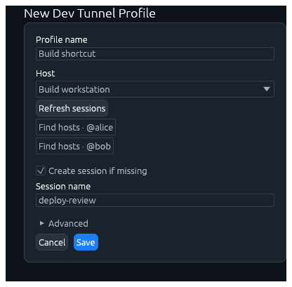
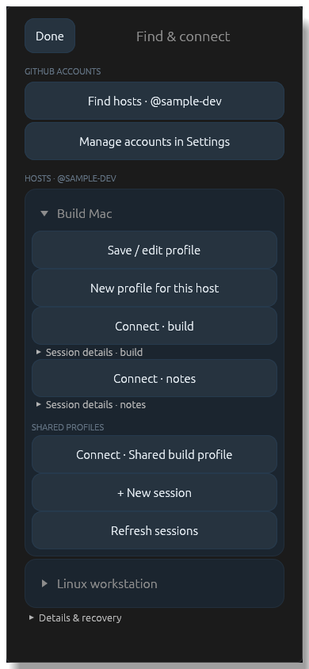

# Opt-in Dev Tunnels service-client lab campaign

This campaign uses the controlled GitHub identity **fes-festerm1**, actual Dev
Tunnels discovery/relay, the native credential store, protected HOST approval,
and production HOST client/session adapters. It is deliberately excluded from
ordinary tests. It does not create GitHub accounts, automate password entry,
accept credentials in job payloads, enroll an owner, weaken host verification,
or claim native GUI or iOS acceptance.

## Scope and required fixtures

Use dedicated ordinary-user host and client VMs. The service-client runner
bounds Linux/macOS children with an owned process group. Windows uses an owned
kill-on-close Job: the child starts suspended with restricted inherited stdio
handles, is assigned and verified before resume, and the Job is terminated and
confirmed empty after either parent exit or timeout. Unavailable Job APIs,
refused assignment or unconfirmed cleanup are **blocked**, never pass.
Keep the host's signed service running while the client campaign executes. The VM lab must have a pinned,
reviewed fesTerm adapter that includes `dev-tunnel-workflow`, and the private host
configuration must explicitly allow that mode. The job payload remains `{}`.
The shared lab's usual exact-source staging, exclusive lock and watchdog apply.
Do not change unrelated VM security, permissions, snapshots or services.

The native runner regression suite is separate from the authenticated service
campaign:

```sh
python -m unittest discover -s scripts/tests -p test_dev_tunnel_workflow.py -v
```

At source `d0cf0a37ae0f4e1f23d15a52f590e5ea92b9b7c2`, the 2026-11-14 Windows
run using official CPython 3.13.17 ARM64 embedded passed 18 tests with one
Unix-permission-mode test skipped. The native Win32 layout/handle test and real
parent-exit, descendant cleanup, timeout and bounded-output cases executed.
This is process-ownership evidence only: authenticated service, native GUI and
iOS acceptance remain separate and unrun by this regression command.

On the host, use the normal fesTerm Settings/profile UI to:

1. Sign in as `fes-festerm1` using device authorization, enable remote access and
   choose that verified account. Setup requires the exact signed host bundle
   and working native service/vault prerequisites.
2. Save a dedicated durable local-shell profile named **Lab shared**, and opt it
   into this computer's host catalog. Use an ordinary POSIX, cmd or PowerShell
   shell that supports `echo`, without a startup TUI or interactive login task.
3. Save another durable profile named **Lab private**, leaving sharing off.
4. Start with **Allow remote clients to create shell sessions** off.

On the client, use the normal account and host-discovery UI to sign in as the
same controlled identity, independently verify the actual host binding and
fingerprint, prepare a client owner key in the native store, and separately
approve that exact key on the host. Grant inventory, shared-profile
start/attach and persistent-session permissions appropriate to the selected
phase. Save a Dev Tunnel recipe named **Lab host** for this exact host.
The account numeric ID, host ID, key and endpoint bindings remain enforced by
the production APIs; display-name matching does not grant authorization.

For interactive macOS setup, use `python3 scripts/run-macos-development.py
--output /absolute/private/new-client-run` from the checkout and keep its tracked
supervisor alive through testing. The directory must be new, outside the
checkout and under a trusted ordinary-user home. The launcher records the
isolated configuration at `new-client-run/config/festerm.toml` and the runtime
at `new-client-run/sessiond`. Retain those paths for the client campaign. On
Windows/Linux use the existing isolated native development/lab launch procedure
and its actual configuration/runtime paths. Do not point the campaign at a
personal production profile or copy a native vault between machines.

Account sign-in and host-local approval require the responsible operator. A
GitHub password or PAT is not an OAuth credential for this runner; the local
password record supplied in chat is never read by the runner or committed.
Complete GitHub's browser verification and any 2FA normally. The native store
must remain unlocked/available to the ordinary-user client process.

## Local operator record

Create `~/.festerm-lab/dev-tunnel-workflow.json` on the **client VM**, outside
source and artifacts. On Windows `~` is the ordinary user's profile directory.
The containing directory and native development directories must be private;
on Unix create them with mode `0700` and the record/configuration with `0600`.
Windows uses current-user-only ACLs, verified again by the native test. Existing
untrusted modes, aliases or ACLs are refused; the campaign never repairs them.

The record contains public fixture metadata and explicit input consent only:

```json
{
  "schema_version": 1,
  "account": "fes-festerm1",
  "configuration": "/absolute/private/new-client-run/config/festerm.toml",
  "runtime_root": "/absolute/private/new-client-run/sessiond",
  "recipe_name": "Lab host",
  "shared_profile_name": "Lab shared",
  "private_profile_name": "Lab private",
  "generic_logical": "REPLACE-WITH-A-NEW-CANONICAL-UUID",
  "denied_logical": "REPLACE-WITH-A-DIFFERENT-NEW-CANONICAL-UUID",
  "creation_allowed": false,
  "allow_shell_input": true,
  "shell": "posix"
}
```

Generate the two UUIDs once during fixture preparation, for example with
`python3 -c 'import uuid; print(uuid.uuid4()); print(uuid.uuid4())'`. Replace both
placeholders and keep those identities unchanged across runs. They must differ
from each other and from the shared profile's logical identity. The denied
logical identity must not already have a running session. Do not generate a
fresh logical ID to escape an uncertain result. Never add a password, token,
private key, arbitrary shell command or arbitrary executable to this record;
unknown fields are refused. `shell` must be `posix`, `powershell` or `cmd`,
matching both the shared fixture and host default generic shell. The fixed
probe assembles a fresh nonce remotely; its complete expected output is absent
from sent input, and only a terminated full output line passes.

## Execute both creation-policy phases

From the exact candidate checkout on the client VM:

```sh
python3 scripts/check_dev_tunnel_workflow.py --run --result /absolute/lab-artifacts/dev-tunnel-workflow-off.txt
```

The explicit `--run` permits real service calls and the fixed echo command in
the dedicated fixture shells. It does not grant new host permissions. The
runner first compiles the single ignored integration test with a 15-minute
build bound, then runs it with a 3-minute process-tree bound. Protocol, worker,
output and exact-detach bounds also apply inside the test.

The creation-off phase verifies:

- native stored credentials represent `fes-festerm1`, and GitHub confirms the
  expected numeric account identity;
- actual account-scoped discovery lists the selected HOST endpoint;
- pinned HOST resolution and protected owner authentication succeed;
- the opted-in shared profile is listed and the private profile is excluded;
- shared-profile start/resume works while generic shell creation is off;
- encrypted terminal input produces a fresh, non-echoed output marker;
- exact detach requires a confirmed Stopped receipt (AlreadyStopped does not
  qualify) and leaves the same durable logical session/generation available;
- another shared-profile ensure resumes the same generation;
- generic ensure of the dedicated missing denied logical identity receives an
  explicit host Denied response, rather than success or inferred absence.

Next use the **host UI** to enable generic remote creation, including any
required reviewed reconfiguration, and ensure the approved owner key separately
has creation authority. Change only `creation_allowed` to `true` in the operator
record. Rerun with a new evidence destination:

```sh
python3 scripts/check_dev_tunnel_workflow.py --run --result /absolute/lab-artifacts/dev-tunnel-workflow-on.txt
```

This phase repeats shared-profile checks and ensures the stable generic lab
logical session with the fixed nonblank name **fesTerm VM lab generic**. It
checks terminal I/O, exact detach, survival and a second ensure returning the
same logical/generation without a duplicate shell. Persistent fixture shells
remain intentionally available for subsequent inspection; the runner never
sends End or deletes tunnels. Disable remote access through the host UI after
operator inspection if no further campaign needs it.

The VM adapter invokes this same runner with fixed arguments and a result file
beneath the supplied artifact directory. For optional validation outside the
adapter, set both `FESTERM_RUN_OPTIONAL_VALIDATION=1` and
`FESTERM_RUN_DEV_TUNNEL_LAB=1`; the latter is never inferred from the global
optional-validation switch. A requested but blocked campaign fails the optional
aggregate, rather than silently becoming skipped/pass.

## Failure, reconciliation and evidence

Exit `0` means the selected **service-client** phase passed. Exit `2` means a
required operator/native prerequisite is blocked; exit `1` means build,
protocol, fixture assertion or timeout failure. A zero-test selection and a
successful exit without the exact completion marker are failures. Child output
is drained nonblockingly into a bounded private memory tail, never copied into
evidence. The owned POSIX group is terminated after normal parent exit as well
as timeout/interruption, with unconditional SIGKILL after the short grace even
if the direct parent already exited. No reader thread or blocking pipe close
can extend the deadline.
The exported result contains only account label, scope, classification and
`gui_acceptance=unrun`; it contains no credentials, terminal history or raw
provider diagnostics.

Before generic ensure is issued, its exact operation is captured through the
existing native protected-original store. Any recovered original stops an
unattended rerun and requires explicit operator reconciliation. Only a
correlated, confirmed response followed by successful exact detach/survival, or
the expected explicit denial, permits local removal of that exact original.
Unknown, lost or failed outcomes retain their original identity. Cancellation
never triggers a replacement create. No cleanup targets a session by display
name or broadly kills host helpers.

This campaign does **not** pass first-time GUI setup, form-open networking,
Save-versus-Connect interactions, clipboard/browser delivery, account-switch
usability, disable/revocation, changed host identity, accessibility, or iOS
Keychain/device/suspension acceptance. Execute those as separately recorded
native UI/device scenarios against the same pinned source. A protocol pass must
not hide a failed or unperformed UI scenario.

## Updated UI review captures

The follow-up repair includes eight [Desktop captures](images/dev-tunnel-workflow/desktop/manifest.json)
and twelve [phone/tablet captures](images/dev-tunnel-workflow/mobile/manifest.json).
Their manifests bind image hashes to an unchanged source fingerprint. These are
production widgets with synthetic fixtures, not evidence of native sign-in,
provider access, hosting readiness or physical-device acceptance.




