<!-- GENERATED FILE - do not edit directly.
     Screenshots:      scripts/capture-ui-state.sh
     Narrative source: docs/ui-state-narrative.md
     Rebuild:          python3 scripts/build_ui_state_doc.py -->

# State of the UI

**Inventory:** 479 captures; 454 distinct PNG hashes.

**Captured:** 2026-11-14T01:16:04.456256+00:00 (Darwin/arm64); HEAD `b5442194c601f02e8f7f624495173b8ea3737559`; dirty sources: `True`. 
**Source-tree SHA-256:** `2c76ebbe29e0bcbdcb194c3dcb79bb50feab4d16d781ee73a3b30bb32473d041`

## How to read this document

This is a finite audited inventory of fesTerm's production-widget surfaces,
intended for design and workflow review rather than as a manual.
It is regenerated, not written by hand: the screenshots come from the real
UI rendered against repository-owned fixture data, so the document cannot
drift from the product without the drift showing up as a changed picture.

Profile identities and document contents here are synthetic. Hosts are
`example.com`/`example.net` subdomains, addresses come from the
documentation-reserved ranges in
RFC 5737, and users are named `devuser`, `builder` and `operator`. Captures use
isolated user directories rather than personal configuration, credentials,
host keys, clipboard content or shell history.

Local editor and picker path bars are a remaining exception to synthetic
identity: they display the physical fixture location under the checkout.
The refreshed macOS headless batch uses the non-personal checkout root
`/Volumes/Storage/src/fesTerm`, but a checkout under a user's home can expose that user's name
and captures vary across worktrees. The pipeline is not yet PII-free by
construction. Public regeneration requires a non-personal checkout root and
path/metadata review until canonical synthetic document/picker display
identities are separated from isolated physical fixture I/O.

Coverage includes distinct forms, dialogs, menus, task, validation, refusal
and recovery presentations. Arbitrary content, every scroll offset and all
hover combinations are not separate surfaces. Native/system and genuinely
capability-gated gaps remain explicit below; a nearby screenshot cannot close
them. This inventory does not assert functional correctness or usability
acceptance. It records how the product currently *presents* itself.

Counts describe capture files, not a claim that every route has unique pixels.
Different intents can deliberately converge on the same bounded presentation
(for example refreshing update metadata before Download versus Install).
Equivalent frames retain separate route metadata; duplicate-image auditing
also checks that a supposed error, result or lower-region capture has not
silently remained on its initial screen.

The refreshed desktop batch has three intentional identical-image pairs:
`host-recipes-edit` / `host-recipes-edit-resume` both show the existing
ResumeOrCreate default; `save-as-small-ready-narrow` /
`save-as-large-ready-narrow` show the same initial visible directory rows
despite loading 12 versus 5,000 files; and `about-update-refresh-download` /
`about-update-refresh-install` share the production metadata-refresh busy
presentation. These are separate fixture requests, not extra visible surfaces.

The refreshed batch pairs this gallery with the
[per-screenshot entry/exit/source route map](ui-review-route-map.md) and
[mobile catalog](state-of-mobile-ui.md). Machine-readable desktop routes are
in `validation/ui-review-routes.json` and
`app/festerm/src/ui_gallery/experimental-routes.json`. Every published desktop
scene must resolve to an audited route; unknown or uncaptured route IDs fail
document generation. The manifest records image SHA-256, dimensions and capture
provenance, including the dirty source-tree fingerprint. HEAD alone is not the
identity of these test-fixture additions.

Headless evidence cannot show native menu bars, system permissions, browser
sign-in, biometric sheets, device keyboards or provider pickers. Those are
explicitly outside the captured set, not implied by a nearby screenshot.
Protected-capability states that cannot be constructed without changing their
authority contract are documented in the experimental and mobile catalogs.
See the refresh entry in [manual validation](manual-validation.md) for native
capture prerequisites. No visual/usability acceptance is claimed here.

Headless captures use the production blue-graphite dark visuals on the actual
rendering context, including built-in controls and popup frames. They retain
each scenario's fonts, viewport and crop; isolated widget pictures are not
full-window/native-desktop evidence. Editor and picker file contents are
synthetic; their displayed absolute paths currently name the capture
worktree's `target/ui-gallery-fixtures/`.

## Starting a session

The New Session tab is the application's front door, and it answers three
different questions at once: what kinds of session can I start, what have I
saved, and what is already running that I could rejoin.

Launch cards across the top cover local shell, SSH, experimental Dev Tunnel,
SFTP, serial and Markdown. Below them the view splits: saved profiles on the
left with search and sort, running sessions on the right grouped by the
provider that owns them. That right-hand panel is the part that distinguishes
fesTerm from a plain terminal: native `festerm-sessiond` sessions, tmux and
screen are listed side by side under one Reattach affordance, so reattaching
does not require knowing which multiplexer produced the session.

The compact variant exists because the launch cards are the least valuable
part of the view once a user has profiles. It shrinks the cards so the
profile and running-session panels start higher, while keeping the card
descriptions.

### New Session in the compact launcher-grid layout

The 'Compact New Session layout' preference shrinks the launch cards so saved profiles and running sessions start higher up the window.

**Enter:** New Session > Local/SSH/SFTP/Serial; choose destination/authentication or advanced options as captioned 
**Exit:** Back/Escape returns to New Session; a deliberate valid submit starts a session outside capture. 
**Production:** `screens::show_launcher`, `screens::show_ssh_form`, `screens::show_sftp_form`, `screens::SerialLauncherForm`

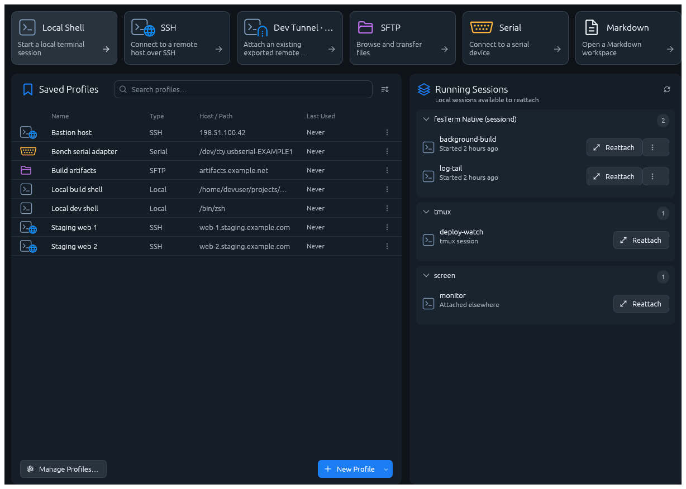

### New Session on first run, before any profile exists

The empty/first-run state: only the fixed launch cards, with no saved profiles or resumable sessions panels to show yet.

**Enter:** New Session > Local/SSH/SFTP/Serial; choose destination/authentication or advanced options as captioned 
**Exit:** Back/Escape returns to New Session; a deliberate valid submit starts a session outside capture. 
**Production:** `screens::show_launcher`, `screens::show_ssh_form`, `screens::show_sftp_form`, `screens::SerialLauncherForm`

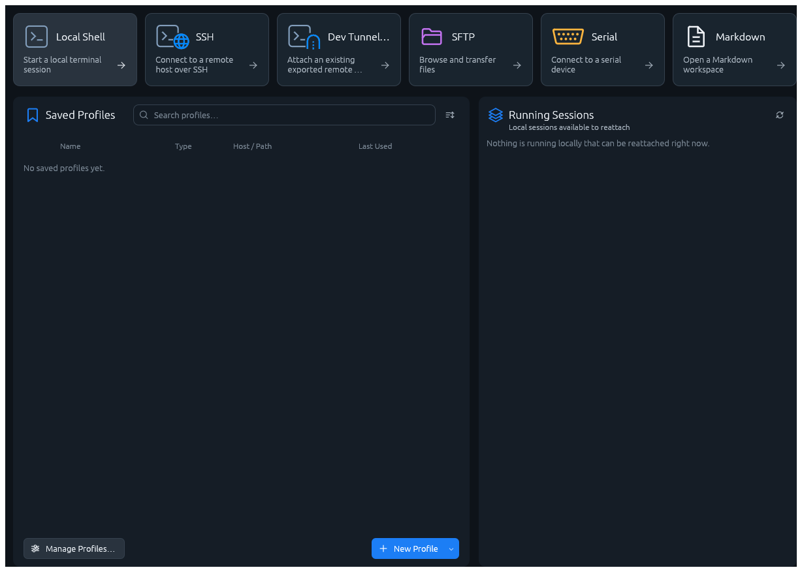

### New Session at a narrow, responsive width

The same populated launcher reflowing at a narrow window: cards and panels stack instead of sitting side by side.

**Enter:** New Session > Local/SSH/SFTP/Serial; choose destination/authentication or advanced options as captioned 
**Exit:** Back/Escape returns to New Session; a deliberate valid submit starts a session outside capture. 
**Production:** `screens::show_launcher`, `screens::show_ssh_form`, `screens::show_sftp_form`, `screens::SerialLauncherForm`

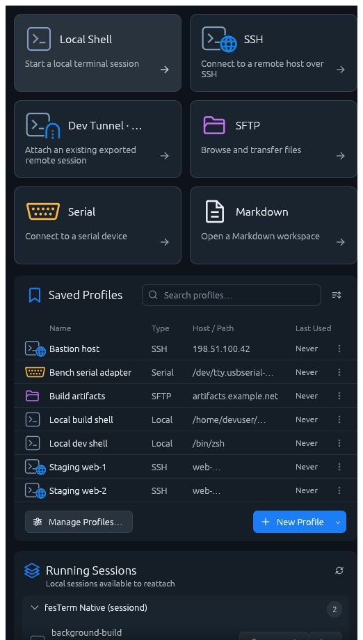

### New Session with saved profiles and running sessions

Launch cards sit above saved profiles of every kind plus resumable local, tmux, and screen sessions, at a normal desktop width.

**Enter:** New Session > Local/SSH/SFTP/Serial; choose destination/authentication or advanced options as captioned 
**Exit:** Back/Escape returns to New Session; a deliberate valid submit starts a session outside capture. 
**Production:** `screens::show_launcher`, `screens::show_ssh_form`, `screens::show_sftp_form`, `screens::SerialLauncherForm`

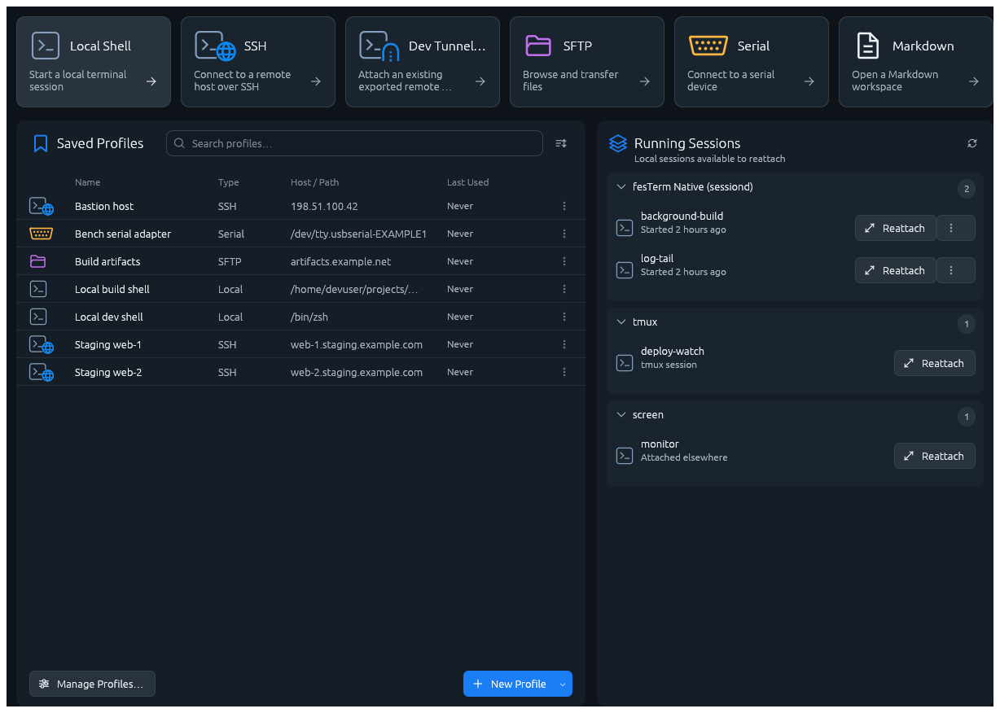

## Connecting

Each transport has its own form, and they share a deliberate shape: the
minimum needed to connect is visible immediately, and everything else is
behind *Advanced settings*. The SSH form separates that minimum into a
**Connection** section and an **Authentication** section (password,
private-key or certificate), with the durable-session toggle on its own band
beneath them; only port forwards remain folded away. Connection shows the
destination in one of two notations -- a single squashed `user@host:port`
field, or separate Username, Host and Port fields -- with a toggle on the
section heading that switches between them and carries the value across. The
squashed form is the fast path and the default, and the separate fields are
the legible alternative; showing both at once, as an earlier pass did, only
left the reader wondering which one the connection would actually use. The
Profiles editor for SSH and SFTP profiles renders this same pane, so a saved
profile opens with its destination already composed in the squashed field.
A first-time SSH connection therefore needs a username and a host, and
nothing else is in the way.

Two details worth noticing in review. Saving a password requires a saved
profile, and the form says so at the point of decision rather than failing
later. And the durable-session toggle explains what it will do — attach to a
named remote tmux or screen session, creating it when needed — because the
difference between a durable and an ordinary remote session is otherwise
invisible until something disconnects.

### Serial connect form

Serial launches ask only for a device path and line settings; there is no host/credential concept for a local serial device.

**Enter:** New Session > Local/SSH/SFTP/Serial; choose destination/authentication or advanced options as captioned 
**Exit:** Back/Escape returns to New Session; a deliberate valid submit starts a session outside capture. 
**Production:** `screens::show_launcher`, `screens::show_ssh_form`, `screens::show_sftp_form`, `screens::SerialLauncherForm`

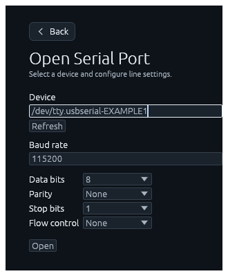

### SFTP connect form

The SFTP launch surface defaults to opening the graphical two-pane file manager once connected.

**Enter:** New Session > Local/SSH/SFTP/Serial; choose destination/authentication or advanced options as captioned 
**Exit:** Back/Escape returns to New Session; a deliberate valid submit starts a session outside capture. 
**Production:** `screens::show_launcher`, `screens::show_ssh_form`, `screens::show_sftp_form`, `screens::SerialLauncherForm`

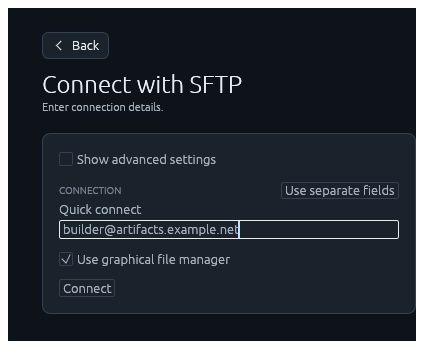

### SSH connect form with Advanced settings expanded

Expanding 'Advanced settings' reveals the port-forwarding controls beneath the always-visible connection, authentication and durable-session sections.

**Enter:** New Session > Local/SSH/SFTP/Serial; choose destination/authentication or advanced options as captioned 
**Exit:** Back/Escape returns to New Session; a deliberate valid submit starts a session outside capture. 
**Production:** `screens::show_launcher`, `screens::show_ssh_form`, `screens::show_sftp_form`, `screens::SerialLauncherForm`

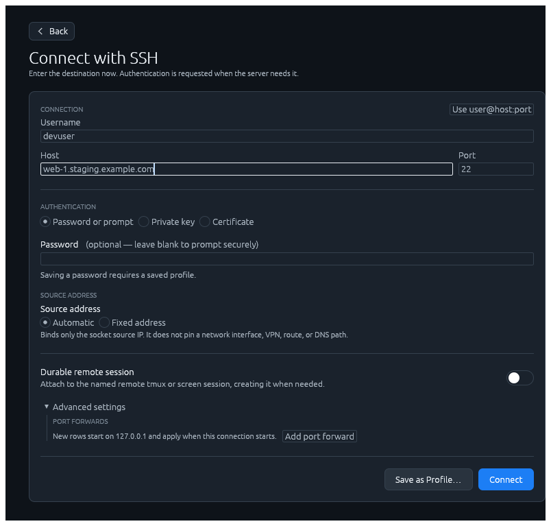

### SSH connect form

The default SSH launch surface: a Connection section led by the squashed user@host:port field and repeating it as Username, Host and Port, an Authentication section for the credential method, and the durable-remote-session toggle, with Advanced settings collapsed.

**Enter:** New Session > Local/SSH/SFTP/Serial; choose destination/authentication or advanced options as captioned 
**Exit:** Back/Escape returns to New Session; a deliberate valid submit starts a session outside capture. 
**Production:** `screens::show_launcher`, `screens::show_ssh_form`, `screens::show_sftp_form`, `screens::SerialLauncherForm`

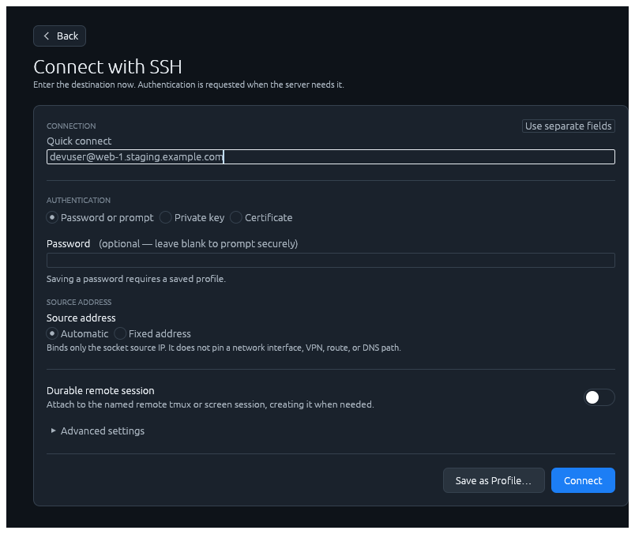

## Working in a session

A connected session is the point of the product, and the terminal surface is
deliberately the least decorated thing in it: no gutter, no persistent
sidebar, no ornament competing with the program's own output. Chrome gets out
of the way once a session is live.

The captures here show the same surface serving different kinds of work — an
interactive remote shell, the line-oriented `sftp` client, and the local
context menus over selected text and a detected path. The `sftp` capture is
worth including precisely because fesTerm also ships a graphical SFTP
workspace: the command-line client remains available and unmodified, and
choosing the GUI is a preference rather than a replacement. Users with muscle
memory for `get` and `put` keep it.

The context-menu pair makes two ownership boundaries visible. Copy and Paste
are local terminal actions rather than bytes sent to the remote program. A
detected path is frozen when the menu opens, then handed to application policy
for **Open in editor** while **Copy path** preserves its exact spelling.

### Copy and Paste in the terminal context menu

A selection remains visible while the terminal's context menu offers Copy and Paste alongside Find, without sending the secondary click to the remote program.

**Enter:** Start a synthetic terminal > normal/history/context/Find/focus-mode or captioned lifecycle state 
**Exit:** Close Find/menu with Escape; toggle Focus Mode again. Reconnect or close retained exited/disconnected history explicitly. 
**Production:** `festerm_ui_egui::TerminalView::show`, `app::FesTermApp::ui_content`

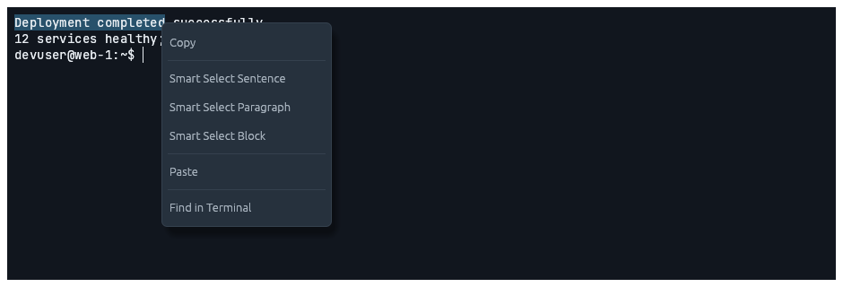

### Actions for a detected terminal path

Secondary-clicking a filesystem path freezes the detected target in the menu, where it can be opened in the editor or copied exactly as a path.

**Enter:** Start a synthetic terminal > normal/history/context/Find/focus-mode or captioned lifecycle state 
**Exit:** Close Find/menu with Escape; toggle Focus Mode again. Reconnect or close retained exited/disconnected history explicitly. 
**Production:** `festerm_ui_egui::TerminalView::show`, `app::FesTermApp::ui_content`

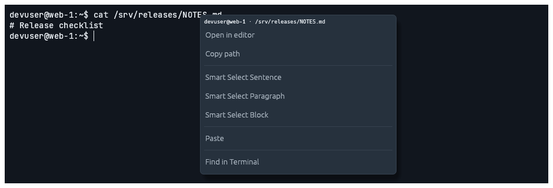

### The sftp command-line interface

The terminal-driven `sftp` client, distinct from the graphical file manager: directory listing, a `get`, and its transfer-progress line.

**Enter:** Start a synthetic terminal > normal/history/context/Find/focus-mode or captioned lifecycle state 
**Exit:** Close Find/menu with Escape; toggle Focus Mode again. Reconnect or close retained exited/disconnected history explicitly. 
**Production:** `festerm_ui_egui::TerminalView::show`, `app::FesTermApp::ui_content`

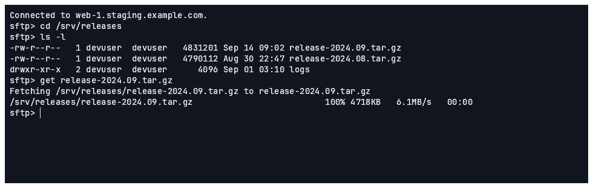

### A connected SSH terminal session

A remote shell mid-use: service status, a log tail, and the resting prompt, rendered by the same grid the terminal view paints for a real PTY.

**Enter:** Start a synthetic terminal > normal/history/context/Find/focus-mode or captioned lifecycle state 
**Exit:** Close Find/menu with Escape; toggle Focus Mode again. Reconnect or close retained exited/disconnected history explicitly. 
**Production:** `festerm_ui_egui::TerminalView::show`, `app::FesTermApp::ui_content`

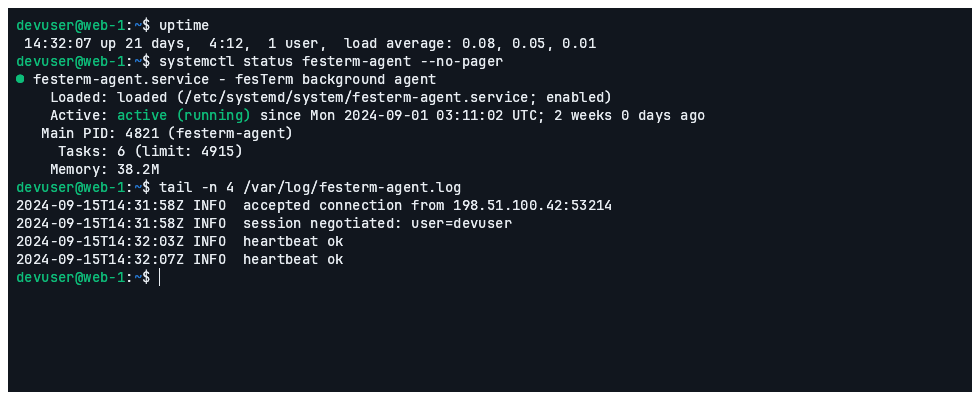

## The SFTP workspace

The graphical SFTP workspace is a two-pane browser: local on the left, remote
on the right, with the transfer direction made explicit by the two buttons
between them rather than implied by drag direction alone.

Several choices here are worth review. Each pane carries its own breadcrumb,
filter box and sort state, so the two sides are navigated independently. Each
pane's footer reports item count, selection count and selected size, which is
the information needed immediately before a transfer. The local pane is
labelled *This computer* and the remote pane carries the account and host it
is actually connected to, because the single most costly mistake in a file
manager is acting on the wrong side.

The pane order is configurable in Settings, for users who think of the remote
side as the primary one.

### The SFTP graphical file-manager workspace

Local and remote panes browsed side by side; the local pane lists an invented project directory, never the real filesystem.

**Enter:** New Session > SFTP > graphical file manager, or saved SSH/SFTP profile > Open SFTP; navigate/transfer as captioned 
**Exit:** Cancel collision or choose an explicit decision; Retry/Edit connection after error; close the SFTP chip to leave. 
**Production:** `sftp_file_manager::SftpFileManagerTab::show`, `sftp_file_manager::show_collision_modal`

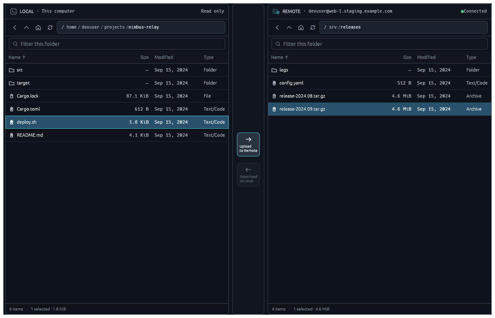

## Markdown workspaces

Markdown is a first-class surface rather than a preview pane, which follows
from where these files usually live: a README or runbook on the far end of an
SSH connection, reached over SFTP. Opening one should not require copying it
locally, and the header here shows a document opened directly from a remote
path.

Preview and Source are peers rather than a mode and its escape hatch, and the
outline is a navigation control — selecting a heading moves the document and
the outline tracks position. For a runbook consulted while something is
broken, that navigation matters more than the rendering does.

### Markdown workspace with the outline open

The heading outline docked alongside the document, letting a reader jump straight to a section of a longer file.

**Enter:** Remote SFTP Markdown selection opens the read-only viewer; choose Preview/Source/Contents or Viewer menu/right-click path 
**Exit:** Escape dismisses one popup; Close viewer returns to its source surface. No remote reload or clipboard action is executed by capture. 
**Production:** `markdown_viewer::MarkdownViewerTab::show`, `markdown_viewer::MarkdownViewerTab::show_toolbar`

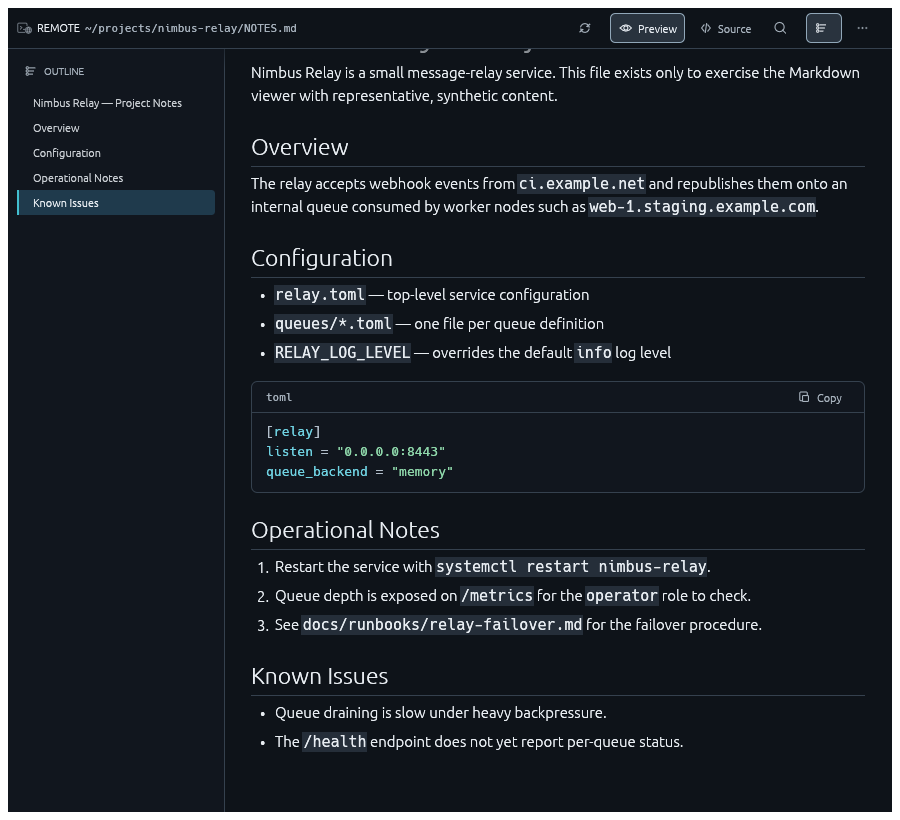

### Markdown workspace, rendered preview

A fictional project's Markdown fetched over an already-authenticated SFTP session, shown in rendered preview mode with headings, a list, and a code block.

**Enter:** Remote SFTP Markdown selection opens the read-only viewer; choose Preview/Source/Contents or Viewer menu/right-click path 
**Exit:** Escape dismisses one popup; Close viewer returns to its source surface. No remote reload or clipboard action is executed by capture. 
**Production:** `markdown_viewer::MarkdownViewerTab::show`, `markdown_viewer::MarkdownViewerTab::show_toolbar`

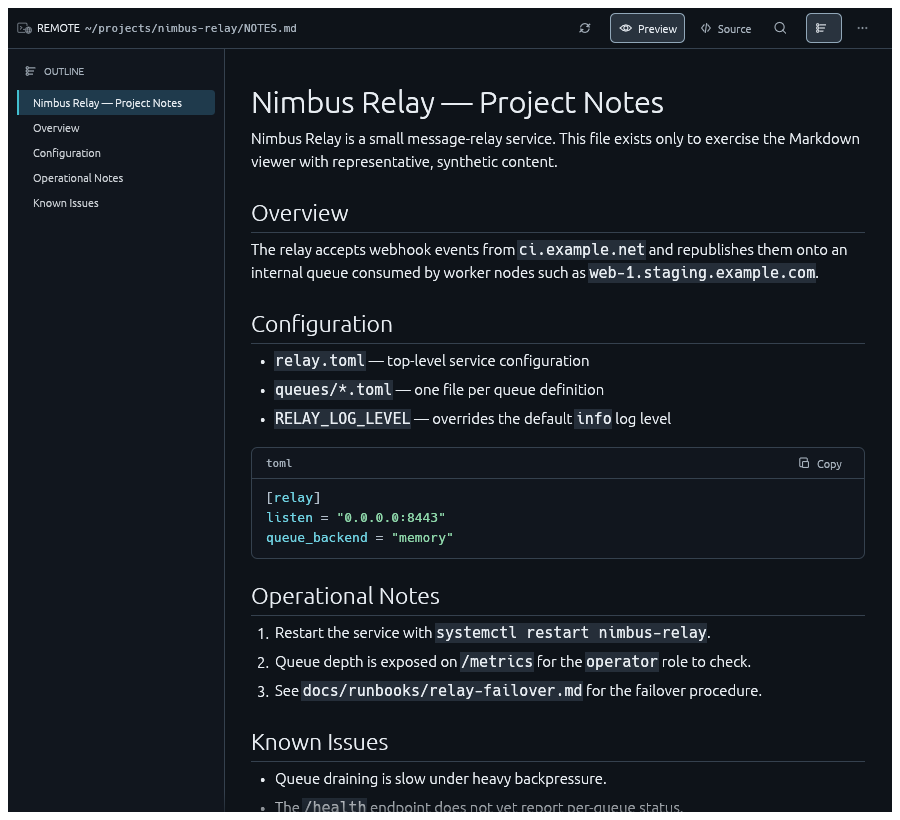

### Markdown workspace, source mode

The same document toggled to raw source, for readers who want to see the Markdown itself rather than its rendering.

**Enter:** Remote SFTP Markdown selection opens the read-only viewer; choose Preview/Source/Contents or Viewer menu/right-click path 
**Exit:** Escape dismisses one popup; Close viewer returns to its source surface. No remote reload or clipboard action is executed by capture. 
**Production:** `markdown_viewer::MarkdownViewerTab::show`, `markdown_viewer::MarkdownViewerTab::show_toolbar`

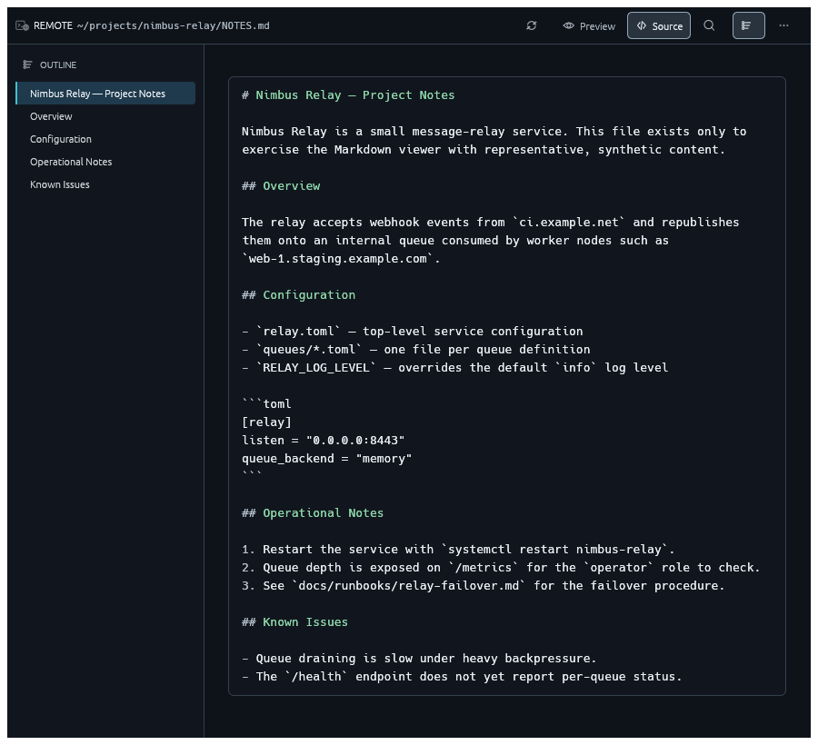

## Editing text

The editor exists because reading a remote runbook almost always turns into
changing one, and the alternative was leaving fesTerm for something else. Its
organising rule is that one open file is one document: every view of it shares
the same text, the same undo history and the same saved-or-not state, so two
windows on one file cannot disagree about what it contains.

That rule is what the first captures are about. The banner, the tab chip and
the status band are three reports of a single fact, and the chip states are
distinguishable by shape before they are distinguishable by colour. When the
file changes underneath an open document, the editor says so and then offers
Compare rather than asking anyone to choose blind; closing the last view of
unsaved text asks first, and names the file it is asking about.

Editing conveniences are per view, not per file. Line numbers, a fixed column
width, vi keys and syntax colour belong to the view they are switched on in —
another window on the same document keeps its own — while Find, replace and
the vi command area share one regular-expression dialect so there is nothing
to relearn between them. When vi keys are on, the view says which mode it is
in above the text as well as in the status bar, because a letter that has
quietly become a command is the worst kind of surprise.

Markdown is handled as a mode of the same tab rather than a separate viewer.
A Markdown file lands in Preview, reading as the finished thing, with the
mode control above it as the way to the source and Split showing both at
once. Source is coloured by role — keyword, string, type, comment — from the
same palette the preview's fenced code uses, so the two halves of a split view
agree about what a string looks like. Colour is a reading aid and nothing
more: it never carries meaning that the text does not already state, and when
a file is too large to parse within budget the editor says the colour is
missing and why.

### Compare, after the file changed underneath the editor

The conflict banner stays pinned above a read-only, line-oriented comparison of the unsaved version against the one the file now holds, so the choice is made with both versions in sight.

**Enter:** Open File > synthetic text/Markdown file > Edit/Preview/Split; perform the captioned Find/options/save/conflict/close trigger 
**Exit:** Close Find/options with Escape; resolve conflicts explicitly. Final dirty close offers Save, Discard changes or Cancel. 
**Production:** `text_editor::TextEditorTab::show`, `text_editor::show_banner`, `app::FesTermApp::show_document_close_confirmation`

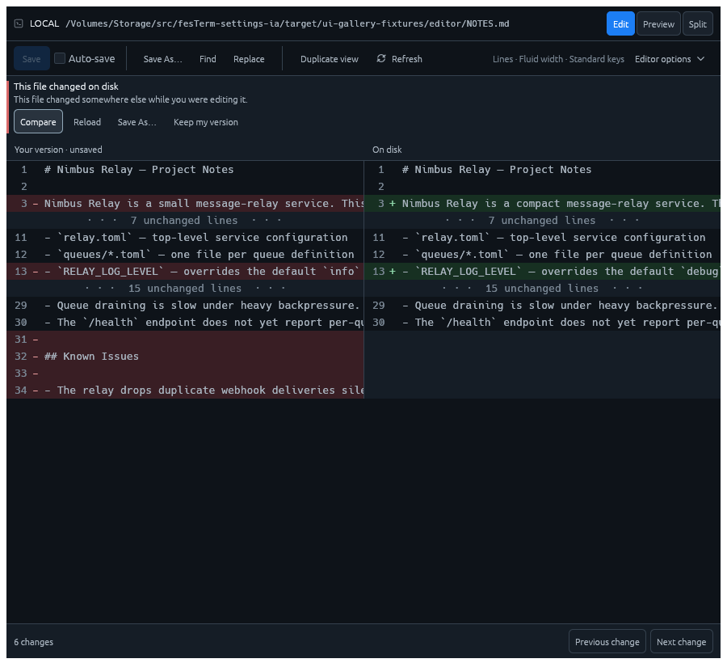

### A document's three states side by side on the chips

Saved, edited, and changed-underneath are three different shapes before they are three different colours, so the row still reads with the colour taken away.

**Enter:** Open File > synthetic text/Markdown file > Edit/Preview/Split; perform the captioned Find/options/save/conflict/close trigger 
**Exit:** Close Find/options with Escape; resolve conflicts explicitly. Final dirty close offers Save, Discard changes or Cancel. 
**Production:** `text_editor::TextEditorTab::show`, `text_editor::show_banner`, `app::FesTermApp::show_document_close_confirmation`

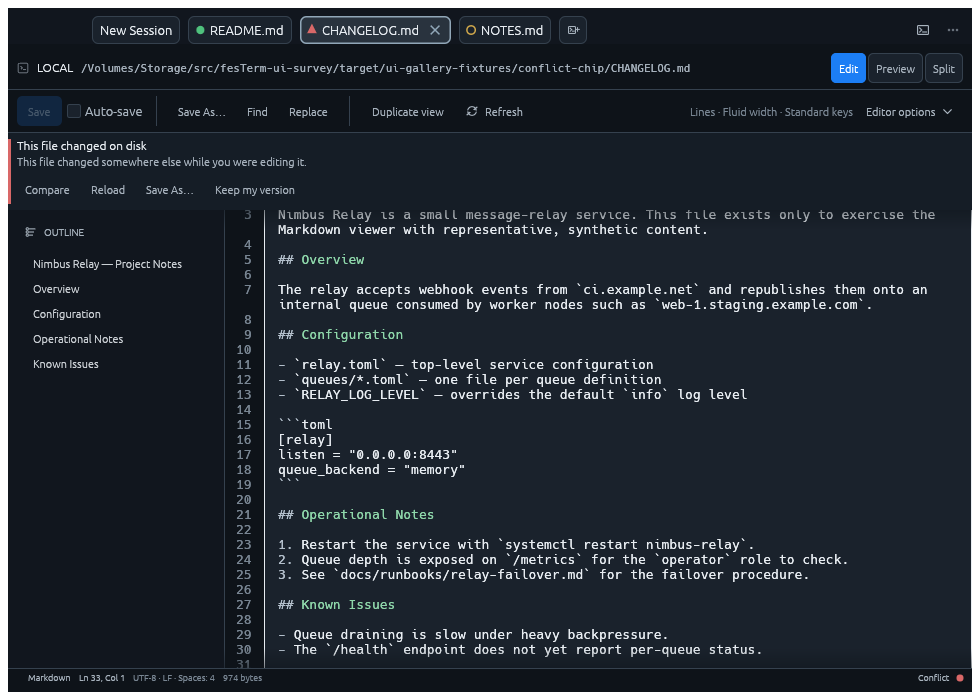

### Closing the last view of a document with unsaved changes

Closing the only remaining view of a typed-in document asks before anything is lost, names the file and where it lives, and makes Save the action the keyboard already has hold of.

**Enter:** Open File > synthetic text/Markdown file > Edit/Preview/Split; perform the captioned Find/options/save/conflict/close trigger 
**Exit:** Close Find/options with Escape; resolve conflicts explicitly. Final dirty close offers Save, Discard changes or Cancel. 
**Production:** `text_editor::TextEditorTab::show`, `text_editor::show_banner`, `app::FesTermApp::show_document_close_confirmation`

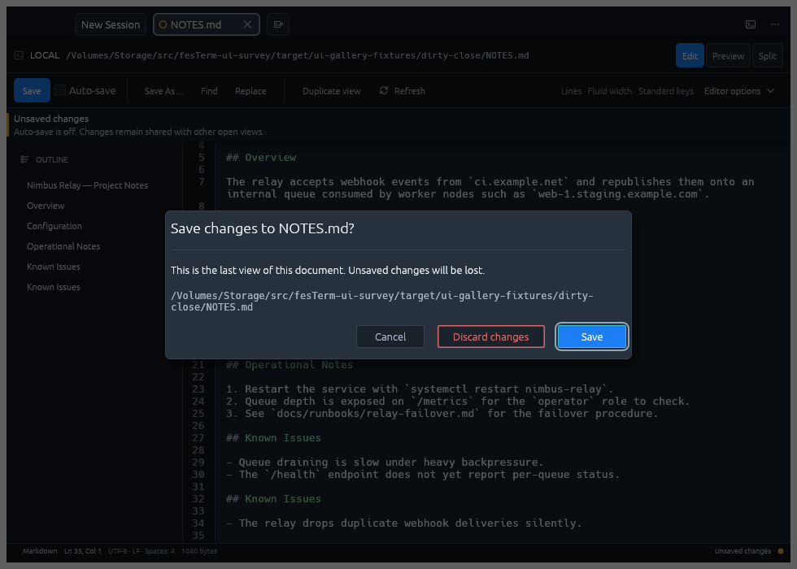

### Find and Replace over the open document

One regular-expression dialect for the toolbar and the command area alike, saying which match of how many is current before anything is replaced.

**Enter:** Open File > synthetic text/Markdown file > Edit/Preview/Split; perform the captioned Find/options/save/conflict/close trigger 
**Exit:** Close Find/options with Escape; resolve conflicts explicitly. Final dirty close offers Save, Discard changes or Cancel. 
**Production:** `text_editor::TextEditorTab::show`, `text_editor::show_banner`, `app::FesTermApp::show_document_close_confirmation`

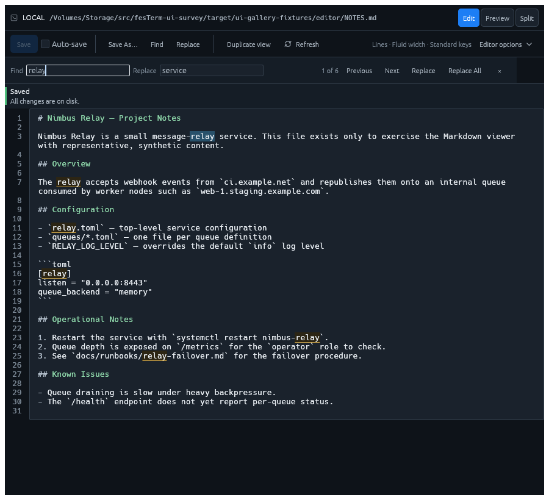

### The per-view editor options

Line numbers, a fixed column count and vi keys belong to this view alone: another window on the same file keeps its own, and none of them touches the text.

**Enter:** Open File > synthetic text/Markdown file > Edit/Preview/Split; perform the captioned Find/options/save/conflict/close trigger 
**Exit:** Close Find/options with Escape; resolve conflicts explicitly. Final dirty close offers Save, Discard changes or Cancel. 
**Production:** `text_editor::TextEditorTab::show`, `text_editor::show_banner`, `app::FesTermApp::show_document_close_confirmation`

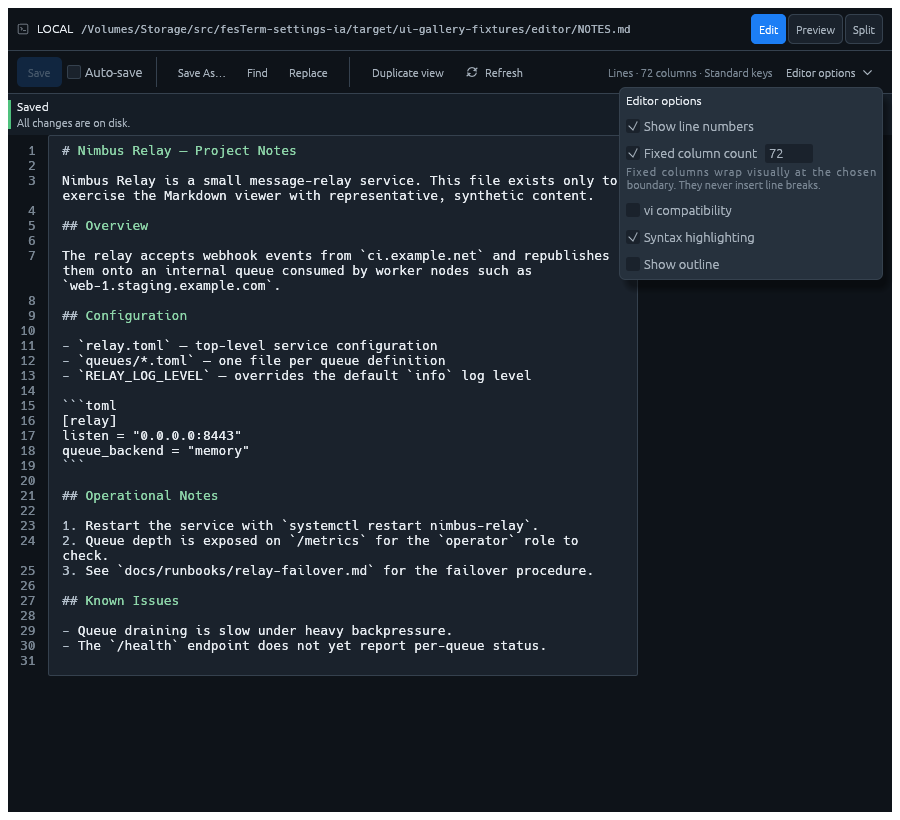

### The editor with the Markdown outline beside it

The same rail the Markdown viewer has, offered while the file renders as Markdown: the headings stay in reach without scrolling to find out where you are.

**Enter:** Open File > synthetic text/Markdown file > Edit/Preview/Split; perform the captioned Find/options/save/conflict/close trigger 
**Exit:** Close Find/options with Escape; resolve conflicts explicitly. Final dirty close offers Save, Discard changes or Cancel. 
**Production:** `text_editor::TextEditorTab::show`, `text_editor::show_banner`, `app::FesTermApp::show_document_close_confirmation`

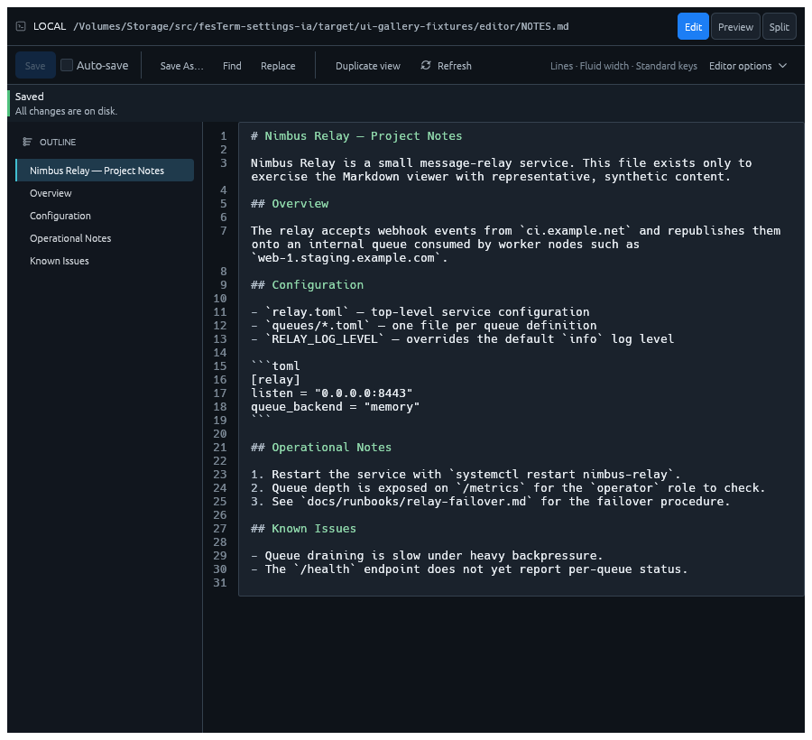

### A Markdown file as it opens

A Markdown document lands in Preview, reading as the finished thing; the mode control above it is the way back to the source.

**Enter:** Open File > synthetic text/Markdown file > Edit/Preview/Split; perform the captioned Find/options/save/conflict/close trigger 
**Exit:** Close Find/options with Escape; resolve conflicts explicitly. Final dirty close offers Save, Discard changes or Cancel. 
**Production:** `text_editor::TextEditorTab::show`, `text_editor::show_banner`, `app::FesTermApp::show_document_close_confirmation`

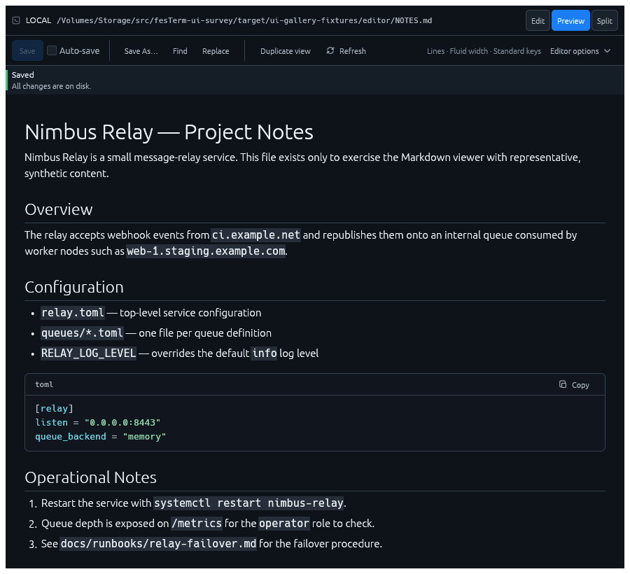

### Choosing where a document is written

One destination browser for both origins, stating an overwrite in words before the fact rather than asking a second time after the Save is already pressed.

**Enter:** Open File > synthetic text/Markdown file > Edit/Preview/Split; perform the captioned Find/options/save/conflict/close trigger 
**Exit:** Close Find/options with Escape; resolve conflicts explicitly. Final dirty close offers Save, Discard changes or Cancel. 
**Production:** `text_editor::TextEditorTab::show`, `text_editor::show_banner`, `app::FesTermApp::show_document_close_confirmation`

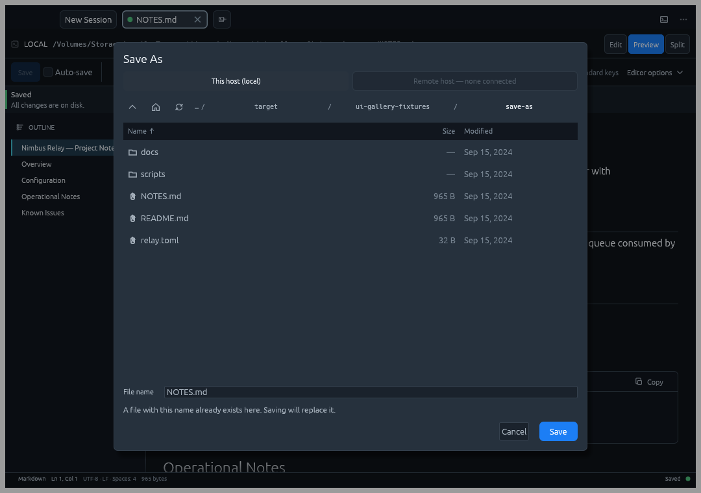

### The native editor, everything saved

A fictional project's notes open for editing, with the origin, the commands, and the status band the editor reports through.

**Enter:** Open File > synthetic text/Markdown file > Edit/Preview/Split; perform the captioned Find/options/save/conflict/close trigger 
**Exit:** Close Find/options with Escape; resolve conflicts explicitly. Final dirty close offers Save, Discard changes or Cancel. 
**Production:** `text_editor::TextEditorTab::show`, `text_editor::show_banner`, `app::FesTermApp::show_document_close_confirmation`

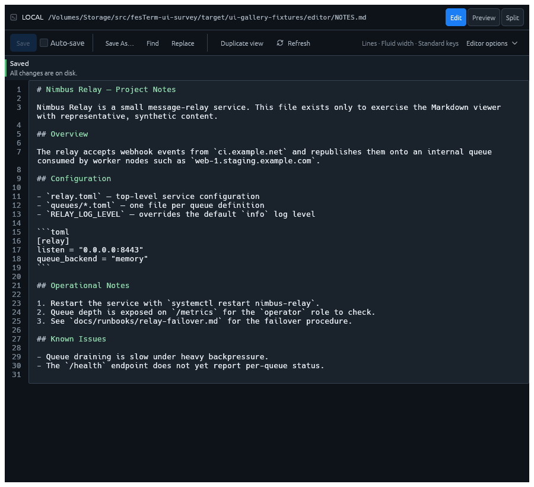

### The editor split with its live preview

One view, two panes: the text on the left and the same document rendered on the right, so a Markdown change can be read as it is typed.

**Enter:** Open File > synthetic text/Markdown file > Edit/Preview/Split; perform the captioned Find/options/save/conflict/close trigger 
**Exit:** Close Find/options with Escape; resolve conflicts explicitly. Final dirty close offers Save, Discard changes or Cancel. 
**Production:** `text_editor::TextEditorTab::show`, `text_editor::show_banner`, `app::FesTermApp::show_document_close_confirmation`

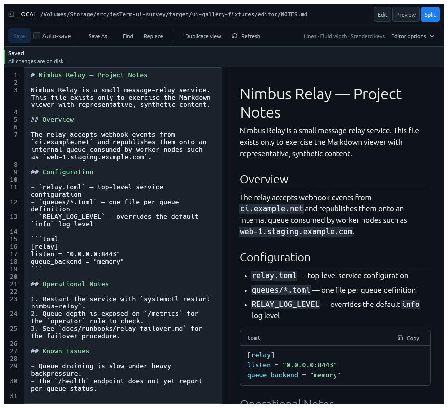

### Source coloured by what it means

Keywords, strings, numbers, types and comments are told apart by role rather than by language, from the same palette the Markdown preview's fenced code uses.

**Enter:** Open File > synthetic text/Markdown file > Edit/Preview/Split; perform the captioned Find/options/save/conflict/close trigger 
**Exit:** Close Find/options with Escape; resolve conflicts explicitly. Final dirty close offers Save, Discard changes or Cancel. 
**Production:** `text_editor::TextEditorTab::show`, `text_editor::show_banner`, `app::FesTermApp::show_document_close_confirmation`

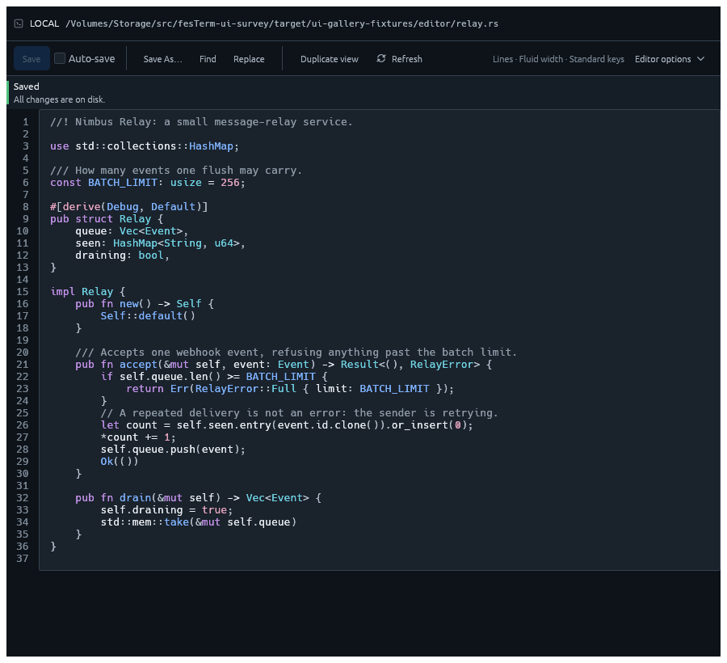

### The native editor holding unsaved changes

The same document after typing: the banner, the chip state, and the status band all report one unsaved document rather than disagreeing.

**Enter:** Open File > synthetic text/Markdown file > Edit/Preview/Split; perform the captioned Find/options/save/conflict/close trigger 
**Exit:** Close Find/options with Escape; resolve conflicts explicitly. Final dirty close offers Save, Discard changes or Cancel. 
**Production:** `text_editor::TextEditorTab::show`, `text_editor::show_banner`, `app::FesTermApp::show_document_close_confirmation`

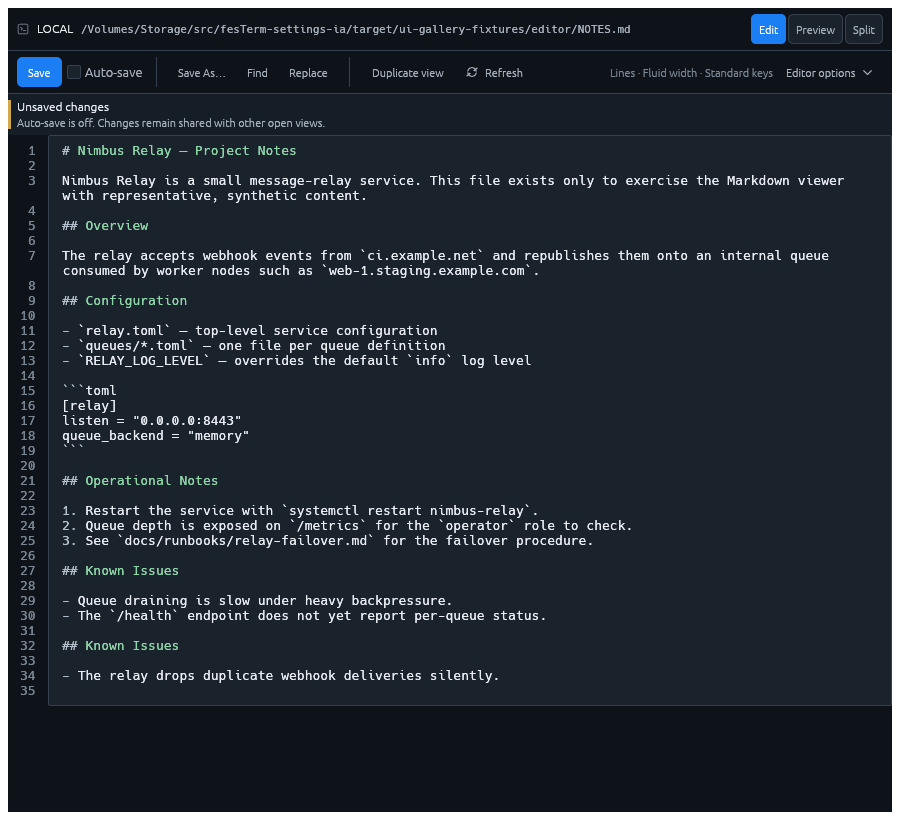

### The vi command area over the open document

One line above the persistent status bar, never in place of it: what the document is and where the caret sits stay readable while a command is being typed.

**Enter:** Open File > synthetic text/Markdown file > Edit/Preview/Split; perform the captioned Find/options/save/conflict/close trigger 
**Exit:** Close Find/options with Escape; resolve conflicts explicitly. Final dirty close offers Save, Discard changes or Cancel. 
**Production:** `text_editor::TextEditorTab::show`, `text_editor::show_banner`, `app::FesTermApp::show_document_close_confirmation`

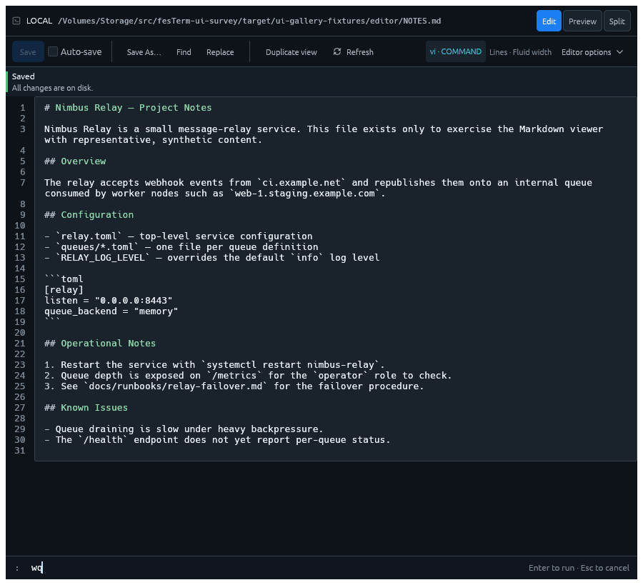

### A view with vi compatibility switched on

The view says which mode it is in, in words, above the text as well as in the status bar, so a letter behaving as a command is never a surprise.

**Enter:** Open File > synthetic text/Markdown file > Edit/Preview/Split; perform the captioned Find/options/save/conflict/close trigger 
**Exit:** Close Find/options with Escape; resolve conflicts explicitly. Final dirty close offers Save, Discard changes or Cancel. 
**Production:** `text_editor::TextEditorTab::show`, `text_editor::show_banner`, `app::FesTermApp::show_document_close_confirmation`

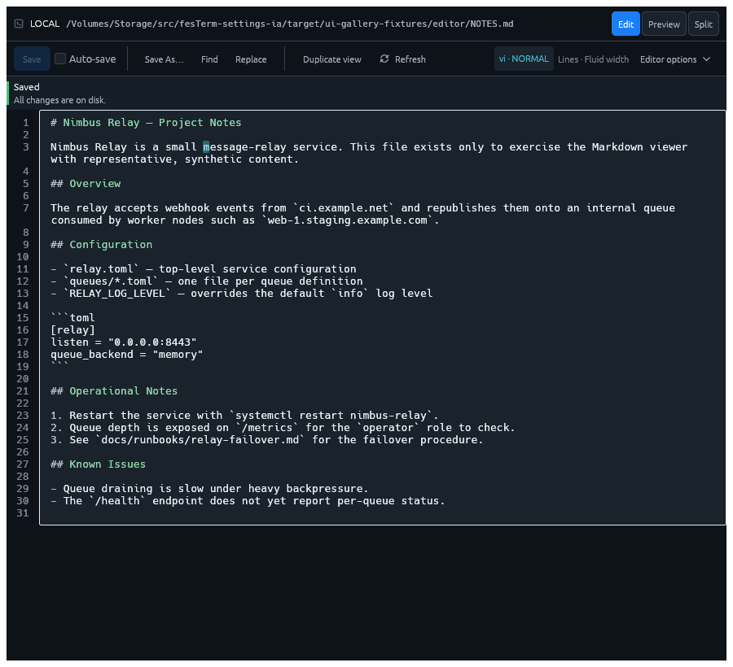

### A vi search matching as it is typed

The same regular-expression dialect the Find bar uses, counting what Enter is about to accept rather than what was last run.

**Enter:** Open File > synthetic text/Markdown file > Edit/Preview/Split; perform the captioned Find/options/save/conflict/close trigger 
**Exit:** Close Find/options with Escape; resolve conflicts explicitly. Final dirty close offers Save, Discard changes or Cancel. 
**Production:** `text_editor::TextEditorTab::show`, `text_editor::show_banner`, `app::FesTermApp::show_document_close_confirmation`

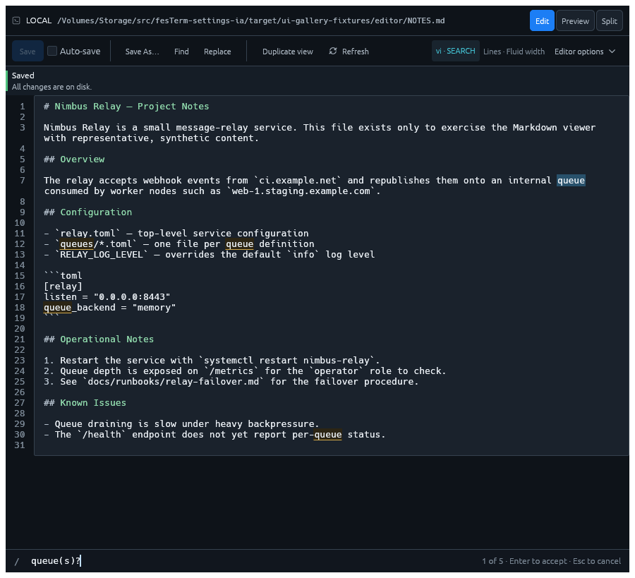

## Session diagnostics

The Session Inspector answers "what exactly am I connected to, and how?" — a
question that becomes urgent precisely when something is wrong and least
convenient to answer by reading scrollback.

It opens beside the session rather than over it, so the terminal stays visible
and readable while the facts are consulted. Content is grouped by what is
being asserted: session identity and grid geometry, the connection's
destination, username and transport, and trust — the key fingerprint and
whether verification is pending or settled. Grouping trust separately is
deliberate, since it is the part a user may need to compare against an
out-of-band source.

The second capture shows a durable multiplexer-backed session, where the facts
on offer differ: what matters is the multiplexer and the session name it can
be rejoined by.

### Session Inspector over a durable tmux session

The same overlay for a session attached through fesTerm's durable persistence provider, showing the extra 'Durable session' facts and 'Resume' (rather than 'Reconnect') action.

**Enter:** Live or retained session > More actions/palette > Session inspector; expand Diagnostics 
**Exit:** Close/Escape/outside click restores the prior viable focus owner without resizing the terminal. 
**Production:** `inspector::show`, `app::FesTermApp::ui_content`

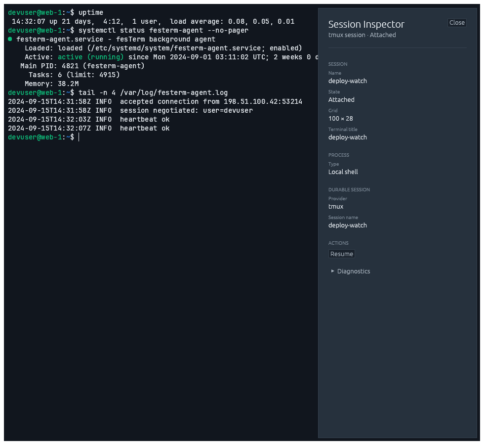

### Session Inspector over an SSH session

The inspector overlay reporting connection facts and a pending host-key fingerprint for a plain SSH shell, without covering the terminal it describes.

**Enter:** Live or retained session > More actions/palette > Session inspector; expand Diagnostics 
**Exit:** Close/Escape/outside click restores the prior viable focus owner without resizing the terminal. 
**Production:** `inspector::show`, `app::FesTermApp::ui_content`

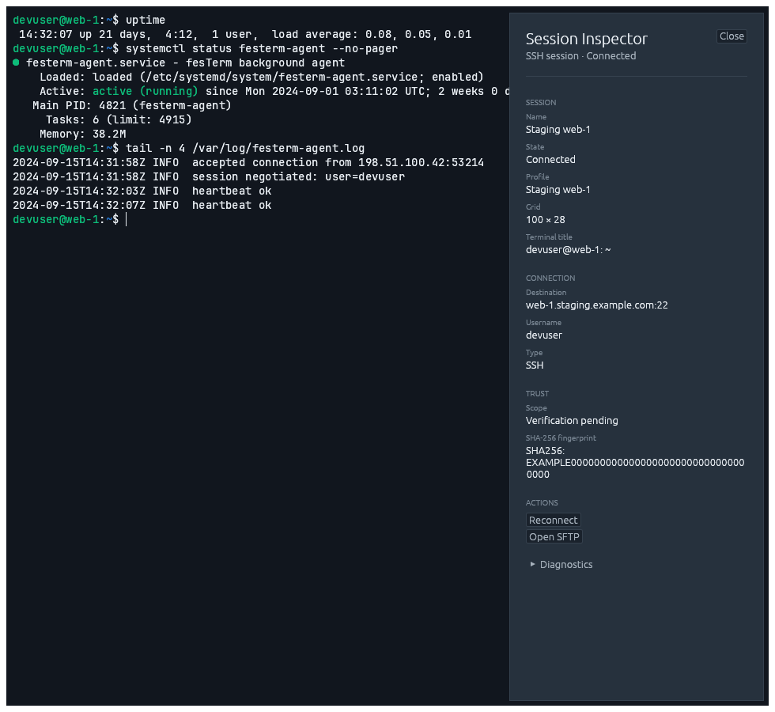

## Session chips

Chips are the persistent record of what is open. Each carries a status dot, a
name, and — in the verbose form — a second line of detail: the host for a
remote session, the multiplexer for a durable one, the file type for a
document. Only the active chip shows a close control, so a row of chips
presents one destructive affordance rather than one per session.

Unread background-session output uses a static dot inside a circle, in the
connection color, at both densities. It does not pulse or schedule animation
frames; activating the session clears it. There is no unread-output setting.

The two captures are the same five sessions under the two settings, which is
the only useful way to view this choice. Verbose chips carry the second line;
compact chips drop it and shrink to roughly half the height. The trade is
worth judging directly from the pair: the second line is what distinguishes
two sessions with similar names on different hosts, and it is also the thing
you stop reading once you know which chip is which.

Note what compact mode does *not* do — it does not abbreviate names, and it
does not drop the status dot. Reconnecting and healthy sessions stay
distinguishable at both densities.

The third capture shows the one piece of news this band ever volunteers: when
a background check finds a newer release, the trailing **More actions**
control grows a single accent dot. It is deliberately the quietest possible
notice — no dialog, no toast, no count — and it points at About, which is
where the download and install controls already live. Once the user has been
there, the dot is gone for that version.

### Session chips in compact mode

The identical five sessions with session details turned off: chips shrink to a single line, fitting more of them in the same row.

**Enter:** Upper window chrome > More actions or right-click the captioned session chip 
**Exit:** Escape/outside click dismisses menu; no chip close/move is dispatched during capture. 
**Production:** `festerm_ui_egui::chrome::show`

### Update-available badge on the overflow control

After a background check finds a newer release, the 'More actions' control carries a single accent dot until the user opens About; its menu gains an 'Update to fesTerm 0.3.0…' entry above the usual items.

**Enter:** Upper window chrome > More actions or right-click the captioned session chip 
**Exit:** Escape/outside click dismisses menu; no chip close/move is dispatched during capture. 
**Production:** `festerm_ui_egui::chrome::show`

### Session chips with details shown

The same five sessions with 'Show session details in chips' enabled: each chip carries a secondary line under its title.

**Enter:** Upper window chrome > More actions or right-click the captioned session chip 
**Exit:** Escape/outside click dismisses menu; no chip close/move is dispatched during capture. 
**Production:** `festerm_ui_egui::chrome::show`

## Settings

Settings is a single scrolling column of cards ordered by how often each is
reached for: Terminal, Startup & sessions, Window & tabs, Files & documents,
Dev Tunnels, Recording, Automation (Beta), Updates & privacy and finally
**Reset all settings…**. The two largest or most specialised groups —
Keyboard shortcuts and Remote access — are drill-in rows that open a sub-page
inside the same Settings tab, as is the live Automation activity; Back or
Escape returns to the row that opened it. Preferences that ship on (workspace
restore, the compact New Session layout, resuming unattached sessions) say
"On by default", and the reset confirmation lists exactly what it restores
and what it leaves alone. Every row carries a one-line explanation of what the setting
actually does, on the principle that a preference nobody can predict the
effect of is worse than no preference.

The cards are uniform width and the page owns the only scrollbar. This
matters more than it sounds: an earlier revision nested a scroll area inside
the page, which left the keyboard list showing three of thirty-five rows
inside a page that also scrolled.

### Settings: Terminal

The first Settings section: terminal font, ligatures and emoji, then scrollback and scroll speed, then mouse and selection.

**Enter:** More actions > Settings; scroll to the captioned card. Keyboard shortcuts › sub-page > choose action > Record shortcut or search. 
**Exit:** Cancel key recording or restore its prior binding; Back or Escape leaves a sub-page; select another chip or close Settings. Screenshot fixtures never persist changes. 
**Production:** `screens::settings::show_settings`, `keyboard::show_editor`

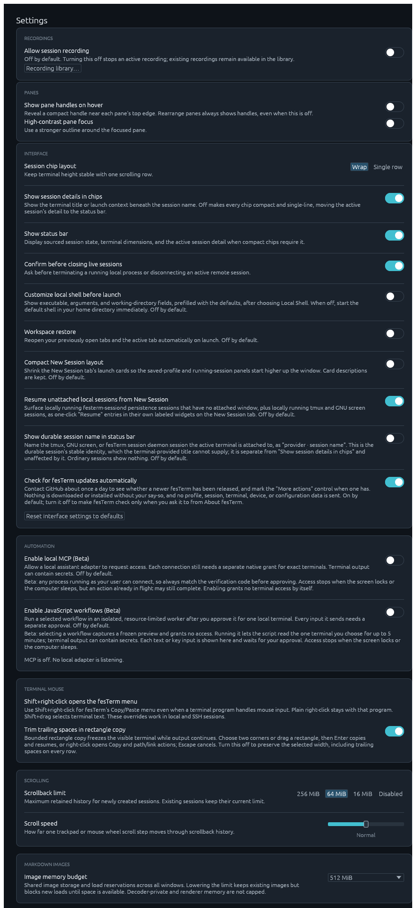

### Settings: Window & tabs

Chip layout and details, the status bar with its dependent durable-name row, quick-switch numbers, and pane appearance, followed by the Keyboard shortcuts drill-in row.

**Enter:** More actions > Settings; scroll to the captioned card. Keyboard shortcuts › sub-page > choose action > Record shortcut or search. 
**Exit:** Cancel key recording or restore its prior binding; Back or Escape leaves a sub-page; select another chip or close Settings. Screenshot fixtures never persist changes. 
**Production:** `screens::settings::show_settings`, `keyboard::show_editor`

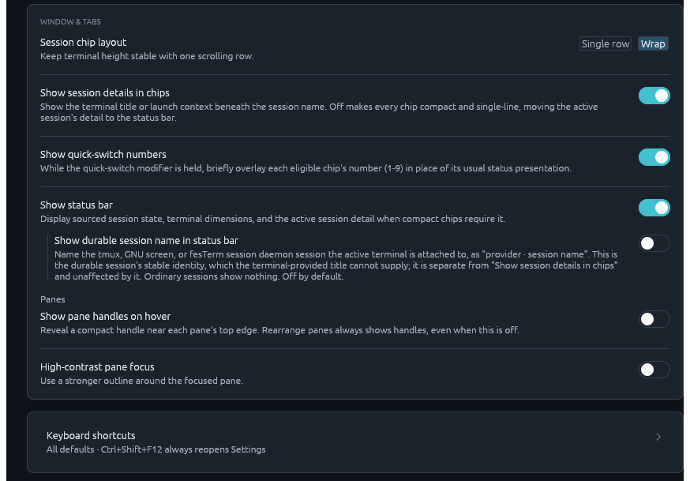

### Settings: Files & documents

SFTP pane order and default local directory, plus the Markdown image memory budget.

**Enter:** More actions > Settings; scroll to the captioned card. Keyboard shortcuts › sub-page > choose action > Record shortcut or search. 
**Exit:** Cancel key recording or restore its prior binding; Back or Escape leaves a sub-page; select another chip or close Settings. Screenshot fixtures never persist changes. 
**Production:** `screens::settings::show_settings`, `keyboard::show_editor`

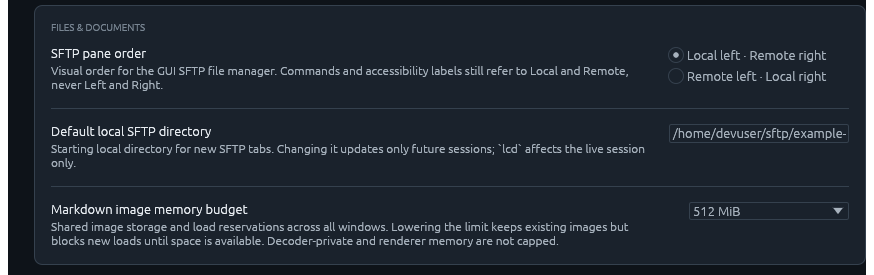

### Settings: Startup & sessions

Workspace restore and close confirmation, the local-shell launch preference, and the New Session tab options (on by default).

**Enter:** More actions > Settings; scroll to the captioned card. Keyboard shortcuts › sub-page > choose action > Record shortcut or search. 
**Exit:** Cancel key recording or restore its prior binding; Back or Escape leaves a sub-page; select another chip or close Settings. Screenshot fixtures never persist changes. 
**Production:** `screens::settings::show_settings`, `keyboard::show_editor`

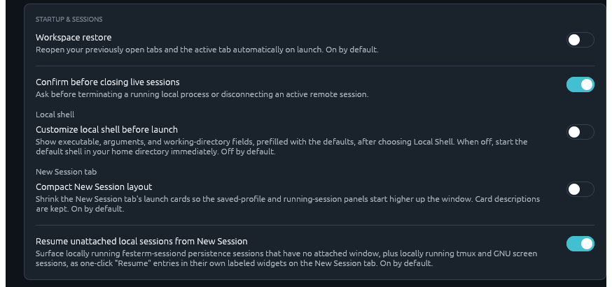

## Keyboard shortcuts

The keyboard editor is the most information-dense surface in the product and
had the most iteration, so it is worth reviewing closely.

Actions are grouped by the scope they apply in — global, terminal, Markdown,
document — because scope is what determines whether a chord reaches fesTerm
or the terminal underneath. Each action carries a one-line description, and
search matches both the title and that description. The *Show* filter narrows
to a single scope, or to just the customized or just the unbound actions.

Chords render as keycaps in columns anchored on the **right**, so the key
itself always lands in the same column and each chord stays contiguous. The
alternative — one fixed column per modifier — forces every row to reserve
space for modifiers it does not use and splits short chords across a gap. The
reasoning is the same as right-aligning numbers.

Selecting an action expands its editor inline beneath its own row, and
clicking the row again closes it. A binding is assigned by pressing
**Record shortcut** and then pressing the combination; capture takes the frame's
key events before the shortcut dispatcher sees them, so binding a shortcut
does not also fire it. Recorded modifiers are normalised to the portable
`Primary` spelling, which is Command on macOS and Ctrl elsewhere, so a chord
captured on one platform still validates on another.

Both resets are always present and disabled — with an explanation on hover —
when they would do nothing. This deliberately departs from the house rule
that a reset appears only for a non-default value, because applied literally
that rule answered "is there a way to undo this?" with silence.

### Keyboard bindings editor, collapsed

Actions grouped by scope, each showing its current chord as keycaps; one customized action carries a 'Customized' badge.

**Enter:** More actions > Settings; scroll to the captioned card. Keyboard shortcuts › sub-page > choose action > Record shortcut or search. 
**Exit:** Cancel key recording or restore its prior binding; Back or Escape leaves a sub-page; select another chip or close Settings. Screenshot fixtures never persist changes. 
**Production:** `screens::settings::show_settings`, `keyboard::show_editor`

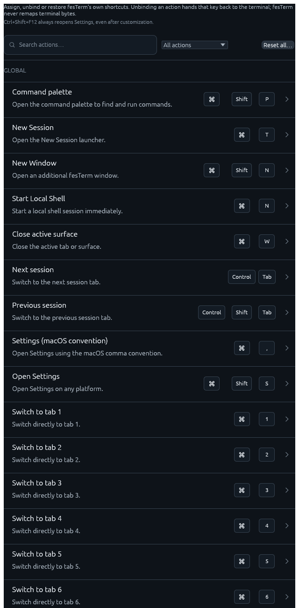

### Keyboard bindings editor filtered by search

Typing into Search narrows the list to matching actions and hides scope groups with no match.

**Enter:** More actions > Settings; scroll to the captioned card. Keyboard shortcuts › sub-page > choose action > Record shortcut or search. 
**Exit:** Cancel key recording or restore its prior binding; Back or Escape leaves a sub-page; select another chip or close Settings. Screenshot fixtures never persist changes. 
**Production:** `screens::settings::show_settings`, `keyboard::show_editor`

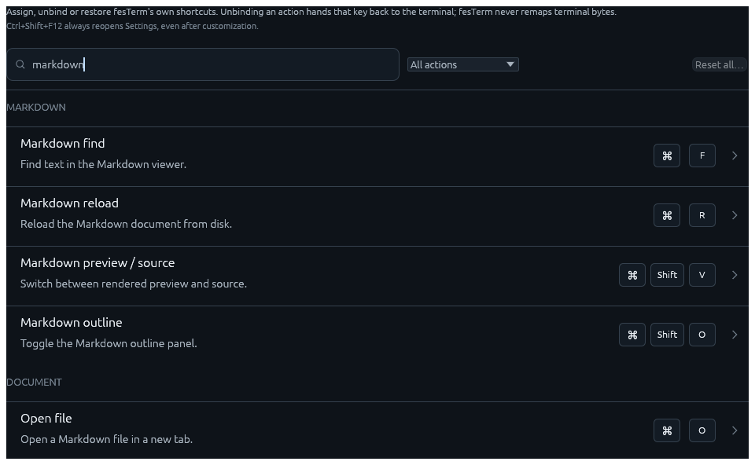

### Keyboard bindings editor capturing a chord

'Record shortcut' arms live chord capture; the editor waits for a chord instead of dispatching whatever is pressed next.

**Enter:** More actions > Settings; scroll to the captioned card. Keyboard shortcuts › sub-page > choose action > Record shortcut or search. 
**Exit:** Cancel key recording or restore its prior binding; Back or Escape leaves a sub-page; select another chip or close Settings. Screenshot fixtures never persist changes. 
**Production:** `screens::settings::show_settings`, `keyboard::show_editor`

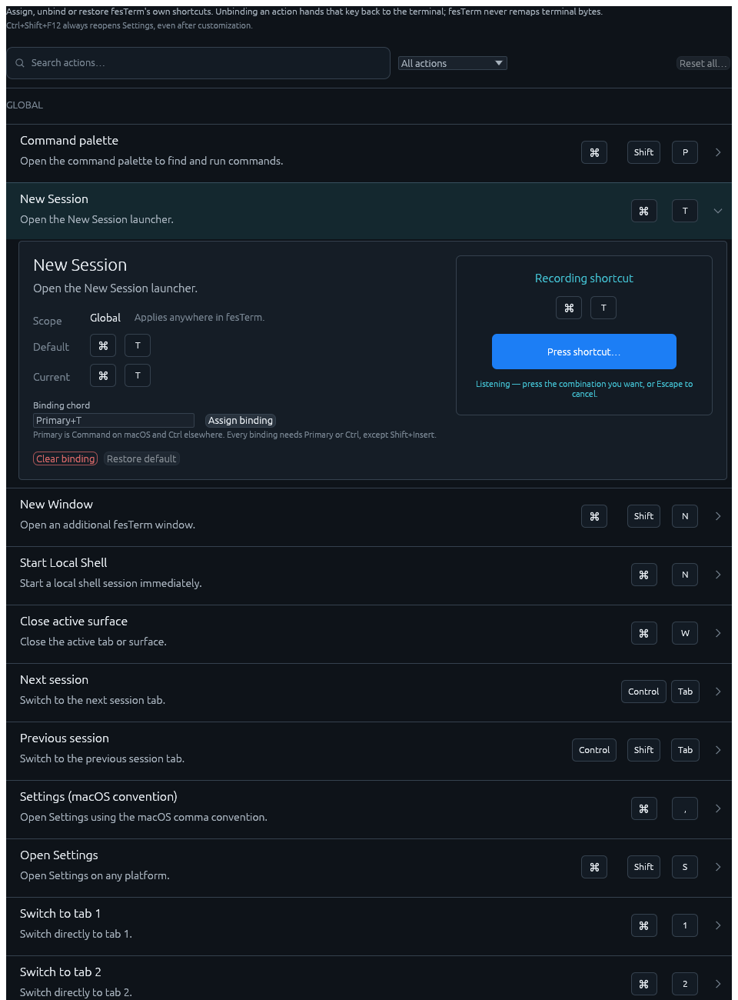

### Keyboard bindings editor with an action selected

Selecting an action expands its inline editor directly under its own row, showing scope, default, and current chord as read-only context.

**Enter:** More actions > Settings; scroll to the captioned card. Keyboard shortcuts › sub-page > choose action > Record shortcut or search. 
**Exit:** Cancel key recording or restore its prior binding; Back or Escape leaves a sub-page; select another chip or close Settings. Screenshot fixtures never persist changes. 
**Production:** `screens::settings::show_settings`, `keyboard::show_editor`

## Profiles

Profiles are the saved form of everything the connection forms can express,
and the editor is per-transport for the same reason the forms are: a serial
adapter and an SSH bastion have almost nothing in common to configure.

The review question here is less about the individual fields than about the
round trip — whether what a user builds in a connection form can be saved
without re-entering it, and whether a saved profile makes clear what it will
do before it is launched.

### Profiles list

Every saved local, SSH, SFTP, and serial profile in a single searchable table, each row carrying an overflow menu for connecting, editing, duplicating, and deleting.

**Enter:** More actions > Profiles > New Profile, saved row or row More actions; choose the captioned edit/delete/duplicate/search action 
**Exit:** Cancel discards staged edits; Save commits metadata. Dismiss row menus with Escape; deletion is separately confirmed and may be blocked by references. 
**Production:** `screens::profiles::show_profiles`, `screens::show_profile_row_menu`

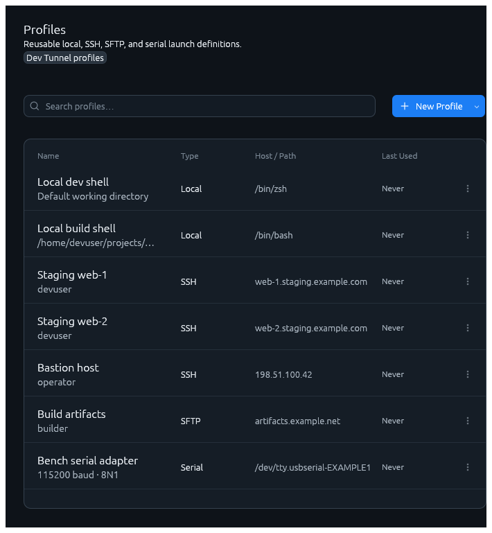

### Serial profile editor

Device path and line settings (baud, data bits, parity, stop bits, flow control) for a saved serial profile.

**Enter:** More actions > Profiles > New Profile, saved row or row More actions; choose the captioned edit/delete/duplicate/search action 
**Exit:** Cancel discards staged edits; Save commits metadata. Dismiss row menus with Escape; deletion is separately confirmed and may be blocked by references. 
**Production:** `screens::profiles::show_profiles`, `screens::show_profile_row_menu`

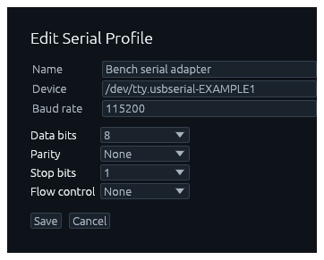

### SFTP profile editor

The same SSH-family editor in SFTP mode, offering the graphical file-manager toggle instead of a terminal type.

**Enter:** More actions > Profiles > New Profile, saved row or row More actions; choose the captioned edit/delete/duplicate/search action 
**Exit:** Cancel discards staged edits; Save commits metadata. Dismiss row menus with Escape; deletion is separately confirmed and may be blocked by references. 
**Production:** `screens::profiles::show_profiles`, `screens::show_profile_row_menu`

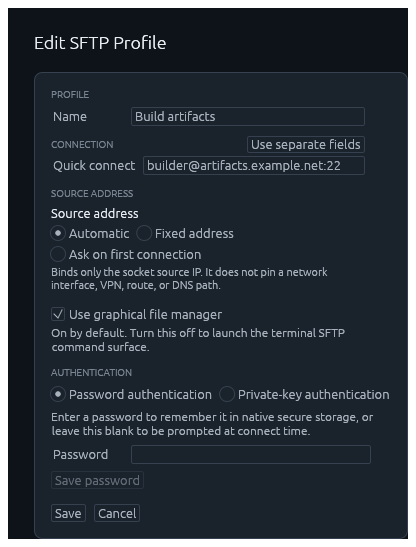

### SSH profile editor

Editing an existing SSH profile's connection metadata and durable- session settings.

**Enter:** More actions > Profiles > New Profile, saved row or row More actions; choose the captioned edit/delete/duplicate/search action 
**Exit:** Cancel discards staged edits; Save commits metadata. Dismiss row menus with Escape; deletion is separately confirmed and may be blocked by references. 
**Production:** `screens::profiles::show_profiles`, `screens::show_profile_row_menu`

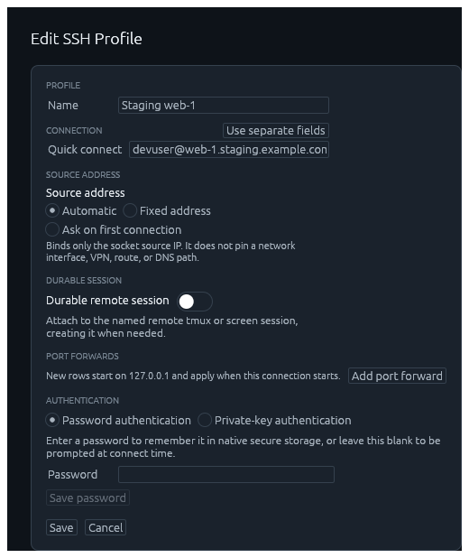

## Dev Tunnel hosts

The host-based Dev Tunnel workflow starts from an explicit, account-scoped
host search rather than a background scan, so every listed host names the
GitHub account that discovered it. A failed refresh keeps the last results
visible and marks them stale instead of clearing the list. The profile editor
pairs a host with a session name that can pick an existing session or name a
new one, created on first connect. Host access on this computer is a separate
opt-in in Remote access settings; requesting it does not enable it.

The captures use synthetic accounts and hosts and render offline. They do not
sign in, contact the tunnel service or advertise anything.

### Host access off

Production hosting controls with an absent synthetic host. Identity and creation controls remain hidden.

**Enter:** Settings → Remote access → Allow remote access through Dev Tunnels (computer-level master switch) 
**Exit:** Leave Settings; turning the switch off tears down advertised shared profiles, and nothing is enabled without the typed review/confirm. 
**Production:** `app::desktop_remote_access::show`, `screens::settings`

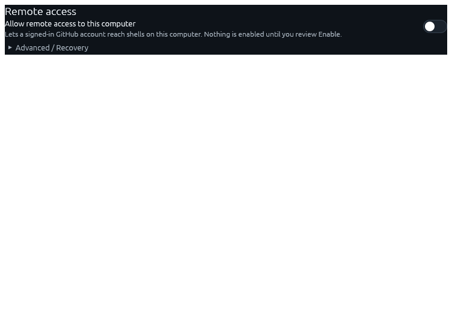

### Host access requested

Requested intent is not readiness. Synthetic account selection grants no host credentials or authority.

**Enter:** Settings → Remote access → Allow remote access through Dev Tunnels (computer-level master switch) 
**Exit:** Leave Settings; turning the switch off tears down advertised shared profiles, and nothing is enabled without the typed review/confirm. 
**Production:** `app::desktop_remote_access::show`, `screens::settings`

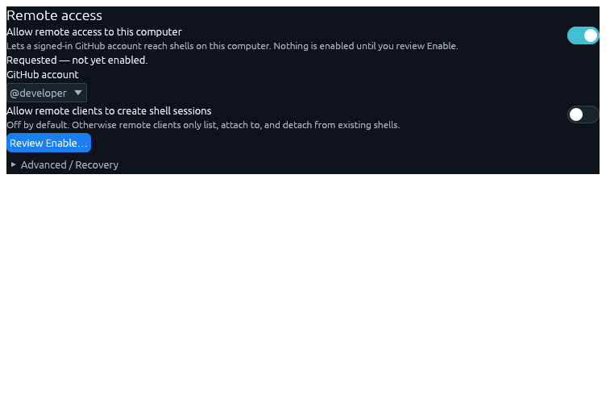

### Explicit account-scoped host discovery

Synthetic last-listed host metadata. Opening does not query the service or assert online availability.

**Enter:** New Session (launcher) → Dev Tunnel host card → Select a host / Find hosts (per signed-in GitHub account) → optional Refresh 
**Exit:** Close the launcher tab or choose another launcher card; selecting a host only stages local metadata and never connects until Connect/Create is pressed. 
**Production:** `screens::host_workspace::show`

### Host discovery with retained results

A synthetic explicit-discovery failure retains useful previous metadata; no native or real-service acceptance.

**Enter:** New Session (launcher) → Dev Tunnel host card → Select a host / Find hosts (per signed-in GitHub account) → optional Refresh 
**Exit:** Close the launcher tab or choose another launcher card; selecting a host only stages local metadata and never connects until Connect/Create is pressed. 
**Production:** `screens::host_workspace::show`

### Narrow host discovery

The same production host choices at 360 logical points, with synthetic account identity only.

**Enter:** New Session (launcher) → Dev Tunnel host card → Select a host / Find hosts (per signed-in GitHub account) → optional Refresh 
**Exit:** Close the launcher tab or choose another launcher card; selecting a host only stages local metadata and never connects until Connect/Create is pressed. 
**Production:** `screens::host_workspace::show`

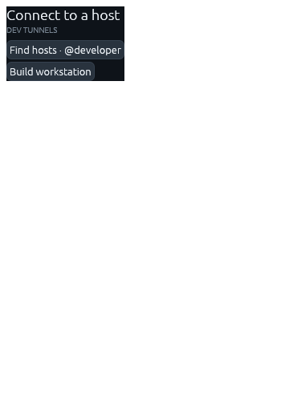

### Offline host profile editor

Production editor with synthetic saved public host hints; no discovery or authentication.

**Enter:** New Session → Dev Tunnel host card → saved host shortcut → Edit (offline host profile editor) 
**Exit:** Cancel/Back discards staged edits; Save writes public metadata only and never connects. 
**Production:** `screens::host_workspace::show`

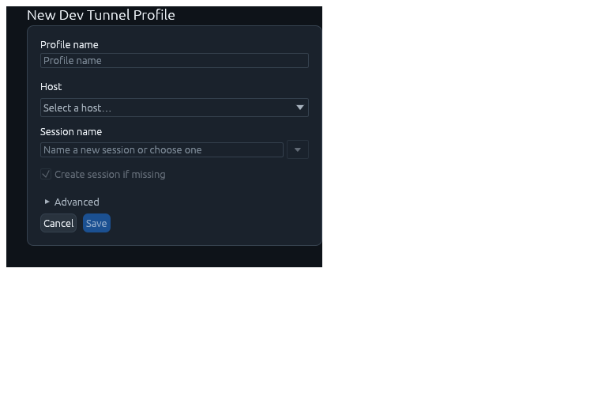

### Narrow offline host profile editor

The production editor at 360 logical points; no native keyboard qualification.

**Enter:** New Session → Dev Tunnel host card → saved host shortcut → Edit (offline host profile editor) 
**Exit:** Cancel/Back discards staged edits; Save writes public metadata only and never connects. 
**Production:** `screens::host_workspace::show`

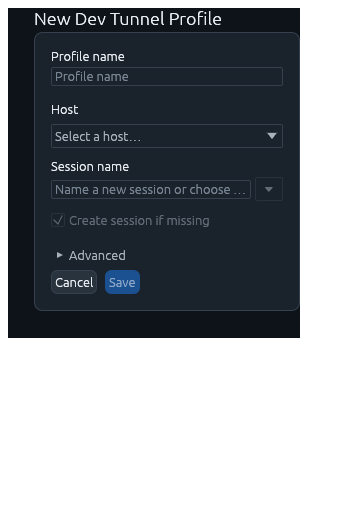

## Desktop pane groups

The real application presents combined views, focused-member details, layout
choices, hover handles, explicit rearrangement and revision-bound movement.
These fixtures preserve each member's identity and use synthetic transports;
they do not start local shells or establish native drag/focus qualification.

### Pinned pane details and unread member

The production group chip opens themed, keyboard-accessible member details with an unread build pane; no real sessions, secrets or user configuration.

**Enter:** Combine live views into a pane group > Layout/Details/Rearrange/handle menu as captioned 
**Exit:** Escape/Done leaves Rearrange; cancel guarded close; Separate restores independent chips without closing sessions. 
**Production:** `app::FesTermApp::show_pane_layout_menu`, `app::FesTermApp::ui_content`, `chrome::show`

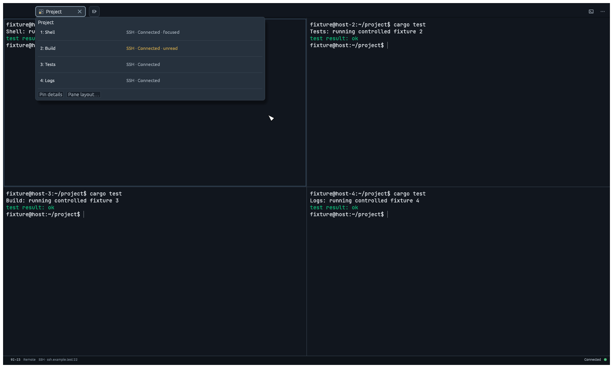

### Equal 1:1 split

Two live terminal panes at equal width with the same content padding and one physical-pixel divider.

**Enter:** Combine live views into a pane group > Layout/Details/Rearrange/handle menu as captioned 
**Exit:** Escape/Done leaves Rearrange; cancel guarded close; Separate restores independent chips without closing sessions. 
**Production:** `app::FesTermApp::show_pane_layout_menu`, `app::FesTermApp::ui_content`, `chrome::show`

### Four live desktop panes

Production composition with controlled fake SSH surfaces; full-opacity siblings, focused inset and shared one-physical-pixel dividers. Not native qualification.

**Enter:** Combine live views into a pane group > Layout/Details/Rearrange/handle menu as captioned 
**Exit:** Escape/Done leaves Rearrange; cancel guarded close; Separate restores independent chips without closing sessions. 
**Production:** `app::FesTermApp::show_pane_layout_menu`, `app::FesTermApp::ui_content`, `chrome::show`

### Compact pane action menu

The hovered member menu keeps Move/Detach and guarded Close distinct from neighboring panes.

**Enter:** Combine live views into a pane group > Layout/Details/Rearrange/handle menu as captioned 
**Exit:** Escape/Done leaves Rearrange; cancel guarded close; Separate restores independent chips without closing sessions. 
**Production:** `app::FesTermApp::show_pane_layout_menu`, `app::FesTermApp::ui_content`, `chrome::show`

### Transient hover handle

A real top-edge pointer hover reveals only the compact grip/name/menu; terminal geometry and padding are unchanged.

**Enter:** Combine live views into a pane group > Layout/Details/Rearrange/handle menu as captioned 
**Exit:** Escape/Done leaves Rearrange; cancel guarded close; Separate restores independent chips without closing sessions. 
**Production:** `app::FesTermApp::show_pane_layout_menu`, `app::FesTermApp::ui_content`, `chrome::show`

### Equal-split hover details

Actual pointer-hover member details, not the pinned popup, over an equal split with an unread member.

**Enter:** Combine live views into a pane group > Layout/Details/Rearrange/handle menu as captioned 
**Exit:** Escape/Done leaves Rearrange; cancel guarded close; Separate restores independent chips without closing sessions. 
**Production:** `app::FesTermApp::show_pane_layout_menu`, `app::FesTermApp::ui_content`, `chrome::show`

### Three-pane hover details

Actual pointer-hover member details over two panes beside one, with focused and unread members distinguished.

**Enter:** Combine live views into a pane group > Layout/Details/Rearrange/handle menu as captioned 
**Exit:** Escape/Done leaves Rearrange; cancel guarded close; Separate restores independent chips without closing sessions. 
**Production:** `app::FesTermApp::show_pane_layout_menu`, `app::FesTermApp::ui_content`, `chrome::show`

### Unequal-split hover details

Actual pointer-hover member details over a 2:1 width split with an unread member.

**Enter:** Combine live views into a pane group > Layout/Details/Rearrange/handle menu as captioned 
**Exit:** Escape/Done leaves Rearrange; cancel guarded close; Separate restores independent chips without closing sessions. 
**Production:** `app::FesTermApp::show_pane_layout_menu`, `app::FesTermApp::ui_content`, `chrome::show`

### Pane configuration dialog

Compact production Pane Layout: selectable members, visual presets, rearrange/equalize/zoom, grouped actions and a separate guarded-close footer.

**Enter:** Combine live views into a pane group > Layout/Details/Rearrange/handle menu as captioned 
**Exit:** Escape/Done leaves Rearrange; cancel guarded close; Separate restores independent chips without closing sessions. 
**Production:** `app::FesTermApp::show_pane_layout_menu`, `app::FesTermApp::ui_content`, `chrome::show`

### Source-specific destination picker

Click-grip reveals an accessible target chooser, directional/Swap cross and separated source Detach/Close actions.

**Enter:** Combine live views into a pane group > Layout/Details/Rearrange/handle menu as captioned 
**Exit:** Escape/Done leaves Rearrange; cancel guarded close; Separate restores independent chips without closing sessions. 
**Production:** `app::FesTermApp::show_pane_layout_menu`, `app::FesTermApp::ui_content`, `chrome::show`

### Explicit pane rearrangement

Window-local manipulation mode shows all handles and Done without allocating a title row.

**Enter:** Combine live views into a pane group > Layout/Details/Rearrange/handle menu as captioned 
**Exit:** Escape/Done leaves Rearrange; cancel guarded close; Separate restores independent chips without closing sessions. 
**Production:** `app::FesTermApp::show_pane_layout_menu`, `app::FesTermApp::ui_content`, `chrome::show`

### Single terminal without a split

The production single-view terminal retains its normal content padding; controlled synthetic SSH session.

**Enter:** Combine live views into a pane group > Layout/Details/Rearrange/handle menu as captioned 
**Exit:** Escape/Done leaves Rearrange; cancel guarded close; Separate restores independent chips without closing sessions. 
**Production:** `app::FesTermApp::show_pane_layout_menu`, `app::FesTermApp::ui_content`, `chrome::show`

### Two panes beside one

Three live terminal panes: two stacked on the left beside one full-height pane on the right.

**Enter:** Combine live views into a pane group > Layout/Details/Rearrange/handle menu as captioned 
**Exit:** Escape/Done leaves Rearrange; cancel guarded close; Separate restores independent chips without closing sessions. 
**Production:** `app::FesTermApp::show_pane_layout_menu`, `app::FesTermApp::ui_content`, `chrome::show`

### Unequal 2:1 width split

Two live terminal panes with a 2:1 width ratio; padding is reserved inside each pane.

**Enter:** Combine live views into a pane group > Layout/Details/Rearrange/handle menu as captioned 
**Exit:** Escape/Done leaves Rearrange; cancel guarded close; Separate restores independent chips without closing sessions. 
**Production:** `app::FesTermApp::show_pane_layout_menu`, `app::FesTermApp::ui_content`, `chrome::show`

## Authentication, recovery and secondary workflows

These captures add the surrounding paths that a happy-path gallery misses:
unknown/changed keys, fresh/restored authentication, startup and retained-history
states, terminal Find and bounded copy, file-drop and application close/update
confirmations, forwarding, profile operations, SFTP failures/transfers/collision
choices and editor save/source/conflict failures. Captions describe the exact
state trigger and user route. Synthetic typed events and test-only model factories
render production widgets without opening transports or submitting actions.

The profile-delete capture intentionally preserves a current implementation
limitation: it has no local Cancel control. The route map names the global
Open Profiles escape rather than inventing a button that is not present.

### About: update available

About > successful update check > review release notes. Exit: close or deliberate Download; no download is started.

**Enter:** More actions > About fesTerm; expand licenses or inspect the captioned synthetic updater state 
**Exit:** Close/Escape returns to the prior owner; no update download, installation or restart is executed. 
**Production:** `app::FesTermApp::show_about`

### About: failed check with retry

About > update check fails validation. Exit: Retry check or close; no unverified download is installed.

**Enter:** More actions > About fesTerm; expand licenses or inspect the captioned synthetic updater state 
**Exit:** Close/Escape returns to the prior owner; no update download, installation or restart is executed. 
**Production:** `app::FesTermApp::show_about`

### About: checking for updates

About > Check for updates > check pending. Exit: response or close About; inert synthetic status.

**Enter:** More actions > About fesTerm; expand licenses or inspect the captioned synthetic updater state 
**Exit:** Close/Escape returns to the prior owner; no update download, installation or restart is executed. 
**Production:** `app::FesTermApp::show_about`

### About: already current

About > Check for updates > no newer version. Exit: close About.

**Enter:** More actions > About fesTerm; expand licenses or inspect the captioned synthetic updater state 
**Exit:** Close/Escape returns to the prior owner; no update download, installation or restart is executed. 
**Production:** `app::FesTermApp::show_about`

### About: downloading update

About > Download > download pending. Exit: completion/failure; closing About does not imply cancellation. Inert status only.

**Enter:** More actions > About fesTerm; expand licenses or inspect the captioned synthetic updater state 
**Exit:** Close/Escape returns to the prior owner; no update download, installation or restart is executed. 
**Production:** `app::FesTermApp::show_about`

### About: failed update operation

About > update operation fails without a safe check retry. Exit: close and inspect the explicit error.

**Enter:** More actions > About fesTerm; expand licenses or inspect the captioned synthetic updater state 
**Exit:** Close/Escape returns to the prior owner; no update download, installation or restart is executed. 
**Production:** `app::FesTermApp::show_about`

### About: installing update

About > deliberate Install > installation pending. Exit: completion/failure. Inert presentation, no installer or live process.

**Enter:** More actions > About fesTerm; expand licenses or inspect the captioned synthetic updater state 
**Exit:** Close/Escape returns to the prior owner; no update download, installation or restart is executed. 
**Production:** `app::FesTermApp::show_about`

### About: refreshing download metadata

About > Download > refresh signed update metadata. Exit: result/refusal or close; no network worker exists.

**Enter:** More actions > About fesTerm; expand licenses or inspect the captioned synthetic updater state 
**Exit:** Close/Escape returns to the prior owner; no update download, installation or restart is executed. 
**Production:** `app::FesTermApp::show_about`

### About: refreshing install metadata

About > Install > revalidate update metadata. Exit: result/refusal or close; no installer exists.

**Enter:** More actions > About fesTerm; expand licenses or inspect the captioned synthetic updater state 
**Exit:** Close/Escape returns to the prior owner; no update download, installation or restart is executed. 
**Production:** `app::FesTermApp::show_about`

### Chrome: inline session rename

Right-click a renamable chip > Rename session (also available by double-click). Isolated production chrome, not native focus-integration evidence. Exit: Enter commits the local alias; Escape cancels. Capture commits nothing.

**Enter:** Upper window chrome > More actions or right-click the captioned session chip 
**Exit:** Escape/outside click dismisses menu; no chip close/move is dispatched during capture. 
**Production:** `festerm_ui_egui::chrome::show`

### Chrome: single scrolling row

Settings > session-chip layout > Single scrolling row > open enough tabs to overflow. Exit: scroll horizontally or restore wrapping.

**Enter:** Upper window chrome > More actions or right-click the captioned session chip 
**Exit:** Escape/outside click dismisses menu; no chip close/move is dispatched during capture. 
**Production:** `festerm_ui_egui::chrome::show`

### Contextual refusal notice

Attempt an unsupported file drop (for example onto SSH). Exit: timed dismissal; nothing is inserted. Synthetic production-widget capture; no live transport, personal profile, vault or clipboard.

**Enter:** Open an unsupported file, or drop files onto an ineligible transport, as captioned 
**Exit:** Acknowledge the open refusal; contextual notice expires. Existing sessions/documents are unchanged. 
**Production:** `app::FesTermApp::show_open_refusal_notice`, `app::FesTermApp::ui_content`

### Document open refusal

Open a binary/unsupported/oversize file. Exit: acknowledge; existing documents stay unchanged. Synthetic production-widget capture; no live transport, personal profile, vault or clipboard.

**Enter:** Open an unsupported file, or drop files onto an ineligible transport, as captioned 
**Exit:** Acknowledge the open refusal; contextual notice expires. Existing sessions/documents are unchanged. 
**Production:** `app::FesTermApp::show_open_refusal_notice`, `app::FesTermApp::ui_content`

### Editor: conflict without comparison bytes

Dirty document > external change with no retained source text. Compare is honestly disabled. Exit: Keep my version/Reload where available/Save As.

**Enter:** Open File > synthetic text/Markdown file > Edit/Preview/Split; perform the captioned Find/options/save/conflict/close trigger 
**Exit:** Close Find/options with Escape; resolve conflicts explicitly. Final dirty close offers Save, Discard changes or Cancel. 
**Production:** `text_editor::TextEditorTab::show`, `text_editor::show_banner`, `app::FesTermApp::show_document_close_confirmation`

### Editor Find: invalid expression

Editor > Find > invalid regular expression. Exit: repair query or Escape.

**Enter:** Open File > synthetic text/Markdown file > Edit/Preview/Split; perform the captioned Find/options/save/conflict/close trigger 
**Exit:** Close Find/options with Escape; resolve conflicts explicitly. Final dirty close offers Save, Discard changes or Cancel. 
**Production:** `text_editor::TextEditorTab::show`, `text_editor::show_banner`, `app::FesTermApp::show_document_close_confirmation`

### Editor Find: no matches

Editor > Find > unmatched query. Exit: change query or Escape.

**Enter:** Open File > synthetic text/Markdown file > Edit/Preview/Split; perform the captioned Find/options/save/conflict/close trigger 
**Exit:** Close Find/options with Escape; resolve conflicts explicitly. Final dirty close offers Save, Discard changes or Cancel. 
**Production:** `text_editor::TextEditorTab::show`, `text_editor::show_banner`, `app::FesTermApp::show_document_close_confirmation`

### Editor: retained recovery versions

Save publication reports recovery files needing explicit review. Exit: inspect retained files, resolve explicitly or close; no overwrite is performed.

**Enter:** Open File > synthetic text/Markdown file > Edit/Preview/Split; perform the captioned Find/options/save/conflict/close trigger 
**Exit:** Close Find/options with Escape; resolve conflicts explicitly. Final dirty close offers Save, Discard changes or Cancel. 
**Production:** `text_editor::TextEditorTab::show`, `text_editor::show_banner`, `app::FesTermApp::show_document_close_confirmation`

### Editor: save failure

Edit > Save > permission/I/O error. Exit: Retry or Save As; edits remain intact.

**Enter:** Open File > synthetic text/Markdown file > Edit/Preview/Split; perform the captioned Find/options/save/conflict/close trigger 
**Exit:** Close Find/options with Escape; resolve conflicts explicitly. Final dirty close offers Save, Discard changes or Cancel. 
**Production:** `text_editor::TextEditorTab::show`, `text_editor::show_banner`, `app::FesTermApp::show_document_close_confirmation`

### Editor: save pending

Editor > Save > bounded write pending. Exit: completion/error; no real write worker runs in this fixture.

**Enter:** Open File > synthetic text/Markdown file > Edit/Preview/Split; perform the captioned Find/options/save/conflict/close trigger 
**Exit:** Close Find/options with Escape; resolve conflicts explicitly. Final dirty close offers Save, Discard changes or Cancel. 
**Production:** `text_editor::TextEditorTab::show`, `text_editor::show_banner`, `app::FesTermApp::show_document_close_confirmation`

### Editor: source disappeared

Open editor > source removed/renamed externally > refresh. Exit: Save As or close; buffer retained.

**Enter:** Open File > synthetic text/Markdown file > Edit/Preview/Split; perform the captioned Find/options/save/conflict/close trigger 
**Exit:** Close Find/options with Escape; resolve conflicts explicitly. Final dirty close offers Save, Discard changes or Cancel. 
**Production:** `text_editor::TextEditorTab::show`, `text_editor::show_banner`, `app::FesTermApp::show_document_close_confirmation`

### Editor: remote source offline

Remote editor > transport disconnects. Exit: revalidate/reconnect, Save As, or close.

**Enter:** Open File > synthetic text/Markdown file > Edit/Preview/Split; perform the captioned Find/options/save/conflict/close trigger 
**Exit:** Close Find/options with Escape; resolve conflicts explicitly. Final dirty close offers Save, Discard changes or Cancel. 
**Production:** `text_editor::TextEditorTab::show`, `text_editor::show_banner`, `app::FesTermApp::show_document_close_confirmation`

### Inspector: disconnected recovery and trace

Disconnected SSH > Session inspector > Diagnostics. Exit: explicit Reconnect or Close; trace is synthetic routing metadata.

**Enter:** Live or retained session > More actions/palette > Session inspector; expand Diagnostics 
**Exit:** Close/Escape/outside click restores the prior viable focus owner without resizing the terminal. 
**Production:** `inspector::show`, `app::FesTermApp::ui_content`

### Live production Session Inspector

Live session > Inspector control/palette. Exit: Close/Escape/outside click restores prior owner. Synthetic production-widget capture; no live transport, personal profile, vault or clipboard.

**Enter:** Live or retained session > More actions/palette > Session inspector; expand Diagnostics 
**Exit:** Close/Escape/outside click restores the prior viable focus owner without resizing the terminal. 
**Production:** `inspector::show`, `app::FesTermApp::ui_content`

### Inspector: local diagnostics

Local session > Session inspector > Diagnostics. Exit: collapse diagnostics or close inspector.

**Enter:** Live or retained session > More actions/palette > Session inspector; expand Diagnostics 
**Exit:** Close/Escape/outside click restores the prior viable focus owner without resizing the terminal. 
**Production:** `inspector::show`, `app::FesTermApp::ui_content`

### Inspector: serial line details

Serial session > Session inspector > Diagnostics. Exit: close; all device identities are synthetic.

**Enter:** Live or retained session > More actions/palette > Session inspector; expand Diagnostics 
**Exit:** Close/Escape/outside click restores the prior viable focus owner without resizing the terminal. 
**Production:** `inspector::show`, `app::FesTermApp::ui_content`

### Collapsed running-session groups

New Session > collapse native/tmux/screen group headings. Exit: expand each heading.

**Enter:** New Session > Local/SSH/SFTP/Serial; choose destination/authentication or advanced options as captioned 
**Exit:** Back/Escape returns to New Session; a deliberate valid submit starts a session outside capture. 
**Production:** `screens::show_launcher`, `screens::show_ssh_form`, `screens::show_sftp_form`, `screens::SerialLauncherForm`

### Launcher profile search without results

New Session > Saved Profiles search > unmatched query. Exit: clear the query.

**Enter:** New Session > Local/SSH/SFTP/Serial; choose destination/authentication or advanced options as captioned 
**Exit:** Back/Escape returns to New Session; a deliberate valid submit starts a session outside capture. 
**Production:** `screens::show_launcher`, `screens::show_ssh_form`, `screens::show_sftp_form`, `screens::SerialLauncherForm`

### Local Shell validation

Local Shell form > submit invalid executable. Exit: correct fields or Back/Escape.

**Enter:** New Session > Local/SSH/SFTP/Serial; choose destination/authentication or advanced options as captioned 
**Exit:** Back/Escape returns to New Session; a deliberate valid submit starts a session outside capture. 
**Production:** `screens::show_launcher`, `screens::show_ssh_form`, `screens::show_sftp_form`, `screens::SerialLauncherForm`

### Customized Local Shell form

Settings > customize local shell; New Session > Local. Exit: Start or Back/Escape. Synthetic executable and directory; no shell is started.

**Enter:** New Session > Local/SSH/SFTP/Serial; choose destination/authentication or advanced options as captioned 
**Exit:** Back/Escape returns to New Session; a deliberate valid submit starts a session outside capture. 
**Production:** `screens::show_launcher`, `screens::show_ssh_form`, `screens::show_sftp_form`, `screens::SerialLauncherForm`

### Markdown: rich selection copy menu

Markdown Preview > select a heading > right-click. Exit: Escape; capture never copies.

**Enter:** Remote SFTP Markdown selection opens the read-only viewer; choose Preview/Source/Contents or Viewer menu/right-click path 
**Exit:** Escape dismisses one popup; Close viewer returns to its source surface. No remote reload or clipboard action is executed by capture. 
**Production:** `markdown_viewer::MarkdownViewerTab::show`, `markdown_viewer::MarkdownViewerTab::show_toolbar`

### Markdown: source-aware selection menu

Markdown Preview > select a heading > Shift + right-click. Exit: Escape; Markdown source is an explicit separate choice.

**Enter:** Remote SFTP Markdown selection opens the read-only viewer; choose Preview/Source/Contents or Viewer menu/right-click path 
**Exit:** Escape dismisses one popup; Close viewer returns to its source surface. No remote reload or clipboard action is executed by capture. 
**Production:** `markdown_viewer::MarkdownViewerTab::show`, `markdown_viewer::MarkdownViewerTab::show_toolbar`

### Markdown: Find matches

Read-only Markdown viewer > Find > query. Exit: Close Find/Escape.

**Enter:** Remote SFTP Markdown selection opens the read-only viewer; choose Preview/Source/Contents or Viewer menu/right-click path 
**Exit:** Escape dismisses one popup; Close viewer returns to its source surface. No remote reload or clipboard action is executed by capture. 
**Production:** `markdown_viewer::MarkdownViewerTab::show`, `markdown_viewer::MarkdownViewerTab::show_toolbar`

### Markdown: Find without matches

Markdown viewer > Find > unmatched query. Exit: change query or Close Find.

**Enter:** Remote SFTP Markdown selection opens the read-only viewer; choose Preview/Source/Contents or Viewer menu/right-click path 
**Exit:** Escape dismisses one popup; Close viewer returns to its source surface. No remote reload or clipboard action is executed by capture. 
**Production:** `markdown_viewer::MarkdownViewerTab::show`, `markdown_viewer::MarkdownViewerTab::show_toolbar`

### Large owned Markdown Preview

Four hundred owned sections and Rust fences use the actual remote-snapshot model and Preview renderer; no network, images or clipboard are accessed.

**Enter:** Remote SFTP Markdown selection opens the read-only viewer; choose Preview/Source/Contents or Viewer menu/right-click path 
**Exit:** Escape dismisses one popup; Close viewer returns to its source surface. No remote reload or clipboard action is executed by capture. 
**Production:** `markdown_viewer::MarkdownViewerTab::show`, `markdown_viewer::MarkdownViewerTab::show_toolbar`

### Large owned Markdown Preview — narrow root

Four hundred owned sections and Rust fences use the actual remote-snapshot model and Preview renderer; no network, images or clipboard are accessed. The root is 360 × 516 logical pixels; this is not native acceptance.

**Enter:** Remote SFTP Markdown selection opens the read-only viewer; choose Preview/Source/Contents or Viewer menu/right-click path 
**Exit:** Escape dismisses one popup; Close viewer returns to its source surface. No remote reload or clipboard action is executed by capture. 
**Production:** `markdown_viewer::MarkdownViewerTab::show`, `markdown_viewer::MarkdownViewerTab::show_toolbar`

### Large owned Markdown Source

The same four-hundred-section snapshot uses its actual Source mode, not a text-editor substitute. Find and native presentation remain unmeasured.

**Enter:** Remote SFTP Markdown selection opens the read-only viewer; choose Preview/Source/Contents or Viewer menu/right-click path 
**Exit:** Escape dismisses one popup; Close viewer returns to its source surface. No remote reload or clipboard action is executed by capture. 
**Production:** `markdown_viewer::MarkdownViewerTab::show`, `markdown_viewer::MarkdownViewerTab::show_toolbar`

### Large owned Markdown Source — narrow root

The same four-hundred-section snapshot uses its actual Source mode, not a text-editor substitute. Find and native presentation remain unmeasured. The root is 360 × 516 logical pixels; this is not native acceptance.

**Enter:** Remote SFTP Markdown selection opens the read-only viewer; choose Preview/Source/Contents or Viewer menu/right-click path 
**Exit:** Escape dismisses one popup; Close viewer returns to its source surface. No remote reload or clipboard action is executed by capture. 
**Production:** `markdown_viewer::MarkdownViewerTab::show`, `markdown_viewer::MarkdownViewerTab::show_toolbar`

### Markdown: path context menu

Markdown viewer > right-click origin path. Exit: Escape; copy requires deliberate action.

**Enter:** Remote SFTP Markdown selection opens the read-only viewer; choose Preview/Source/Contents or Viewer menu/right-click path 
**Exit:** Escape dismisses one popup; Close viewer returns to its source surface. No remote reload or clipboard action is executed by capture. 
**Production:** `markdown_viewer::MarkdownViewerTab::show`, `markdown_viewer::MarkdownViewerTab::show_toolbar`

### Markdown: remote reload unavailable

Remote Markdown viewer > Reload. The embedded production footer exposes the refusal/stale state normally owned by the app status bar. Exit: close and reopen from SFTP to refresh; no new transport is guessed.

**Enter:** Remote SFTP Markdown selection opens the read-only viewer; choose Preview/Source/Contents or Viewer menu/right-click path 
**Exit:** Escape dismisses one popup; Close viewer returns to its source surface. No remote reload or clipboard action is executed by capture. 
**Production:** `markdown_viewer::MarkdownViewerTab::show`, `markdown_viewer::MarkdownViewerTab::show_toolbar`

### Markdown: viewer overflow

Markdown viewer > Viewer menu. Exit: Escape, Reload or Close viewer.

**Enter:** Remote SFTP Markdown selection opens the read-only viewer; choose Preview/Source/Contents or Viewer menu/right-click path 
**Exit:** Escape dismisses one popup; Close viewer returns to its source surface. No remote reload or clipboard action is executed by capture. 
**Production:** `markdown_viewer::MarkdownViewerTab::show`, `markdown_viewer::MarkdownViewerTab::show_toolbar`

### Palette: narrow category choices

Narrow Command palette > All categories. Wide layout uses category chips instead. Exit: choose a category or Escape; Escape does not also dismiss the palette.

**Enter:** More actions > Command palette or configured shortcut; filter/select category as captioned 
**Exit:** Escape dismisses category popup first, then palette, restoring the exact prior viable focus owner. 
**Production:** `festerm_ui_egui::palette::show`

### Palette: no results

Open Command palette > enter an unmatched query. Exit: clear the query or Escape.

**Enter:** More actions > Command palette or configured shortcut; filter/select category as captioned 
**Exit:** Escape dismisses category popup first, then palette, restoring the exact prior viable focus owner. 
**Production:** `festerm_ui_egui::palette::show`

### Live Port Forward Manager

Live SSH > palette/shortcut > Port Forward Manager. Exit: Close/Escape; mappings are live-only. Synthetic production-widget capture; no live transport, personal profile, vault or clipboard.

**Enter:** Live SSH > palette/shortcut > Port Forward Manager; enter the captioned mapping 
**Exit:** Correct validation fields or Close/Escape. Capture does not add a forward. 
**Production:** `app::FesTermApp::show_port_forward_manager`

### Port Forward Manager: validation error

Port Forward Manager > add a mapping with invalid bind port. Exit: correct fields or Close. Synthetic production-widget capture; no live transport, personal profile, vault or clipboard.

**Enter:** Live SSH > palette/shortcut > Port Forward Manager; enter the captioned mapping 
**Exit:** Correct validation fields or Close/Escape. Capture does not add a forward. 
**Production:** `app::FesTermApp::show_port_forward_manager`

### Profiles: delete confirmation

Profiles > saved SSH row > More actions > Delete. The current surface exposes only Delete, not a local Cancel. Reopen Profiles through the global action to abandon it; capture never deletes.

**Enter:** Profiles > saved row > More actions > Delete 
**Exit:** Current implementation has no local Cancel. Reopen Profiles through the global action to abandon confirmation; Delete is never pressed by capture. 
**Production:** `screens::profiles::ProfilesScreenMode::ConfirmDelete`

### Profiles: duplicate draft

Profiles > saved SSH row > More actions > Duplicate. Exit: Save new profile or Cancel; credentials are not copied.

**Enter:** More actions > Profiles > New Profile, saved row or row More actions; choose the captioned edit/delete/duplicate/search action 
**Exit:** Cancel discards staged edits; Save commits metadata. Dismiss row menus with Escape; deletion is separately confirmed and may be blocked by references. 
**Production:** `screens::profiles::show_profiles`, `screens::show_profile_row_menu`

### Profiles: Local profile and persistence

Profiles > New Profile > Local. Exit: Save/Cancel; capture never launches a shell.

**Enter:** More actions > Profiles > New Profile, saved row or row More actions; choose the captioned edit/delete/duplicate/search action 
**Exit:** Cancel discards staged edits; Save commits metadata. Dismiss row menus with Escape; deletion is separately confirmed and may be blocked by references. 
**Production:** `screens::profiles::show_profiles`, `screens::show_profile_row_menu`

### Profiles: New Profile menu

Profiles > New Profile. Exit: choose a transport or Escape.

**Enter:** More actions > Profiles > New Profile, saved row or row More actions; choose the captioned edit/delete/duplicate/search action 
**Exit:** Cancel discards staged edits; Save commits metadata. Dismiss row menus with Escape; deletion is separately confirmed and may be blocked by references. 
**Production:** `screens::profiles::show_profiles`, `screens::show_profile_row_menu`

### Profiles: profile actions

Profiles > saved SSH row > More actions. Exit: choose an action or Escape.

**Enter:** More actions > Profiles > New Profile, saved row or row More actions; choose the captioned edit/delete/duplicate/search action 
**Exit:** Cancel discards staged edits; Save commits metadata. Dismiss row menus with Escape; deletion is separately confirmed and may be blocked by references. 
**Production:** `screens::profiles::show_profiles`, `screens::show_profile_row_menu`

### Profiles: search without results

Profiles > Search profiles > unmatched query. Exit: clear the query.

**Enter:** More actions > Profiles > New Profile, saved row or row More actions; choose the captioned edit/delete/duplicate/search action 
**Exit:** Cancel discards staged edits; Save commits metadata. Dismiss row menus with Escape; deletion is separately confirmed and may be blocked by references. 
**Production:** `screens::profiles::show_profiles`, `screens::show_profile_row_menu`

### Close window with live sessions

Close a secondary window containing live sessions. Exit: Cancel or deliberate Close Window. Synthetic production-widget capture; no live transport, personal profile, vault or clipboard.

**Enter:** Perform the captioned close/quit/update/paste/file-drop/reset/native takeover/termination action 
**Exit:** Cancel preserves the exact target and live sessions; destructive or input-producing actions require explicit confirmation and are never activated by capture. 
**Production:** `app::confirmations`, `app::FesTermApp::ui_content`

### Local file-drop insertion preview

Drop files on a live local terminal. Exit: Cancel or explicit insertion; no Enter is sent. Synthetic production-widget capture; no live transport, personal profile, vault or clipboard.

**Enter:** Perform the captioned close/quit/update/paste/file-drop/reset/native takeover/termination action 
**Exit:** Cancel preserves the exact target and live sessions; destructive or input-producing actions require explicit confirmation and are never activated by capture. 
**Production:** `app::confirmations`, `app::FesTermApp::ui_content`

### Install update with live sessions

About > ready update > install while sessions run. Exit: Cancel preserves update/session; explicit install. Synthetic production-widget capture; no live transport, personal profile, vault or clipboard.

**Enter:** Perform the captioned close/quit/update/paste/file-drop/reset/native takeover/termination action 
**Exit:** Cancel preserves the exact target and live sessions; destructive or input-producing actions require explicit confirmation and are never activated by capture. 
**Production:** `app::confirmations`, `app::FesTermApp::ui_content`

### Take over an attached native session

Launcher > native session > Take over. Exit: Cancel or explicit takeover of the same generation. Synthetic production-widget capture; no live transport, personal profile, vault or clipboard.

**Enter:** Perform the captioned close/quit/update/paste/file-drop/reset/native takeover/termination action 
**Exit:** Cancel preserves the exact target and live sessions; destructive or input-producing actions require explicit confirmation and are never activated by capture. 
**Production:** `app::confirmations`, `app::FesTermApp::ui_content`

### Terminate a durable native session

Launcher > Running Sessions > native row menu > Terminate. Exit: Cancel or deliberate termination. Synthetic production-widget capture; no live transport, personal profile, vault or clipboard.

**Enter:** Perform the captioned close/quit/update/paste/file-drop/reset/native takeover/termination action 
**Exit:** Cancel preserves the exact target and live sessions; destructive or input-producing actions require explicit confirmation and are never activated by capture. 
**Production:** `app::confirmations`, `app::FesTermApp::ui_content`

### Quit with live sessions

Quit with a live session. Exit: Cancel preserves sessions; explicit Quit ends them. Synthetic production-widget capture; no live transport, personal profile, vault or clipboard.

**Enter:** Perform the captioned close/quit/update/paste/file-drop/reset/native takeover/termination action 
**Exit:** Cancel preserves the exact target and live sessions; destructive or input-producing actions require explicit confirmation and are never activated by capture. 
**Production:** `app::confirmations`, `app::FesTermApp::ui_content`

### Reset all settings

Settings > change a preference > Reset all settings…; exit: Cancel or deliberate Reset. Synthetic production-widget capture; no live transport, personal profile, vault or clipboard.

**Enter:** Perform the captioned close/quit/update/paste/file-drop/reset/native takeover/termination action 
**Exit:** Cancel preserves the exact target and live sessions; destructive or input-producing actions require explicit confirmation and are never activated by capture. 
**Production:** `app::confirmations`, `app::FesTermApp::ui_content`

### Restart after update with live sessions

Installed update > restart while sessions run. Exit: Cancel or explicit restart. Synthetic production-widget capture; no live transport, personal profile, vault or clipboard.

**Enter:** Perform the captioned close/quit/update/paste/file-drop/reset/native takeover/termination action 
**Exit:** Cancel preserves the exact target and live sessions; destructive or input-producing actions require explicit confirmation and are never activated by capture. 
**Production:** `app::confirmations`, `app::FesTermApp::ui_content`

### Serial validation

New Session > Serial > invalid baud > Open. No device discovery or device open is performed.

**Enter:** New Session > Local/SSH/SFTP/Serial; choose destination/authentication or advanced options as captioned 
**Exit:** Back/Escape returns to New Session; a deliberate valid submit starts a session outside capture. 
**Production:** `screens::show_launcher`, `screens::show_ssh_form`, `screens::show_sftp_form`, `screens::SerialLauncherForm`

### Session: disconnected history

Live SSH > lose connection. Exit: Reconnect, diagnostics or Close Tab. Synthetic production-widget capture; no live transport, personal profile, vault or clipboard.

**Enter:** Start a synthetic terminal > normal/history/context/Find/focus-mode or captioned lifecycle state 
**Exit:** Close Find/menu with Escape; toggle Focus Mode again. Reconnect or close retained exited/disconnected history explicitly. 
**Production:** `festerm_ui_egui::TerminalView::show`, `app::FesTermApp::ui_content`

### Session: exited history

Local/remote process exits. Exit: inspect/copy history, relaunch where supported, or Close Tab. Synthetic production-widget capture; no live transport, personal profile, vault or clipboard.

**Enter:** Start a synthetic terminal > normal/history/context/Find/focus-mode or captioned lifecycle state 
**Exit:** Close Find/menu with Escape; toggle Focus Mode again. Reconnect or close retained exited/disconnected history explicitly. 
**Production:** `festerm_ui_egui::TerminalView::show`, `app::FesTermApp::ui_content`

### Session: startup failure

Start a session > transport refuses startup. Exit: diagnostics/recovery or Close Tab. Synthetic production-widget capture; no live transport, personal profile, vault or clipboard.

**Enter:** Start a synthetic terminal > normal/history/context/Find/focus-mode or captioned lifecycle state 
**Exit:** Close Find/menu with Escape; toggle Focus Mode again. Reconnect or close retained exited/disconnected history explicitly. 
**Production:** `festerm_ui_egui::TerminalView::show`, `app::FesTermApp::ui_content`

### Session: starting

Connect/start a session while transport startup is pending. Exit: connection succeeds/fails, or close tab. Synthetic production-widget capture; no live transport, personal profile, vault or clipboard.

**Enter:** Start a synthetic terminal > normal/history/context/Find/focus-mode or captioned lifecycle state 
**Exit:** Close Find/menu with Escape; toggle Focus Mode again. Reconnect or close retained exited/disconnected history explicitly. 
**Production:** `festerm_ui_egui::TerminalView::show`, `app::FesTermApp::ui_content`

### Settings: complete card stack

More actions > Settings. Tall headless viewport exposes the full implemented card stack; scroll in a normal window. Exit: select another chip or close Settings.

**Enter:** More actions > Settings; scroll to the captioned card. Keyboard shortcuts › sub-page > choose action > Record shortcut or search. 
**Exit:** Cancel key recording or restore its prior binding; Back or Escape leaves a sub-page; select another chip or close Settings. Screenshot fixtures never persist changes. 
**Production:** `screens::settings::show_settings`, `keyboard::show_editor`

### GUI SFTP: authentication

Saved GUI SFTP profile > Connect, or edit a failed connection. Exit: Connect/Cancel; fixture never connects.

**Enter:** Connect after host trust, or restore a metadata-only workspace tab requiring fresh authentication 
**Exit:** Clear/cancel fresh credentials or explicitly Connect. Capture never submits a credential. 
**Production:** `screens::show_ssh_authentication_required`, `screens::show_sftp_authentication_required`, `sftp_file_manager::show_authentication_required`, `app::FesTermApp::ui_content`

### GUI SFTP: empty directories

Navigate each pane to an empty synthetic directory. Exit: Back/Up.

**Enter:** New Session > SFTP > graphical file manager, or saved SSH/SFTP profile > Open SFTP; navigate/transfer as captioned 
**Exit:** Cancel collision or choose an explicit decision; Retry/Edit connection after error; close the SFTP chip to leave. 
**Production:** `sftp_file_manager::SftpFileManagerTab::show`, `sftp_file_manager::show_collision_modal`

### GUI SFTP: narrow pane switcher

Resize GUI SFTP below split-view threshold. Switch Local/Remote to navigate. Exit: widen window.

**Enter:** New Session > SFTP > graphical file manager, or saved SSH/SFTP profile > Open SFTP; navigate/transfer as captioned 
**Exit:** Cancel collision or choose an explicit decision; Retry/Edit connection after error; close the SFTP chip to leave. 
**Production:** `sftp_file_manager::SftpFileManagerTab::show`, `sftp_file_manager::show_collision_modal`

### GUI SFTP: remote-left preference

Settings > SFTP pane order > remote left, then return to file manager.

**Enter:** New Session > SFTP > graphical file manager, or saved SSH/SFTP profile > Open SFTP; navigate/transfer as captioned 
**Exit:** Cancel collision or choose an explicit decision; Retry/Edit connection after error; close the SFTP chip to leave. 
**Production:** `sftp_file_manager::SftpFileManagerTab::show`, `sftp_file_manager::show_collision_modal`

### GUI SFTP: collision decision

Transfer > existing destination. Exit: Replace/Skip/Keep Both/Cancel; optional apply-to-all. Synthetic worker event; no overwrite.

**Enter:** New Session > SFTP > graphical file manager, or saved SSH/SFTP profile > Open SFTP; navigate/transfer as captioned 
**Exit:** Cancel collision or choose an explicit decision; Retry/Edit connection after error; close the SFTP chip to leave. 
**Production:** `sftp_file_manager::SftpFileManagerTab::show`, `sftp_file_manager::show_collision_modal`

### GUI SFTP: connecting

Submit GUI SFTP authentication > connection pending. Exit: success or error.

**Enter:** New Session > SFTP > graphical file manager, or saved SSH/SFTP profile > Open SFTP; navigate/transfer as captioned 
**Exit:** Cancel collision or choose an explicit decision; Retry/Edit connection after error; close the SFTP chip to leave. 
**Production:** `sftp_file_manager::SftpFileManagerTab::show`, `sftp_file_manager::show_collision_modal`

### GUI SFTP: first connection failed

GUI SFTP connection fails before first listing. Exit: Retry or Edit connection.

**Enter:** New Session > SFTP > graphical file manager, or saved SSH/SFTP profile > Open SFTP; navigate/transfer as captioned 
**Exit:** Cancel collision or choose an explicit decision; Retry/Edit connection after error; close the SFTP chip to leave. 
**Production:** `sftp_file_manager::SftpFileManagerTab::show`, `sftp_file_manager::show_collision_modal`

### GUI SFTP: directory requests pending

Navigate/refresh a directory > bounded listing pending. Exit: response/error, or another navigation; no loader runs in capture.

**Enter:** New Session > SFTP > graphical file manager, or saved SSH/SFTP profile > Open SFTP; navigate/transfer as captioned 
**Exit:** Cancel collision or choose an explicit decision; Retry/Edit connection after error; close the SFTP chip to leave. 
**Production:** `sftp_file_manager::SftpFileManagerTab::show`, `sftp_file_manager::show_collision_modal`

### GUI SFTP: stale listing after disconnect

Connected file manager > connection lost. Exit: Retry/Edit connection; retained listing stays visible.

**Enter:** New Session > SFTP > graphical file manager, or saved SSH/SFTP profile > Open SFTP; navigate/transfer as captioned 
**Exit:** Cancel collision or choose an explicit decision; Retry/Edit connection after error; close the SFTP chip to leave. 
**Production:** `sftp_file_manager::SftpFileManagerTab::show`, `sftp_file_manager::show_collision_modal`

### GUI SFTP: filtered directory without matches

Type an unmatched filter in a populated directory. Exit: clear the filter; files are not deleted.

**Enter:** New Session > SFTP > graphical file manager, or saved SSH/SFTP profile > Open SFTP; navigate/transfer as captioned 
**Exit:** Cancel collision or choose an explicit decision; Retry/Edit connection after error; close the SFTP chip to leave. 
**Production:** `sftp_file_manager::SftpFileManagerTab::show`, `sftp_file_manager::show_collision_modal`

### GUI SFTP: directory listing refusal

Navigate/refresh a remote directory > permission denied. Exit: Retry, return to a readable directory or close.

**Enter:** New Session > SFTP > graphical file manager, or saved SSH/SFTP profile > Open SFTP; navigate/transfer as captioned 
**Exit:** Cancel collision or choose an explicit decision; Retry/Edit connection after error; close the SFTP chip to leave. 
**Production:** `sftp_file_manager::SftpFileManagerTab::show`, `sftp_file_manager::show_collision_modal`

### GUI SFTP: local file context menu

Local pane > right-click a file > Reveal in Finder/Explorer. Exit: Escape; no native file manager is opened.

**Enter:** New Session > SFTP > graphical file manager, or saved SSH/SFTP profile > Open SFTP; navigate/transfer as captioned 
**Exit:** Cancel collision or choose an explicit decision; Retry/Edit connection after error; close the SFTP chip to leave. 
**Production:** `sftp_file_manager::SftpFileManagerTab::show`, `sftp_file_manager::show_collision_modal`

### GUI SFTP: operation refusal

File manager > open an unsupported/oversize file. Exit: dismiss banner or choose another file.

**Enter:** New Session > SFTP > graphical file manager, or saved SSH/SFTP profile > Open SFTP; navigate/transfer as captioned 
**Exit:** Cancel collision or choose an explicit decision; Retry/Edit connection after error; close the SFTP chip to leave. 
**Production:** `sftp_file_manager::SftpFileManagerTab::show`, `sftp_file_manager::show_collision_modal`

### GUI SFTP: direct path editing

Local pane > click path / location shortcut. Exit: Escape restores navigation; Enter would request a new directory, never pressed here.

**Enter:** New Session > SFTP > graphical file manager, or saved SSH/SFTP profile > Open SFTP; navigate/transfer as captioned 
**Exit:** Cancel collision or choose an explicit decision; Retry/Edit connection after error; close the SFTP chip to leave. 
**Production:** `sftp_file_manager::SftpFileManagerTab::show`, `sftp_file_manager::show_collision_modal`

### GUI SFTP: private key

GUI SFTP authentication > Private key. Exit: change auth method or Cancel.

**Enter:** Connect after host trust, or restore a metadata-only workspace tab requiring fresh authentication 
**Exit:** Clear/cancel fresh credentials or explicitly Connect. Capture never submits a credential. 
**Production:** `screens::show_ssh_authentication_required`, `screens::show_sftp_authentication_required`, `sftp_file_manager::show_authentication_required`, `app::FesTermApp::ui_content`

### SFTP terminal-mode alternative

New Session > SFTP > turn graphical file manager off. Exit: Connect or Back.

**Enter:** New Session > Local/SSH/SFTP/Serial; choose destination/authentication or advanced options as captioned 
**Exit:** Back/Escape returns to New Session; a deliberate valid submit starts a session outside capture. 
**Production:** `screens::show_launcher`, `screens::show_ssh_form`, `screens::show_sftp_form`, `screens::SerialLauncherForm`

### GUI SFTP: isolated transfer drawer

File manager > Transfers drawer. Isolated production drawer shows live progress and completed/failed history without the surrounding panes. Scroll for remaining rows.

**Enter:** New Session > SFTP > graphical file manager, or saved SSH/SFTP profile > Open SFTP; navigate/transfer as captioned 
**Exit:** Cancel collision or choose an explicit decision; Retry/Edit connection after error; close the SFTP chip to leave. 
**Production:** `sftp_file_manager::SftpFileManagerTab::show`, `sftp_file_manager::show_collision_modal`

### GUI SFTP: transfer progress and history

Select local/remote files > Upload/Download. Synthetic typed worker events show running, completed and failed rows; no files are transferred.

**Enter:** New Session > SFTP > graphical file manager, or saved SSH/SFTP profile > Open SFTP; navigate/transfer as captioned 
**Exit:** Cancel collision or choose an explicit decision; Retry/Edit connection after error; close the SFTP chip to leave. 
**Production:** `sftp_file_manager::SftpFileManagerTab::show`, `sftp_file_manager::show_collision_modal`

### GUI SFTP: changed host

GUI SFTP > host presents changed key. Exit: deliberate yes/Enter or Cancel.

**Enter:** New Session > SSH/SFTP, or saved profile > Connect > unknown/changed host key 
**Exit:** Reject/Cancel/Escape; accept only after deliberate fingerprint review. Changed keys require typed yes. 
**Production:** `app::FesTermApp::show_host_key_prompt_ui`, `sftp_file_manager::show_host_key_prompt`

### GUI SFTP: unknown host

GUI SFTP > Connect > first-seen host key. Exit: Reject/Accept Once/Accept and Remember.

**Enter:** New Session > SSH/SFTP, or saved profile > Connect > unknown/changed host key 
**Exit:** Reject/Cancel/Escape; accept only after deliberate fingerprint review. Changed keys require typed yes. 
**Production:** `app::FesTermApp::show_host_key_prompt_ui`, `sftp_file_manager::show_host_key_prompt`

### SSH certificate authentication

New Session > SSH > Certificate. Exit: switch auth or Back.

**Enter:** New Session > Local/SSH/SFTP/Serial; choose destination/authentication or advanced options as captioned 
**Exit:** Back/Escape returns to New Session; a deliberate valid submit starts a session outside capture. 
**Production:** `screens::show_launcher`, `screens::show_ssh_form`, `screens::show_sftp_form`, `screens::SerialLauncherForm`

### SSH durable-session options

SSH > enable durable remote session > select provider/recovery. Exit: disable or Back. No provider probe is run.

**Enter:** New Session > Local/SSH/SFTP/Serial; choose destination/authentication or advanced options as captioned 
**Exit:** Back/Escape returns to New Session; a deliberate valid submit starts a session outside capture. 
**Production:** `screens::show_launcher`, `screens::show_ssh_form`, `screens::show_sftp_form`, `screens::SerialLauncherForm`

### SSH: live password prompt

SSH > Connect > verify host > worker requests password. Exit: submit transient password or cancel. Synthetic production-widget capture; no live transport, personal profile, vault or clipboard.

**Enter:** Connect after host trust, or restore a metadata-only workspace tab requiring fresh authentication 
**Exit:** Clear/cancel fresh credentials or explicitly Connect. Capture never submits a credential. 
**Production:** `screens::show_ssh_authentication_required`, `screens::show_sftp_authentication_required`, `sftp_file_manager::show_authentication_required`, `app::FesTermApp::ui_content`

### SSH: rejected password and retry

SSH password prompt > rejected authentication > next transient prompt. Exit: retry or Escape; no actual password is entered. Synthetic production-widget capture; no live transport, personal profile, vault or clipboard.

**Enter:** Connect after host trust, or restore a metadata-only workspace tab requiring fresh authentication 
**Exit:** Clear/cancel fresh credentials or explicitly Connect. Capture never submits a credential. 
**Production:** `screens::show_ssh_authentication_required`, `screens::show_sftp_authentication_required`, `sftp_file_manager::show_authentication_required`, `app::FesTermApp::ui_content`

### SSH private-key authentication

New Session > SSH > Private key. Key and passphrase are empty; no credential is read. Exit: switch auth or Back.

**Enter:** New Session > Local/SSH/SFTP/Serial; choose destination/authentication or advanced options as captioned 
**Exit:** Back/Escape returns to New Session; a deliberate valid submit starts a session outside capture. 
**Production:** `screens::show_launcher`, `screens::show_ssh_form`, `screens::show_sftp_form`, `screens::SerialLauncherForm`

### SSH separate destination fields

New Session > SSH > Use separate fields. Exit: switch notation or Back.

**Enter:** New Session > Local/SSH/SFTP/Serial; choose destination/authentication or advanced options as captioned 
**Exit:** Back/Escape returns to New Session; a deliberate valid submit starts a session outside capture. 
**Production:** `screens::show_launcher`, `screens::show_ssh_form`, `screens::show_sftp_form`, `screens::SerialLauncherForm`

### SSH: changed host key

Connect to a host whose saved key differs. Exit: Escape cancels; deliberate typed yes replaces trust. Synthetic production-widget capture; no live transport, personal profile, vault or clipboard.

**Enter:** New Session > SSH/SFTP, or saved profile > Connect > unknown/changed host key 
**Exit:** Reject/Cancel/Escape; accept only after deliberate fingerprint review. Changed keys require typed yes. 
**Production:** `app::FesTermApp::show_host_key_prompt_ui`, `sftp_file_manager::show_host_key_prompt`

### SSH: first-seen host key

New Session > SSH > Connect > unknown host. Exit: N/Escape cancels; Y accepts once; A remembers. Synthetic production-widget capture; no live transport, personal profile, vault or clipboard.

**Enter:** New Session > SSH/SFTP, or saved profile > Connect > unknown/changed host key 
**Exit:** Reject/Cancel/Escape; accept only after deliberate fingerprint review. Changed keys require typed yes. 
**Production:** `app::FesTermApp::show_host_key_prompt_ui`, `sftp_file_manager::show_host_key_prompt`

### SSH form validation

SSH > Connect with invalid fields. Exit: correct fields or Back.

**Enter:** New Session > Local/SSH/SFTP/Serial; choose destination/authentication or advanced options as captioned 
**Exit:** Back/Escape returns to New Session; a deliberate valid submit starts a session outside capture. 
**Production:** `screens::show_launcher`, `screens::show_ssh_form`, `screens::show_sftp_form`, `screens::SerialLauncherForm`

### Terminal Find: matches

Live terminal > Find (palette/menu/shortcut) > enter test. Exit: Escape or Close returns focus. Synthetic production-widget capture; no live transport, personal profile, vault or clipboard.

**Enter:** Start a synthetic terminal > normal/history/context/Find/focus-mode or captioned lifecycle state 
**Exit:** Close Find/menu with Escape; toggle Focus Mode again. Reconnect or close retained exited/disconnected history explicitly. 
**Production:** `festerm_ui_egui::TerminalView::show`, `app::FesTermApp::ui_content`

### Terminal Find: no matches

Terminal > Find > query absent from history. Exit: clear/change query or Close. Synthetic production-widget capture; no live transport, personal profile, vault or clipboard.

**Enter:** Start a synthetic terminal > normal/history/context/Find/focus-mode or captioned lifecycle state 
**Exit:** Close Find/menu with Escape; toggle Focus Mode again. Reconnect or close retained exited/disconnected history explicitly. 
**Production:** `festerm_ui_egui::TerminalView::show`, `app::FesTermApp::ui_content`

### Terminal: Focus Mode

Live terminal > palette > Focus Mode. Exit: toggle Focus Mode again; Escape belongs to the terminal. Synthetic production-widget capture; no live transport, personal profile, vault or clipboard.

**Enter:** Start a synthetic terminal > normal/history/context/Find/focus-mode or captioned lifecycle state 
**Exit:** Close Find/menu with Escape; toggle Focus Mode again. Reconnect or close retained exited/disconnected history explicitly. 
**Production:** `festerm_ui_egui::TerminalView::show`, `app::FesTermApp::ui_content`

### Bounded rectangle copy

Terminal > palette > Bounded rectangle copy. Click two corners or drag to select; Enter/Copy accepts, Escape cancels. Capture stops before copying. Synthetic production-widget capture; no live transport, personal profile, vault or clipboard.

**Enter:** Focused terminal > palette/context menu > Bounded rectangle copy or Smart Select Paragraph 
**Exit:** Escape cancels local capture/selection. Copy is separate; no clipboard is read or written during capture. 
**Production:** `festerm_ui_egui::TerminalView::show`, `tabs::AppState::dispatch`

### Bounded rectangle: selected cells

Bounded rectangle copy > click two corners. Exit: Escape cancels; explicit Copy is separate and never activated by capture. Synthetic production-widget capture; no live transport, personal profile, vault or clipboard.

**Enter:** Focused terminal > palette/context menu > Bounded rectangle copy or Smart Select Paragraph 
**Exit:** Escape cancels local capture/selection. Copy is separate; no clipboard is read or written during capture. 
**Production:** `festerm_ui_egui::TerminalView::show`, `tabs::AppState::dispatch`

### Smart selection: unavailable target

Smart Select Paragraph at a blank/border target. Exit: notice expires; choose ordinary drag or another target. Synthetic production-widget capture; no live transport, personal profile, vault or clipboard.

**Enter:** Focused terminal > palette/context menu > Bounded rectangle copy or Smart Select Paragraph 
**Exit:** Escape cancels local capture/selection. Copy is separate; no clipboard is read or written during capture. 
**Production:** `festerm_ui_egui::TerminalView::show`, `tabs::AppState::dispatch`

### Smart paragraph selection

Terminal > local smart-selection command > Paragraph. Highlight/instruction or honest refusal is retained; Copy is always a separate deliberate action. Escape cancels. Synthetic production-widget capture; no live transport, personal profile, vault or clipboard.

**Enter:** Focused terminal > palette/context menu > Bounded rectangle copy or Smart Select Paragraph 
**Exit:** Escape cancels local capture/selection. Copy is separate; no clipboard is read or written during capture. 
**Production:** `festerm_ui_egui::TerminalView::show`, `tabs::AppState::dispatch`

### Workspace: SFTP requires fresh authentication

Restore metadata-only terminal SFTP workspace tab. Exit: fresh authentication or Cancel. No prior trust or secret is restored.

**Enter:** Connect after host trust, or restore a metadata-only workspace tab requiring fresh authentication 
**Exit:** Clear/cancel fresh credentials or explicitly Connect. Capture never submits a credential. 
**Production:** `screens::show_ssh_authentication_required`, `screens::show_sftp_authentication_required`, `sftp_file_manager::show_authentication_required`, `app::FesTermApp::ui_content`

### Workspace: SSH requires fresh authentication

Restore metadata-only SSH workspace tab. Exit: enter fresh credentials and Connect, or Back/Cancel. No transport is restored.

**Enter:** Connect after host trust, or restore a metadata-only workspace tab requiring fresh authentication 
**Exit:** Clear/cancel fresh credentials or explicitly Connect. Capture never submits a credential. 
**Production:** `screens::show_ssh_authentication_required`, `screens::show_sftp_authentication_required`, `sftp_file_manager::show_authentication_required`, `app::FesTermApp::ui_content`

## Experimental, hosting, recording and automation surfaces

HOST recipes, host review/inventory, legacy Dev Tunnels, local-host ownership
and cleanup, Remote access settings, PowerShell, recording and local
automation use their actual production renderers with inert synthetic state.
Enterprise discovery is an internal implemented surface whose product entry
points are intentionally hidden; its screenshots do not advertise a released
workflow.

No vault approval, cloud account, device sign-in, persistent host, protected
original or privileged grant is implied by a screenshot. The experimental
route catalog lists genuine capability/native prerequisites separately from
rendered states. Actions are never dispatched during capture.

### Dev Tunnel · previous and proposed host identity

Production UI with synthetic, inert fixture state. No network, native vault, service, tunnel, remote execution or recording is started. See the route catalog for reachability and native-only limitations.

**Enter:** Saved legacy Dev Tunnel → Connect → different host fingerprint; account-save flow → explicit host trust without connecting 
**Exit:** Cancel or Escape refuses proposed trust. Independently investigate changed host identity before reconnecting; closing never saves a changed trust decision. 
**Production:** `FesTermApp::show_native_tunnel`

### Dev Tunnel connection · working

Production UI with synthetic, inert fixture state. No network, native vault, service, tunnel, remote execution or recording is started. See the route catalog for reachability and native-only limitations.

**Enter:** Launcher or Profiles → legacy Dev Tunnel profile → Connect → explicit GitHub device sign-in → host trust 
**Exit:** Cancel or Escape cancels pending connection or refuses host trust; an error offers Close. Return to the profile and reconnect explicitly after correcting the account, storage or host identity. Do not approve a changed fingerprint merely to clear the error. 
**Production:** `FesTermApp::show_native_tunnel`, `tunnel_workflow::Stage`

### Dev Tunnel connection · native storage refusal

Production UI with synthetic, inert fixture state. No network, native vault, service, tunnel, remote execution or recording is started. See the route catalog for reachability and native-only limitations.

**Enter:** Launcher or Profiles → legacy Dev Tunnel profile → Connect → explicit GitHub device sign-in → host trust 
**Exit:** Cancel or Escape cancels pending connection or refuses host trust; an error offers Close. Return to the profile and reconnect explicitly after correcting the account, storage or host identity. Do not approve a changed fingerprint merely to clear the error. 
**Production:** `FesTermApp::show_native_tunnel`, `tunnel_workflow::Stage`

### Dev Tunnel connection · explicit device sign-in

Production UI with synthetic, inert fixture state. No network, native vault, service, tunnel, remote execution or recording is started. See the route catalog for reachability and native-only limitations.

**Enter:** Launcher or Profiles → legacy Dev Tunnel profile → Connect → explicit GitHub device sign-in → host trust 
**Exit:** Cancel or Escape cancels pending connection or refuses host trust; an error offers Close. Return to the profile and reconnect explicitly after correcting the account, storage or host identity. Do not approve a changed fingerprint merely to clear the error. 
**Production:** `FesTermApp::show_native_tunnel`, `tunnel_workflow::Stage`

### Dev Tunnel · account-save-only host trust

Production UI with synthetic, inert fixture state. No network, native vault, service, tunnel, remote execution or recording is started. See the route catalog for reachability and native-only limitations.

**Enter:** Saved legacy Dev Tunnel → Connect → different host fingerprint; account-save flow → explicit host trust without connecting 
**Exit:** Cancel or Escape refuses proposed trust. Independently investigate changed host identity before reconnecting; closing never saves a changed trust decision. 
**Production:** `FesTermApp::show_native_tunnel`

### Dev Tunnel connection · host fingerprint trust

Production UI with synthetic, inert fixture state. No network, native vault, service, tunnel, remote execution or recording is started. See the route catalog for reachability and native-only limitations.

**Enter:** Launcher or Profiles → legacy Dev Tunnel profile → Connect → explicit GitHub device sign-in → host trust 
**Exit:** Cancel or Escape cancels pending connection or refuses host trust; an error offers Close. Return to the profile and reconnect explicitly after correcting the account, storage or host identity. Do not approve a changed fingerprint merely to clear the error. 
**Production:** `FesTermApp::show_native_tunnel`, `tunnel_workflow::Stage`

### Dev Tunnels · destructive deletion confirmation

Production UI with synthetic, inert fixture state. No network, native vault, service, tunnel, remote execution or recording is started. See the route catalog for reachability and native-only limitations.

**Enter:** Profiles → Add Dev Tunnel / account browser → Browse my tunnels → optional Rename / Delete 
**Exit:** Cancel or Escape cancels working/device-flow browsing; Close exits a completed list or error. Rename Cancel returns to the list; deletion Keep refuses deletion. Closing never grants host trust or connects a shell. 
**Production:** `FesTermApp::show_tunnel_browser`, `tunnel_browser::Stage`

### Dev Tunnels · empty account

Production UI with synthetic, inert fixture state. No network, native vault, service, tunnel, remote execution or recording is started. See the route catalog for reachability and native-only limitations.

**Enter:** Profiles → Add Dev Tunnel / account browser → Browse my tunnels → optional Rename / Delete 
**Exit:** Cancel or Escape cancels working/device-flow browsing; Close exits a completed list or error. Rename Cancel returns to the list; deletion Keep refuses deletion. Closing never grants host trust or connects a shell. 
**Production:** `FesTermApp::show_tunnel_browser`, `tunnel_browser::Stage`

### Dev Tunnels · secure storage unavailable

Production UI with synthetic, inert fixture state. No network, native vault, service, tunnel, remote execution or recording is started. See the route catalog for reachability and native-only limitations.

**Enter:** Profiles → Add Dev Tunnel / account browser → Browse my tunnels → optional Rename / Delete 
**Exit:** Cancel or Escape cancels working/device-flow browsing; Close exits a completed list or error. Rename Cancel returns to the list; deletion Keep refuses deletion. Closing never grants host trust or connects a shell. 
**Production:** `FesTermApp::show_tunnel_browser`, `tunnel_browser::Stage`

### Dev Tunnels · account browser

Production UI with synthetic, inert fixture state. No network, native vault, service, tunnel, remote execution or recording is started. See the route catalog for reachability and native-only limitations.

**Enter:** Profiles → Add Dev Tunnel / account browser → Browse my tunnels → optional Rename / Delete 
**Exit:** Cancel or Escape cancels working/device-flow browsing; Close exits a completed list or error. Rename Cancel returns to the list; deletion Keep refuses deletion. Closing never grants host trust or connects a shell. 
**Production:** `FesTermApp::show_tunnel_browser`, `tunnel_browser::Stage`

### Dev Tunnels · rename public friendly name

Production UI with synthetic, inert fixture state. No network, native vault, service, tunnel, remote execution or recording is started. See the route catalog for reachability and native-only limitations.

**Enter:** Profiles → Add Dev Tunnel / account browser → Browse my tunnels → optional Rename / Delete 
**Exit:** Cancel or Escape cancels working/device-flow browsing; Close exits a completed list or error. Rename Cancel returns to the list; deletion Keep refuses deletion. Closing never grants host trust or connects a shell. 
**Production:** `FesTermApp::show_tunnel_browser`, `tunnel_browser::Stage`

### Dev Tunnels · device sign-in

Production UI with synthetic, inert fixture state. No network, native vault, service, tunnel, remote execution or recording is started. See the route catalog for reachability and native-only limitations.

**Enter:** Profiles → Add Dev Tunnel / account browser → Browse my tunnels → optional Rename / Delete 
**Exit:** Cancel or Escape cancels working/device-flow browsing; Close exits a completed list or error. Rename Cancel returns to the list; deletion Keep refuses deletion. Closing never grants host trust or connects a shell. 
**Production:** `FesTermApp::show_tunnel_browser`, `tunnel_browser::Stage`

### Dev Tunnels · discovery in progress

Production UI with synthetic, inert fixture state. No network, native vault, service, tunnel, remote execution or recording is started. See the route catalog for reachability and native-only limitations.

**Enter:** Profiles → Add Dev Tunnel / account browser → Browse my tunnels → optional Rename / Delete 
**Exit:** Cancel or Escape cancels working/device-flow browsing; Close exits a completed list or error. Rename Cancel returns to the list; deletion Keep refuses deletion. Closing never grants host trust or connects a shell. 
**Production:** `FesTermApp::show_tunnel_browser`, `tunnel_browser::Stage`

### Enterprise discovery · closed

Production UI with synthetic, inert fixture state. No network, native vault, service, tunnel, remote execution or recording is started. See the route catalog for reachability and native-only limitations.

**Enter:** INTERNAL ONLY: OpenEnterpriseDiscovery command → tenant/client/Dev Center setup → Sign in and discover. Product GUI entry points are deliberately hidden pending owner approval. 
**Exit:** INTERNAL ONLY: Cancel sign-in cancels SigningIn/Discovering and waits for worker cleanup. Inventory offers Sign out and clear or Close; tab close retains cleanup ownership until workers finish. Failed/Closed setup requires a new explicit sign-in. These fixtures do not imply a discoverable public launcher entry. 
**Production:** `enterprise::EnterpriseTab::show`

### Enterprise discovery · closing

Production UI with synthetic, inert fixture state. No network, native vault, service, tunnel, remote execution or recording is started. See the route catalog for reachability and native-only limitations.

**Enter:** INTERNAL ONLY: OpenEnterpriseDiscovery command → tenant/client/Dev Center setup → Sign in and discover. Product GUI entry points are deliberately hidden pending owner approval. 
**Exit:** INTERNAL ONLY: Cancel sign-in cancels SigningIn/Discovering and waits for worker cleanup. Inventory offers Sign out and clear or Close; tab close retains cleanup ownership until workers finish. Failed/Closed setup requires a new explicit sign-in. These fixtures do not imply a discoverable public launcher entry. 
**Production:** `enterprise::EnterpriseTab::show`

### Enterprise discovery · discovering

Production UI with synthetic, inert fixture state. No network, native vault, service, tunnel, remote execution or recording is started. See the route catalog for reachability and native-only limitations.

**Enter:** INTERNAL ONLY: OpenEnterpriseDiscovery command → tenant/client/Dev Center setup → Sign in and discover. Product GUI entry points are deliberately hidden pending owner approval. 
**Exit:** INTERNAL ONLY: Cancel sign-in cancels SigningIn/Discovering and waits for worker cleanup. Inventory offers Sign out and clear or Close; tab close retains cleanup ownership until workers finish. Failed/Closed setup requires a new explicit sign-in. These fixtures do not imply a discoverable public launcher entry. 
**Production:** `enterprise::EnterpriseTab::show`

### Enterprise discovery · no owned inventory

Production UI with synthetic, inert fixture state. No network, native vault, service, tunnel, remote execution or recording is started. See the route catalog for reachability and native-only limitations.

**Enter:** INTERNAL ONLY: OpenEnterpriseDiscovery → foreground sign-in/discovery → empty, project-denied or bounded inventory 
**Exit:** INTERNAL ONLY: Sign out and clear discards transient inventory; Close/tab close retains worker cleanup ownership. A subsequent discovery requires a new explicit sign-in. 
**Production:** `enterprise::EnterpriseTab::show_inventory`

### Enterprise discovery · refused request

Production UI with synthetic, inert fixture state. No network, native vault, service, tunnel, remote execution or recording is started. See the route catalog for reachability and native-only limitations.

**Enter:** INTERNAL ONLY: OpenEnterpriseDiscovery command → tenant/client/Dev Center setup → Sign in and discover. Product GUI entry points are deliberately hidden pending owner approval. 
**Exit:** INTERNAL ONLY: Cancel sign-in cancels SigningIn/Discovering and waits for worker cleanup. Inventory offers Sign out and clear or Close; tab close retains cleanup ownership until workers finish. Failed/Closed setup requires a new explicit sign-in. These fixtures do not imply a discoverable public launcher entry. 
**Production:** `enterprise::EnterpriseTab::show`

### Enterprise discovery · read-only inventory

Production UI with synthetic, inert fixture state. No network, native vault, service, tunnel, remote execution or recording is started. See the route catalog for reachability and native-only limitations.

**Enter:** INTERNAL ONLY: OpenEnterpriseDiscovery command → tenant/client/Dev Center setup → Sign in and discover. Product GUI entry points are deliberately hidden pending owner approval. 
**Exit:** INTERNAL ONLY: Cancel sign-in cancels SigningIn/Discovering and waits for worker cleanup. Inventory offers Sign out and clear or Close; tab close retains cleanup ownership until workers finish. Failed/Closed setup requires a new explicit sign-in. These fixtures do not imply a discoverable public launcher entry. 
**Production:** `enterprise::EnterpriseTab::show`

### Enterprise discovery · setup

Production UI with synthetic, inert fixture state. No network, native vault, service, tunnel, remote execution or recording is started. See the route catalog for reachability and native-only limitations.

**Enter:** INTERNAL ONLY: OpenEnterpriseDiscovery command → tenant/client/Dev Center setup → Sign in and discover. Product GUI entry points are deliberately hidden pending owner approval. 
**Exit:** INTERNAL ONLY: Cancel sign-in cancels SigningIn/Discovering and waits for worker cleanup. Inventory offers Sign out and clear or Close; tab close retains cleanup ownership until workers finish. Failed/Closed setup requires a new explicit sign-in. These fixtures do not imply a discoverable public launcher entry. 
**Production:** `enterprise::EnterpriseTab::show`

### Enterprise discovery · signing in

Production UI with synthetic, inert fixture state. No network, native vault, service, tunnel, remote execution or recording is started. See the route catalog for reachability and native-only limitations.

**Enter:** INTERNAL ONLY: OpenEnterpriseDiscovery command → tenant/client/Dev Center setup → Sign in and discover. Product GUI entry points are deliberately hidden pending owner approval. 
**Exit:** INTERNAL ONLY: Cancel sign-in cancels SigningIn/Discovering and waits for worker cleanup. Inventory offers Sign out and clear or Close; tab close retains cleanup ownership until workers finish. Failed/Closed setup requires a new explicit sign-in. These fixtures do not imply a discoverable public launcher entry. 
**Production:** `enterprise::EnterpriseTab::show`

### Enterprise discovery · bounded omitted and unfetched results

Production UI with synthetic, inert fixture state. No network, native vault, service, tunnel, remote execution or recording is started. See the route catalog for reachability and native-only limitations.

**Enter:** INTERNAL ONLY: OpenEnterpriseDiscovery → foreground sign-in/discovery → empty, project-denied or bounded inventory 
**Exit:** INTERNAL ONLY: Sign out and clear discards transient inventory; Close/tab close retains worker cleanup ownership. A subsequent discovery requires a new explicit sign-in. 
**Production:** `enterprise::EnterpriseTab::show_inventory`

### Enterprise discovery · project resource authorization refused

Production UI with synthetic, inert fixture state. No network, native vault, service, tunnel, remote execution or recording is started. See the route catalog for reachability and native-only limitations.

**Enter:** INTERNAL ONLY: OpenEnterpriseDiscovery → foreground sign-in/discovery → empty, project-denied or bounded inventory 
**Exit:** INTERNAL ONLY: Sign out and clear discards transient inventory; Close/tab close retains worker cleanup ownership. A subsequent discovery requires a new explicit sign-in. 
**Production:** `enterprise::EnterpriseTab::show_inventory`

### Selected HOST · explicitly fresh logical session

Production UI with synthetic, inert fixture state. No network, native vault, service, tunnel, remote execution or recording is started. See the route catalog for reachability and native-only limitations.

**Enter:** Profiles → HOST recipe → Review and connect → retained original-action presentation or explicit AlwaysCreate/AttachOnly recipe behavior 
**Exit:** Cancel or Escape closes review without replaying or replacing the original action. Review the same current binding again; a resolved-but-unpresented response is not permission to create another shell. 
**Production:** `FesTermApp::show_host_browser`

### Selected HOST · exact-generation attach only

Production UI with synthetic, inert fixture state. No network, native vault, service, tunnel, remote execution or recording is started. See the route catalog for reachability and native-only limitations.

**Enter:** Profiles → HOST recipe → Review and connect → retained original-action presentation or explicit AlwaysCreate/AttachOnly recipe behavior 
**Exit:** Cancel or Escape closes review without replaying or replacing the original action. Review the same current binding again; a resolved-but-unpresented response is not permission to create another shell. 
**Production:** `FesTermApp::show_host_browser`

### Selected HOST · explicit exact launch confirmation

Production UI with synthetic, inert fixture state. No network, native vault, service, tunnel, remote execution or recording is started. See the route catalog for reachability and native-only limitations.

**Enter:** Profiles → Host/session recipes · Experimental → recipe → Review and connect… 
**Exit:** Cancel or Escape closes foreground HOST review without connecting or replaying input. Local owner-key preparation may already have completed: reopen and explicitly reload the same protected receipt. Uncertain creation retains its original action; closing review is not absence, deletion or replacement consent. 
**Production:** `FesTermApp::show_host_browser`, `host_browser::Browser`

### Selected HOST · empty inventory grants no creation authority

Production UI with synthetic, inert fixture state. No network, native vault, service, tunnel, remote execution or recording is started. See the route catalog for reachability and native-only limitations.

**Enter:** Profiles → Host/session recipes · Experimental → recipe → Review and connect… 
**Exit:** Cancel or Escape closes foreground HOST review without connecting or replaying input. Local owner-key preparation may already have completed: reopen and explicitly reload the same protected receipt. Uncertain creation retains its original action; closing review is not absence, deletion or replacement consent. 
**Production:** `FesTermApp::show_host_browser`, `host_browser::Browser`

### Selected HOST · authorized available and occupied sessions

Production UI with synthetic, inert fixture state. No network, native vault, service, tunnel, remote execution or recording is started. See the route catalog for reachability and native-only limitations.

**Enter:** Profiles → Host/session recipes · Experimental → recipe → Review and connect… 
**Exit:** Cancel or Escape closes foreground HOST review without connecting or replaying input. Local owner-key preparation may already have completed: reopen and explicitly reload the same protected receipt. Uncertain creation retains its original action; closing review is not absence, deletion or replacement consent. 
**Production:** `FesTermApp::show_host_browser`, `host_browser::Browser`

### Selected HOST · unknown is never absent

Production UI with synthetic, inert fixture state. No network, native vault, service, tunnel, remote execution or recording is started. See the route catalog for reachability and native-only limitations.

**Enter:** Profiles → Host/session recipes · Experimental → recipe → Review and connect… 
**Exit:** Cancel or Escape closes foreground HOST review without connecting or replaying input. Local owner-key preparation may already have completed: reopen and explicitly reload the same protected receipt. Uncertain creation retains its original action; closing review is not absence, deletion or replacement consent. 
**Production:** `FesTermApp::show_host_browser`, `host_browser::Browser`

### Selected HOST · public owner key and independent host approval

Production UI with synthetic, inert fixture state. No network, native vault, service, tunnel, remote execution or recording is started. See the route catalog for reachability and native-only limitations.

**Enter:** Profiles → Host/session recipes · Experimental → recipe → Review and connect… 
**Exit:** Cancel or Escape closes foreground HOST review without connecting or replaying input. Local owner-key preparation may already have completed: reopen and explicitly reload the same protected receipt. Uncertain creation retains its original action; closing review is not absence, deletion or replacement consent. 
**Production:** `FesTermApp::show_host_browser`, `host_browser::Browser`

### New Dev Tunnel profile · hosts grouped by account

Production UI with synthetic, inert fixture state. No network, native vault, service, tunnel, remote execution or recording is started. See the route catalog for reachability and native-only limitations.

**Enter:** Profiles → New Profile → Dev Tunnel → Host dropdown, with two signed-in GitHub accounts 
**Exit:** Choosing a host only fills the draft; Escape or clicking away closes the dropdown. Cancel/Back discards the draft without saving or connecting. 
**Production:** `screens::profiles::show_profiles`, `screens::host_workspace::show_profile_host_picker`

### New Dev Tunnel profile · refreshing every account

Production UI with synthetic, inert fixture state. No network, native vault, service, tunnel, remote execution or recording is started. See the route catalog for reachability and native-only limitations.

**Enter:** Profiles → New Profile → Dev Tunnel → Host dropdown, with two signed-in GitHub accounts 
**Exit:** Choosing a host only fills the draft; Escape or clicking away closes the dropdown. Cancel/Back discards the draft without saving or connecting. 
**Production:** `screens::profiles::show_profiles`, `screens::host_workspace::show_profile_host_picker`

### New Dev Tunnel profile · refresh failed, cached hosts kept

Production UI with synthetic, inert fixture state. No network, native vault, service, tunnel, remote execution or recording is started. See the route catalog for reachability and native-only limitations.

**Enter:** Profiles → New Profile → Dev Tunnel → Host dropdown, with two signed-in GitHub accounts 
**Exit:** Choosing a host only fills the draft; Escape or clicking away closes the dropdown. Cancel/Back discards the draft without saving or connecting. 
**Production:** `screens::profiles::show_profiles`, `screens::host_workspace::show_profile_host_picker`

### New Dev Tunnel profile · existing session selected

Production UI with synthetic, inert fixture state. No network, native vault, service, tunnel, remote execution or recording is started. See the route catalog for reachability and native-only limitations.

**Enter:** Profiles → New Profile → Dev Tunnel → choose host → Existing session selector or Create session if missing 
**Exit:** Selecting an existing session or typing a new name only edits the draft; Cancel/Back discards it. Save is a separate explicit action, never dispatched during capture. 
**Production:** `screens::profiles::show_profiles`, `screens::profiles::host_recipes`

### Edit Dev Tunnel profile · saved session kept

Production UI with synthetic, inert fixture state. No network, native vault, service, tunnel, remote execution or recording is started. See the route catalog for reachability and native-only limitations.

**Enter:** Profiles → New Profile → Dev Tunnel → choose host → Existing session selector or Create session if missing 
**Exit:** Selecting an existing session or typing a new name only edits the draft; Cancel/Back discards it. Save is a separate explicit action, never dispatched during capture. 
**Production:** `screens::profiles::show_profiles`, `screens::profiles::host_recipes`

### New Dev Tunnel profile · new session named

Production UI with synthetic, inert fixture state. No network, native vault, service, tunnel, remote execution or recording is started. See the route catalog for reachability and native-only limitations.

**Enter:** Profiles → New Profile → Dev Tunnel → choose host → Existing session selector or Create session if missing 
**Exit:** Selecting an existing session or typing a new name only edits the draft; Cancel/Back discards it. Save is a separate explicit action, never dispatched during capture. 
**Production:** `screens::profiles::show_profiles`, `screens::profiles::host_recipes`

### New Dev Tunnel profile · existing sessions dropdown

Production UI with synthetic, inert fixture state. No network, native vault, service, tunnel, remote execution or recording is started. See the route catalog for reachability and native-only limitations.

**Enter:** Profiles → New Profile → Dev Tunnel → choose host → Existing session selector or Create session if missing 
**Exit:** Selecting an existing session or typing a new name only edits the draft; Cancel/Back discards it. Save is a separate explicit action, never dispatched during capture. 
**Production:** `screens::profiles::show_profiles`, `screens::profiles::host_recipes`

### HOST recipes · add public launch metadata

Production UI with synthetic, inert fixture state. No network, native vault, service, tunnel, remote execution or recording is started. See the route catalog for reachability and native-only limitations.

**Enter:** Profiles → Host/session recipes · Experimental → Add / Edit / Copy / Delete / Import / Export 
**Exit:** Cancel abandons an unsaved editor, duplicate, import or deletion review and returns to recipes. Export uses Back to recipes; the list uses Back to Profiles. A failed save keeps the staged metadata for correction or cancellation. Deleting metadata never ends the remote shell. 
**Production:** `screens::profiles::host_recipes::HostRecipesState::show`

### HOST recipes · duplicate with fresh identity

Production UI with synthetic, inert fixture state. No network, native vault, service, tunnel, remote execution or recording is started. See the route catalog for reachability and native-only limitations.

**Enter:** Profiles → Host/session recipes · Experimental → Add / Edit / Copy / Delete / Import / Export 
**Exit:** Cancel abandons an unsaved editor, duplicate, import or deletion review and returns to recipes. Export uses Back to recipes; the list uses Back to Profiles. A failed save keeps the staged metadata for correction or cancellation. Deleting metadata never ends the remote shell. 
**Production:** `screens::profiles::host_recipes::HostRecipesState::show`

### HOST recipes · delete metadata, keep shell

Production UI with synthetic, inert fixture state. No network, native vault, service, tunnel, remote execution or recording is started. See the route catalog for reachability and native-only limitations.

**Enter:** Profiles → Host/session recipes · Experimental → Add / Edit / Copy / Delete / Import / Export 
**Exit:** Cancel abandons an unsaved editor, duplicate, import or deletion review and returns to recipes. Export uses Back to recipes; the list uses Back to Profiles. A failed save keeps the staged metadata for correction or cancellation. Deleting metadata never ends the remote shell. 
**Production:** `screens::profiles::host_recipes::HostRecipesState::show`

### HOST recipes · edit future launch metadata

Production UI with synthetic, inert fixture state. No network, native vault, service, tunnel, remote execution or recording is started. See the route catalog for reachability and native-only limitations.

**Enter:** Profiles → Host/session recipes · Experimental → Add / Edit / Copy / Delete / Import / Export 
**Exit:** Cancel abandons an unsaved editor, duplicate, import or deletion review and returns to recipes. Export uses Back to recipes; the list uses Back to Profiles. A failed save keeps the staged metadata for correction or cancellation. Deleting metadata never ends the remote shell. 
**Production:** `screens::profiles::host_recipes::HostRecipesState::show`

### HOST recipes · always create behavior

Production UI with synthetic, inert fixture state. No network, native vault, service, tunnel, remote execution or recording is started. See the route catalog for reachability and native-only limitations.

**Enter:** Profiles → Host/session recipes → Import malformed/reviewed public JSON or edit Temporary/AttachOnly/AlwaysCreate/ResumeOrCreate metadata 
**Exit:** Cancel abandons the staged import/editor and returns to recipes. Correct malformed JSON or generation fields and review again. Metadata save/import never executes a recipe or ends a shell. 
**Production:** `screens::profiles::host_recipes::HostRecipesState::show`

### HOST recipes · exact running generation

Production UI with synthetic, inert fixture state. No network, native vault, service, tunnel, remote execution or recording is started. See the route catalog for reachability and native-only limitations.

**Enter:** Profiles → Host/session recipes → Import malformed/reviewed public JSON or edit Temporary/AttachOnly/AlwaysCreate/ResumeOrCreate metadata 
**Exit:** Cancel abandons the staged import/editor and returns to recipes. Correct malformed JSON or generation fields and review again. Metadata save/import never executes a recipe or ends a shell. 
**Production:** `screens::profiles::host_recipes::HostRecipesState::show`

### HOST recipes · resume-or-create (persistent default; same editor)

Production UI with synthetic, inert fixture state. No network, native vault, service, tunnel, remote execution or recording is started. See the route catalog for reachability and native-only limitations.

**Enter:** Profiles → Host/session recipes → Import malformed/reviewed public JSON or edit Temporary/AttachOnly/AlwaysCreate/ResumeOrCreate metadata 
**Exit:** Cancel abandons the staged import/editor and returns to recipes. Correct malformed JSON or generation fields and review again. Metadata save/import never executes a recipe or ends a shell. 
**Production:** `screens::profiles::host_recipes::HostRecipesState::show`

### HOST recipes · bounded temporary lifetime

Production UI with synthetic, inert fixture state. No network, native vault, service, tunnel, remote execution or recording is started. See the route catalog for reachability and native-only limitations.

**Enter:** Profiles → Host/session recipes → Import malformed/reviewed public JSON or edit Temporary/AttachOnly/AlwaysCreate/ResumeOrCreate metadata 
**Exit:** Cancel abandons the staged import/editor and returns to recipes. Correct malformed JSON or generation fields and review again. Metadata save/import never executes a recipe or ends a shell. 
**Production:** `screens::profiles::host_recipes::HostRecipesState::show`

### HOST recipes · failed metadata persistence

Production UI with synthetic, inert fixture state. No network, native vault, service, tunnel, remote execution or recording is started. See the route catalog for reachability and native-only limitations.

**Enter:** Profiles → Host/session recipes · Experimental → Add / Edit / Copy / Delete / Import / Export 
**Exit:** Cancel abandons an unsaved editor, duplicate, import or deletion review and returns to recipes. Export uses Back to recipes; the list uses Back to Profiles. A failed save keeps the staged metadata for correction or cancellation. Deleting metadata never ends the remote shell. 
**Production:** `screens::profiles::host_recipes::HostRecipesState::show`

### HOST recipes · portable public metadata export

Production UI with synthetic, inert fixture state. No network, native vault, service, tunnel, remote execution or recording is started. See the route catalog for reachability and native-only limitations.

**Enter:** Profiles → Host/session recipes · Experimental → Add / Edit / Copy / Delete / Import / Export 
**Exit:** Cancel abandons an unsaved editor, duplicate, import or deletion review and returns to recipes. Export uses Back to recipes; the list uses Back to Profiles. A failed save keeps the staged metadata for correction or cancellation. Deleting metadata never ends the remote shell. 
**Production:** `screens::profiles::host_recipes::HostRecipesState::show`

### HOST recipes · paste portable JSON

Production UI with synthetic, inert fixture state. No network, native vault, service, tunnel, remote execution or recording is started. See the route catalog for reachability and native-only limitations.

**Enter:** Profiles → Host/session recipes · Experimental → Add / Edit / Copy / Delete / Import / Export 
**Exit:** Cancel abandons an unsaved editor, duplicate, import or deletion review and returns to recipes. Export uses Back to recipes; the list uses Back to Profiles. A failed save keeps the staged metadata for correction or cancellation. Deleting metadata never ends the remote shell. 
**Production:** `screens::profiles::host_recipes::HostRecipesState::show`

### HOST recipes · invalid portable JSON refusal

Production UI with synthetic, inert fixture state. No network, native vault, service, tunnel, remote execution or recording is started. See the route catalog for reachability and native-only limitations.

**Enter:** Profiles → Host/session recipes → Import malformed/reviewed public JSON or edit Temporary/AttachOnly/AlwaysCreate/ResumeOrCreate metadata 
**Exit:** Cancel abandons the staged import/editor and returns to recipes. Correct malformed JSON or generation fields and review again. Metadata save/import never executes a recipe or ends a shell. 
**Production:** `screens::profiles::host_recipes::HostRecipesState::show`

### HOST recipes · review unverified import

Production UI with synthetic, inert fixture state. No network, native vault, service, tunnel, remote execution or recording is started. See the route catalog for reachability and native-only limitations.

**Enter:** Profiles → Host/session recipes · Experimental → Add / Edit / Copy / Delete / Import / Export 
**Exit:** Cancel abandons an unsaved editor, duplicate, import or deletion review and returns to recipes. Export uses Back to recipes; the list uses Back to Profiles. A failed save keeps the staged metadata for correction or cancellation. Deleting metadata never ends the remote shell. 
**Production:** `screens::profiles::host_recipes::HostRecipesState::show`

### HOST recipes · explicitly reviewed unverified import

Production UI with synthetic, inert fixture state. No network, native vault, service, tunnel, remote execution or recording is started. See the route catalog for reachability and native-only limitations.

**Enter:** Profiles → Host/session recipes → Import malformed/reviewed public JSON or edit Temporary/AttachOnly/AlwaysCreate/ResumeOrCreate metadata 
**Exit:** Cancel abandons the staged import/editor and returns to recipes. Correct malformed JSON or generation fields and review again. Metadata save/import never executes a recipe or ends a shell. 
**Production:** `screens::profiles::host_recipes::HostRecipesState::show`

### HOST recipes · offline metadata list

Production UI with synthetic, inert fixture state. No network, native vault, service, tunnel, remote execution or recording is started. See the route catalog for reachability and native-only limitations.

**Enter:** Profiles → Host/session recipes · Experimental → Add / Edit / Copy / Delete / Import / Export 
**Exit:** Cancel abandons an unsaved editor, duplicate, import or deletion review and returns to recipes. Export uses Back to recipes; the list uses Back to Profiles. A failed save keeps the staged metadata for correction or cancellation. Deleting metadata never ends the remote shell. 
**Production:** `screens::profiles::host_recipes::HostRecipesState::show`

### Selected HOST · host-confirmed original not admitted for presentation

Production UI with synthetic, inert fixture state. No network, native vault, service, tunnel, remote execution or recording is started. See the route catalog for reachability and native-only limitations.

**Enter:** Profiles → HOST recipe → Review and connect → retained original-action presentation or explicit AlwaysCreate/AttachOnly recipe behavior 
**Exit:** Cancel or Escape closes review without replaying or replacing the original action. Review the same current binding again; a resolved-but-unpresented response is not permission to create another shell. 
**Production:** `FesTermApp::show_host_browser`

### Selected HOST · retained original-action metadata

Production UI with synthetic, inert fixture state. No network, native vault, service, tunnel, remote execution or recording is started. See the route catalog for reachability and native-only limitations.

**Enter:** Profiles → HOST recipe → Review and connect → retained original-action presentation or explicit AlwaysCreate/AttachOnly recipe behavior 
**Exit:** Cancel or Escape closes review without replaying or replacing the original action. Review the same current binding again; a resolved-but-unpresented response is not permission to create another shell. 
**Production:** `FesTermApp::show_host_browser`

### Selected HOST · first-connect binding consent

Production UI with synthetic, inert fixture state. No network, native vault, service, tunnel, remote execution or recording is started. See the route catalog for reachability and native-only limitations.

**Enter:** Profiles → Host/session recipes · Experimental → recipe → Review and connect… 
**Exit:** Cancel or Escape closes foreground HOST review without connecting or replaying input. Local owner-key preparation may already have completed: reopen and explicitly reload the same protected receipt. Uncertain creation retains its original action; closing review is not absence, deletion or replacement consent. 
**Production:** `FesTermApp::show_host_browser`, `host_browser::Browser`

### Selected HOST · protected-store refusal

Production UI with synthetic, inert fixture state. No network, native vault, service, tunnel, remote execution or recording is started. See the route catalog for reachability and native-only limitations.

**Enter:** Profiles → Host/session recipes · Experimental → recipe → Review and connect… 
**Exit:** Cancel or Escape closes foreground HOST review without connecting or replaying input. Local owner-key preparation may already have completed: reopen and explicitly reload the same protected receipt. Uncertain creation retains its original action; closing review is not absence, deletion or replacement consent. 
**Production:** `FesTermApp::show_host_browser`, `host_browser::Browser`

### Selected HOST · bounded owner worker

Production UI with synthetic, inert fixture state. No network, native vault, service, tunnel, remote execution or recording is started. See the route catalog for reachability and native-only limitations.

**Enter:** Profiles → Host/session recipes · Experimental → recipe → Review and connect… 
**Exit:** Cancel or Escape closes foreground HOST review without connecting or replaying input. Local owner-key preparation may already have completed: reopen and explicitly reload the same protected receipt. Uncertain creation retains its original action; closing review is not absence, deletion or replacement consent. 
**Production:** `FesTermApp::show_host_browser`, `host_browser::Browser`

### Host setup · Linux dependencies and pinned installer

Production UI with synthetic, inert fixture state. No network, native vault, service, tunnel, remote execution or recording is started. See the route catalog for reachability and native-only limitations.

**Enter:** Command palette → Dev Tunnel: Set up a host…; or Profiles → New Profile → Dev Tunnel → Set up a host… → choose platform/options 
**Exit:** Back returns to the profile list without installing or executing anything. View script opens a read-only embedded installer tab; close that tab to return. Copy command/script requires a separate explicit action, never dispatched during capture. 
**Production:** `screens::profiles::show_profiles`, `screens::profiles::ProfilesScreenMode::HostSetup`, `screens::profiles::HostSetupDraft::command`

### Host setup · macOS pinned installer command

Production UI with synthetic, inert fixture state. No network, native vault, service, tunnel, remote execution or recording is started. See the route catalog for reachability and native-only limitations.

**Enter:** Command palette → Dev Tunnel: Set up a host…; or Profiles → New Profile → Dev Tunnel → Set up a host… → choose platform/options 
**Exit:** Back returns to the profile list without installing or executing anything. View script opens a read-only embedded installer tab; close that tab to return. Copy command/script requires a separate explicit action, never dispatched during capture. 
**Production:** `screens::profiles::show_profiles`, `screens::profiles::ProfilesScreenMode::HostSetup`, `screens::profiles::HostSetupDraft::command`

### Host setup · upgrade disables friendly name and refuses takeover

Production UI with synthetic, inert fixture state. No network, native vault, service, tunnel, remote execution or recording is started. See the route catalog for reachability and native-only limitations.

**Enter:** Command palette → Dev Tunnel: Set up a host…; or Profiles → New Profile → Dev Tunnel → Set up a host… → choose platform/options 
**Exit:** Back returns to the profile list without installing or executing anything. View script opens a read-only embedded installer tab; close that tab to return. Copy command/script requires a separate explicit action, never dispatched during capture. 
**Production:** `screens::profiles::show_profiles`, `screens::profiles::ProfilesScreenMode::HostSetup`, `screens::profiles::HostSetupDraft::command`

### Host setup · Windows pinned installer command

Production UI with synthetic, inert fixture state. No network, native vault, service, tunnel, remote execution or recording is started. See the route catalog for reachability and native-only limitations.

**Enter:** Command palette → Dev Tunnel: Set up a host…; or Profiles → New Profile → Dev Tunnel → Set up a host… → choose platform/options 
**Exit:** Back returns to the profile list without installing or executing anything. View script opens a read-only embedded installer tab; close that tab to return. Copy command/script requires a separate explicit action, never dispatched during capture. 
**Production:** `screens::profiles::show_profiles`, `screens::profiles::ProfilesScreenMode::HostSetup`, `screens::profiles::HostSetupDraft::command`

### Selected HOST · temporary lifetime creation consent

Production UI with synthetic, inert fixture state. No network, native vault, service, tunnel, remote execution or recording is started. See the route catalog for reachability and native-only limitations.

**Enter:** Profiles → Host/session recipes · Experimental → recipe → Review and connect… 
**Exit:** Cancel or Escape closes foreground HOST review without connecting or replaying input. Local owner-key preparation may already have completed: reopen and explicitly reload the same protected receipt. Uncertain creation retains its original action; closing review is not absence, deletion or replacement consent. 
**Production:** `FesTermApp::show_host_browser`, `host_browser::Browser`

### Profile hosting · explicit GitHub account choice

Production UI with synthetic, inert fixture state. No network, native vault, service, tunnel, remote execution or recording is started. See the route catalog for reachability and native-only limitations.

**Enter:** Profiles → add/edit Local profile → expose through Dev Tunnel → Choose GitHub account 
**Exit:** Cancel or Escape returns to the staged Local profile editor without verified account consent. In-flight account work is cancelled; a sign-in already completed in the external browser can remain with the CLI. Retry account check is explicit; incompatible existing exposures must be reconciled before changing accounts. 
**Production:** `profile_hosting::account::Chooser::poll`

### Profile hosting · incompatible recorded accounts

Production UI with synthetic, inert fixture state. No network, native vault, service, tunnel, remote execution or recording is started. See the route catalog for reachability and native-only limitations.

**Enter:** Profiles → add/edit Local profile → expose through Dev Tunnel → Choose GitHub account 
**Exit:** Cancel or Escape returns to the staged Local profile editor without verified account consent. In-flight account work is cancelled; a sign-in already completed in the external browser can remain with the CLI. Retry account check is explicit; incompatible existing exposures must be reconciled before changing accounts. 
**Production:** `profile_hosting::account::Chooser::poll`

### Profile hosting · verified helper unavailable

Production UI with synthetic, inert fixture state. No network, native vault, service, tunnel, remote execution or recording is started. See the route catalog for reachability and native-only limitations.

**Enter:** Profiles → add/edit Local profile → expose through Dev Tunnel → Choose GitHub account 
**Exit:** Cancel or Escape returns to the staged Local profile editor without verified account consent. In-flight account work is cancelled; a sign-in already completed in the external browser can remain with the CLI. Retry account check is explicit; incompatible existing exposures must be reconciled before changing accounts. 
**Production:** `profile_hosting::account::Chooser::poll`

### Profile hosting · no verified account

Production UI with synthetic, inert fixture state. No network, native vault, service, tunnel, remote execution or recording is started. See the route catalog for reachability and native-only limitations.

**Enter:** Profiles → add/edit Local profile → expose through Dev Tunnel → Choose GitHub account 
**Exit:** Cancel or Escape returns to the staged Local profile editor without verified account consent. In-flight account work is cancelled; a sign-in already completed in the external browser can remain with the CLI. Retry account check is explicit; incompatible existing exposures must be reconciled before changing accounts. 
**Production:** `profile_hosting::account::Chooser::poll`

### Profile hosting · checking or waiting for browser

Production UI with synthetic, inert fixture state. No network, native vault, service, tunnel, remote execution or recording is started. See the route catalog for reachability and native-only limitations.

**Enter:** Profiles → add/edit Local profile → expose through Dev Tunnel → Choose GitHub account 
**Exit:** Cancel or Escape returns to the staged Local profile editor without verified account consent. In-flight account work is cancelled; a sign-in already completed in the external browser can remain with the CLI. Retry account check is explicit; incompatible existing exposures must be reconciled before changing accounts. 
**Production:** `profile_hosting::account::Chooser::poll`

### Profile hosting · unreferenced exposure cleanup

Production UI with synthetic, inert fixture state. No network, native vault, service, tunnel, remote execution or recording is started. See the route catalog for reachability and native-only limitations.

**Enter:** Profiles → locally hosted persistent profile → New shell / Recreate missing tunnel; Settings hosted inventory → Revoke unreferenced exposure 
**Exit:** Cancel or Escape dismisses new-shell, recreate-tunnel or unreferenced-cleanup confirmation without starting a shell, recreating exposure or removing resources. Return to Profiles or Settings to inspect and review the exact current binding again. 
**Production:** `FesTermApp::poll_local_hosts`, `profile_hosting::Controller`

### Profile hosting · new persistent shell confirmation

Production UI with synthetic, inert fixture state. No network, native vault, service, tunnel, remote execution or recording is started. See the route catalog for reachability and native-only limitations.

**Enter:** Profiles → locally hosted persistent profile → New shell / Recreate missing tunnel; Settings hosted inventory → Revoke unreferenced exposure 
**Exit:** Cancel or Escape dismisses new-shell, recreate-tunnel or unreferenced-cleanup confirmation without starting a shell, recreating exposure or removing resources. Return to Profiles or Settings to inspect and review the exact current binding again. 
**Production:** `FesTermApp::poll_local_hosts`, `profile_hosting::Controller`

### Profile hosting · recreate missing exposure confirmation

Production UI with synthetic, inert fixture state. No network, native vault, service, tunnel, remote execution or recording is started. See the route catalog for reachability and native-only limitations.

**Enter:** Profiles → locally hosted persistent profile → New shell / Recreate missing tunnel; Settings hosted inventory → Revoke unreferenced exposure 
**Exit:** Cancel or Escape dismisses new-shell, recreate-tunnel or unreferenced-cleanup confirmation without starting a shell, recreating exposure or removing resources. Return to Profiles or Settings to inspect and review the exact current binding again. 
**Production:** `FesTermApp::poll_local_hosts`, `profile_hosting::Controller`

### MCP controller · armed control and disarm

Production UI with synthetic, inert fixture state. No network, native vault, service, tunnel, remote execution or recording is started. See the route catalog for reachability and native-only limitations.

**Enter:** Settings → Local MCP (Beta) → connection code / exact attachment consent; Controller registrations → Choose terminal → Confirm association → independent metadata or requested-input review 
**Exit:** Reject direct MCP connection or Disconnect/Revoke this MCP connection closes its access. Cancel controller selection, Cancel metadata review and Cancel requested input reject the corresponding review; revoke metadata, Disarm terminal control or Unregister controller end later authority. Cancellation/disarm cannot undo already admitted input. Merely leaving Settings does not revoke a grant. 
**Production:** `screens::settings::automation_settings`, `screens::settings::direct_verification_settings`

### MCP controller · association confirmation

Production UI with synthetic, inert fixture state. No network, native vault, service, tunnel, remote execution or recording is started. See the route catalog for reachability and native-only limitations.

**Enter:** Settings → Local MCP (Beta) → connection code / exact attachment consent; Controller registrations → Choose terminal → Confirm association → independent metadata or requested-input review 
**Exit:** Reject direct MCP connection or Disconnect/Revoke this MCP connection closes its access. Cancel controller selection, Cancel metadata review and Cancel requested input reject the corresponding review; revoke metadata, Disarm terminal control or Unregister controller end later authority. Cancellation/disarm cannot undo already admitted input. Merely leaving Settings does not revoke a grant. 
**Production:** `screens::settings::automation_settings`, `screens::settings::direct_verification_settings`

### MCP controller · confirm in originating window

Production UI with synthetic, inert fixture state. No network, native vault, service, tunnel, remote execution or recording is started. See the route catalog for reachability and native-only limitations.

**Enter:** Settings → Local MCP → Controller registrations → choice/association/metadata/input review → target disappears, list is incomplete, originating window differs or review is revoked 
**Exit:** Cancel controller selection, Cancel metadata review or Cancel requested input refuses that proposal. Return to the originating window and explicitly choose/review current targets. Disarm/revoke stops later admission, not already admitted input. 
**Production:** `screens::settings::automation_settings`

### MCP controller · selected target disappeared

Production UI with synthetic, inert fixture state. No network, native vault, service, tunnel, remote execution or recording is started. See the route catalog for reachability and native-only limitations.

**Enter:** Settings → Local MCP → Controller registrations → choice/association/metadata/input review → target disappears, list is incomplete, originating window differs or review is revoked 
**Exit:** Cancel controller selection, Cancel metadata review or Cancel requested input refuses that proposal. Return to the originating window and explicitly choose/review current targets. Disarm/revoke stops later admission, not already admitted input. 
**Production:** `screens::settings::automation_settings`

### MCP controller · cancelling requested input

Production UI with synthetic, inert fixture state. No network, native vault, service, tunnel, remote execution or recording is started. See the route catalog for reachability and native-only limitations.

**Enter:** Settings → Local MCP (Beta) → connection code / exact attachment consent; Controller registrations → Choose terminal → Confirm association → independent metadata or requested-input review 
**Exit:** Reject direct MCP connection or Disconnect/Revoke this MCP connection closes its access. Cancel controller selection, Cancel metadata review and Cancel requested input reject the corresponding review; revoke metadata, Disarm terminal control or Unregister controller end later authority. Cancellation/disarm cannot undo already admitted input. Merely leaving Settings does not revoke a grant. 
**Production:** `screens::settings::automation_settings`, `screens::settings::direct_verification_settings`

### MCP controller · choose this window's exact terminal

Production UI with synthetic, inert fixture state. No network, native vault, service, tunnel, remote execution or recording is started. See the route catalog for reachability and native-only limitations.

**Enter:** Settings → Local MCP (Beta) → connection code / exact attachment consent; Controller registrations → Choose terminal → Confirm association → independent metadata or requested-input review 
**Exit:** Reject direct MCP connection or Disconnect/Revoke this MCP connection closes its access. Cancel controller selection, Cancel metadata review and Cancel requested input reject the corresponding review; revoke metadata, Disarm terminal control or Unregister controller end later authority. Cancellation/disarm cannot undo already admitted input. Merely leaving Settings does not revoke a grant. 
**Production:** `screens::settings::automation_settings`, `screens::settings::direct_verification_settings`

### MCP controller · no local target in this window

Production UI with synthetic, inert fixture state. No network, native vault, service, tunnel, remote execution or recording is started. See the route catalog for reachability and native-only limitations.

**Enter:** Settings → Local MCP → Controller registrations → choice/association/metadata/input review → target disappears, list is incomplete, originating window differs or review is revoked 
**Exit:** Cancel controller selection, Cancel metadata review or Cancel requested input refuses that proposal. Return to the originating window and explicitly choose/review current targets. Disarm/revoke stops later admission, not already admitted input. 
**Production:** `screens::settings::automation_settings`

### MCP controller · choice belongs to another window

Production UI with synthetic, inert fixture state. No network, native vault, service, tunnel, remote execution or recording is started. See the route catalog for reachability and native-only limitations.

**Enter:** Settings → Local MCP → Controller registrations → choice/association/metadata/input review → target disappears, list is incomplete, originating window differs or review is revoked 
**Exit:** Cancel controller selection, Cancel metadata review or Cancel requested input refuses that proposal. Return to the originating window and explicitly choose/review current targets. Disarm/revoke stops later admission, not already admitted input. 
**Production:** `screens::settings::automation_settings`

### MCP controller · bounded incomplete target inventory

Production UI with synthetic, inert fixture state. No network, native vault, service, tunnel, remote execution or recording is started. See the route catalog for reachability and native-only limitations.

**Enter:** Settings → Local MCP → Controller registrations → choice/association/metadata/input review → target disappears, list is incomplete, originating window differs or review is revoked 
**Exit:** Cancel controller selection, Cancel metadata review or Cancel requested input refuses that proposal. Return to the originating window and explicitly choose/review current targets. Disarm/revoke stops later admission, not already admitted input. 
**Production:** `screens::settings::automation_settings`

### MCP controller · registration grants no authority

Production UI with synthetic, inert fixture state. No network, native vault, service, tunnel, remote execution or recording is started. See the route catalog for reachability and native-only limitations.

**Enter:** Settings → Local MCP (Beta) → connection code / exact attachment consent; Controller registrations → Choose terminal → Confirm association → independent metadata or requested-input review 
**Exit:** Reject direct MCP connection or Disconnect/Revoke this MCP connection closes its access. Cancel controller selection, Cancel metadata review and Cancel requested input reject the corresponding review; revoke metadata, Disarm terminal control or Unregister controller end later authority. Cancellation/disarm cannot undo already admitted input. Merely leaving Settings does not revoke a grant. 
**Production:** `screens::settings::automation_settings`, `screens::settings::direct_verification_settings`

### MCP controller · review input in associated window

Production UI with synthetic, inert fixture state. No network, native vault, service, tunnel, remote execution or recording is started. See the route catalog for reachability and native-only limitations.

**Enter:** Settings → Local MCP → Controller registrations → choice/association/metadata/input review → target disappears, list is incomplete, originating window differs or review is revoked 
**Exit:** Cancel controller selection, Cancel metadata review or Cancel requested input refuses that proposal. Return to the originating window and explicitly choose/review current targets. Disarm/revoke stops later admission, not already admitted input. 
**Production:** `screens::settings::automation_settings`

### MCP controller · input target disappeared

Production UI with synthetic, inert fixture state. No network, native vault, service, tunnel, remote execution or recording is started. See the route catalog for reachability and native-only limitations.

**Enter:** Settings → Local MCP → Controller registrations → choice/association/metadata/input review → target disappears, list is incomplete, originating window differs or review is revoked 
**Exit:** Cancel controller selection, Cancel metadata review or Cancel requested input refuses that proposal. Return to the originating window and explicitly choose/review current targets. Disarm/revoke stops later admission, not already admitted input. 
**Production:** `screens::settings::automation_settings`

### MCP controller · requested input review entry

Production UI with synthetic, inert fixture state. No network, native vault, service, tunnel, remote execution or recording is started. See the route catalog for reachability and native-only limitations.

**Enter:** Settings → Local MCP (Beta) → connection code / exact attachment consent; Controller registrations → Choose terminal → Confirm association → independent metadata or requested-input review 
**Exit:** Reject direct MCP connection or Disconnect/Revoke this MCP connection closes its access. Cancel controller selection, Cancel metadata review and Cancel requested input reject the corresponding review; revoke metadata, Disarm terminal control or Unregister controller end later authority. Cancellation/disarm cannot undo already admitted input. Merely leaving Settings does not revoke a grant. 
**Production:** `screens::settings::automation_settings`, `screens::settings::direct_verification_settings`

### MCP controller · exact text confirmation

Production UI with synthetic, inert fixture state. No network, native vault, service, tunnel, remote execution or recording is started. See the route catalog for reachability and native-only limitations.

**Enter:** Settings → Local MCP (Beta) → connection code / exact attachment consent; Controller registrations → Choose terminal → Confirm association → independent metadata or requested-input review 
**Exit:** Reject direct MCP connection or Disconnect/Revoke this MCP connection closes its access. Cancel controller selection, Cancel metadata review and Cancel requested input reject the corresponding review; revoke metadata, Disarm terminal control or Unregister controller end later authority. Cancellation/disarm cannot undo already admitted input. Merely leaving Settings does not revoke a grant. 
**Production:** `screens::settings::automation_settings`, `screens::settings::direct_verification_settings`

### MCP controller · stale input review refused

Production UI with synthetic, inert fixture state. No network, native vault, service, tunnel, remote execution or recording is started. See the route catalog for reachability and native-only limitations.

**Enter:** Settings → Local MCP → Controller registrations → choice/association/metadata/input review → target disappears, list is incomplete, originating window differs or review is revoked 
**Exit:** Cancel controller selection, Cancel metadata review or Cancel requested input refuses that proposal. Return to the originating window and explicitly choose/review current targets. Disarm/revoke stops later admission, not already admitted input. 
**Production:** `screens::settings::automation_settings`

### MCP controller · exact text with explicit Enter

Production UI with synthetic, inert fixture state. No network, native vault, service, tunnel, remote execution or recording is started. See the route catalog for reachability and native-only limitations.

**Enter:** Settings → Local MCP → Controller registrations → choice/association/metadata/input review → target disappears, list is incomplete, originating window differs or review is revoked 
**Exit:** Cancel controller selection, Cancel metadata review or Cancel requested input refuses that proposal. Return to the originating window and explicitly choose/review current targets. Disarm/revoke stops later admission, not already admitted input. 
**Production:** `screens::settings::automation_settings`

### MCP controller · exact key confirmation

Production UI with synthetic, inert fixture state. No network, native vault, service, tunnel, remote execution or recording is started. See the route catalog for reachability and native-only limitations.

**Enter:** Settings → Local MCP (Beta) → connection code / exact attachment consent; Controller registrations → Choose terminal → Confirm association → independent metadata or requested-input review 
**Exit:** Reject direct MCP connection or Disconnect/Revoke this MCP connection closes its access. Cancel controller selection, Cancel metadata review and Cancel requested input reject the corresponding review; revoke metadata, Disarm terminal control or Unregister controller end later authority. Cancellation/disarm cannot undo already admitted input. Merely leaving Settings does not revoke a grant. 
**Production:** `screens::settings::automation_settings`, `screens::settings::direct_verification_settings`

### MCP controller · metadata consent entry

Production UI with synthetic, inert fixture state. No network, native vault, service, tunnel, remote execution or recording is started. See the route catalog for reachability and native-only limitations.

**Enter:** Settings → Local MCP (Beta) → connection code / exact attachment consent; Controller registrations → Choose terminal → Confirm association → independent metadata or requested-input review 
**Exit:** Reject direct MCP connection or Disconnect/Revoke this MCP connection closes its access. Cancel controller selection, Cancel metadata review and Cancel requested input reject the corresponding review; revoke metadata, Disarm terminal control or Unregister controller end later authority. Cancellation/disarm cannot undo already admitted input. Merely leaving Settings does not revoke a grant. 
**Production:** `screens::settings::automation_settings`, `screens::settings::direct_verification_settings`

### MCP controller · metadata consent cancelling

Production UI with synthetic, inert fixture state. No network, native vault, service, tunnel, remote execution or recording is started. See the route catalog for reachability and native-only limitations.

**Enter:** Settings → Local MCP (Beta) → connection code / exact attachment consent; Controller registrations → Choose terminal → Confirm association → independent metadata or requested-input review 
**Exit:** Reject direct MCP connection or Disconnect/Revoke this MCP connection closes its access. Cancel controller selection, Cancel metadata review and Cancel requested input reject the corresponding review; revoke metadata, Disarm terminal control or Unregister controller end later authority. Cancellation/disarm cannot undo already admitted input. Merely leaving Settings does not revoke a grant. 
**Production:** `screens::settings::automation_settings`, `screens::settings::direct_verification_settings`

### MCP controller · metadata belongs to another window

Production UI with synthetic, inert fixture state. No network, native vault, service, tunnel, remote execution or recording is started. See the route catalog for reachability and native-only limitations.

**Enter:** Settings → Local MCP → Controller registrations → choice/association/metadata/input review → target disappears, list is incomplete, originating window differs or review is revoked 
**Exit:** Cancel controller selection, Cancel metadata review or Cancel requested input refuses that proposal. Return to the originating window and explicitly choose/review current targets. Disarm/revoke stops later admission, not already admitted input. 
**Production:** `screens::settings::automation_settings`

### MCP controller · granted metadata revocation

Production UI with synthetic, inert fixture state. No network, native vault, service, tunnel, remote execution or recording is started. See the route catalog for reachability and native-only limitations.

**Enter:** Settings → Local MCP (Beta) → connection code / exact attachment consent; Controller registrations → Choose terminal → Confirm association → independent metadata or requested-input review 
**Exit:** Reject direct MCP connection or Disconnect/Revoke this MCP connection closes its access. Cancel controller selection, Cancel metadata review and Cancel requested input reject the corresponding review; revoke metadata, Disarm terminal control or Unregister controller end later authority. Cancellation/disarm cannot undo already admitted input. Merely leaving Settings does not revoke a grant. 
**Production:** `screens::settings::automation_settings`, `screens::settings::direct_verification_settings`

### MCP controller · missing metadata target

Production UI with synthetic, inert fixture state. No network, native vault, service, tunnel, remote execution or recording is started. See the route catalog for reachability and native-only limitations.

**Enter:** Settings → Local MCP → Controller registrations → choice/association/metadata/input review → target disappears, list is incomplete, originating window differs or review is revoked 
**Exit:** Cancel controller selection, Cancel metadata review or Cancel requested input refuses that proposal. Return to the originating window and explicitly choose/review current targets. Disarm/revoke stops later admission, not already admitted input. 
**Production:** `screens::settings::automation_settings`

### MCP controller · separate metadata review

Production UI with synthetic, inert fixture state. No network, native vault, service, tunnel, remote execution or recording is started. See the route catalog for reachability and native-only limitations.

**Enter:** Settings → Local MCP (Beta) → connection code / exact attachment consent; Controller registrations → Choose terminal → Confirm association → independent metadata or requested-input review 
**Exit:** Reject direct MCP connection or Disconnect/Revoke this MCP connection closes its access. Cancel controller selection, Cancel metadata review and Cancel requested input reject the corresponding review; revoke metadata, Disarm terminal control or Unregister controller end later authority. Cancellation/disarm cannot undo already admitted input. Merely leaving Settings does not revoke a grant. 
**Production:** `screens::settings::automation_settings`, `screens::settings::direct_verification_settings`

### MCP controller · metadata grant revoking

Production UI with synthetic, inert fixture state. No network, native vault, service, tunnel, remote execution or recording is started. See the route catalog for reachability and native-only limitations.

**Enter:** Settings → Local MCP (Beta) → connection code / exact attachment consent; Controller registrations → Choose terminal → Confirm association → independent metadata or requested-input review 
**Exit:** Reject direct MCP connection or Disconnect/Revoke this MCP connection closes its access. Cancel controller selection, Cancel metadata review and Cancel requested input reject the corresponding review; revoke metadata, Disarm terminal control or Unregister controller end later authority. Cancellation/disarm cannot undo already admitted input. Merely leaving Settings does not revoke a grant. 
**Production:** `screens::settings::automation_settings`, `screens::settings::direct_verification_settings`

### MCP controller · cancelled metadata review

Production UI with synthetic, inert fixture state. No network, native vault, service, tunnel, remote execution or recording is started. See the route catalog for reachability and native-only limitations.

**Enter:** Settings → Local MCP → Controller registrations → choice/association/metadata/input review → target disappears, list is incomplete, originating window differs or review is revoked 
**Exit:** Cancel controller selection, Cancel metadata review or Cancel requested input refuses that proposal. Return to the originating window and explicitly choose/review current targets. Disarm/revoke stops later admission, not already admitted input. 
**Production:** `screens::settings::automation_settings`

### MCP · explicit new-connection controller registration opt-in

Production UI with synthetic, inert fixture state. No network, native vault, service, tunnel, remote execution or recording is started. See the route catalog for reachability and native-only limitations.

**Enter:** Settings → Local MCP → Controller registrations before this process has opted in → inspect explicit Enable controller registration for new connections 
**Exit:** Leave Settings without enabling. Opt-in alone would not associate a terminal or approve observation/input; existing connections cannot silently upgrade. 
**Production:** `screens::settings::automation_settings`

### MCP controller · preparing exact input

Production UI with synthetic, inert fixture state. No network, native vault, service, tunnel, remote execution or recording is started. See the route catalog for reachability and native-only limitations.

**Enter:** Settings → Local MCP (Beta) → connection code / exact attachment consent; Controller registrations → Choose terminal → Confirm association → independent metadata or requested-input review 
**Exit:** Reject direct MCP connection or Disconnect/Revoke this MCP connection closes its access. Cancel controller selection, Cancel metadata review and Cancel requested input reject the corresponding review; revoke metadata, Disarm terminal control or Unregister controller end later authority. Cancellation/disarm cannot undo already admitted input. Merely leaving Settings does not revoke a grant. 
**Production:** `screens::settings::automation_settings`, `screens::settings::direct_verification_settings`

### MCP controller · submission may be admitted

Production UI with synthetic, inert fixture state. No network, native vault, service, tunnel, remote execution or recording is started. See the route catalog for reachability and native-only limitations.

**Enter:** Settings → Local MCP (Beta) → connection code / exact attachment consent; Controller registrations → Choose terminal → Confirm association → independent metadata or requested-input review 
**Exit:** Reject direct MCP connection or Disconnect/Revoke this MCP connection closes its access. Cancel controller selection, Cancel metadata review and Cancel requested input reject the corresponding review; revoke metadata, Disarm terminal control or Unregister controller end later authority. Cancellation/disarm cannot undo already admitted input. Merely leaving Settings does not revoke a grant. 
**Production:** `screens::settings::automation_settings`, `screens::settings::direct_verification_settings`

### MCP controller · submitting approved input

Production UI with synthetic, inert fixture state. No network, native vault, service, tunnel, remote execution or recording is started. See the route catalog for reachability and native-only limitations.

**Enter:** Settings → Local MCP → Controller registrations → choice/association/metadata/input review → target disappears, list is incomplete, originating window differs or review is revoked 
**Exit:** Cancel controller selection, Cancel metadata review or Cancel requested input refuses that proposal. Return to the originating window and explicitly choose/review current targets. Disarm/revoke stops later admission, not already admitted input. 
**Production:** `screens::settings::automation_settings`

### MCP · independent direct-channel fingerprint

Production UI with synthetic, inert fixture state. No network, native vault, service, tunnel, remote execution or recording is started. See the route catalog for reachability and native-only limitations.

**Enter:** Settings → Local MCP (Beta) → connection code / exact attachment consent; Controller registrations → Choose terminal → Confirm association → independent metadata or requested-input review 
**Exit:** Reject direct MCP connection or Disconnect/Revoke this MCP connection closes its access. Cancel controller selection, Cancel metadata review and Cancel requested input reject the corresponding review; revoke metadata, Disarm terminal control or Unregister controller end later authority. Cancellation/disarm cannot undo already admitted input. Merely leaving Settings does not revoke a grant. 
**Production:** `screens::settings::automation_settings`, `screens::settings::direct_verification_settings`

### MCP · disabled

Production UI with synthetic, inert fixture state. No network, native vault, service, tunnel, remote execution or recording is started. See the route catalog for reachability and native-only limitations.

**Enter:** Settings → Local MCP (Beta) → connection code / exact attachment consent; Controller registrations → Choose terminal → Confirm association → independent metadata or requested-input review 
**Exit:** Reject direct MCP connection or Disconnect/Revoke this MCP connection closes its access. Cancel controller selection, Cancel metadata review and Cancel requested input reject the corresponding review; revoke metadata, Disarm terminal control or Unregister controller end later authority. Cancellation/disarm cannot undo already admitted input. Merely leaving Settings does not revoke a grant. 
**Production:** `screens::settings::automation_settings`, `screens::settings::direct_verification_settings`

### MCP · observation grant and revocation

Production UI with synthetic, inert fixture state. No network, native vault, service, tunnel, remote execution or recording is started. See the route catalog for reachability and native-only limitations.

**Enter:** Settings → Local MCP (Beta) → connection code / exact attachment consent; Controller registrations → Choose terminal → Confirm association → independent metadata or requested-input review 
**Exit:** Reject direct MCP connection or Disconnect/Revoke this MCP connection closes its access. Cancel controller selection, Cancel metadata review and Cancel requested input reject the corresponding review; revoke metadata, Disarm terminal control or Unregister controller end later authority. Cancellation/disarm cannot undo already admitted input. Merely leaving Settings does not revoke a grant. 
**Production:** `screens::settings::automation_settings`, `screens::settings::direct_verification_settings`

### MCP · exact attachment observation consent

Production UI with synthetic, inert fixture state. No network, native vault, service, tunnel, remote execution or recording is started. See the route catalog for reachability and native-only limitations.

**Enter:** Settings → Local MCP (Beta) → connection code / exact attachment consent; Controller registrations → Choose terminal → Confirm association → independent metadata or requested-input review 
**Exit:** Reject direct MCP connection or Disconnect/Revoke this MCP connection closes its access. Cancel controller selection, Cancel metadata review and Cancel requested input reject the corresponding review; revoke metadata, Disarm terminal control or Unregister controller end later authority. Cancellation/disarm cannot undo already admitted input. Merely leaving Settings does not revoke a grant. 
**Production:** `screens::settings::automation_settings`, `screens::settings::direct_verification_settings`

### PowerShell · cancellation pending

Production UI with synthetic, inert fixture state. No network, native vault, service, tunnel, remote execution or recording is started. See the route catalog for reachability and native-only limitations.

**Enter:** Settings → enable experimental PowerShell → Profiles → PowerShell profile → Connect → Run / Cancel 
**Exit:** Cancel connection refuses a pending connection. Stop requests cancellation of a running pipeline; Close or tab close waits for owned runspace cleanup and may require the app's active-session confirmation. Failed/Closed returns to setup for an explicit new connection, never automatic command replay. 
**Production:** `powershell::PowerShellTab::show`

### PowerShell · runspace closed

Production UI with synthetic, inert fixture state. No network, native vault, service, tunnel, remote execution or recording is started. See the route catalog for reachability and native-only limitations.

**Enter:** Settings → enable experimental PowerShell → Profiles → PowerShell profile → Connect → Run / Cancel 
**Exit:** Cancel connection refuses a pending connection. Stop requests cancellation of a running pipeline; Close or tab close waits for owned runspace cleanup and may require the app's active-session confirmation. Failed/Closed returns to setup for an explicit new connection, never automatic command replay. 
**Production:** `powershell::PowerShellTab::show`

### PowerShell · runspace cleanup

Production UI with synthetic, inert fixture state. No network, native vault, service, tunnel, remote execution or recording is started. See the route catalog for reachability and native-only limitations.

**Enter:** Settings → enable experimental PowerShell → Profiles → PowerShell profile → Connect → Run / Cancel 
**Exit:** Cancel connection refuses a pending connection. Stop requests cancellation of a running pipeline; Close or tab close waits for owned runspace cleanup and may require the app's active-session confirmation. Failed/Closed returns to setup for an explicit new connection, never automatic command replay. 
**Production:** `powershell::PowerShellTab::show`

### PowerShell · connecting

Production UI with synthetic, inert fixture state. No network, native vault, service, tunnel, remote execution or recording is started. See the route catalog for reachability and native-only limitations.

**Enter:** Settings → enable experimental PowerShell → Profiles → PowerShell profile → Connect → Run / Cancel 
**Exit:** Cancel connection refuses a pending connection. Stop requests cancellation of a running pipeline; Close or tab close waits for owned runspace cleanup and may require the app's active-session confirmation. Failed/Closed returns to setup for an explicit new connection, never automatic command replay. 
**Production:** `powershell::PowerShellTab::show`

### PowerShell · connection refusal

Production UI with synthetic, inert fixture state. No network, native vault, service, tunnel, remote execution or recording is started. See the route catalog for reachability and native-only limitations.

**Enter:** Settings → enable experimental PowerShell → Profiles → PowerShell profile → Connect → Run / Cancel 
**Exit:** Cancel connection refuses a pending connection. Stop requests cancellation of a running pipeline; Close or tab close waits for owned runspace cleanup and may require the app's active-session confirmation. Failed/Closed returns to setup for an explicit new connection, never automatic command replay. 
**Production:** `powershell::PowerShellTab::show`

### PowerShell · structured result details

Production UI with synthetic, inert fixture state. No network, native vault, service, tunnel, remote execution or recording is started. See the route catalog for reachability and native-only limitations.

**Enter:** Settings → enable experimental PowerShell → Profiles → PowerShell profile → Connect → Run / Cancel 
**Exit:** Cancel connection refuses a pending connection. Stop requests cancellation of a running pipeline; Close or tab close waits for owned runspace cleanup and may require the app's active-session confirmation. Failed/Closed returns to setup for an explicit new connection, never automatic command replay. 
**Production:** `powershell::PowerShellTab::show`

### PowerShell · running pipeline

Production UI with synthetic, inert fixture state. No network, native vault, service, tunnel, remote execution or recording is started. See the route catalog for reachability and native-only limitations.

**Enter:** Settings → enable experimental PowerShell → Profiles → PowerShell profile → Connect → Run / Cancel 
**Exit:** Cancel connection refuses a pending connection. Stop requests cancellation of a running pipeline; Close or tab close waits for owned runspace cleanup and may require the app's active-session confirmation. Failed/Closed returns to setup for an explicit new connection, never automatic command replay. 
**Production:** `powershell::PowerShellTab::show`

### PowerShell · credential and transport setup

Production UI with synthetic, inert fixture state. No network, native vault, service, tunnel, remote execution or recording is started. See the route catalog for reachability and native-only limitations.

**Enter:** Settings → enable experimental PowerShell → Profiles → PowerShell profile → Connect → Run / Cancel 
**Exit:** Cancel connection refuses a pending connection. Stop requests cancellation of a running pipeline; Close or tab close waits for owned runspace cleanup and may require the app's active-session confirmation. Failed/Closed returns to setup for an explicit new connection, never automatic command replay. 
**Production:** `powershell::PowerShellTab::show`

### PowerShell · SSH transport and pinned identity

Production UI with synthetic, inert fixture state. No network, native vault, service, tunnel, remote execution or recording is started. See the route catalog for reachability and native-only limitations.

**Enter:** Settings → enable experimental PowerShell → Profiles → PowerShell profile → Connect → Run / Cancel 
**Exit:** Cancel connection refuses a pending connection. Stop requests cancellation of a running pipeline; Close or tab close waits for owned runspace cleanup and may require the app's active-session confirmation. Failed/Closed returns to setup for an explicit new connection, never automatic command replay. 
**Production:** `powershell::PowerShellTab::show`

### PowerShell · expanded typed object

Production UI with synthetic, inert fixture state. No network, native vault, service, tunnel, remote execution or recording is started. See the route catalog for reachability and native-only limitations.

**Enter:** Settings → enable experimental PowerShell → Profiles → PowerShell profile → Connect → Run / Cancel 
**Exit:** Cancel connection refuses a pending connection. Stop requests cancellation of a running pipeline; Close or tab close waits for owned runspace cleanup and may require the app's active-session confirmation. Failed/Closed returns to setup for an explicit new connection, never automatic command replay. 
**Production:** `powershell::PowerShellTab::show`

### Dev Tunnel profile · expanded Advanced controls

Production UI with synthetic, inert fixture state. No network, native vault, service, tunnel, remote execution or recording is started. See the route catalog for reachability and native-only limitations.

**Enter:** Profiles → New Profile → Dev Tunnel · Experimental; or saved Dev Tunnel row → Edit → Advanced → optional Use destination file; Save stages validation and transactional persistence 
**Exit:** Cancel or Back discards the staged draft without connecting or mutating an existing session. Collapse Advanced without changing metadata. Correct invalid fields or explicitly retry a failed Save; pending Save never claims success or connects automatically. 
**Production:** `screens::profiles::show_profiles`, `screens::profiles::ProfilesScreenMode::EditDevTunnel`, `screens::profiles::DevTunnelProfileDraft::build`

### Dev Tunnel profile · saved public endpoint editing

Production UI with synthetic, inert fixture state. No network, native vault, service, tunnel, remote execution or recording is started. See the route catalog for reachability and native-only limitations.

**Enter:** Profiles → New Profile → Dev Tunnel · Experimental; or saved Dev Tunnel row → Edit → Advanced → optional Use destination file; Save stages validation and transactional persistence 
**Exit:** Cancel or Back discards the staged draft without connecting or mutating an existing session. Collapse Advanced without changing metadata. Correct invalid fields or explicitly retry a failed Save; pending Save never claims success or connects automatically. 
**Production:** `screens::profiles::show_profiles`, `screens::profiles::ProfilesScreenMode::EditDevTunnel`, `screens::profiles::DevTunnelProfileDraft::build`

### Dev Tunnel profile · legacy destination file and scoped token controls

Production UI with synthetic, inert fixture state. No network, native vault, service, tunnel, remote execution or recording is started. See the route catalog for reachability and native-only limitations.

**Enter:** Profiles → New Profile → Dev Tunnel · Experimental; or saved Dev Tunnel row → Edit → Advanced → optional Use destination file; Save stages validation and transactional persistence 
**Exit:** Cancel or Back discards the staged draft without connecting or mutating an existing session. Collapse Advanced without changing metadata. Correct invalid fields or explicitly retry a failed Save; pending Save never claims success or connects automatically. 
**Production:** `screens::profiles::show_profiles`, `screens::profiles::ProfilesScreenMode::EditDevTunnel`, `screens::profiles::DevTunnelProfileDraft::build`

### Dev Tunnel profile · basic new form

Production UI with synthetic, inert fixture state. No network, native vault, service, tunnel, remote execution or recording is started. See the route catalog for reachability and native-only limitations.

**Enter:** Profiles → New Profile → Dev Tunnel · Experimental; or saved Dev Tunnel row → Edit → Advanced → optional Use destination file; Save stages validation and transactional persistence 
**Exit:** Cancel or Back discards the staged draft without connecting or mutating an existing session. Collapse Advanced without changing metadata. Correct invalid fields or explicitly retry a failed Save; pending Save never claims success or connects automatically. 
**Production:** `screens::profiles::show_profiles`, `screens::profiles::ProfilesScreenMode::EditDevTunnel`, `screens::profiles::DevTunnelProfileDraft::build`

### Dev Tunnel profile · failed save retains draft

Production UI with synthetic, inert fixture state. No network, native vault, service, tunnel, remote execution or recording is started. See the route catalog for reachability and native-only limitations.

**Enter:** Profiles → New Profile → Dev Tunnel · Experimental; or saved Dev Tunnel row → Edit → Advanced → optional Use destination file; Save stages validation and transactional persistence 
**Exit:** Cancel or Back discards the staged draft without connecting or mutating an existing session. Collapse Advanced without changing metadata. Correct invalid fields or explicitly retry a failed Save; pending Save never claims success or connects automatically. 
**Production:** `screens::profiles::show_profiles`, `screens::profiles::ProfilesScreenMode::EditDevTunnel`, `screens::profiles::DevTunnelProfileDraft::build`

### Dev Tunnel profile · pending transactional save

Production UI with synthetic, inert fixture state. No network, native vault, service, tunnel, remote execution or recording is started. See the route catalog for reachability and native-only limitations.

**Enter:** Profiles → New Profile → Dev Tunnel · Experimental; or saved Dev Tunnel row → Edit → Advanced → optional Use destination file; Save stages validation and transactional persistence 
**Exit:** Cancel or Back discards the staged draft without connecting or mutating an existing session. Collapse Advanced without changing metadata. Correct invalid fields or explicitly retry a failed Save; pending Save never claims success or connects automatically. 
**Production:** `screens::profiles::show_profiles`, `screens::profiles::ProfilesScreenMode::EditDevTunnel`, `screens::profiles::DevTunnelProfileDraft::build`

### Dev Tunnel profile · invalid locator refusal

Production UI with synthetic, inert fixture state. No network, native vault, service, tunnel, remote execution or recording is started. See the route catalog for reachability and native-only limitations.

**Enter:** Profiles → New Profile → Dev Tunnel · Experimental; or saved Dev Tunnel row → Edit → Advanced → optional Use destination file; Save stages validation and transactional persistence 
**Exit:** Cancel or Back discards the staged draft without connecting or mutating an existing session. Collapse Advanced without changing metadata. Correct invalid fields or explicitly retry a failed Save; pending Save never claims success or connects automatically. 
**Production:** `screens::profiles::show_profiles`, `screens::profiles::ProfilesScreenMode::EditDevTunnel`, `screens::profiles::DevTunnelProfileDraft::build`

### PowerShell profile · endpoint change clears password

Production UI with synthetic, inert fixture state. No network, native vault, service, tunnel, remote execution or recording is started. See the route catalog for reachability and native-only limitations.

**Enter:** Profiles → New Profile → PowerShell; or saved PowerShell row → Edit → HTTPS/NTLM or SSH subsystem → exact endpoint/trust/source fields → Save validation 
**Exit:** Cancel discards staged metadata and clears the password widget. Correct invalid port or missing SSH pin and explicitly Save again. Endpoint changes require password re-entry; saving metadata never connects or falls back to another transport/configuration. 
**Production:** `screens::profiles::show_profiles`, `screens::profiles::ProfilesScreenMode::EditPowerShell`, `screens::profiles::PowerShellProfileDraft::build`

### PowerShell profile · named HTTPS configuration, CA and Ask source

Production UI with synthetic, inert fixture state. No network, native vault, service, tunnel, remote execution or recording is started. See the route catalog for reachability and native-only limitations.

**Enter:** Profiles → New Profile → PowerShell; or saved PowerShell row → Edit → HTTPS/NTLM or SSH subsystem → exact endpoint/trust/source fields → Save validation 
**Exit:** Cancel discards staged metadata and clears the password widget. Correct invalid port or missing SSH pin and explicitly Save again. Endpoint changes require password re-entry; saving metadata never connects or falls back to another transport/configuration. 
**Production:** `screens::profiles::show_profiles`, `screens::profiles::ProfilesScreenMode::EditPowerShell`, `screens::profiles::PowerShellProfileDraft::build`

### PowerShell profile · basic HTTPS/NTLM form

Production UI with synthetic, inert fixture state. No network, native vault, service, tunnel, remote execution or recording is started. See the route catalog for reachability and native-only limitations.

**Enter:** Profiles → New Profile → PowerShell; or saved PowerShell row → Edit → HTTPS/NTLM or SSH subsystem → exact endpoint/trust/source fields → Save validation 
**Exit:** Cancel discards staged metadata and clears the password widget. Correct invalid port or missing SSH pin and explicitly Save again. Endpoint changes require password re-entry; saving metadata never connects or falls back to another transport/configuration. 
**Production:** `screens::profiles::show_profiles`, `screens::profiles::ProfilesScreenMode::EditPowerShell`, `screens::profiles::PowerShellProfileDraft::build`

### PowerShell profile · pinned SSH subsystem editing

Production UI with synthetic, inert fixture state. No network, native vault, service, tunnel, remote execution or recording is started. See the route catalog for reachability and native-only limitations.

**Enter:** Profiles → New Profile → PowerShell; or saved PowerShell row → Edit → HTTPS/NTLM or SSH subsystem → exact endpoint/trust/source fields → Save validation 
**Exit:** Cancel discards staged metadata and clears the password widget. Correct invalid port or missing SSH pin and explicitly Save again. Endpoint changes require password re-entry; saving metadata never connects or falls back to another transport/configuration. 
**Production:** `screens::profiles::show_profiles`, `screens::profiles::ProfilesScreenMode::EditPowerShell`, `screens::profiles::PowerShellProfileDraft::build`

### PowerShell profile · missing SSH host pin refusal

Production UI with synthetic, inert fixture state. No network, native vault, service, tunnel, remote execution or recording is started. See the route catalog for reachability and native-only limitations.

**Enter:** Profiles → New Profile → PowerShell; or saved PowerShell row → Edit → HTTPS/NTLM or SSH subsystem → exact endpoint/trust/source fields → Save validation 
**Exit:** Cancel discards staged metadata and clears the password widget. Correct invalid port or missing SSH pin and explicitly Save again. Endpoint changes require password re-entry; saving metadata never connects or falls back to another transport/configuration. 
**Production:** `screens::profiles::show_profiles`, `screens::profiles::ProfilesScreenMode::EditPowerShell`, `screens::profiles::PowerShellProfileDraft::build`

### PowerShell profile · invalid port refusal

Production UI with synthetic, inert fixture state. No network, native vault, service, tunnel, remote execution or recording is started. See the route catalog for reachability and native-only limitations.

**Enter:** Profiles → New Profile → PowerShell; or saved PowerShell row → Edit → HTTPS/NTLM or SSH subsystem → exact endpoint/trust/source fields → Save validation 
**Exit:** Cancel discards staged metadata and clears the password widget. Correct invalid port or missing SSH pin and explicitly Save again. Endpoint changes require password re-entry; saving metadata never connects or falls back to another transport/configuration. 
**Production:** `screens::profiles::show_profiles`, `screens::profiles::ProfilesScreenMode::EditPowerShell`, `screens::profiles::PowerShellProfileDraft::build`

### Recording · delete unfinished options confirmation

Production UI with synthetic, inert fixture state. No network, native vault, service, tunnel, remote execution or recording is started. See the route catalog for reachability and native-only limitations.

**Enter:** Settings → Recording defaults; terminal recording action → Start / Include sessions / Stop and export; Recording library → Retry / Recover / Delete 
**Exit:** Cancel or Escape dismisses Start/Include; Close leaves settings or library. Export Keep source for later retains private data; retry Back and deletion Cancel return to the library. Active Stop recording finalizes capture; Cancel preparation/export stops that work without claiming publication. Incomplete sources remain for explicit recovery or deletion; Dismiss only hides an idle status notice. 
**Production:** `application::recording::DesktopRecording::show`, `application::recording::ui::Dialog`, `FesTermApp::show_recording_status`

### Recording · delete private source confirmation

Production UI with synthetic, inert fixture state. No network, native vault, service, tunnel, remote execution or recording is started. See the route catalog for reachability and native-only limitations.

**Enter:** Settings → Recording defaults; terminal recording action → Start / Include sessions / Stop and export; Recording library → Retry / Recover / Delete 
**Exit:** Cancel or Escape dismisses Start/Include; Close leaves settings or library. Export Keep source for later retains private data; retry Back and deletion Cancel return to the library. Active Stop recording finalizes capture; Cancel preparation/export stops that work without claiming publication. Incomplete sources remain for explicit recovery or deletion; Dismiss only hides an idle status notice. 
**Production:** `application::recording::DesktopRecording::show`, `application::recording::ui::Dialog`, `FesTermApp::show_recording_status`

### Recording · delete staged video confirmation

Production UI with synthetic, inert fixture state. No network, native vault, service, tunnel, remote execution or recording is started. See the route catalog for reachability and native-only limitations.

**Enter:** Settings → Recording defaults; terminal recording action → Start / Include sessions / Stop and export; Recording library → Retry / Recover / Delete 
**Exit:** Cancel or Escape dismisses Start/Include; Close leaves settings or library. Export Keep source for later retains private data; retry Back and deletion Cancel return to the library. Active Stop recording finalizes capture; Cancel preparation/export stops that work without claiming publication. Incomplete sources remain for explicit recovery or deletion; Dismiss only hides an idle status notice. 
**Production:** `application::recording::DesktopRecording::show`, `application::recording::ui::Dialog`, `FesTermApp::show_recording_status`

### Recording · calculate and export

Production UI with synthetic, inert fixture state. No network, native vault, service, tunnel, remote execution or recording is started. See the route catalog for reachability and native-only limitations.

**Enter:** Settings → Recording defaults; terminal recording action → Start / Include sessions / Stop and export; Recording library → Retry / Recover / Delete 
**Exit:** Cancel or Escape dismisses Start/Include; Close leaves settings or library. Export Keep source for later retains private data; retry Back and deletion Cancel return to the library. Active Stop recording finalizes capture; Cancel preparation/export stops that work without claiming publication. Incomplete sources remain for explicit recovery or deletion; Dismiss only hides an idle status notice. 
**Production:** `application::recording::DesktopRecording::show`, `application::recording::ui::Dialog`, `FesTermApp::show_recording_status`

### Recording · synchronized duration calculation

Production UI with synthetic, inert fixture state. No network, native vault, service, tunnel, remote execution or recording is started. See the route catalog for reachability and native-only limitations.

**Enter:** Recording library → retained complete/incomplete/empty source, orphan options or staging; completed source → Export → Calculate duration 
**Exit:** Close leaves the library without modifying data. Keep source for later closes export and retains private data; cancellation of actual preview/export never claims publication. 
**Production:** `application::recording::ui::library_rows`, `application::recording::DesktopRecording::show`

### Recording · calculated duration and export confirmation

Production UI with synthetic, inert fixture state. No network, native vault, service, tunnel, remote execution or recording is started. See the route catalog for reachability and native-only limitations.

**Enter:** Recording library → retained complete/incomplete/empty source, orphan options or staging; completed source → Export → Calculate duration 
**Exit:** Close leaves the library without modifying data. Keep source for later closes export and retains private data; cancellation of actual preview/export never claims publication. 
**Production:** `application::recording::ui::library_rows`, `application::recording::DesktopRecording::show`

### Recording · first-party export font selector

Production UI with synthetic, inert fixture state. No network, native vault, service, tunnel, remote execution or recording is started. See the route catalog for reachability and native-only limitations.

**Enter:** Recording menu → Recording settings → enable typing normalization, burst limits and progressive reveal; edit naming template or open Font/Theme/playback-speed selector 
**Exit:** Cancel discards draft settings. Escape dismisses an open selector. Correct an invalid template before Save; choosing a preview option never records or exports anything. 
**Production:** `application::recording::ui::settings`

### Recording · include additional sessions

Production UI with synthetic, inert fixture state. No network, native vault, service, tunnel, remote execution or recording is started. See the route catalog for reachability and native-only limitations.

**Enter:** Settings → Recording defaults; terminal recording action → Start / Include sessions / Stop and export; Recording library → Retry / Recover / Delete 
**Exit:** Cancel or Escape dismisses Start/Include; Close leaves settings or library. Export Keep source for later retains private data; retry Back and deletion Cancel return to the library. Active Stop recording finalizes capture; Cancel preparation/export stops that work without claiming publication. Incomplete sources remain for explicit recovery or deletion; Dismiss only hides an idle status notice. 
**Production:** `application::recording::DesktopRecording::show`, `application::recording::ui::Dialog`, `FesTermApp::show_recording_status`

### Recording · no additional eligible sessions

Production UI with synthetic, inert fixture state. No network, native vault, service, tunnel, remote execution or recording is started. See the route catalog for reachability and native-only limitations.

**Enter:** Recording menu → Start recording → no active terminals, Include new sessions or One-recording export options; active recording → Include sessions with no further eligible rows 
**Exit:** Cancel returns without recording or changing inclusion. Uncheck Include new sessions to withdraw that draft choice. Close the empty inclusion dialog without mutating recording membership. 
**Production:** `application::recording::DesktopRecording::show`

### Recording · private source library

Production UI with synthetic, inert fixture state. No network, native vault, service, tunnel, remote execution or recording is started. See the route catalog for reachability and native-only limitations.

**Enter:** Settings → Recording defaults; terminal recording action → Start / Include sessions / Stop and export; Recording library → Retry / Recover / Delete 
**Exit:** Cancel or Escape dismisses Start/Include; Close leaves settings or library. Export Keep source for later retains private data; retry Back and deletion Cancel return to the library. Active Stop recording finalizes capture; Cancel preparation/export stops that work without claiming publication. Incomplete sources remain for explicit recovery or deletion; Dismiss only hides an idle status notice. 
**Production:** `application::recording::DesktopRecording::show`, `application::recording::ui::Dialog`, `FesTermApp::show_recording_status`

### Recording · inspected empty private library

Production UI with synthetic, inert fixture state. No network, native vault, service, tunnel, remote execution or recording is started. See the route catalog for reachability and native-only limitations.

**Enter:** Settings → Recording defaults; terminal recording action → Start / Include sessions / Stop and export; Recording library → Retry / Recover / Delete 
**Exit:** Cancel or Escape dismisses Start/Include; Close leaves settings or library. Export Keep source for later retains private data; retry Back and deletion Cancel return to the library. Active Stop recording finalizes capture; Cancel preparation/export stops that work without claiming publication. Incomplete sources remain for explicit recovery or deletion; Dismiss only hides an idle status notice. 
**Production:** `application::recording::DesktopRecording::show`, `application::recording::ui::Dialog`, `FesTermApp::show_recording_status`

### Recording · complete, recoverable, corrupt, empty, orphan and staged rows

Production UI with synthetic, inert fixture state. No network, native vault, service, tunnel, remote execution or recording is started. See the route catalog for reachability and native-only limitations.

**Enter:** Recording library → retained complete/incomplete/empty source, orphan options or staging; completed source → Export → Calculate duration 
**Exit:** Close leaves the library without modifying data. Keep source for later closes export and retains private data; cancellation of actual preview/export never claims publication. 
**Production:** `application::recording::ui::library_rows`, `application::recording::DesktopRecording::show`

### Recording · native privacy monitoring unavailable

Production UI with synthetic, inert fixture state. No network, native vault, service, tunnel, remote execution or recording is started. See the route catalog for reachability and native-only limitations.

**Enter:** Settings → Recording defaults; terminal recording action → Start / Include sessions / Stop and export; Recording library → Retry / Recover / Delete 
**Exit:** Cancel or Escape dismisses Start/Include; Close leaves settings or library. Export Keep source for later retains private data; retry Back and deletion Cancel return to the library. Active Stop recording finalizes capture; Cancel preparation/export stops that work without claiming publication. Incomplete sources remain for explicit recovery or deletion; Dismiss only hides an idle status notice. 
**Production:** `application::recording::DesktopRecording::show`, `application::recording::ui::Dialog`, `FesTermApp::show_recording_status`

### Recording · recover validated prefix

Production UI with synthetic, inert fixture state. No network, native vault, service, tunnel, remote execution or recording is started. See the route catalog for reachability and native-only limitations.

**Enter:** Settings → Recording defaults; terminal recording action → Start / Include sessions / Stop and export; Recording library → Retry / Recover / Delete 
**Exit:** Cancel or Escape dismisses Start/Include; Close leaves settings or library. Export Keep source for later retains private data; retry Back and deletion Cancel return to the library. Active Stop recording finalizes capture; Cancel preparation/export stops that work without claiming publication. Incomplete sources remain for explicit recovery or deletion; Dismiss only hides an idle status notice. 
**Production:** `application::recording::DesktopRecording::show`, `application::recording::ui::Dialog`, `FesTermApp::show_recording_status`

### Recording · retry retained private source

Production UI with synthetic, inert fixture state. No network, native vault, service, tunnel, remote execution or recording is started. See the route catalog for reachability and native-only limitations.

**Enter:** Settings → Recording defaults; terminal recording action → Start / Include sessions / Stop and export; Recording library → Retry / Recover / Delete 
**Exit:** Cancel or Escape dismisses Start/Include; Close leaves settings or library. Export Keep source for later retains private data; retry Back and deletion Cancel return to the library. Active Stop recording finalizes capture; Cancel preparation/export stops that work without claiming publication. Incomplete sources remain for explicit recovery or deletion; Dismiss only hides an idle status notice. 
**Production:** `application::recording::DesktopRecording::show`, `application::recording::ui::Dialog`, `FesTermApp::show_recording_status`

### Recording · device-local defaults

Production UI with synthetic, inert fixture state. No network, native vault, service, tunnel, remote execution or recording is started. See the route catalog for reachability and native-only limitations.

**Enter:** Settings → Recording defaults; terminal recording action → Start / Include sessions / Stop and export; Recording library → Retry / Recover / Delete 
**Exit:** Cancel or Escape dismisses Start/Include; Close leaves settings or library. Export Keep source for later retains private data; retry Back and deletion Cancel return to the library. Active Stop recording finalizes capture; Cancel preparation/export stops that work without claiming publication. Incomplete sources remain for explicit recovery or deletion; Dismiss only hides an idle status notice. 
**Production:** `application::recording::DesktopRecording::show`, `application::recording::ui::Dialog`, `FesTermApp::show_recording_status`

### Recording · typing, burst and progressive-reveal controls

Production UI with synthetic, inert fixture state. No network, native vault, service, tunnel, remote execution or recording is started. See the route catalog for reachability and native-only limitations.

**Enter:** Recording menu → Recording settings → enable typing normalization, burst limits and progressive reveal; edit naming template or open Font/Theme/playback-speed selector 
**Exit:** Cancel discards draft settings. Escape dismisses an open selector. Correct an invalid template before Save; choosing a preview option never records or exports anything. 
**Production:** `application::recording::ui::settings`

### Recording · invalid naming template preview

Production UI with synthetic, inert fixture state. No network, native vault, service, tunnel, remote execution or recording is started. See the route catalog for reachability and native-only limitations.

**Enter:** Recording menu → Recording settings → enable typing normalization, burst limits and progressive reveal; edit naming template or open Font/Theme/playback-speed selector 
**Exit:** Cancel discards draft settings. Escape dismisses an open selector. Correct an invalid template before Save; choosing a preview option never records or exports anything. 
**Production:** `application::recording::ui::settings`

### Recording · playback-speed selector

Production UI with synthetic, inert fixture state. No network, native vault, service, tunnel, remote execution or recording is started. See the route catalog for reachability and native-only limitations.

**Enter:** Recording menu → Recording settings → enable typing normalization, burst limits and progressive reveal; edit naming template or open Font/Theme/playback-speed selector 
**Exit:** Cancel discards draft settings. Escape dismisses an open selector. Correct an invalid template before Save; choosing a preview option never records or exports anything. 
**Production:** `application::recording::ui::settings`

### Recording · explicit session consent

Production UI with synthetic, inert fixture state. No network, native vault, service, tunnel, remote execution or recording is started. See the route catalog for reachability and native-only limitations.

**Enter:** Settings → Recording defaults; terminal recording action → Start / Include sessions / Stop and export; Recording library → Retry / Recover / Delete 
**Exit:** Cancel or Escape dismisses Start/Include; Close leaves settings or library. Export Keep source for later retains private data; retry Back and deletion Cancel return to the library. Active Stop recording finalizes capture; Cancel preparation/export stops that work without claiming publication. Incomplete sources remain for explicit recovery or deletion; Dismiss only hides an idle status notice. 
**Production:** `application::recording::DesktopRecording::show`, `application::recording::ui::Dialog`, `FesTermApp::show_recording_status`

### Recording · no running terminal available

Production UI with synthetic, inert fixture state. No network, native vault, service, tunnel, remote execution or recording is started. See the route catalog for reachability and native-only limitations.

**Enter:** Recording menu → Start recording → no active terminals, Include new sessions or One-recording export options; active recording → Include sessions with no further eligible rows 
**Exit:** Cancel returns without recording or changing inclusion. Uncheck Include new sessions to withdraw that draft choice. Close the empty inclusion dialog without mutating recording membership. 
**Production:** `application::recording::DesktopRecording::show`

### Recording · consent to future sessions and integrity warning

Production UI with synthetic, inert fixture state. No network, native vault, service, tunnel, remote execution or recording is started. See the route catalog for reachability and native-only limitations.

**Enter:** Recording menu → Start recording → no active terminals, Include new sessions or One-recording export options; active recording → Include sessions with no further eligible rows 
**Exit:** Cancel returns without recording or changing inclusion. Uncheck Include new sessions to withdraw that draft choice. Close the empty inclusion dialog without mutating recording membership. 
**Production:** `application::recording::DesktopRecording::show`

### Recording · expanded one-recording options

Production UI with synthetic, inert fixture state. No network, native vault, service, tunnel, remote execution or recording is started. See the route catalog for reachability and native-only limitations.

**Enter:** Recording menu → Start recording → no active terminals, Include new sessions or One-recording export options; active recording → Include sessions with no further eligible rows 
**Exit:** Cancel returns without recording or changing inclusion. Uncheck Include new sessions to withdraw that draft choice. Close the empty inclusion dialog without mutating recording membership. 
**Production:** `application::recording::DesktopRecording::show`

### Recording · active capture status and stop

Production UI with synthetic, inert fixture state. No network, native vault, service, tunnel, remote execution or recording is started. See the route catalog for reachability and native-only limitations.

**Enter:** Settings → Recording defaults; terminal recording action → Start / Include sessions / Stop and export; Recording library → Retry / Recover / Delete 
**Exit:** Cancel or Escape dismisses Start/Include; Close leaves settings or library. Export Keep source for later retains private data; retry Back and deletion Cancel return to the library. Active Stop recording finalizes capture; Cancel preparation/export stops that work without claiming publication. Incomplete sources remain for explicit recovery or deletion; Dismiss only hides an idle status notice. 
**Production:** `application::recording::DesktopRecording::show`, `application::recording::ui::Dialog`, `FesTermApp::show_recording_status`

### Recording · ready for export status

Production UI with synthetic, inert fixture state. No network, native vault, service, tunnel, remote execution or recording is started. See the route catalog for reachability and native-only limitations.

**Enter:** Settings → Recording defaults; terminal recording action → Start / Include sessions / Stop and export; Recording library → Retry / Recover / Delete 
**Exit:** Cancel or Escape dismisses Start/Include; Close leaves settings or library. Export Keep source for later retains private data; retry Back and deletion Cancel return to the library. Active Stop recording finalizes capture; Cancel preparation/export stops that work without claiming publication. Incomplete sources remain for explicit recovery or deletion; Dismiss only hides an idle status notice. 
**Production:** `application::recording::DesktopRecording::show`, `application::recording::ui::Dialog`, `FesTermApp::show_recording_status`

### Recording · export status and cancel

Production UI with synthetic, inert fixture state. No network, native vault, service, tunnel, remote execution or recording is started. See the route catalog for reachability and native-only limitations.

**Enter:** Settings → Recording defaults; terminal recording action → Start / Include sessions / Stop and export; Recording library → Retry / Recover / Delete 
**Exit:** Cancel or Escape dismisses Start/Include; Close leaves settings or library. Export Keep source for later retains private data; retry Back and deletion Cancel return to the library. Active Stop recording finalizes capture; Cancel preparation/export stops that work without claiming publication. Incomplete sources remain for explicit recovery or deletion; Dismiss only hides an idle status notice. 
**Production:** `application::recording::DesktopRecording::show`, `application::recording::ui::Dialog`, `FesTermApp::show_recording_status`

### Recording · incomplete retained source status

Production UI with synthetic, inert fixture state. No network, native vault, service, tunnel, remote execution or recording is started. See the route catalog for reachability and native-only limitations.

**Enter:** Settings → Recording defaults; terminal recording action → Start / Include sessions / Stop and export; Recording library → Retry / Recover / Delete 
**Exit:** Cancel or Escape dismisses Start/Include; Close leaves settings or library. Export Keep source for later retains private data; retry Back and deletion Cancel return to the library. Active Stop recording finalizes capture; Cancel preparation/export stops that work without claiming publication. Incomplete sources remain for explicit recovery or deletion; Dismiss only hides an idle status notice. 
**Production:** `application::recording::DesktopRecording::show`, `application::recording::ui::Dialog`, `FesTermApp::show_recording_status`

### Recording · preparation status and cancel

Production UI with synthetic, inert fixture state. No network, native vault, service, tunnel, remote execution or recording is started. See the route catalog for reachability and native-only limitations.

**Enter:** Settings → Recording defaults; terminal recording action → Start / Include sessions / Stop and export; Recording library → Retry / Recover / Delete 
**Exit:** Cancel or Escape dismisses Start/Include; Close leaves settings or library. Export Keep source for later retains private data; retry Back and deletion Cancel return to the library. Active Stop recording finalizes capture; Cancel preparation/export stops that work without claiming publication. Incomplete sources remain for explicit recovery or deletion; Dismiss only hides an idle status notice. 
**Production:** `application::recording::DesktopRecording::show`, `application::recording::ui::Dialog`, `FesTermApp::show_recording_status`

### Recording · export theme selector

Production UI with synthetic, inert fixture state. No network, native vault, service, tunnel, remote execution or recording is started. See the route catalog for reachability and native-only limitations.

**Enter:** Recording menu → Recording settings → enable typing normalization, burst limits and progressive reveal; edit naming template or open Font/Theme/playback-speed selector 
**Exit:** Cancel discards draft settings. Escape dismisses an open selector. Correct an invalid template before Save; choosing a preview option never records or exports anything. 
**Production:** `application::recording::ui::settings`

### Remote access · no local installation

Production UI with synthetic, inert fixture state. No network, native vault, service, tunnel, remote execution or recording is started. See the route catalog for reachability and native-only limitations.

**Enter:** Settings → Remote access · this device → explicit status refresh / Review action / separate Confirm 
**Exit:** Not now dismisses an installation review. During work use Cancel and fence mutating work and wait for actual revocation/drain. Leaving Settings only hides the surface; it does not disable access or prove cleanup. Preserve uncertain original sharing operations; Refresh and explicitly review recovery or authenticated cleanup again. Release keeps the shell; rollback is an explicit irreversible unshare. 
**Production:** `desktop_remote_access::show`, `desktop_remote_access::View`, `desktop_remote_access::Operation`, `desktop_remote_access::Failure`

### Remote access · authenticating exact bundle

Production UI with synthetic, inert fixture state. No network, native vault, service, tunnel, remote execution or recording is started. See the route catalog for reachability and native-only limitations.

**Enter:** Settings → Remote access · this device → explicit status refresh / Review action / separate Confirm 
**Exit:** Not now dismisses an installation review. During work use Cancel and fence mutating work and wait for actual revocation/drain. Leaving Settings only hides the surface; it does not disable access or prove cleanup. Preserve uncertain original sharing operations; Refresh and explicitly review recovery or authenticated cleanup again. Release keeps the shell; rollback is an explicit irreversible unshare. 
**Production:** `desktop_remote_access::show`, `desktop_remote_access::View`, `desktop_remote_access::Operation`, `desktop_remote_access::Failure`

### Remote access · explicit advanced signed local bundle

Production UI with synthetic, inert fixture state. No network, native vault, service, tunnel, remote execution or recording is started. See the route catalog for reachability and native-only limitations.

**Enter:** Settings → Remote access · this device → explicit status refresh / Review action / separate Confirm 
**Exit:** Not now dismisses an installation review. During work use Cancel and fence mutating work and wait for actual revocation/drain. Leaving Settings only hides the surface; it does not disable access or prove cleanup. Preserve uncertain original sharing operations; Refresh and explicitly review recovery or authenticated cleanup again. Release keeps the shell; rollback is an explicit irreversible unshare. 
**Production:** `desktop_remote_access::show`, `desktop_remote_access::View`, `desktop_remote_access::Operation`, `desktop_remote_access::Failure`

### Remote access · reviewed manual signed file selection

Production UI with synthetic, inert fixture state. No network, native vault, service, tunnel, remote execution or recording is started. See the route catalog for reachability and native-only limitations.

**Enter:** Settings → Remote access · this device → Advanced · explicit signed local bundle → Use manually selected signed files 
**Exit:** Uncheck the explicit manual-bundle choice or leave Settings without confirming Enable. Collapse Advanced to hide its fields. Neither leaving nor collapsing installs, approves or cleans up anything. 
**Production:** `desktop_remote_access::show`

### Remote access · authenticated bytes

Production UI with synthetic, inert fixture state. No network, native vault, service, tunnel, remote execution or recording is started. See the route catalog for reachability and native-only limitations.

**Enter:** Settings → Remote access · this device → explicit status refresh / Review action / separate Confirm 
**Exit:** Not now dismisses an installation review. During work use Cancel and fence mutating work and wait for actual revocation/drain. Leaving Settings only hides the surface; it does not disable access or prove cleanup. Preserve uncertain original sharing operations; Refresh and explicitly review recovery or authenticated cleanup again. Release keeps the shell; rollback is an explicit irreversible unshare. 
**Production:** `desktop_remote_access::show`, `desktop_remote_access::View`, `desktop_remote_access::Operation`, `desktop_remote_access::Failure`

### Remote access · cancelling and fencing

Production UI with synthetic, inert fixture state. No network, native vault, service, tunnel, remote execution or recording is started. See the route catalog for reachability and native-only limitations.

**Enter:** Settings → Remote access · this device → explicit status refresh / Review action / separate Confirm 
**Exit:** Not now dismisses an installation review. During work use Cancel and fence mutating work and wait for actual revocation/drain. Leaving Settings only hides the surface; it does not disable access or prove cleanup. Preserve uncertain original sharing operations; Refresh and explicitly review recovery or authenticated cleanup again. Release keeps the shell; rollback is an explicit irreversible unshare. 
**Production:** `desktop_remote_access::show`, `desktop_remote_access::View`, `desktop_remote_access::Operation`, `desktop_remote_access::Failure`

### Remote access · authenticated manual provider guidance

Production UI with synthetic, inert fixture state. No network, native vault, service, tunnel, remote execution or recording is started. See the route catalog for reachability and native-only limitations.

**Enter:** Settings → Remote access · this device → explicit status refresh / Review action / separate Confirm 
**Exit:** Not now dismisses an installation review. During work use Cancel and fence mutating work and wait for actual revocation/drain. Leaving Settings only hides the surface; it does not disable access or prove cleanup. Preserve uncertain original sharing operations; Refresh and explicitly review recovery or authenticated cleanup again. Release keeps the shell; rollback is an explicit irreversible unshare. 
**Production:** `desktop_remote_access::show`, `desktop_remote_access::View`, `desktop_remote_access::Operation`, `desktop_remote_access::Failure`

### Remote access · missing cleanup receipt

Production UI with synthetic, inert fixture state. No network, native vault, service, tunnel, remote execution or recording is started. See the route catalog for reachability and native-only limitations.

**Enter:** Settings → Remote access · this device → explicit status refresh / Review action / separate Confirm 
**Exit:** Not now dismisses an installation review. During work use Cancel and fence mutating work and wait for actual revocation/drain. Leaving Settings only hides the surface; it does not disable access or prove cleanup. Preserve uncertain original sharing operations; Refresh and explicitly review recovery or authenticated cleanup again. Release keeps the shell; rollback is an explicit irreversible unshare. 
**Production:** `desktop_remote_access::show`, `desktop_remote_access::View`, `desktop_remote_access::Operation`, `desktop_remote_access::Failure`

### Remote access · unverified stored cleanup context

Production UI with synthetic, inert fixture state. No network, native vault, service, tunnel, remote execution or recording is started. See the route catalog for reachability and native-only limitations.

**Enter:** Settings → Remote access · this device → explicit status refresh / Review action / separate Confirm 
**Exit:** Not now dismisses an installation review. During work use Cancel and fence mutating work and wait for actual revocation/drain. Leaving Settings only hides the surface; it does not disable access or prove cleanup. Preserve uncertain original sharing operations; Refresh and explicitly review recovery or authenticated cleanup again. Release keeps the shell; rollback is an explicit irreversible unshare. 
**Production:** `desktop_remote_access::show`, `desktop_remote_access::View`, `desktop_remote_access::Operation`, `desktop_remote_access::Failure`

### Remote access · setup returned, not ready

Production UI with synthetic, inert fixture state. No network, native vault, service, tunnel, remote execution or recording is started. See the route catalog for reachability and native-only limitations.

**Enter:** Settings → Remote access · this device → explicit status refresh / Review action / separate Confirm 
**Exit:** Not now dismisses an installation review. During work use Cancel and fence mutating work and wait for actual revocation/drain. Leaving Settings only hides the surface; it does not disable access or prove cleanup. Preserve uncertain original sharing operations; Refresh and explicitly review recovery or authenticated cleanup again. Release keeps the shell; rollback is an explicit irreversible unshare. 
**Production:** `desktop_remote_access::show`, `desktop_remote_access::View`, `desktop_remote_access::Operation`, `desktop_remote_access::Failure`

### Remote access · foreground device sign-in

Production UI with synthetic, inert fixture state. No network, native vault, service, tunnel, remote execution or recording is started. See the route catalog for reachability and native-only limitations.

**Enter:** Settings → Remote access · this device → explicit status refresh / Review action / separate Confirm 
**Exit:** Not now dismisses an installation review. During work use Cancel and fence mutating work and wait for actual revocation/drain. Leaving Settings only hides the surface; it does not disable access or prove cleanup. Preserve uncertain original sharing operations; Refresh and explicitly review recovery or authenticated cleanup again. Release keeps the shell; rollback is an explicit irreversible unshare. 
**Production:** `desktop_remote_access::show`, `desktop_remote_access::View`, `desktop_remote_access::Operation`, `desktop_remote_access::Failure`

### Remote access · disabled

Production UI with synthetic, inert fixture state. No network, native vault, service, tunnel, remote execution or recording is started. See the route catalog for reachability and native-only limitations.

**Enter:** Settings → Remote access · this device → explicit status refresh / Review action / separate Confirm 
**Exit:** Not now dismisses an installation review. During work use Cancel and fence mutating work and wait for actual revocation/drain. Leaving Settings only hides the surface; it does not disable access or prove cleanup. Preserve uncertain original sharing operations; Refresh and explicitly review recovery or authenticated cleanup again. Release keeps the shell; rollback is an explicit irreversible unshare. 
**Production:** `desktop_remote_access::show`, `desktop_remote_access::View`, `desktop_remote_access::Operation`, `desktop_remote_access::Failure`

### Remote access · enable requested

Production UI with synthetic, inert fixture state. No network, native vault, service, tunnel, remote execution or recording is started. See the route catalog for reachability and native-only limitations.

**Enter:** Settings → Remote access · this device → explicit status refresh / Review action / separate Confirm 
**Exit:** Not now dismisses an installation review. During work use Cancel and fence mutating work and wait for actual revocation/drain. Leaving Settings only hides the surface; it does not disable access or prove cleanup. Preserve uncertain original sharing operations; Refresh and explicitly review recovery or authenticated cleanup again. Release keeps the shell; rollback is an explicit irreversible unshare. 
**Production:** `desktop_remote_access::show`, `desktop_remote_access::View`, `desktop_remote_access::Operation`, `desktop_remote_access::Failure`

### Remote access · account verification required

Production UI with synthetic, inert fixture state. No network, native vault, service, tunnel, remote execution or recording is started. See the route catalog for reachability and native-only limitations.

**Enter:** Settings → Remote access · this device → explicit status refresh / Review action / separate Confirm 
**Exit:** Not now dismisses an installation review. During work use Cancel and fence mutating work and wait for actual revocation/drain. Leaving Settings only hides the surface; it does not disable access or prove cleanup. Preserve uncertain original sharing operations; Refresh and explicitly review recovery or authenticated cleanup again. Release keeps the shell; rollback is an explicit irreversible unshare. 
**Production:** `desktop_remote_access::show`, `desktop_remote_access::View`, `desktop_remote_access::Operation`, `desktop_remote_access::Failure`

### Remote access · admission draining

Production UI with synthetic, inert fixture state. No network, native vault, service, tunnel, remote execution or recording is started. See the route catalog for reachability and native-only limitations.

**Enter:** Settings → Remote access · this device → explicit status refresh / Review action / separate Confirm 
**Exit:** Not now dismisses an installation review. During work use Cancel and fence mutating work and wait for actual revocation/drain. Leaving Settings only hides the surface; it does not disable access or prove cleanup. Preserve uncertain original sharing operations; Refresh and explicitly review recovery or authenticated cleanup again. Release keeps the shell; rollback is an explicit irreversible unshare. 
**Production:** `desktop_remote_access::show`, `desktop_remote_access::View`, `desktop_remote_access::Operation`, `desktop_remote_access::Failure`

### Remote access · cancelled operation

Production UI with synthetic, inert fixture state. No network, native vault, service, tunnel, remote execution or recording is started. See the route catalog for reachability and native-only limitations.

**Enter:** Settings → Remote access · this device → explicit status refresh / Review action / separate Confirm 
**Exit:** Not now dismisses an installation review. During work use Cancel and fence mutating work and wait for actual revocation/drain. Leaving Settings only hides the surface; it does not disable access or prove cleanup. Preserve uncertain original sharing operations; Refresh and explicitly review recovery or authenticated cleanup again. Release keeps the shell; rollback is an explicit irreversible unshare. 
**Production:** `desktop_remote_access::show`, `desktop_remote_access::View`, `desktop_remote_access::Operation`, `desktop_remote_access::Failure`

### Remote access · stale scope refusal

Production UI with synthetic, inert fixture state. No network, native vault, service, tunnel, remote execution or recording is started. See the route catalog for reachability and native-only limitations.

**Enter:** Settings → Remote access · this device → explicit status refresh / Review action / separate Confirm 
**Exit:** Not now dismisses an installation review. During work use Cancel and fence mutating work and wait for actual revocation/drain. Leaving Settings only hides the surface; it does not disable access or prove cleanup. Preserve uncertain original sharing operations; Refresh and explicitly review recovery or authenticated cleanup again. Release keeps the shell; rollback is an explicit irreversible unshare. 
**Production:** `desktop_remote_access::show`, `desktop_remote_access::View`, `desktop_remote_access::Operation`, `desktop_remote_access::Failure`

### Remote access · cloud outcome uncertain

Production UI with synthetic, inert fixture state. No network, native vault, service, tunnel, remote execution or recording is started. See the route catalog for reachability and native-only limitations.

**Enter:** Settings → Remote access · this device → explicit status refresh / Review action / separate Confirm 
**Exit:** Not now dismisses an installation review. During work use Cancel and fence mutating work and wait for actual revocation/drain. Leaving Settings only hides the surface; it does not disable access or prove cleanup. Preserve uncertain original sharing operations; Refresh and explicitly review recovery or authenticated cleanup again. Release keeps the shell; rollback is an explicit irreversible unshare. 
**Production:** `desktop_remote_access::show`, `desktop_remote_access::View`, `desktop_remote_access::Operation`, `desktop_remote_access::Failure`

### Remote access · bounded acquisition failed

Production UI with synthetic, inert fixture state. No network, native vault, service, tunnel, remote execution or recording is started. See the route catalog for reachability and native-only limitations.

**Enter:** Settings → Remote access · this device → explicit status refresh / Review action / separate Confirm 
**Exit:** Not now dismisses an installation review. During work use Cancel and fence mutating work and wait for actual revocation/drain. Leaving Settings only hides the surface; it does not disable access or prove cleanup. Preserve uncertain original sharing operations; Refresh and explicitly review recovery or authenticated cleanup again. Release keeps the shell; rollback is an explicit irreversible unshare. 
**Production:** `desktop_remote_access::show`, `desktop_remote_access::View`, `desktop_remote_access::Operation`, `desktop_remote_access::Failure`

### Remote access · bounded draft validation

Production UI with synthetic, inert fixture state. No network, native vault, service, tunnel, remote execution or recording is started. See the route catalog for reachability and native-only limitations.

**Enter:** Settings → Remote access · this device → explicit status refresh / Review action / separate Confirm 
**Exit:** Not now dismisses an installation review. During work use Cancel and fence mutating work and wait for actual revocation/drain. Leaving Settings only hides the surface; it does not disable access or prove cleanup. Preserve uncertain original sharing operations; Refresh and explicitly review recovery or authenticated cleanup again. Release keeps the shell; rollback is an explicit irreversible unshare. 
**Production:** `desktop_remote_access::show`, `desktop_remote_access::View`, `desktop_remote_access::Operation`, `desktop_remote_access::Failure`

### Remote access · no native observation

Production UI with synthetic, inert fixture state. No network, native vault, service, tunnel, remote execution or recording is started. See the route catalog for reachability and native-only limitations.

**Enter:** Settings → Remote access · this device → explicit status refresh / Review action / separate Confirm 
**Exit:** Not now dismisses an installation review. During work use Cancel and fence mutating work and wait for actual revocation/drain. Leaving Settings only hides the surface; it does not disable access or prove cleanup. Preserve uncertain original sharing operations; Refresh and explicitly review recovery or authenticated cleanup again. Release keeps the shell; rollback is an explicit irreversible unshare. 
**Production:** `desktop_remote_access::show`, `desktop_remote_access::View`, `desktop_remote_access::Operation`, `desktop_remote_access::Failure`

### Remote access · owner approval refused

Production UI with synthetic, inert fixture state. No network, native vault, service, tunnel, remote execution or recording is started. See the route catalog for reachability and native-only limitations.

**Enter:** Settings → Remote access · this device → explicit status refresh / Review action / separate Confirm 
**Exit:** Not now dismisses an installation review. During work use Cancel and fence mutating work and wait for actual revocation/drain. Leaving Settings only hides the surface; it does not disable access or prove cleanup. Preserve uncertain original sharing operations; Refresh and explicitly review recovery or authenticated cleanup again. Release keeps the shell; rollback is an explicit irreversible unshare. 
**Production:** `desktop_remote_access::show`, `desktop_remote_access::View`, `desktop_remote_access::Operation`, `desktop_remote_access::Failure`

### Remote access · native policy unqualified

Production UI with synthetic, inert fixture state. No network, native vault, service, tunnel, remote execution or recording is started. See the route catalog for reachability and native-only limitations.

**Enter:** Settings → Remote access · this device → explicit status refresh / Review action / separate Confirm 
**Exit:** Not now dismisses an installation review. During work use Cancel and fence mutating work and wait for actual revocation/drain. Leaving Settings only hides the surface; it does not disable access or prove cleanup. Preserve uncertain original sharing operations; Refresh and explicitly review recovery or authenticated cleanup again. Release keeps the shell; rollback is an explicit irreversible unshare. 
**Production:** `desktop_remote_access::show`, `desktop_remote_access::View`, `desktop_remote_access::Operation`, `desktop_remote_access::Failure`

### Remote access · protected storage refusal

Production UI with synthetic, inert fixture state. No network, native vault, service, tunnel, remote execution or recording is started. See the route catalog for reachability and native-only limitations.

**Enter:** Settings → Remote access · this device → explicit status refresh / Review action / separate Confirm 
**Exit:** Not now dismisses an installation review. During work use Cancel and fence mutating work and wait for actual revocation/drain. Leaving Settings only hides the surface; it does not disable access or prove cleanup. Preserve uncertain original sharing operations; Refresh and explicitly review recovery or authenticated cleanup again. Release keeps the shell; rollback is an explicit irreversible unshare. 
**Production:** `desktop_remote_access::show`, `desktop_remote_access::View`, `desktop_remote_access::Operation`, `desktop_remote_access::Failure`

### Remote access · incomplete reconciliation

Production UI with synthetic, inert fixture state. No network, native vault, service, tunnel, remote execution or recording is started. See the route catalog for reachability and native-only limitations.

**Enter:** Settings → Remote access · this device → explicit status refresh / Review action / separate Confirm 
**Exit:** Not now dismisses an installation review. During work use Cancel and fence mutating work and wait for actual revocation/drain. Leaving Settings only hides the surface; it does not disable access or prove cleanup. Preserve uncertain original sharing operations; Refresh and explicitly review recovery or authenticated cleanup again. Release keeps the shell; rollback is an explicit irreversible unshare. 
**Production:** `desktop_remote_access::show`, `desktop_remote_access::View`, `desktop_remote_access::Operation`, `desktop_remote_access::Failure`

### Remote access · refresh required

Production UI with synthetic, inert fixture state. No network, native vault, service, tunnel, remote execution or recording is started. See the route catalog for reachability and native-only limitations.

**Enter:** Settings → Remote access · this device → explicit status refresh / Review action / separate Confirm 
**Exit:** Not now dismisses an installation review. During work use Cancel and fence mutating work and wait for actual revocation/drain. Leaving Settings only hides the surface; it does not disable access or prove cleanup. Preserve uncertain original sharing operations; Refresh and explicitly review recovery or authenticated cleanup again. Release keeps the shell; rollback is an explicit irreversible unshare. 
**Production:** `desktop_remote_access::show`, `desktop_remote_access::View`, `desktop_remote_access::Operation`, `desktop_remote_access::Failure`

### Remote access · session generation changed

Production UI with synthetic, inert fixture state. No network, native vault, service, tunnel, remote execution or recording is started. See the route catalog for reachability and native-only limitations.

**Enter:** Settings → Remote access · this device → explicit status refresh / Review action / separate Confirm 
**Exit:** Not now dismisses an installation review. During work use Cancel and fence mutating work and wait for actual revocation/drain. Leaving Settings only hides the surface; it does not disable access or prove cleanup. Preserve uncertain original sharing operations; Refresh and explicitly review recovery or authenticated cleanup again. Release keeps the shell; rollback is an explicit irreversible unshare. 
**Production:** `desktop_remote_access::show`, `desktop_remote_access::View`, `desktop_remote_access::Operation`, `desktop_remote_access::Failure`

### Remote access · source capability refused

Production UI with synthetic, inert fixture state. No network, native vault, service, tunnel, remote execution or recording is started. See the route catalog for reachability and native-only limitations.

**Enter:** Settings → Remote access · this device → explicit status refresh / Review action / separate Confirm 
**Exit:** Not now dismisses an installation review. During work use Cancel and fence mutating work and wait for actual revocation/drain. Leaving Settings only hides the surface; it does not disable access or prove cleanup. Preserve uncertain original sharing operations; Refresh and explicitly review recovery or authenticated cleanup again. Release keeps the shell; rollback is an explicit irreversible unshare. 
**Production:** `desktop_remote_access::show`, `desktop_remote_access::View`, `desktop_remote_access::Operation`, `desktop_remote_access::Failure`

### Remote access · signed bundle refused

Production UI with synthetic, inert fixture state. No network, native vault, service, tunnel, remote execution or recording is started. See the route catalog for reachability and native-only limitations.

**Enter:** Settings → Remote access · this device → explicit status refresh / Review action / separate Confirm 
**Exit:** Not now dismisses an installation review. During work use Cancel and fence mutating work and wait for actual revocation/drain. Leaving Settings only hides the surface; it does not disable access or prove cleanup. Preserve uncertain original sharing operations; Refresh and explicitly review recovery or authenticated cleanup again. Release keeps the shell; rollback is an explicit irreversible unshare. 
**Production:** `desktop_remote_access::show`, `desktop_remote_access::View`, `desktop_remote_access::Operation`, `desktop_remote_access::Failure`

### Remote access · exact release not published

Production UI with synthetic, inert fixture state. No network, native vault, service, tunnel, remote execution or recording is started. See the route catalog for reachability and native-only limitations.

**Enter:** Settings → Remote access · this device → explicit status refresh / Review action / separate Confirm 
**Exit:** Not now dismisses an installation review. During work use Cancel and fence mutating work and wait for actual revocation/drain. Leaving Settings only hides the surface; it does not disable access or prove cleanup. Preserve uncertain original sharing operations; Refresh and explicitly review recovery or authenticated cleanup again. Release keeps the shell; rollback is an explicit irreversible unshare. 
**Production:** `desktop_remote_access::show`, `desktop_remote_access::View`, `desktop_remote_access::Operation`, `desktop_remote_access::Failure`

### Remote access · native vault unavailable

Production UI with synthetic, inert fixture state. No network, native vault, service, tunnel, remote execution or recording is started. See the route catalog for reachability and native-only limitations.

**Enter:** Settings → Remote access · this device → explicit status refresh / Review action / separate Confirm 
**Exit:** Not now dismisses an installation review. During work use Cancel and fence mutating work and wait for actual revocation/drain. Leaving Settings only hides the surface; it does not disable access or prove cleanup. Preserve uncertain original sharing operations; Refresh and explicitly review recovery or authenticated cleanup again. Release keeps the shell; rollback is an explicit irreversible unshare. 
**Production:** `desktop_remote_access::show`, `desktop_remote_access::View`, `desktop_remote_access::Operation`, `desktop_remote_access::Failure`

### Remote access · public owner context

Production UI with synthetic, inert fixture state. No network, native vault, service, tunnel, remote execution or recording is started. See the route catalog for reachability and native-only limitations.

**Enter:** Settings → Remote access · this device → explicit status refresh / Review action / separate Confirm 
**Exit:** Not now dismisses an installation review. During work use Cancel and fence mutating work and wait for actual revocation/drain. Leaving Settings only hides the surface; it does not disable access or prove cleanup. Preserve uncertain original sharing operations; Refresh and explicitly review recovery or authenticated cleanup again. Release keeps the shell; rollback is an explicit irreversible unshare. 
**Production:** `desktop_remote_access::show`, `desktop_remote_access::View`, `desktop_remote_access::Operation`, `desktop_remote_access::Failure`

### Remote access · provisioned is not ready

Production UI with synthetic, inert fixture state. No network, native vault, service, tunnel, remote execution or recording is started. See the route catalog for reachability and native-only limitations.

**Enter:** Settings → Remote access · this device → explicit status refresh / Review action / separate Confirm 
**Exit:** Not now dismisses an installation review. During work use Cancel and fence mutating work and wait for actual revocation/drain. Leaving Settings only hides the surface; it does not disable access or prove cleanup. Preserve uncertain original sharing operations; Refresh and explicitly review recovery or authenticated cleanup again. Release keeps the shell; rollback is an explicit irreversible unshare. 
**Production:** `desktop_remote_access::show`, `desktop_remote_access::View`, `desktop_remote_access::Operation`, `desktop_remote_access::Failure`

### Remote access · native qualification

Production UI with synthetic, inert fixture state. No network, native vault, service, tunnel, remote execution or recording is started. See the route catalog for reachability and native-only limitations.

**Enter:** Settings → Remote access · this device → explicit status refresh / Review action / separate Confirm 
**Exit:** Not now dismisses an installation review. During work use Cancel and fence mutating work and wait for actual revocation/drain. Leaving Settings only hides the surface; it does not disable access or prove cleanup. Preserve uncertain original sharing operations; Refresh and explicitly review recovery or authenticated cleanup again. Release keeps the shell; rollback is an explicit irreversible unshare. 
**Production:** `desktop_remote_access::show`, `desktop_remote_access::View`, `desktop_remote_access::Operation`, `desktop_remote_access::Failure`

### Remote access · reconciling

Production UI with synthetic, inert fixture state. No network, native vault, service, tunnel, remote execution or recording is started. See the route catalog for reachability and native-only limitations.

**Enter:** Settings → Remote access · this device → explicit status refresh / Review action / separate Confirm 
**Exit:** Not now dismisses an installation review. During work use Cancel and fence mutating work and wait for actual revocation/drain. Leaving Settings only hides the surface; it does not disable access or prove cleanup. Preserve uncertain original sharing operations; Refresh and explicitly review recovery or authenticated cleanup again. Release keeps the shell; rollback is an explicit irreversible unshare. 
**Production:** `desktop_remote_access::show`, `desktop_remote_access::View`, `desktop_remote_access::Operation`, `desktop_remote_access::Failure`

### Remote access · recorded removal

Production UI with synthetic, inert fixture state. No network, native vault, service, tunnel, remote execution or recording is started. See the route catalog for reachability and native-only limitations.

**Enter:** Settings → Remote access · this device → explicit status refresh / Review action / separate Confirm 
**Exit:** Not now dismisses an installation review. During work use Cancel and fence mutating work and wait for actual revocation/drain. Leaving Settings only hides the surface; it does not disable access or prove cleanup. Preserve uncertain original sharing operations; Refresh and explicitly review recovery or authenticated cleanup again. Release keeps the shell; rollback is an explicit irreversible unshare. 
**Production:** `desktop_remote_access::show`, `desktop_remote_access::View`, `desktop_remote_access::Operation`, `desktop_remote_access::Failure`

### Remote access · revoke and drain

Production UI with synthetic, inert fixture state. No network, native vault, service, tunnel, remote execution or recording is started. See the route catalog for reachability and native-only limitations.

**Enter:** Settings → Remote access · this device → explicit status refresh / Review action / separate Confirm 
**Exit:** Not now dismisses an installation review. During work use Cancel and fence mutating work and wait for actual revocation/drain. Leaving Settings only hides the surface; it does not disable access or prove cleanup. Preserve uncertain original sharing operations; Refresh and explicitly review recovery or authenticated cleanup again. Release keeps the shell; rollback is an explicit irreversible unshare. 
**Production:** `desktop_remote_access::show`, `desktop_remote_access::View`, `desktop_remote_access::Operation`, `desktop_remote_access::Failure`

### Remote access · explicit enable consent

Production UI with synthetic, inert fixture state. No network, native vault, service, tunnel, remote execution or recording is started. See the route catalog for reachability and native-only limitations.

**Enter:** Settings → Remote access · this device → explicit status refresh / Review action / separate Confirm 
**Exit:** Not now dismisses an installation review. During work use Cancel and fence mutating work and wait for actual revocation/drain. Leaving Settings only hides the surface; it does not disable access or prove cleanup. Preserve uncertain original sharing operations; Refresh and explicitly review recovery or authenticated cleanup again. Release keeps the shell; rollback is an explicit irreversible unshare. 
**Production:** `desktop_remote_access::show`, `desktop_remote_access::View`, `desktop_remote_access::Operation`, `desktop_remote_access::Failure`

### Remote access · owner-context review

Production UI with synthetic, inert fixture state. No network, native vault, service, tunnel, remote execution or recording is started. See the route catalog for reachability and native-only limitations.

**Enter:** Settings → Remote access · this device → explicit status refresh / Review action / separate Confirm 
**Exit:** Not now dismisses an installation review. During work use Cancel and fence mutating work and wait for actual revocation/drain. Leaving Settings only hides the surface; it does not disable access or prove cleanup. Preserve uncertain original sharing operations; Refresh and explicitly review recovery or authenticated cleanup again. Release keeps the shell; rollback is an explicit irreversible unshare. 
**Production:** `desktop_remote_access::show`, `desktop_remote_access::View`, `desktop_remote_access::Operation`, `desktop_remote_access::Failure`

### Remote access · native observation confirmation

Production UI with synthetic, inert fixture state. No network, native vault, service, tunnel, remote execution or recording is started. See the route catalog for reachability and native-only limitations.

**Enter:** Settings → Remote access · this device → explicit status refresh / Review action / separate Confirm 
**Exit:** Not now dismisses an installation review. During work use Cancel and fence mutating work and wait for actual revocation/drain. Leaving Settings only hides the surface; it does not disable access or prove cleanup. Preserve uncertain original sharing operations; Refresh and explicitly review recovery or authenticated cleanup again. Release keeps the shell; rollback is an explicit irreversible unshare. 
**Production:** `desktop_remote_access::show`, `desktop_remote_access::View`, `desktop_remote_access::Operation`, `desktop_remote_access::Failure`

### Remote access · exact owner-key approval

Production UI with synthetic, inert fixture state. No network, native vault, service, tunnel, remote execution or recording is started. See the route catalog for reachability and native-only limitations.

**Enter:** Settings → Remote access · this device → explicit status refresh / Review action / separate Confirm 
**Exit:** Not now dismisses an installation review. During work use Cancel and fence mutating work and wait for actual revocation/drain. Leaving Settings only hides the surface; it does not disable access or prove cleanup. Preserve uncertain original sharing operations; Refresh and explicitly review recovery or authenticated cleanup again. Release keeps the shell; rollback is an explicit irreversible unshare. 
**Production:** `desktop_remote_access::show`, `desktop_remote_access::View`, `desktop_remote_access::Operation`, `desktop_remote_access::Failure`

### Remote access · interrupted setup recovery

Production UI with synthetic, inert fixture state. No network, native vault, service, tunnel, remote execution or recording is started. See the route catalog for reachability and native-only limitations.

**Enter:** Settings → Remote access · this device → explicit status refresh / Review action / separate Confirm 
**Exit:** Not now dismisses an installation review. During work use Cancel and fence mutating work and wait for actual revocation/drain. Leaving Settings only hides the surface; it does not disable access or prove cleanup. Preserve uncertain original sharing operations; Refresh and explicitly review recovery or authenticated cleanup again. Release keeps the shell; rollback is an explicit irreversible unshare. 
**Production:** `desktop_remote_access::show`, `desktop_remote_access::View`, `desktop_remote_access::Operation`, `desktop_remote_access::Failure`

### Remote access · start confirmation

Production UI with synthetic, inert fixture state. No network, native vault, service, tunnel, remote execution or recording is started. See the route catalog for reachability and native-only limitations.

**Enter:** Settings → Remote access · this device → explicit status refresh / Review action / separate Confirm 
**Exit:** Not now dismisses an installation review. During work use Cancel and fence mutating work and wait for actual revocation/drain. Leaving Settings only hides the surface; it does not disable access or prove cleanup. Preserve uncertain original sharing operations; Refresh and explicitly review recovery or authenticated cleanup again. Release keeps the shell; rollback is an explicit irreversible unshare. 
**Production:** `desktop_remote_access::show`, `desktop_remote_access::View`, `desktop_remote_access::Operation`, `desktop_remote_access::Failure`

### Remote access · uninstall confirmation

Production UI with synthetic, inert fixture state. No network, native vault, service, tunnel, remote execution or recording is started. See the route catalog for reachability and native-only limitations.

**Enter:** Settings → Remote access · this device → explicit status refresh / Review action / separate Confirm 
**Exit:** Not now dismisses an installation review. During work use Cancel and fence mutating work and wait for actual revocation/drain. Leaving Settings only hides the surface; it does not disable access or prove cleanup. Preserve uncertain original sharing operations; Refresh and explicitly review recovery or authenticated cleanup again. Release keeps the shell; rollback is an explicit irreversible unshare. 
**Production:** `desktop_remote_access::show`, `desktop_remote_access::View`, `desktop_remote_access::Operation`, `desktop_remote_access::Failure`

### Share exact local shell · active response

Production UI with synthetic, inert fixture state. No network, native vault, service, tunnel, remote execution or recording is started. See the route catalog for reachability and native-only limitations.

**Enter:** Settings → Remote access · this device → explicit status refresh / Review action / separate Confirm 
**Exit:** Not now dismisses an installation review. During work use Cancel and fence mutating work and wait for actual revocation/drain. Leaving Settings only hides the surface; it does not disable access or prove cleanup. Preserve uncertain original sharing operations; Refresh and explicitly review recovery or authenticated cleanup again. Release keeps the shell; rollback is an explicit irreversible unshare. 
**Production:** `desktop_remote_access::show`, `desktop_remote_access::View`, `desktop_remote_access::Operation`, `desktop_remote_access::Failure`

### Share exact local shell · eligible-session selection

Production UI with synthetic, inert fixture state. No network, native vault, service, tunnel, remote execution or recording is started. See the route catalog for reachability and native-only limitations.

**Enter:** Settings → Remote access · this device → eligible attached persistent shell → Review exact generation 
**Exit:** Leave Settings without selecting a session, or retain it privately. Merely seeing an eligible row does not Bind, Switch or grant exposure. 
**Production:** `desktop_remote_access::show`

### Share exact local shell · private prepared status

Production UI with synthetic, inert fixture state. No network, native vault, service, tunnel, remote execution or recording is started. See the route catalog for reachability and native-only limitations.

**Enter:** Settings → Remote access · this device → explicit status refresh / Review action / separate Confirm 
**Exit:** Not now dismisses an installation review. During work use Cancel and fence mutating work and wait for actual revocation/drain. Leaving Settings only hides the surface; it does not disable access or prove cleanup. Preserve uncertain original sharing operations; Refresh and explicitly review recovery or authenticated cleanup again. Release keeps the shell; rollback is an explicit irreversible unshare. 
**Production:** `desktop_remote_access::show`, `desktop_remote_access::View`, `desktop_remote_access::Operation`, `desktop_remote_access::Failure`

### Share exact local shell · original-operation recovery

Production UI with synthetic, inert fixture state. No network, native vault, service, tunnel, remote execution or recording is started. See the route catalog for reachability and native-only limitations.

**Enter:** Settings → Remote access · this device → explicit status refresh / Review action / separate Confirm 
**Exit:** Not now dismisses an installation review. During work use Cancel and fence mutating work and wait for actual revocation/drain. Leaving Settings only hides the surface; it does not disable access or prove cleanup. Preserve uncertain original sharing operations; Refresh and explicitly review recovery or authenticated cleanup again. Release keeps the shell; rollback is an explicit irreversible unshare. 
**Production:** `desktop_remote_access::show`, `desktop_remote_access::View`, `desktop_remote_access::Operation`, `desktop_remote_access::Failure`

### Share exact local shell · released response

Production UI with synthetic, inert fixture state. No network, native vault, service, tunnel, remote execution or recording is started. See the route catalog for reachability and native-only limitations.

**Enter:** Settings → Remote access · this device → explicit status refresh / Review action / separate Confirm 
**Exit:** Not now dismisses an installation review. During work use Cancel and fence mutating work and wait for actual revocation/drain. Leaving Settings only hides the surface; it does not disable access or prove cleanup. Preserve uncertain original sharing operations; Refresh and explicitly review recovery or authenticated cleanup again. Release keeps the shell; rollback is an explicit irreversible unshare. 
**Production:** `desktop_remote_access::show`, `desktop_remote_access::View`, `desktop_remote_access::Operation`, `desktop_remote_access::Failure`

### Share exact local shell · revoked response

Production UI with synthetic, inert fixture state. No network, native vault, service, tunnel, remote execution or recording is started. See the route catalog for reachability and native-only limitations.

**Enter:** Settings → Remote access · this device → explicit status refresh / Review action / separate Confirm 
**Exit:** Not now dismisses an installation review. During work use Cancel and fence mutating work and wait for actual revocation/drain. Leaving Settings only hides the surface; it does not disable access or prove cleanup. Preserve uncertain original sharing operations; Refresh and explicitly review recovery or authenticated cleanup again. Release keeps the shell; rollback is an explicit irreversible unshare. 
**Production:** `desktop_remote_access::show`, `desktop_remote_access::View`, `desktop_remote_access::Operation`, `desktop_remote_access::Failure`

### Share exact local shell · uncertain original operation

Production UI with synthetic, inert fixture state. No network, native vault, service, tunnel, remote execution or recording is started. See the route catalog for reachability and native-only limitations.

**Enter:** Settings → Remote access · this device → explicit status refresh / Review action / separate Confirm 
**Exit:** Not now dismisses an installation review. During work use Cancel and fence mutating work and wait for actual revocation/drain. Leaving Settings only hides the surface; it does not disable access or prove cleanup. Preserve uncertain original sharing operations; Refresh and explicitly review recovery or authenticated cleanup again. Release keeps the shell; rollback is an explicit irreversible unshare. 
**Production:** `desktop_remote_access::show`, `desktop_remote_access::View`, `desktop_remote_access::Operation`, `desktop_remote_access::Failure`

### Share exact local shell · unsupported source

Production UI with synthetic, inert fixture state. No network, native vault, service, tunnel, remote execution or recording is started. See the route catalog for reachability and native-only limitations.

**Enter:** Settings → Remote access · this device → explicit status refresh / Review action / separate Confirm 
**Exit:** Not now dismisses an installation review. During work use Cancel and fence mutating work and wait for actual revocation/drain. Leaving Settings only hides the surface; it does not disable access or prove cleanup. Preserve uncertain original sharing operations; Refresh and explicitly review recovery or authenticated cleanup again. Release keeps the shell; rollback is an explicit irreversible unshare. 
**Production:** `desktop_remote_access::show`, `desktop_remote_access::View`, `desktop_remote_access::Operation`, `desktop_remote_access::Failure`

### Remote access · stopping

Production UI with synthetic, inert fixture state. No network, native vault, service, tunnel, remote execution or recording is started. See the route catalog for reachability and native-only limitations.

**Enter:** Settings → Remote access · this device → explicit status refresh / Review action / separate Confirm 
**Exit:** Not now dismisses an installation review. During work use Cancel and fence mutating work and wait for actual revocation/drain. Leaving Settings only hides the surface; it does not disable access or prove cleanup. Preserve uncertain original sharing operations; Refresh and explicitly review recovery or authenticated cleanup again. Release keeps the shell; rollback is an explicit irreversible unshare. 
**Production:** `desktop_remote_access::show`, `desktop_remote_access::View`, `desktop_remote_access::Operation`, `desktop_remote_access::Failure`

### Remote access · not observed

Production UI with synthetic, inert fixture state. No network, native vault, service, tunnel, remote execution or recording is started. See the route catalog for reachability and native-only limitations.

**Enter:** Settings → Remote access · this device → explicit status refresh / Review action / separate Confirm 
**Exit:** Not now dismisses an installation review. During work use Cancel and fence mutating work and wait for actual revocation/drain. Leaving Settings only hides the surface; it does not disable access or prove cleanup. Preserve uncertain original sharing operations; Refresh and explicitly review recovery or authenticated cleanup again. Release keeps the shell; rollback is an explicit irreversible unshare. 
**Production:** `desktop_remote_access::show`, `desktop_remote_access::View`, `desktop_remote_access::Operation`, `desktop_remote_access::Failure`

### JavaScript workflow · cancelling source read

Production UI with synthetic, inert fixture state. No network, native vault, service, tunnel, remote execution or recording is started. See the route catalog for reachability and native-only limitations.

**Enter:** Settings → JavaScript workflows (Beta) → Select workflow JSON → captured source/capability review → privacy monitoring → explicit Run → separate per-input consent / Stop 
**Exit:** Clear workflow preview abandons captured-source review without granting execution. Deny rejects the displayed input; Stop workflow ends the active run. A capture still cancelling must finish before another read starts. Leaving Settings does not itself stop an existing run, and stopping never undoes already admitted terminal input. 
**Production:** `screens::settings::workflow_settings`, `screens::settings::workflow_run_settings`, `screens::settings::workflow_run_status`

### JavaScript workflow · expanded requested capability disclosure

Production UI with synthetic, inert fixture state. No network, native vault, service, tunnel, remote execution or recording is started. See the route catalog for reachability and native-only limitations.

**Enter:** Settings → JavaScript workflows → captured multi-module bundle → expand capabilities/parameters/source → module selector or next page → explicit parameter-bearing Run review 
**Exit:** Collapse disclosures or Clear workflow preview without executing. Correct invalid fields or select an eligible local terminal before a new explicit review; Stop workflow ends any actual active run without undoing previously admitted input. 
**Production:** `screens::settings::workflow_source_review`, `screens::settings::workflow_run_settings`, `screens::settings::workflow_settings`

### JavaScript workflow · bounded source capture

Production UI with synthetic, inert fixture state. No network, native vault, service, tunnel, remote execution or recording is started. See the route catalog for reachability and native-only limitations.

**Enter:** Settings → JavaScript workflows (Beta) → Select workflow JSON → captured source/capability review → privacy monitoring → explicit Run → separate per-input consent / Stop 
**Exit:** Clear workflow preview abandons captured-source review without granting execution. Deny rejects the displayed input; Stop workflow ends the active run. A capture still cancelling must finish before another read starts. Leaving Settings does not itself stop an existing run, and stopping never undoes already admitted terminal input. 
**Production:** `screens::settings::workflow_settings`, `screens::settings::workflow_run_settings`, `screens::settings::workflow_run_status`

### JavaScript workflow · offline selection entry

Production UI with synthetic, inert fixture state. No network, native vault, service, tunnel, remote execution or recording is started. See the route catalog for reachability and native-only limitations.

**Enter:** Settings → JavaScript workflows (Beta) → Select workflow JSON → captured source/capability review → privacy monitoring → explicit Run → separate per-input consent / Stop 
**Exit:** Clear workflow preview abandons captured-source review without granting execution. Deny rejects the displayed input; Stop workflow ends the active run. A capture still cancelling must finish before another read starts. Leaving Settings does not itself stop an existing run, and stopping never undoes already admitted terminal input. 
**Production:** `screens::settings::workflow_settings`, `screens::settings::workflow_run_settings`, `screens::settings::workflow_run_status`

### JavaScript workflow · validation refusal

Production UI with synthetic, inert fixture state. No network, native vault, service, tunnel, remote execution or recording is started. See the route catalog for reachability and native-only limitations.

**Enter:** Settings → JavaScript workflows (Beta) → Select workflow JSON → captured source/capability review → privacy monitoring → explicit Run → separate per-input consent / Stop 
**Exit:** Clear workflow preview abandons captured-source review without granting execution. Deny rejects the displayed input; Stop workflow ends the active run. A capture still cancelling must finish before another read starts. Leaving Settings does not itself stop an existing run, and stopping never undoes already admitted terminal input. 
**Production:** `screens::settings::workflow_settings`, `screens::settings::workflow_run_settings`, `screens::settings::workflow_run_status`

### JavaScript workflow · exact input consent

Production UI with synthetic, inert fixture state. No network, native vault, service, tunnel, remote execution or recording is started. See the route catalog for reachability and native-only limitations.

**Enter:** Settings → JavaScript workflows (Beta) → Select workflow JSON → captured source/capability review → privacy monitoring → explicit Run → separate per-input consent / Stop 
**Exit:** Clear workflow preview abandons captured-source review without granting execution. Deny rejects the displayed input; Stop workflow ends the active run. A capture still cancelling must finish before another read starts. Leaving Settings does not itself stop an existing run, and stopping never undoes already admitted terminal input. 
**Production:** `screens::settings::workflow_settings`, `screens::settings::workflow_run_settings`, `screens::settings::workflow_run_status`

### JavaScript workflow · queued exact inputs and refusal notice

Production UI with synthetic, inert fixture state. No network, native vault, service, tunnel, remote execution or recording is started. See the route catalog for reachability and native-only limitations.

**Enter:** Settings → JavaScript workflows → explicit reviewed Run starts isolated worker; queued exact input/refusal notice; captured source → Next source page → final page 
**Exit:** Stop workflow fences subsequent admission without undoing previously admitted input. Cancel exact input refuses that proposal. Previous source page or collapse returns from read-only source review. 
**Production:** `screens::settings::workflow_settings`, `screens::settings::workflow_source_review`

### JavaScript workflow · privacy monitoring starting

Production UI with synthetic, inert fixture state. No network, native vault, service, tunnel, remote execution or recording is started. See the route catalog for reachability and native-only limitations.

**Enter:** Settings → JavaScript workflows (Beta) → Select workflow JSON → captured source/capability review → privacy monitoring → explicit Run → separate per-input consent / Stop 
**Exit:** Clear workflow preview abandons captured-source review without granting execution. Deny rejects the displayed input; Stop workflow ends the active run. A capture still cancelling must finish before another read starts. Leaving Settings does not itself stop an existing run, and stopping never undoes already admitted terminal input. 
**Production:** `screens::settings::workflow_settings`, `screens::settings::workflow_run_settings`, `screens::settings::workflow_run_status`

### JavaScript workflow · expanded typed parameters and module list

Production UI with synthetic, inert fixture state. No network, native vault, service, tunnel, remote execution or recording is started. See the route catalog for reachability and native-only limitations.

**Enter:** Settings → JavaScript workflows → captured multi-module bundle → expand capabilities/parameters/source → module selector or next page → explicit parameter-bearing Run review 
**Exit:** Collapse disclosures or Clear workflow preview without executing. Correct invalid fields or select an eligible local terminal before a new explicit review; Stop workflow ends any actual active run without undoing previously admitted input. 
**Production:** `screens::settings::workflow_source_review`, `screens::settings::workflow_run_settings`, `screens::settings::workflow_settings`

### JavaScript workflow · integer range and text bound refusal

Production UI with synthetic, inert fixture state. No network, native vault, service, tunnel, remote execution or recording is started. See the route catalog for reachability and native-only limitations.

**Enter:** Settings → JavaScript workflows → captured multi-module bundle → expand capabilities/parameters/source → module selector or next page → explicit parameter-bearing Run review 
**Exit:** Collapse disclosures or Clear workflow preview without executing. Correct invalid fields or select an eligible local terminal before a new explicit review; Stop workflow ends any actual active run without undoing previously admitted input. 
**Production:** `screens::settings::workflow_source_review`, `screens::settings::workflow_run_settings`, `screens::settings::workflow_settings`

### JavaScript workflow · reviewed parameter-bearing run

Production UI with synthetic, inert fixture state. No network, native vault, service, tunnel, remote execution or recording is started. See the route catalog for reachability and native-only limitations.

**Enter:** Settings → JavaScript workflows → captured multi-module bundle → expand capabilities/parameters/source → module selector or next page → explicit parameter-bearing Run review 
**Exit:** Collapse disclosures or Clear workflow preview without executing. Correct invalid fields or select an eligible local terminal before a new explicit review; Stop workflow ends any actual active run without undoing previously admitted input. 
**Production:** `screens::settings::workflow_source_review`, `screens::settings::workflow_run_settings`, `screens::settings::workflow_settings`

### JavaScript workflow · frozen snapshot and privacy gate

Production UI with synthetic, inert fixture state. No network, native vault, service, tunnel, remote execution or recording is started. See the route catalog for reachability and native-only limitations.

**Enter:** Settings → JavaScript workflows (Beta) → Select workflow JSON → captured source/capability review → privacy monitoring → explicit Run → separate per-input consent / Stop 
**Exit:** Clear workflow preview abandons captured-source review without granting execution. Deny rejects the displayed input; Stop workflow ends the active run. A capture still cancelling must finish before another read starts. Leaving Settings does not itself stop an existing run, and stopping never undoes already admitted terminal input. 
**Production:** `screens::settings::workflow_settings`, `screens::settings::workflow_run_settings`, `screens::settings::workflow_run_status`

### JavaScript workflow · explicit execution consent

Production UI with synthetic, inert fixture state. No network, native vault, service, tunnel, remote execution or recording is started. See the route catalog for reachability and native-only limitations.

**Enter:** Settings → JavaScript workflows (Beta) → Select workflow JSON → captured source/capability review → privacy monitoring → explicit Run → separate per-input consent / Stop 
**Exit:** Clear workflow preview abandons captured-source review without granting execution. Deny rejects the displayed input; Stop workflow ends the active run. A capture still cancelling must finish before another read starts. Leaving Settings does not itself stop an existing run, and stopping never undoes already admitted terminal input. 
**Production:** `screens::settings::workflow_settings`, `screens::settings::workflow_run_settings`, `screens::settings::workflow_run_status`

### JavaScript workflow · no eligible local terminal

Production UI with synthetic, inert fixture state. No network, native vault, service, tunnel, remote execution or recording is started. See the route catalog for reachability and native-only limitations.

**Enter:** Settings → JavaScript workflows → captured multi-module bundle → expand capabilities/parameters/source → module selector or next page → explicit parameter-bearing Run review 
**Exit:** Collapse disclosures or Clear workflow preview without executing. Correct invalid fields or select an eligible local terminal before a new explicit review; Stop workflow ends any actual active run without undoing previously admitted input. 
**Production:** `screens::settings::workflow_source_review`, `screens::settings::workflow_run_settings`, `screens::settings::workflow_settings`

### JavaScript workflow · active run management

Production UI with synthetic, inert fixture state. No network, native vault, service, tunnel, remote execution or recording is started. See the route catalog for reachability and native-only limitations.

**Enter:** Settings → JavaScript workflows (Beta) → Select workflow JSON → captured source/capability review → privacy monitoring → explicit Run → separate per-input consent / Stop 
**Exit:** Clear workflow preview abandons captured-source review without granting execution. Deny rejects the displayed input; Stop workflow ends the active run. A capture still cancelling must finish before another read starts. Leaving Settings does not itself stop an existing run, and stopping never undoes already admitted terminal input. 
**Production:** `screens::settings::workflow_settings`, `screens::settings::workflow_run_settings`, `screens::settings::workflow_run_status`

### JavaScript workflow · approved input waits for idle

Production UI with synthetic, inert fixture state. No network, native vault, service, tunnel, remote execution or recording is started. See the route catalog for reachability and native-only limitations.

**Enter:** Settings → JavaScript workflows (Beta) → Select workflow JSON → captured source/capability review → privacy monitoring → explicit Run → separate per-input consent / Stop 
**Exit:** Clear workflow preview abandons captured-source review without granting execution. Deny rejects the displayed input; Stop workflow ends the active run. A capture still cancelling must finish before another read starts. Leaving Settings does not itself stop an existing run, and stopping never undoes already admitted terminal input. 
**Production:** `screens::settings::workflow_settings`, `screens::settings::workflow_run_settings`, `screens::settings::workflow_run_status`

### JavaScript workflow · captured source review

Production UI with synthetic, inert fixture state. No network, native vault, service, tunnel, remote execution or recording is started. See the route catalog for reachability and native-only limitations.

**Enter:** Settings → JavaScript workflows (Beta) → Select workflow JSON → captured source/capability review → privacy monitoring → explicit Run → separate per-input consent / Stop 
**Exit:** Clear workflow preview abandons captured-source review without granting execution. Deny rejects the displayed input; Stop workflow ends the active run. A capture still cancelling must finish before another read starts. Leaving Settings does not itself stop an existing run, and stopping never undoes already admitted terminal input. 
**Production:** `screens::settings::workflow_settings`, `screens::settings::workflow_run_settings`, `screens::settings::workflow_run_status`

### JavaScript workflow · final source page boundary

Production UI with synthetic, inert fixture state. No network, native vault, service, tunnel, remote execution or recording is started. See the route catalog for reachability and native-only limitations.

**Enter:** Settings → JavaScript workflows → explicit reviewed Run starts isolated worker; queued exact input/refusal notice; captured source → Next source page → final page 
**Exit:** Stop workflow fences subsequent admission without undoing previously admitted input. Cancel exact input refuses that proposal. Previous source page or collapse returns from read-only source review. 
**Production:** `screens::settings::workflow_settings`, `screens::settings::workflow_source_review`

### JavaScript workflow · captured module selector

Production UI with synthetic, inert fixture state. No network, native vault, service, tunnel, remote execution or recording is started. See the route catalog for reachability and native-only limitations.

**Enter:** Settings → JavaScript workflows → captured multi-module bundle → expand capabilities/parameters/source → module selector or next page → explicit parameter-bearing Run review 
**Exit:** Collapse disclosures or Clear workflow preview without executing. Correct invalid fields or select an eligible local terminal before a new explicit review; Stop workflow ends any actual active run without undoing previously admitted input. 
**Production:** `screens::settings::workflow_source_review`, `screens::settings::workflow_run_settings`, `screens::settings::workflow_settings`

### JavaScript workflow · second bounded source page

Production UI with synthetic, inert fixture state. No network, native vault, service, tunnel, remote execution or recording is started. See the route catalog for reachability and native-only limitations.

**Enter:** Settings → JavaScript workflows → captured multi-module bundle → expand capabilities/parameters/source → module selector or next page → explicit parameter-bearing Run review 
**Exit:** Collapse disclosures or Clear workflow preview without executing. Correct invalid fields or select an eligible local terminal before a new explicit review; Stop workflow ends any actual active run without undoing previously admitted input. 
**Production:** `screens::settings::workflow_source_review`, `screens::settings::workflow_run_settings`, `screens::settings::workflow_settings`

### JavaScript workflow · isolated worker starting

Production UI with synthetic, inert fixture state. No network, native vault, service, tunnel, remote execution or recording is started. See the route catalog for reachability and native-only limitations.

**Enter:** Settings → JavaScript workflows → explicit reviewed Run starts isolated worker; queued exact input/refusal notice; captured source → Next source page → final page 
**Exit:** Stop workflow fences subsequent admission without undoing previously admitted input. Cancel exact input refuses that proposal. Previous source page or collapse returns from read-only source review. 
**Production:** `screens::settings::workflow_settings`, `screens::settings::workflow_source_review`

### JavaScript workflow · newer source selection waiting

Production UI with synthetic, inert fixture state. No network, native vault, service, tunnel, remote execution or recording is started. See the route catalog for reachability and native-only limitations.

**Enter:** Settings → JavaScript workflows (Beta) → Select workflow JSON → captured source/capability review → privacy monitoring → explicit Run → separate per-input consent / Stop 
**Exit:** Clear workflow preview abandons captured-source review without granting execution. Deny rejects the displayed input; Stop workflow ends the active run. A capture still cancelling must finish before another read starts. Leaving Settings does not itself stop an existing run, and stopping never undoes already admitted terminal input. 
**Production:** `screens::settings::workflow_settings`, `screens::settings::workflow_run_settings`, `screens::settings::workflow_run_status`

## Menus, safety and file-dialog states

The bounded non-terminal probe catalog complements the original 48 gallery
scenarios with production About/licenses/updater states, expanded chrome and
chip menus, terminal selection/link/path/history menus, representative close
and paste safeguards, and Open File/Save As sheets. Each has a normal root
and a `360 × 516` narrow counterpart. These are full-root themed captures, not
hand-drawn modal substitutes or native-window acceptance.

Two additional gallery-only command-palette views support the coordinated
style review, using the real application-owned commands and initial search
focus. They do not add palette timing claims to the bounded performance batch.

Another 23 gallery-only examples support before/after geometry review at
`752 × 516`, `360 × 516` and selected `360 × 240` roots. They combine
licenses with a synthetic ready updater, long palette identity/path/shortcut,
deep ready/error picker paths, `NOTES.md` overwrite, long live-close identity,
the maximum bounded paste preview, dirty-close actions and applicable overflow
controls. Optional manifest geometry records root bounds, actions and focus;
missing/clipped controls remain observations, not successful acceptance.
Pre-style and candidate captures must retain identical physical fixture identities.
Owned checkout paths are real display identities and require publication review;
they are not automatically canonical or free of checkout usernames.
The existing capture test can select only these 23 examples with
`FESTERM_UI_GALLERY_SCENES=style-review`, or exact comma-delimited scene IDs,
into a fresh evidence directory. Curated before/after geometry iteration
does not require full-gallery generation.
Default fixture paths are rooted in the compiled worktree, so matching scene
names alone cannot qualify a cross-worktree comparison. An opt-in owned
physical-root/run/phase mode can bind sequential baseline/candidate captures
to the same real I/O paths, retaining actual tasks and document freshness.
Its ownership/input/phase/targeted-cleanup tests and the exact 23-state
`style-pair-20261001-1700` sequential capture completed with production-f0
widgets before and candidate `daf9796` after, using the same real Q-drive paths,
input contents/mtimes, CPU/DX12 adapter and 1.0 pixels-per-point. This qualifies
that retained input identity and drawing provenance, not complete style
acceptance: actual short Save As drawing escapes the sheet, while deep narrow
Open File breadcrumbs occupy the initial ready/error viewport. Missing or
clipped actions are still not passes. The completed phase is immutable and its
inventoried inputs were cleaned only by successful completion; further source
iterations require a fresh uniformly matched pair. Captions record actual
paths and mode, not anonymized metadata or sanitized pixels. See the
[owned comparison contract](../validation/windows-warp/README.md).

Source follow-up pins Save As filename/notice/actions and enforces inherited
nested-panel clipping before child paint and pointer registration; the
paint-only workaround was superseded. Initial modal-owned Save As fields/actions
pass at all three roots/both densities. It bounds Open File breadcrumbs to a horizontally
scrollable row retaining all exact ancestor targets and full hover identities.
New tests prove clipped row/action pointer refusal and safe navigation.
Open File now reserves Cancel and the error/list viewport; initial path/filter
pointer focus, error paint and modal-owned actions pass at all three roots/both
densities, with terminal focus restored after cancellation. The Save response
has an explicit ID on the filename's modal layer. A fresh uniformly matched
pair must still qualify subsequent drawing; the
completed `daf9796` pair is neither relabeled nor promoted.

The fresh `style-pair-20261002-r2` pair then qualified corrected `426c458`'s
bounded geometry/action slice through exact physical file SHA/mtime/kind parity
and inspection of all 23 AFTER images at 752×516, 360×516 and five 360×240
states. Observed off-root sheets/actions became zero; initial principal fields
and actions remain visible, with compact body rows/navigation/disclosures
scrollable. About-short's update action, null overflow areas and collapsed
palette/update-announcement states are not promoted. Native/usability,
performance and anonymous-origin claims remain excluded, and the original
48 PNGs/failed first pair are unchanged.

Directory examples use owned synthetic files and the actual background listing
tasks. A ready entry or the actual task error must be verified at a usable root
before capture; the style examples then resize without navigation or reload.
Loading is not silently accepted as a small/large/error example. Updater
examples use existing in-process test controllers and never check a live
endpoint or install a package. A fake session records input rather than
starting a shell or reaching a host.

The reusable [surface matrix](../validation/windows-warp/surface-matrix.json)
retains all 33 audited families and 163 unique GUI references. It explicitly
leaves remaining variants and native prerequisites unqualified. First UI
calls, preparation/worker wait, warmup and steady forced frames are distinct
from real user input, idle scheduling, cold process startup and presentation.
The bounded 52-scene performance batch and the full 125-scene gallery remain
unexecuted here; the named 23-state pair does not qualify sibling states,
performance, hardware, native UI or usability. Its retained captions and
manifests are drawing evidence, with the visual blockers above, rather than a
blanket catalog acceptance.

### About with licenses expanded

Bundled-font attribution is expanded in the real bounded license scroll area.

**Enter:** More actions > About fesTerm; expand licenses or inspect the captioned synthetic updater state 
**Exit:** Close/Escape returns to the prior owner; no update download, installation or restart is executed. 
**Production:** `app::FesTermApp::show_about`

### About with licenses expanded — narrow root

Bundled-font attribution is expanded in the real bounded license scroll area. The root is 360 × 516 logical pixels; this is not native acceptance.

**Enter:** More actions > About fesTerm; expand licenses or inspect the captioned synthetic updater state 
**Exit:** Close/Escape returns to the prior owner; no update download, installation or restart is executed. 
**Production:** `app::FesTermApp::show_about`

### About in a developer build

The real About dialog honestly reports unavailable updating. No endpoint is contacted.

**Enter:** More actions > About fesTerm; expand licenses or inspect the captioned synthetic updater state 
**Exit:** Close/Escape returns to the prior owner; no update download, installation or restart is executed. 
**Production:** `app::FesTermApp::show_about`

### About in a developer build — narrow root

The real About dialog honestly reports unavailable updating. No endpoint is contacted. The root is 360 × 516 logical pixels; this is not native acceptance.

**Enter:** More actions > About fesTerm; expand licenses or inspect the captioned synthetic updater state 
**Exit:** Close/Escape returns to the prior owner; no update download, installation or restart is executed. 
**Production:** `app::FesTermApp::show_about`

### About with an idle synthetic updater

The existing in-process no-update backend supplies the Check for Updates state; no network or installed package is used.

**Enter:** More actions > About fesTerm; expand licenses or inspect the captioned synthetic updater state 
**Exit:** Close/Escape returns to the prior owner; no update download, installation or restart is executed. 
**Production:** `app::FesTermApp::show_about`

### About with an idle synthetic updater — narrow root

The existing in-process no-update backend supplies the Check for Updates state; no network or installed package is used. The root is 360 × 516 logical pixels; this is not native acceptance.

**Enter:** More actions > About fesTerm; expand licenses or inspect the captioned synthetic updater state 
**Exit:** Close/Escape returns to the prior owner; no update download, installation or restart is executed. 
**Production:** `app::FesTermApp::show_about`

### About after a synthetic install

The existing test controller supplies the Installed message without installing anything.

**Enter:** More actions > About fesTerm; expand licenses or inspect the captioned synthetic updater state 
**Exit:** Close/Escape returns to the prior owner; no update download, installation or restart is executed. 
**Production:** `app::FesTermApp::show_about`

### About after a synthetic install — narrow root

The existing test controller supplies the Installed message without installing anything. The root is 360 × 516 logical pixels; this is not native acceptance.

**Enter:** More actions > About fesTerm; expand licenses or inspect the captioned synthetic updater state 
**Exit:** Close/Escape returns to the prior owner; no update download, installation or restart is executed. 
**Production:** `app::FesTermApp::show_about`

### About with a verified synthetic update

The existing test controller supplies Ready to Install. This does not verify downloading, signatures or restart.

**Enter:** More actions > About fesTerm; expand licenses or inspect the captioned synthetic updater state 
**Exit:** Close/Escape returns to the prior owner; no update download, installation or restart is executed. 
**Production:** `app::FesTermApp::show_about`

### About with a verified synthetic update — narrow root

The existing test controller supplies Ready to Install. This does not verify downloading, signatures or restart. The root is 360 × 516 logical pixels; this is not native acceptance.

**Enter:** More actions > About fesTerm; expand licenses or inspect the captioned synthetic updater state 
**Exit:** Close/Escape returns to the prior owner; no update download, installation or restart is executed. 
**Production:** `app::FesTermApp::show_about`

### First live session chip context menu

The first chip omits Move left; no transport is running.

**Enter:** Upper window chrome > More actions or right-click the captioned session chip 
**Exit:** Escape/outside click dismisses menu; no chip close/move is dispatched during capture. 
**Production:** `festerm_ui_egui::chrome::show`

### First live session chip context menu — narrow root

The first chip omits Move left; no transport is running. The root is 360 × 516 logical pixels; this is not native acceptance.

**Enter:** Upper window chrome > More actions or right-click the captioned session chip 
**Exit:** Escape/outside click dismisses menu; no chip close/move is dispatched during capture. 
**Production:** `festerm_ui_egui::chrome::show`

### Last read-only session chip context menu

An exited fake session is the last chip; Move right is absent and Close remains available.

**Enter:** Upper window chrome > More actions or right-click the captioned session chip 
**Exit:** Escape/outside click dismisses menu; no chip close/move is dispatched during capture. 
**Production:** `festerm_ui_egui::chrome::show`

### Last read-only session chip context menu — narrow root

An exited fake session is the last chip; Move right is absent and Close remains available. The root is 360 × 516 logical pixels; this is not native acceptance.

**Enter:** Upper window chrome > More actions or right-click the captioned session chip 
**Exit:** Escape/outside click dismisses menu; no chip close/move is dispatched during capture. 
**Production:** `festerm_ui_egui::chrome::show`

### Inactive middle chip context menu

A real session chip is targeted without activating it; both move directions remain applicable.

**Enter:** Upper window chrome > More actions or right-click the captioned session chip 
**Exit:** Escape/outside click dismisses menu; no chip close/move is dispatched during capture. 
**Production:** `festerm_ui_egui::chrome::show`

### Inactive middle chip context menu — narrow root

A real session chip is targeted without activating it; both move directions remain applicable. The root is 360 × 516 logical pixels; this is not native acceptance.

**Enter:** Upper window chrome > More actions or right-click the captioned session chip 
**Exit:** Escape/outside click dismisses menu; no chip close/move is dispatched during capture. 
**Production:** `festerm_ui_egui::chrome::show`

### Expanded More actions

The actual full-application overflow menu retains applicable controls and narrow-width collapse policy.

**Enter:** Upper window chrome > More actions or right-click the captioned session chip 
**Exit:** Escape/outside click dismisses menu; no chip close/move is dispatched during capture. 
**Production:** `festerm_ui_egui::chrome::show`

### Expanded More actions — narrow root

The actual full-application overflow menu retains applicable controls and narrow-width collapse policy. The root is 360 × 516 logical pixels; this is not native acceptance.

**Enter:** Upper window chrome > More actions or right-click the captioned session chip 
**Exit:** Escape/outside click dismisses menu; no chip close/move is dispatched during capture. 
**Production:** `festerm_ui_egui::chrome::show`

### Open File directory error

A nonexistent owned fixture path produces the real task error, which is asserted rather than substituting a loading frame.

**Enter:** More actions > Open File; browse the synthetic ready/error directory described in the caption 
**Exit:** Cancel/Escape preserves the previous surface; select a file only deliberately. 
**Production:** `app::FesTermApp::show_markdown_file_picker`

### Open File directory error — narrow root

A nonexistent owned fixture path produces the real task error, which is asserted rather than substituting a loading frame. The root is 360 × 516 logical pixels; this is not native acceptance.

**Enter:** More actions > Open File; browse the synthetic ready/error directory described in the caption 
**Exit:** Cancel/Escape preserves the previous surface; select a file only deliberately. 
**Production:** `app::FesTermApp::show_markdown_file_picker`

### Open File with a ready large directory

Five thousand synthetic files arrive through the actual worker; the real virtualized listing is used.

**Enter:** More actions > Open File; browse the synthetic ready/error directory described in the caption 
**Exit:** Cancel/Escape preserves the previous surface; select a file only deliberately. 
**Production:** `app::FesTermApp::show_markdown_file_picker`

### Open File with a ready large directory — narrow root

Five thousand synthetic files arrive through the actual worker; the real virtualized listing is used. The root is 360 × 516 logical pixels; this is not native acceptance.

**Enter:** More actions > Open File; browse the synthetic ready/error directory described in the caption 
**Exit:** Cancel/Escape preserves the previous surface; select a file only deliberately. 
**Production:** `app::FesTermApp::show_markdown_file_picker`

### Open File with a ready small directory

Twelve synthetic files arrive through the actual local-directory worker. Ready state is asserted before capture or steady timing.

**Enter:** More actions > Open File; browse the synthetic ready/error directory described in the caption 
**Exit:** Cancel/Escape preserves the previous surface; select a file only deliberately. 
**Production:** `app::FesTermApp::show_markdown_file_picker`

### Open File with a ready small directory — narrow root

Twelve synthetic files arrive through the actual local-directory worker. Ready state is asserted before capture or steady timing. The root is 360 × 516 logical pixels; this is not native acceptance.

**Enter:** More actions > Open File; browse the synthetic ready/error directory described in the caption 
**Exit:** Cancel/Escape preserves the previous surface; select a file only deliberately. 
**Production:** `app::FesTermApp::show_markdown_file_picker`

### Grouped production command palette

The real application-owned command list and its initial search focus, over a synthetic SSH terminal with all applicable categories. This gallery-only fixture is not included in the bounded performance batch.

**Enter:** More actions > Command palette or configured shortcut; filter/select category as captioned 
**Exit:** Escape dismisses category popup first, then palette, restoring the exact prior viable focus owner. 
**Production:** `festerm_ui_egui::palette::show`

### Production command palette at a narrow root

The same real command palette at 360 × 516 logical pixels, preserving its production sizing rather than drawing a fitted substitute. Geometry/native qualification remains pending.

**Enter:** More actions > Command palette or configured shortcut; filter/select category as captioned 
**Exit:** Escape dismisses category popup first, then palette, restoring the exact prior viable focus owner. 
**Production:** `festerm_ui_egui::palette::show`

### Final dirty-document close

A real document edit and final-view close request produce the production modal, with Save rather than Cancel as its documented default.

**Enter:** Open File > synthetic text/Markdown file > Edit/Preview/Split; perform the captioned Find/options/save/conflict/close trigger 
**Exit:** Close Find/options with Escape; resolve conflicts explicitly. Final dirty close offers Save, Discard changes or Cancel. 
**Production:** `text_editor::TextEditorTab::show`, `text_editor::show_banner`, `app::FesTermApp::show_document_close_confirmation`

### Final dirty-document close — narrow root

A real document edit and final-view close request produce the production modal, with Save rather than Cancel as its documented default. The root is 360 × 516 logical pixels; this is not native acceptance.

**Enter:** Open File > synthetic text/Markdown file > Edit/Preview/Split; perform the captioned Find/options/save/conflict/close trigger 
**Exit:** Close Find/options with Escape; resolve conflicts explicitly. Final dirty close offers Save, Discard changes or Cancel. 
**Production:** `text_editor::TextEditorTab::show`, `text_editor::show_banner`, `app::FesTermApp::show_document_close_confirmation`

### Live SSH close confirmation

The real close request names the synthetic SSH target and generation; Cancel is the safe default.

**Enter:** Perform the captioned close/quit/update/paste/file-drop/reset/native takeover/termination action 
**Exit:** Cancel preserves the exact target and live sessions; destructive or input-producing actions require explicit confirmation and are never activated by capture. 
**Production:** `app::confirmations`, `app::FesTermApp::ui_content`

### Live SSH close confirmation — narrow root

The real close request names the synthetic SSH target and generation; Cancel is the safe default. The root is 360 × 516 logical pixels; this is not native acceptance.

**Enter:** Perform the captioned close/quit/update/paste/file-drop/reset/native takeover/termination action 
**Exit:** Cancel preserves the exact target and live sessions; destructive or input-producing actions require explicit confirmation and are never activated by capture. 
**Production:** `app::confirmations`, `app::FesTermApp::ui_content`

### Bounded risky-paste preview

Application paste policy produces a large multiline confirmation over a fake live session. No clipboard is read or input delivered.

**Enter:** Perform the captioned close/quit/update/paste/file-drop/reset/native takeover/termination action 
**Exit:** Cancel preserves the exact target and live sessions; destructive or input-producing actions require explicit confirmation and are never activated by capture. 
**Production:** `app::confirmations`, `app::FesTermApp::ui_content`

### Bounded risky-paste preview — narrow root

Application paste policy produces a large multiline confirmation over a fake live session. No clipboard is read or input delivered. The root is 360 × 516 logical pixels; this is not native acceptance.

**Enter:** Perform the captioned close/quit/update/paste/file-drop/reset/native takeover/termination action 
**Exit:** Cancel preserves the exact target and live sessions; destructive or input-producing actions require explicit confirmation and are never activated by capture. 
**Production:** `app::confirmations`, `app::FesTermApp::ui_content`

### Save As directory error

A nonexistent owned destination produces the actual directory-worker error; no save is performed.

**Enter:** Editor > Save As; select the captioned synthetic destination directory/name 
**Exit:** Cancel/Escape leaves the document intact. Existing targets require explicit confirmation; capture never presses Save. 
**Production:** `app::FesTermApp::show_save_as_picker`

### Save As directory error — narrow root

A nonexistent owned destination produces the actual directory-worker error; no save is performed. The root is 360 × 516 logical pixels; this is not native acceptance.

**Enter:** Editor > Save As; select the captioned synthetic destination directory/name 
**Exit:** Cancel/Escape leaves the document intact. Existing targets require explicit confirmation; capture never presses Save. 
**Production:** `app::FesTermApp::show_save_as_picker`

### Save As with a ready large directory

The real destination picker browses five thousand task-loaded files, with a pinned name/action footer.

**Enter:** Editor > Save As; select the captioned synthetic destination directory/name 
**Exit:** Cancel/Escape leaves the document intact. Existing targets require explicit confirmation; capture never presses Save. 
**Production:** `app::FesTermApp::show_save_as_picker`

### Save As with a ready large directory — narrow root

The real destination picker browses five thousand task-loaded files, with a pinned name/action footer. The root is 360 × 516 logical pixels; this is not native acceptance.

**Enter:** Editor > Save As; select the captioned synthetic destination directory/name 
**Exit:** Cancel/Escape leaves the document intact. Existing targets require explicit confirmation; capture never presses Save. 
**Production:** `app::FesTermApp::show_save_as_picker`

### Save As existing-target notice

A task-loaded existing file produces the production overwrite notice. The fixture never presses Save.

**Enter:** Editor > Save As; select the captioned synthetic destination directory/name 
**Exit:** Cancel/Escape leaves the document intact. Existing targets require explicit confirmation; capture never presses Save. 
**Production:** `app::FesTermApp::show_save_as_picker`

### Save As existing-target notice — narrow root

A task-loaded existing file produces the production overwrite notice. The fixture never presses Save. The root is 360 × 516 logical pixels; this is not native acceptance.

**Enter:** Editor > Save As; select the captioned synthetic destination directory/name 
**Exit:** Cancel/Escape leaves the document intact. Existing targets require explicit confirmation; capture never presses Save. 
**Production:** `app::FesTermApp::show_save_as_picker`

### Save As with a ready small directory

The real editor and destination picker browse twelve task-loaded synthetic files; the destination is a new name.

**Enter:** Editor > Save As; select the captioned synthetic destination directory/name 
**Exit:** Cancel/Escape leaves the document intact. Existing targets require explicit confirmation; capture never presses Save. 
**Production:** `app::FesTermApp::show_save_as_picker`

### Save As with a ready small directory — narrow root

The real editor and destination picker browse twelve task-loaded synthetic files; the destination is a new name. The root is 360 × 516 logical pixels; this is not native acceptance.

**Enter:** Editor > Save As; select the captioned synthetic destination directory/name 
**Exit:** Cancel/Escape leaves the document intact. Existing targets require explicit confirmation; capture never presses Save. 
**Production:** `app::FesTermApp::show_save_as_picker`

### About with packaged update and licenses — 752 × 516 root

The existing synthetic ReadyToInstall controller is combined with expanded licenses in the real About dialog; no download or installation occurs. Gallery-only geometry evidence, not a timing or native acceptance result. Physical fixture paths, where present, belong to this checkout and require publication review. Actual physical scene directory: /Volumes/Storage/src/fesTerm-settings-ia/target/ui-gallery-fixtures/surface-batch/style-about-ready-licenses-baseline. This is real I/O identity, not anonymized or synthetic display metadata; only explicitly matched owned runs qualify that input identity.

**Enter:** More actions > About fesTerm; expand licenses or inspect the captioned synthetic updater state 
**Exit:** Close/Escape returns to the prior owner; no update download, installation or restart is executed. 
**Production:** `app::FesTermApp::show_about`

### About with packaged update and licenses — 360 × 516 root

The existing synthetic ReadyToInstall controller is combined with expanded licenses in the real About dialog; no download or installation occurs. The same fixture at a narrow root; clipping or inaccessible actions are recorded, not treated as a pass. Owned physical checkout paths require publication review. Actual physical scene directory: /Volumes/Storage/src/fesTerm-settings-ia/target/ui-gallery-fixtures/surface-batch/style-about-ready-licenses-narrow. This is real I/O identity, not anonymized or synthetic display metadata; only explicitly matched owned runs qualify that input identity.

**Enter:** More actions > About fesTerm; expand licenses or inspect the captioned synthetic updater state 
**Exit:** Close/Escape returns to the prior owner; no update download, installation or restart is executed. 
**Production:** `app::FesTermApp::show_about`

### About with packaged update and licenses — 360 × 240 root

Actual application content after its state was verified at 752 × 516 and the root resized to 360 × 240. This exposes disclosure scrolling and action reachability; the manifest records missing/off-root controls rather than certifying them. Owned physical checkout paths require publication review. No timing or native acceptance is claimed. Actual physical scene directory: /Volumes/Storage/src/fesTerm-settings-ia/target/ui-gallery-fixtures/surface-batch/style-about-ready-licenses-short. This is real I/O identity, not anonymized or synthetic display metadata; only explicitly matched owned runs qualify that input identity.

**Enter:** More actions > About fesTerm; expand licenses or inspect the captioned synthetic updater state 
**Exit:** Close/Escape returns to the prior owner; no update download, installation or restart is executed. 
**Production:** `app::FesTermApp::show_about`

### Final dirty-document close — 752 × 516 root

An actual edit and final-view close request preserve the document origin, Save default, Discard changes and Cancel. The source remains unchanged. Gallery-only geometry evidence, not a timing or native acceptance result. Physical fixture paths, where present, belong to this checkout and require publication review. Actual physical scene directory: /Volumes/Storage/src/fesTerm-settings-ia/target/ui-gallery-fixtures/surface-batch/style-dirty-document-close-baseline. This is real I/O identity, not anonymized or synthetic display metadata; only explicitly matched owned runs qualify that input identity.

**Enter:** Open File > synthetic text/Markdown file > Edit/Preview/Split; perform the captioned Find/options/save/conflict/close trigger 
**Exit:** Close Find/options with Escape; resolve conflicts explicitly. Final dirty close offers Save, Discard changes or Cancel. 
**Production:** `text_editor::TextEditorTab::show`, `text_editor::show_banner`, `app::FesTermApp::show_document_close_confirmation`

### Final dirty-document close — 360 × 516 root

An actual edit and final-view close request preserve the document origin, Save default, Discard changes and Cancel. The source remains unchanged. The same fixture at a narrow root; clipping or inaccessible actions are recorded, not treated as a pass. Owned physical checkout paths require publication review. Actual physical scene directory: /Volumes/Storage/src/fesTerm-settings-ia/target/ui-gallery-fixtures/surface-batch/style-dirty-document-close-narrow. This is real I/O identity, not anonymized or synthetic display metadata; only explicitly matched owned runs qualify that input identity.

**Enter:** Open File > synthetic text/Markdown file > Edit/Preview/Split; perform the captioned Find/options/save/conflict/close trigger 
**Exit:** Close Find/options with Escape; resolve conflicts explicitly. Final dirty close offers Save, Discard changes or Cancel. 
**Production:** `text_editor::TextEditorTab::show`, `text_editor::show_banner`, `app::FesTermApp::show_document_close_confirmation`

### Final dirty-document close — 360 × 240 root

Actual application content after its state was verified at 752 × 516 and the root resized to 360 × 240. This exposes disclosure scrolling and action reachability; the manifest records missing/off-root controls rather than certifying them. Owned physical checkout paths require publication review. No timing or native acceptance is claimed. Actual physical scene directory: /Volumes/Storage/src/fesTerm-settings-ia/target/ui-gallery-fixtures/surface-batch/style-dirty-document-close-short. This is real I/O identity, not anonymized or synthetic display metadata; only explicitly matched owned runs qualify that input identity.

**Enter:** Open File > synthetic text/Markdown file > Edit/Preview/Split; perform the captioned Find/options/save/conflict/close trigger 
**Exit:** Close Find/options with Escape; resolve conflicts explicitly. Final dirty close offers Save, Discard changes or Cancel. 
**Production:** `text_editor::TextEditorTab::show`, `text_editor::show_banner`, `app::FesTermApp::show_document_close_confirmation`

### Expanded overflow over a live synthetic session — 752 × 516 root

Actual More actions exposes the applicable palette and inspector controls, including narrow-width collapse. Menu action bounds and row heights are recorded without inventing a menu budget. Gallery-only geometry evidence, not a timing or native acceptance result. Physical fixture paths, where present, belong to this checkout and require publication review. Actual physical scene directory: /Volumes/Storage/src/fesTerm-settings-ia/target/ui-gallery-fixtures/surface-batch/style-expanded-overflow-baseline. This is real I/O identity, not anonymized or synthetic display metadata; only explicitly matched owned runs qualify that input identity.

**Enter:** Upper window chrome > More actions or right-click the captioned session chip 
**Exit:** Escape/outside click dismisses menu; no chip close/move is dispatched during capture. 
**Production:** `festerm_ui_egui::chrome::show`

### Expanded overflow over a live synthetic session — 360 × 516 root

Actual More actions exposes the applicable palette and inspector controls, including narrow-width collapse. Menu action bounds and row heights are recorded without inventing a menu budget. The same fixture at a narrow root; clipping or inaccessible actions are recorded, not treated as a pass. Owned physical checkout paths require publication review. Actual physical scene directory: /Volumes/Storage/src/fesTerm-settings-ia/target/ui-gallery-fixtures/surface-batch/style-expanded-overflow-narrow. This is real I/O identity, not anonymized or synthetic display metadata; only explicitly matched owned runs qualify that input identity.

**Enter:** Upper window chrome > More actions or right-click the captioned session chip 
**Exit:** Escape/outside click dismisses menu; no chip close/move is dispatched during capture. 
**Production:** `festerm_ui_egui::chrome::show`

### Live close with long target identity — 752 × 516 root

A real rename and generation-targeted close request preserve the long synthetic session identity and Cancel default. Gallery-only geometry evidence, not a timing or native acceptance result. Physical fixture paths, where present, belong to this checkout and require publication review. Actual physical scene directory: /Volumes/Storage/src/fesTerm-settings-ia/target/ui-gallery-fixtures/surface-batch/style-live-close-long-identity-baseline. This is real I/O identity, not anonymized or synthetic display metadata; only explicitly matched owned runs qualify that input identity.

**Enter:** Perform the captioned close/quit/update/paste/file-drop/reset/native takeover/termination action 
**Exit:** Cancel preserves the exact target and live sessions; destructive or input-producing actions require explicit confirmation and are never activated by capture. 
**Production:** `app::confirmations`, `app::FesTermApp::ui_content`

### Live close with long target identity — 360 × 516 root

A real rename and generation-targeted close request preserve the long synthetic session identity and Cancel default. The same fixture at a narrow root; clipping or inaccessible actions are recorded, not treated as a pass. Owned physical checkout paths require publication review. Actual physical scene directory: /Volumes/Storage/src/fesTerm-settings-ia/target/ui-gallery-fixtures/surface-batch/style-live-close-long-identity-narrow. This is real I/O identity, not anonymized or synthetic display metadata; only explicitly matched owned runs qualify that input identity.

**Enter:** Perform the captioned close/quit/update/paste/file-drop/reset/native takeover/termination action 
**Exit:** Cancel preserves the exact target and live sessions; destructive or input-producing actions require explicit confirmation and are never activated by capture. 
**Production:** `app::confirmations`, `app::FesTermApp::ui_content`

### Open File missing deep directory — 752 × 516 root

A missing owned path produces the actual directory-task error before resizing; no loading fallback is substituted. Gallery-only geometry evidence, not a timing or native acceptance result. Physical fixture paths, where present, belong to this checkout and require publication review. Actual physical scene directory: /Volumes/Storage/src/fesTerm-settings-ia/target/ui-gallery-fixtures/surface-batch/style-open-file-deep-error-baseline. This is real I/O identity, not anonymized or synthetic display metadata; only explicitly matched owned runs qualify that input identity.

**Enter:** More actions > Open File; browse the synthetic ready/error directory described in the caption 
**Exit:** Cancel/Escape preserves the previous surface; select a file only deliberately. 
**Production:** `app::FesTermApp::show_markdown_file_picker`

### Open File missing deep directory — 360 × 516 root

A missing owned path produces the actual directory-task error before resizing; no loading fallback is substituted. The same fixture at a narrow root; clipping or inaccessible actions are recorded, not treated as a pass. Owned physical checkout paths require publication review. Actual physical scene directory: /Volumes/Storage/src/fesTerm-settings-ia/target/ui-gallery-fixtures/surface-batch/style-open-file-deep-error-narrow. This is real I/O identity, not anonymized or synthetic display metadata; only explicitly matched owned runs qualify that input identity.

**Enter:** More actions > Open File; browse the synthetic ready/error directory described in the caption 
**Exit:** Cancel/Escape preserves the previous surface; select a file only deliberately. 
**Production:** `app::FesTermApp::show_markdown_file_picker`

### Open File in a deep owned directory — 752 × 516 root

Twelve owned files are loaded by the actual directory task; the ready listing is asserted before resizing. Gallery-only geometry evidence, not a timing or native acceptance result. Physical fixture paths, where present, belong to this checkout and require publication review. Actual physical scene directory: /Volumes/Storage/src/fesTerm-settings-ia/target/ui-gallery-fixtures/surface-batch/style-open-file-deep-ready-baseline. This is real I/O identity, not anonymized or synthetic display metadata; only explicitly matched owned runs qualify that input identity.

**Enter:** More actions > Open File; browse the synthetic ready/error directory described in the caption 
**Exit:** Cancel/Escape preserves the previous surface; select a file only deliberately. 
**Production:** `app::FesTermApp::show_markdown_file_picker`

### Open File in a deep owned directory — 360 × 516 root

Twelve owned files are loaded by the actual directory task; the ready listing is asserted before resizing. The same fixture at a narrow root; clipping or inaccessible actions are recorded, not treated as a pass. Owned physical checkout paths require publication review. Actual physical scene directory: /Volumes/Storage/src/fesTerm-settings-ia/target/ui-gallery-fixtures/surface-batch/style-open-file-deep-ready-narrow. This is real I/O identity, not anonymized or synthetic display metadata; only explicitly matched owned runs qualify that input identity.

**Enter:** More actions > Open File; browse the synthetic ready/error directory described in the caption 
**Exit:** Cancel/Escape preserves the previous surface; select a file only deliberately. 
**Production:** `app::FesTermApp::show_markdown_file_picker`

### Open File in a deep owned directory — 360 × 240 root

Actual application content after its state was verified at 752 × 516 and the root resized to 360 × 240. This exposes disclosure scrolling and action reachability; the manifest records missing/off-root controls rather than certifying them. Owned physical checkout paths require publication review. No timing or native acceptance is claimed. Actual physical scene directory: /Volumes/Storage/src/fesTerm-settings-ia/target/ui-gallery-fixtures/surface-batch/style-open-file-deep-ready-short. This is real I/O identity, not anonymized or synthetic display metadata; only explicitly matched owned runs qualify that input identity.

**Enter:** More actions > Open File; browse the synthetic ready/error directory described in the caption 
**Exit:** Cancel/Escape preserves the previous surface; select a file only deliberately. 
**Production:** `app::FesTermApp::show_markdown_file_picker`

### Filtered palette with long identity and secondary path — 752 × 516 root

An actual session rename, synthetic terminal-title protocol metadata and real palette filtering expose the full accessible identity, long secondary path and configured quick-tab shortcut. Gallery-only geometry evidence, not a timing or native acceptance result. Physical fixture paths, where present, belong to this checkout and require publication review. Actual physical scene directory: /Volumes/Storage/src/fesTerm-settings-ia/target/ui-gallery-fixtures/surface-batch/style-palette-long-identity-baseline. This is real I/O identity, not anonymized or synthetic display metadata; only explicitly matched owned runs qualify that input identity.

**Enter:** More actions > Command palette or configured shortcut; filter/select category as captioned 
**Exit:** Escape dismisses category popup first, then palette, restoring the exact prior viable focus owner. 
**Production:** `festerm_ui_egui::palette::show`

### Filtered palette with long identity and secondary path — 360 × 516 root

An actual session rename, synthetic terminal-title protocol metadata and real palette filtering expose the full accessible identity, long secondary path and configured quick-tab shortcut. The same fixture at a narrow root; clipping or inaccessible actions are recorded, not treated as a pass. Owned physical checkout paths require publication review. Actual physical scene directory: /Volumes/Storage/src/fesTerm-settings-ia/target/ui-gallery-fixtures/surface-batch/style-palette-long-identity-narrow. This is real I/O identity, not anonymized or synthetic display metadata; only explicitly matched owned runs qualify that input identity.

**Enter:** More actions > Command palette or configured shortcut; filter/select category as captioned 
**Exit:** Escape dismisses category popup first, then palette, restoring the exact prior viable focus owner. 
**Production:** `festerm_ui_egui::palette::show`

### Maximum bounded paste preview — 752 × 516 root

The actual paste-policy preview reaches eight lines and 800 characters, with an omission notice and Cancel default. No clipboard is read and no bytes are delivered. Gallery-only geometry evidence, not a timing or native acceptance result. Physical fixture paths, where present, belong to this checkout and require publication review. Actual physical scene directory: /Volumes/Storage/src/fesTerm-settings-ia/target/ui-gallery-fixtures/surface-batch/style-paste-max-preview-baseline. This is real I/O identity, not anonymized or synthetic display metadata; only explicitly matched owned runs qualify that input identity.

**Enter:** Perform the captioned close/quit/update/paste/file-drop/reset/native takeover/termination action 
**Exit:** Cancel preserves the exact target and live sessions; destructive or input-producing actions require explicit confirmation and are never activated by capture. 
**Production:** `app::confirmations`, `app::FesTermApp::ui_content`

### Maximum bounded paste preview — 360 × 516 root

The actual paste-policy preview reaches eight lines and 800 characters, with an omission notice and Cancel default. No clipboard is read and no bytes are delivered. The same fixture at a narrow root; clipping or inaccessible actions are recorded, not treated as a pass. Owned physical checkout paths require publication review. Actual physical scene directory: /Volumes/Storage/src/fesTerm-settings-ia/target/ui-gallery-fixtures/surface-batch/style-paste-max-preview-narrow. This is real I/O identity, not anonymized or synthetic display metadata; only explicitly matched owned runs qualify that input identity.

**Enter:** Perform the captioned close/quit/update/paste/file-drop/reset/native takeover/termination action 
**Exit:** Cancel preserves the exact target and live sessions; destructive or input-producing actions require explicit confirmation and are never activated by capture. 
**Production:** `app::confirmations`, `app::FesTermApp::ui_content`

### Maximum bounded paste preview — 360 × 240 root

Actual application content after its state was verified at 752 × 516 and the root resized to 360 × 240. This exposes disclosure scrolling and action reachability; the manifest records missing/off-root controls rather than certifying them. Owned physical checkout paths require publication review. No timing or native acceptance is claimed. Actual physical scene directory: /Volumes/Storage/src/fesTerm-settings-ia/target/ui-gallery-fixtures/surface-batch/style-paste-max-preview-short. This is real I/O identity, not anonymized or synthetic display metadata; only explicitly matched owned runs qualify that input identity.

**Enter:** Perform the captioned close/quit/update/paste/file-drop/reset/native takeover/termination action 
**Exit:** Cancel preserves the exact target and live sessions; destructive or input-producing actions require explicit confirmation and are never activated by capture. 
**Production:** `app::confirmations`, `app::FesTermApp::ui_content`

### Save As existing NOTES.md — 752 × 516 root

The actual task loads an owned deep destination containing NOTES.md, producing the overwrite notice beside the disabled remote destination. Save is never pressed. Gallery-only geometry evidence, not a timing or native acceptance result. Physical fixture paths, where present, belong to this checkout and require publication review. Actual physical scene directory: /Volumes/Storage/src/fesTerm-settings-ia/target/ui-gallery-fixtures/surface-batch/style-save-as-notes-overwrite-baseline. This is real I/O identity, not anonymized or synthetic display metadata; only explicitly matched owned runs qualify that input identity.

**Enter:** Editor > Save As; select the captioned synthetic destination directory/name 
**Exit:** Cancel/Escape leaves the document intact. Existing targets require explicit confirmation; capture never presses Save. 
**Production:** `app::FesTermApp::show_save_as_picker`

### Save As existing NOTES.md — 360 × 516 root

The actual task loads an owned deep destination containing NOTES.md, producing the overwrite notice beside the disabled remote destination. Save is never pressed. The same fixture at a narrow root; clipping or inaccessible actions are recorded, not treated as a pass. Owned physical checkout paths require publication review. Actual physical scene directory: /Volumes/Storage/src/fesTerm-settings-ia/target/ui-gallery-fixtures/surface-batch/style-save-as-notes-overwrite-narrow. This is real I/O identity, not anonymized or synthetic display metadata; only explicitly matched owned runs qualify that input identity.

**Enter:** Editor > Save As; select the captioned synthetic destination directory/name 
**Exit:** Cancel/Escape leaves the document intact. Existing targets require explicit confirmation; capture never presses Save. 
**Production:** `app::FesTermApp::show_save_as_picker`

### Save As existing NOTES.md — 360 × 240 root

Actual application content after its state was verified at 752 × 516 and the root resized to 360 × 240. This exposes disclosure scrolling and action reachability; the manifest records missing/off-root controls rather than certifying them. Owned physical checkout paths require publication review. No timing or native acceptance is claimed. Actual physical scene directory: /Volumes/Storage/src/fesTerm-settings-ia/target/ui-gallery-fixtures/surface-batch/style-save-as-notes-overwrite-short. This is real I/O identity, not anonymized or synthetic display metadata; only explicitly matched owned runs qualify that input identity.

**Enter:** Editor > Save As; select the captioned synthetic destination directory/name 
**Exit:** Cancel/Escape leaves the document intact. Existing targets require explicit confirmation; capture never presses Save. 
**Production:** `app::FesTermApp::show_save_as_picker`

### Unavailable detected-path action

The same frozen target has a disabled Open action with an honest reason; Copy path remains available.

**Enter:** Start a synthetic terminal > normal/history/context/Find/focus-mode or captioned lifecycle state 
**Exit:** Close Find/menu with Escape; toggle Focus Mode again. Reconnect or close retained exited/disconnected history explicitly. 
**Production:** `festerm_ui_egui::TerminalView::show`, `app::FesTermApp::ui_content`

### Unavailable detected-path action — narrow root

The same frozen target has a disabled Open action with an honest reason; Copy path remains available. The root is 360 × 516 logical pixels; this is not native acceptance.

**Enter:** Start a synthetic terminal > normal/history/context/Find/focus-mode or captioned lifecycle state 
**Exit:** Close Find/menu with Escape; toggle Focus Mode again. Reconnect or close retained exited/disconnected history explicitly. 
**Production:** `festerm_ui_egui::TerminalView::show`, `app::FesTermApp::ui_content`

### Live terminal history menu

Without selection, the real view offers Find and application-enabled history snapshot actions.

**Enter:** Start a synthetic terminal > normal/history/context/Find/focus-mode or captioned lifecycle state 
**Exit:** Close Find/menu with Escape; toggle Focus Mode again. Reconnect or close retained exited/disconnected history explicitly. 
**Production:** `festerm_ui_egui::TerminalView::show`, `app::FesTermApp::ui_content`

### Live terminal history menu — narrow root

Without selection, the real view offers Find and application-enabled history snapshot actions. The root is 360 × 516 logical pixels; this is not native acceptance.

**Enter:** Start a synthetic terminal > normal/history/context/Find/focus-mode or captioned lifecycle state 
**Exit:** Close Find/menu with Escape; toggle Focus Mode again. Reconnect or close retained exited/disconnected history explicitly. 
**Production:** `festerm_ui_egui::TerminalView::show`, `app::FesTermApp::ui_content`

### Explicit terminal link menu

An OSC 8 documentation URL retains its exact Open/Copy target.

**Enter:** Start a synthetic terminal > normal/history/context/Find/focus-mode or captioned lifecycle state 
**Exit:** Close Find/menu with Escape; toggle Focus Mode again. Reconnect or close retained exited/disconnected history explicitly. 
**Production:** `festerm_ui_egui::TerminalView::show`, `app::FesTermApp::ui_content`

### Explicit terminal link menu — narrow root

An OSC 8 documentation URL retains its exact Open/Copy target. The root is 360 × 516 logical pixels; this is not native acceptance.

**Enter:** Start a synthetic terminal > normal/history/context/Find/focus-mode or captioned lifecycle state 
**Exit:** Close Find/menu with Escape; toggle Focus Mode again. Reconnect or close retained exited/disconnected history explicitly. 
**Production:** `festerm_ui_egui::TerminalView::show`, `app::FesTermApp::ui_content`

### Detected-path action menu

The production view displays an application-owned frozen synthetic path action and Copy path.

**Enter:** Start a synthetic terminal > normal/history/context/Find/focus-mode or captioned lifecycle state 
**Exit:** Close Find/menu with Escape; toggle Focus Mode again. Reconnect or close retained exited/disconnected history explicitly. 
**Production:** `festerm_ui_egui::TerminalView::show`, `app::FesTermApp::ui_content`

### Detected-path action menu — narrow root

The production view displays an application-owned frozen synthetic path action and Copy path. The root is 360 × 516 logical pixels; this is not native acceptance.

**Enter:** Start a synthetic terminal > normal/history/context/Find/focus-mode or captioned lifecycle state 
**Exit:** Close Find/menu with Escape; toggle Focus Mode again. Reconnect or close retained exited/disconnected history explicitly. 
**Production:** `festerm_ui_egui::TerminalView::show`, `app::FesTermApp::ui_content`

### Read-only terminal history menu

History remains inspectable without Paste or accepted terminal keystrokes.

**Enter:** Start a synthetic terminal > normal/history/context/Find/focus-mode or captioned lifecycle state 
**Exit:** Close Find/menu with Escape; toggle Focus Mode again. Reconnect or close retained exited/disconnected history explicitly. 
**Production:** `festerm_ui_egui::TerminalView::show`, `app::FesTermApp::ui_content`

### Read-only terminal history menu — narrow root

History remains inspectable without Paste or accepted terminal keystrokes. The root is 360 × 516 logical pixels; this is not native acceptance.

**Enter:** Start a synthetic terminal > normal/history/context/Find/focus-mode or captioned lifecycle state 
**Exit:** Close Find/menu with Escape; toggle Focus Mode again. Reconnect or close retained exited/disconnected history explicitly. 
**Production:** `festerm_ui_egui::TerminalView::show`, `app::FesTermApp::ui_content`

### Read-only terminal selection menu

The real terminal view preserves selection and Copy/Find but omits Paste.

**Enter:** Start a synthetic terminal > normal/history/context/Find/focus-mode or captioned lifecycle state 
**Exit:** Close Find/menu with Escape; toggle Focus Mode again. Reconnect or close retained exited/disconnected history explicitly. 
**Production:** `festerm_ui_egui::TerminalView::show`, `app::FesTermApp::ui_content`

### Read-only terminal selection menu — narrow root

The real terminal view preserves selection and Copy/Find but omits Paste. The root is 360 × 516 logical pixels; this is not native acceptance.

**Enter:** Start a synthetic terminal > normal/history/context/Find/focus-mode or captioned lifecycle state 
**Exit:** Close Find/menu with Escape; toggle Focus Mode again. Reconnect or close retained exited/disconnected history explicitly. 
**Production:** `festerm_ui_egui::TerminalView::show`, `app::FesTermApp::ui_content`

### Live terminal selection menu

A real pointer drag selects repository-owned text; Copy, Paste and Find are shown without snapshot actions.

**Enter:** Start a synthetic terminal > normal/history/context/Find/focus-mode or captioned lifecycle state 
**Exit:** Close Find/menu with Escape; toggle Focus Mode again. Reconnect or close retained exited/disconnected history explicitly. 
**Production:** `festerm_ui_egui::TerminalView::show`, `app::FesTermApp::ui_content`

### Live terminal selection menu — narrow root

A real pointer drag selects repository-owned text; Copy, Paste and Find are shown without snapshot actions. The root is 360 × 516 logical pixels; this is not native acceptance.

**Enter:** Start a synthetic terminal > normal/history/context/Find/focus-mode or captioned lifecycle state 
**Exit:** Close Find/menu with Escape; toggle Focus Mode again. Reconnect or close retained exited/disconnected history explicitly. 
**Production:** `festerm_ui_egui::TerminalView::show`, `app::FesTermApp::ui_content`

